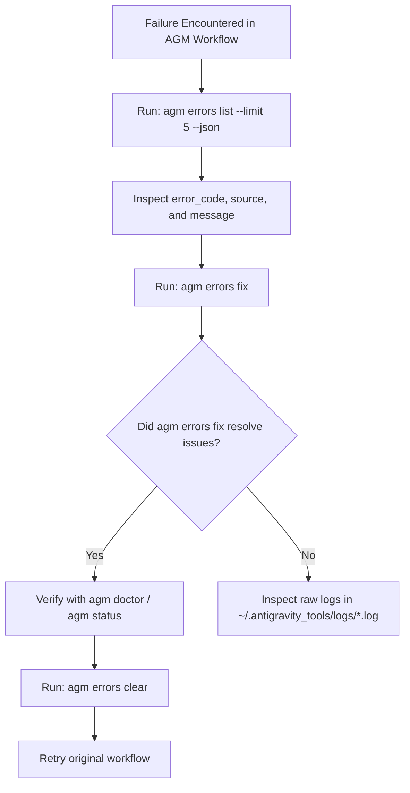

# AGM AI Diagnostics, Telemetry & Speed Error Database (`errors.db`)

Manages error telemetry inspection, SQLite speed error database queries, structured diagnostic error codes, failed commands tracking, rolling file logs, and automated self-healing procedures across Antigravity-Manager (AGM).

---

## 1. Architectural Overview

Antigravity-Manager utilizes a multi-tier telemetry and diagnostic architecture designed for high throughput, full auditability, and zero silent failures:

1. **File Logging System**: Rolling file logs stored in `~/.antigravity_tools/logs/` partitioned by date (`antigravity-tools.YYYY-MM-DD.log`).
2. **Speed Error Database (`errors.db`)**: High-performance SQLite database operating in Write-Ahead Logging (`WAL`) mode with `NORMAL` synchronous pragma and dedicated indices for sub-millisecond error record insertion from both backend and frontend.
3. **Failed Commands Telemetry (`repo_prompts.db:failed_commands`)**: SQLite table tracking unrecognized CLI inputs, hit frequencies, and Levenshtein distance suggestion matches.
4. **CLI Error & Healing Suite (`agm errors`, `agm fc`)**: Terminal interface for listing, filtering, counting, clearing, and auto-healing system issues.

```mermaid
flowchart TD
    subgraph Sinks["Error Sinks & Producers"]
        FE["Frontend (React / Zustand)"] -->|useErrorStore / captureError| IPC["Tauri IPC: log_client_error / REST: /api/errors/log"]
        BE["Backend (Rust AppError)"] -->|tracing / record_ignored| LOGFILE["~/.antigravity_tools/logs/*.log"]
        IPC --> ERRDB[("errors.db\n(WAL mode, fast inserts)")]
        BE -->|ops::record_error| ERRDB
        CLI_INPUT["Unrecognized CLI Commands"] --> FCDB[("repo_prompts.db\nfailed_commands table")]
    end

    subgraph Inspection["Diagnostics & Query Engine"]
        CLI_LS["agm errors list [--limit N] [--severity S] [--json]"] --> ERRDB
        CLI_CLR["agm errors clear"] --> ERRDB
        CLI_FC["agm failed-commands [N] / agm fc"] --> FCDB
        CLI_FIX["agm errors fix [--dry-run] [--json]"] --> HEAL["Automated Self-Healing Engine"]
    end

    subgraph Healing["Self-Healing Probes (8-Stage Ladder)"]
        HEAL --> L1["1. Data Directory Permissions (~/.antigravity_tools)"]
        HEAL --> L2["2. Log Directory Structure (~/.antigravity_tools/logs)"]
        HEAL --> L3["3. Stale Lockfile Purge (*.lock)"]
        HEAL --> L4["4. Account Vault Integrity (accounts.json)"]
        HEAL --> L5["5. GUI Configuration Health (gui_config.json)"]
        HEAL --> L6["6. SQLite Integrity Verification (PRAGMA quick_check)"]
        HEAL --> L7["7. Resumption Artifact Remediation (.antigravity_resume_task.json)"]
        HEAL --> L8["8. Loopback Reverse Proxy Port Probe (8045)"]
    end
```



---

## 2. Telemetry & Log File Locations

All AGM persistent operational state, logs, and database vaults reside in the user data directory:

- **Windows**: `C:\Users\<User>\.antigravity_tools\`
- **Linux**: `/home/<user>/.antigravity_tools/`
- **macOS**: `/Users/<user>/.antigravity_tools/`

### Key Files and Databases

| Path | Purpose | Format |
|---|---|---|
| `~/.antigravity_tools/logs/` | Date-partitioned rolling logs | Text / ANSI (`YYYY-MM-DD.log`) |
| `~/.antigravity_tools/errors.db` | High-speed structured error records | SQLite 3 (WAL mode) |
| `~/.antigravity_tools/repo_prompts.db` | Prompts, conversation trees, failed commands | SQLite 3 (WAL mode) |
| `~/.antigravity_tools/accounts.json` | Encrypted account vault and active profile | JSON |
| `~/.antigravity_tools/gui_config.json` | Persistent user interface & daemon preferences | JSON |
| `~/.antigravity_tools/proxy.db` | Upstream reverse proxy latency & access logs | SQLite 3 |
| `~/.antigravity_tools/email_vault.db` | SMTP/IMAP configurations and delivery records | SQLite 3 |

---

## 3. SQLite Speed Error Database (`errors.db`)

Located at `~/.antigravity_tools/errors.db`. Designed for ultra-low latency write throughput without blocking main worker threads.

### Schema: `errors`

```sql
CREATE TABLE IF NOT EXISTS errors (
    id TEXT PRIMARY KEY,
    error_code TEXT NOT NULL,
    severity TEXT NOT NULL,
    message TEXT NOT NULL,
    stack_trace TEXT,
    source TEXT,
    trigger_action TEXT,
    metadata_json TEXT,
    created_at INTEGER NOT NULL
);

CREATE INDEX IF NOT EXISTS idx_errors_created_at ON errors(created_at DESC);
CREATE INDEX IF NOT EXISTS idx_errors_code ON errors(error_code);
CREATE INDEX IF NOT EXISTS idx_errors_severity ON errors(severity);
```

### Column Descriptions

- **`id`**: Unique UUID string identifier.
- **`error_code`**: Standard error classification code (`E1001`–`E9001`).
- **`severity`**: Log level (`error`, `warn`, `info`).
- **`message`**: Human-readable error description.
- **`stack_trace`**: Stack trace string (frontend or backend).
- **`source`**: Originating component or module (e.g. `window.onerror`, `useInstanceStore.syncInstance`, `proxy_engine`).
- **`trigger_action`**: Action being executed when failure happened (e.g. `sync_instance`, `save_telegram_config`).
- **`metadata_json`**: Serialized JSON payload containing contextual parameters, endpoints, or response statuses.
- **`created_at`**: Unix millisecond epoch timestamp.

---

## 4. CLI Error Query & Self-Healing Commands (`agm errors`)

The `agm errors` command suite provides inspection, historical purging, and automated self-healing.

### 4.1. List Errors (`agm errors list`)

```bash
# View the last 20 errors in formatted table view
agm errors list

# View the last 50 error-level records
agm errors list --limit 50 --severity error

# Output pure machine-readable JSON for automated AI scripts
agm errors list --limit 10 --json
```

**Formatted Table Output Example**:
```
================================================================================
  AGM Speed Error Database (errors.db) - Total: 14 error(s) | Showing: 2
================================================================================
  #    CODE    SEV     TIMESTAMP            SOURCE               MESSAGE
  ------------------------------------------------------------------------------
  1    E1001   ERROR   2026-10-18 17:45:01  window.onerror       Network connection refused
  2    E4001   WARN    2026-10-18 17:42:15  account_service      Permission denied reading lock
================================================================================
  • Clear history:    agm errors clear
  • Run self-healing: agm errors fix
```

### 4.2. Count Errors (`agm errors count`)

```bash
agm errors count
# Returns count breakdown by severity: total, error, warn, info
```

### 4.3. Clear Error History (`agm errors clear`)

Purges all recorded error records from `errors.db` and runs `VACUUM` to reclaim disk space:

```bash
agm errors clear
# Returns: ✅ Successfully cleared 14 recorded error(s) from errors.db.

agm errors clear --json
# Returns: {"cleared": 14, "message": "Successfully cleared 14 error records from errors.db", "success": true}
```

### 4.4. Run Automated Self-Healing (`agm errors fix`)

The self-healing engine executes 8 automated diagnostic probes, detects broken state, and applies surgical repairs without manual operator intervention:

```bash
# Run automated diagnosis and apply surgical fixes
agm errors fix

# Dry-run preview mode (detects issues without writing fixes)
agm errors fix --dry-run

# Output structured diagnosis report as JSON
agm errors fix --json
```

**Diagnostic Fix Output Example**:
```
================================================================================
  AGM Automated Diagnostic & Self-Healing Engine                                
================================================================================
  [✓ PASSED] Data Directory Permissions       Directory is accessible and writable.
  [✓ PASSED] Log Directory Structure          Logs directory is healthy.
  [🔧 FIXED] Stale Lockfile Inspection        Healed 1 stale lockfile(s).
  [✓ PASSED] Account Vault Configuration      Valid accounts.json structure (3 accounts).
  [✓ PASSED] GUI / App Configuration          gui_config.json is well-formed JSON.
  [✓ PASSED] SQLite Database Integrity        All checked databases (5) passed PRAGMA quick_check.
  [🔧 FIXED] Resumption Artifacts Hygiene     Removed 1 stray resumption artifact(s).
  [✓ PASSED] Proxy Server Port Probe          Proxy port 8045 is active and responsive.

  Surgical Fixes Applied:
    + Removed stale lockfile: "updater.lock"
    + Cleaned up stray resumption artifact: "antigravity-resume_task.json"

================================================================================
  Summary: 8/8 checks passed. 2 surgical fix(es) applied. Status: [RECOVERED]
================================================================================
```

---

## 5. Failed Commands Telemetry (`agm failed-commands` / `agm fc`)

Tracks all unrecognized commands entered into the CLI, records hit count, and matches likely candidates using Levenshtein distance.

### CLI Inspection Commands

```bash
# View top 20 unrecognized/failed commands with suggestions
agm failed-commands
agm fc

# View top 50 entries
agm fc 50

# Machine-readable JSON output
agm fc --json

# View distinct failed command count and total hit metrics
agm fc count
agm fcc

# Purge failed command telemetry
agm fc clear
```

**Table Output Example**:
```
================================================================================
  AGM Failed / Undetected Commands Inspector (Distinct: 4, Total Hits: 12)
================================================================================
  #    COMMAND                  HITS     DOMAIN     SUGGESTION
  ------------------------------------------------------------------------------
  1    agm swtich               6        account    agm switch
  2    agm statues              3        quota      agm status
  3    agm updater              2        update     agm update
  4    agm bckup                1        prompt     agm backup
================================================================================
```

---

## 6. Diagnostic Error Code Taxonomy

Antigravity-Manager categorizes backend and frontend failures into deterministic error codes:

| Error Code | Category | Root Cause | Recommended Surgical Remedy |
|---|---|---|---|
| **`E1001`** | Network / Transport | Upstream or loopback connection refused, DNS timeout | Verify proxy loopback port (8045), check firewall, run `agm errors fix` |
| **`E1002`** | HTTP Gateway | Upstream returned HTTP status code (4xx, 5xx) | Inspect upstream endpoint quota, check token validity |
| **`E1003`** | Rate Limiting | HTTP 429 Too Many Requests, model cooldown active | Run `agm ff` to fast-forward to a fresh account |
| **`E2001`** | OAuth / Auth | Google OAuth token refresh failed, token revoked | Run `agm accounts` to verify tokens, re-authenticate account |
| **`E3001`** | SQLite Database | SQLite busy timeout, WAL lock, disk I/O error | Run `agm errors fix` to checkpoint WAL and clear stale locks |
| **`E4001`** | Filesystem I/O | File read/write failure, permission denied | Check folder permissions for `~/.antigravity_tools/` |
| **`E5001`** | Configuration | Malformed JSON in `accounts.json` or `gui_config.json` | Run `agm errors fix` to restore from `.bak` backup |
| **`E6001`** | Account Governance | Zero eligible accounts with positive quota remaining | Run `agm status` to check quotas, refresh accounts |
| **`E7001`** | Process Lifecycle | Antigravity IDE process spawn failure, PID mismatch | Terminate zombie processes with `agm instances stop <id>` |
| **`E7002`** | IDE Detection | Antigravity binary not found in standard filesystem paths | Configure custom executable path in settings |
| **`E8001`** | Tauri IPC | Frontend to backend serialization or handler timeout | Restart GUI application with `agm open-ui` |
| **`E8002`** | Email Watcher | SMTP or IMAP connection / authentication failure | Verify credentials with `agm test-email` |
| **`E9001`** | Unhandled Runtime | Unexpected client error or JavaScript unhandled rejection | Inspect stack trace via `agm errors list --json` |

---

## 7. AI Agent Self-Healing Playbook

When an AI agent or automated script encounters an AGM error, follow this step-by-step diagnostic workflow:



### Step-by-Step Autonomous Execution Protocol

1. **Query Active Errors**:
   ```bash
   agm errors list --limit 5 --json
   ```
   Parse `error_code`, `source`, and `message` to pinpoint whether failure is network (`E1001`), database (`E3001`), filesystem (`E4001`), or configuration (`E5001`).

2. **Trigger Automated Self-Healing**:
   ```bash
   agm errors fix --json
   ```
   The engine automatically cleans stale lockfiles, checkpoints SQLite WAL files, cleans stray resumption artifacts, and verifies config JSON validity.

3. **Verify Node Health**:
   ```bash
   agm status --json
   ```
   Ensure active account credentials and quota balance are healthy.

4. **Clear Diagnostic Backlog**:
   ```bash
   agm errors clear --json
   ```
   Reset error tracking after resolution so subsequent failures are isolated and visible.
