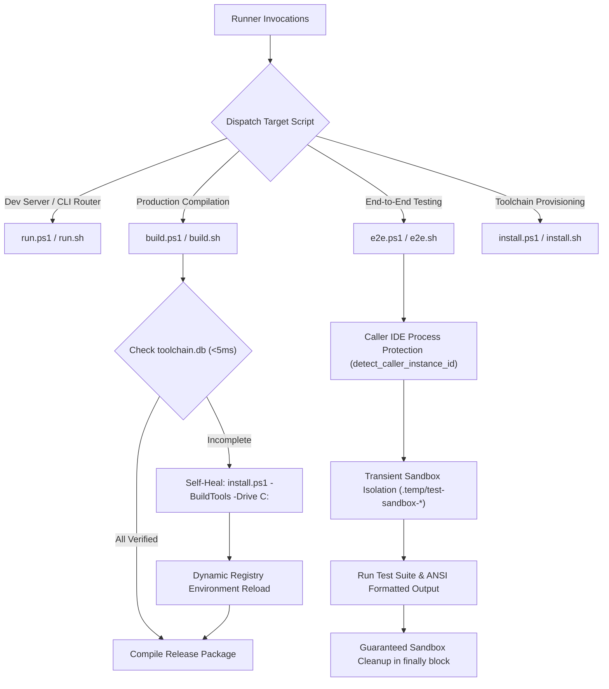

# Create Run & Runner Suite Skill (`create-run-ps1-file`)

This skill autonomously architects, constructs, and verifies cross-platform execution runners (`run.ps1`/`run.sh`, `build.ps1`/`build.sh`, `e2e.ps1`/`e2e.sh`, `install.ps1`/`install.sh`) driven by single-responsibility contracts, fast SQLite verification tracking (`toolchain.db`), toolchain self-healing, and C: drive defaulting.

## Architecture & Lifecyle

## Implementation Standards

1. **Dedicated Single Responsibility:**
   - `run.ps1` / `run.sh`: Dev server, hot reload, CLI router. Delegates `-Build` / `--build` to `build.ps1` / `build.sh`.
   - `build.ps1` / `build.sh`: Dedicated production compilation. Never starts UI. Probes prerequisites and auto-installs via `install.ps1 -BuildTools` if missing.
   - `e2e.ps1` / `e2e.sh`: Unified testing harness with caller IDE preservation and sandboxed isolation.
   - `install.ps1` / `install.sh`: Universal toolchain provisioner defaulting to C: drive with `-Drive` override.
2. **System C: Drive Default Invariant:**
   - All toolchains (Rust, LLVM/Clang, MSVC, NASM) default strictly to `C:` (`C:\Program Files\LLVM`, `%LOCALAPPDATA%\agm-toolchain-cache`).
   - `D:` drive is NEVER used by default simply because it exists; it requires explicit `-Drive D`.
3. **SQLite Toolchain Tracking (`toolchain.db`):**
   - Verified toolchains are recorded in `ToolchainInstallation` table with affirmative boolean `IsVerified` and FIFO view.
   - Fast pre-flight check `<5ms` avoids repeated network or heavy disk probes.
4. **Caller IDE Self-Preservation:**
   - Automated tests detect and protect the developer's active IDE PID.
5. **Clean Sandbox Teardown:**
   - Isolated ephemeral sandbox directories (`.temp/test-sandbox-*`) torn down guaranteed in `finally` / `trap`.
