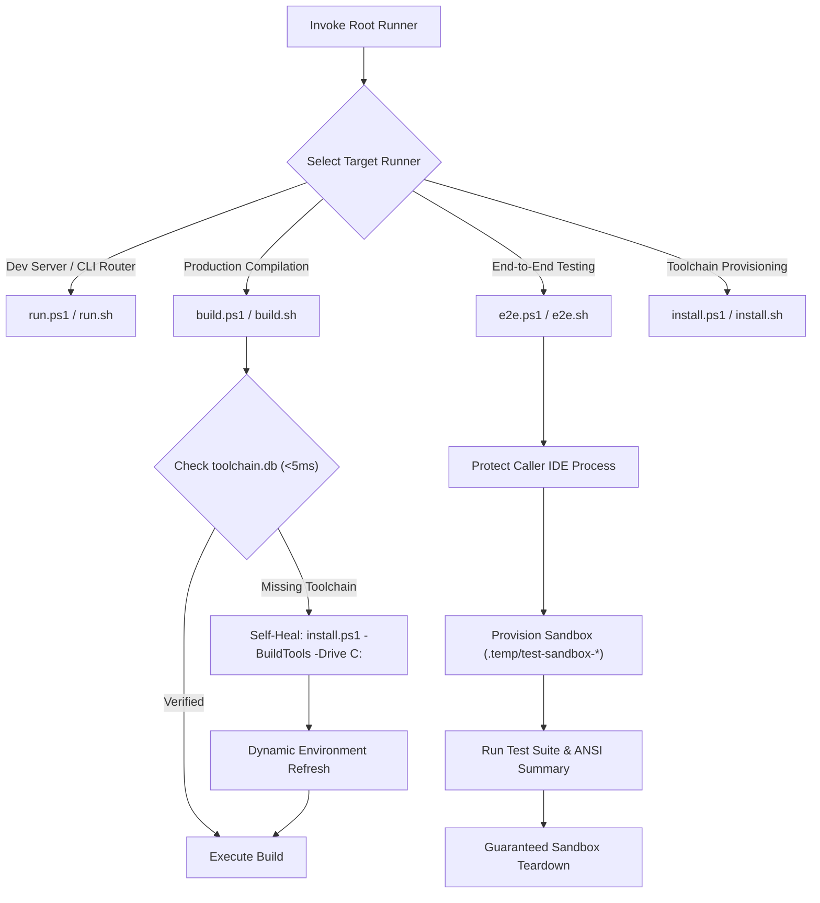

# Run & Runner Suite Orchestration Skill (`run`)

This skill autonomously executes and manages the repository's dedicated single-responsibility root runners across Windows (PowerShell) and POSIX (Bash):

| Runner (Windows) | Runner (POSIX / Bash) | Primary Responsibility | Auto Self-Healing? |
| :--- | :--- | :--- | :---: |
| **`run.ps1`** | **`run.sh`** | Hot-reload development server (`npm run tauri dev`), Vite frontend server, or fast CLI router (`agm ...`). When `-Build` / `--build` is passed, delegates directly to `build.ps1` / `build.sh`. | ✅ Yes |
| **`build.ps1`** | **`build.sh`** | Dedicated production compiler (`npm run tauri build` / `cargo build --release`). Never launches UI. Probes prerequisites and auto-installs via `install.ps1 -BuildTools` if missing. Supports `-CliOnly`, `-FrontendOnly`, `-Clean`, and `-DryRun`. | ✅ Yes |
| **`e2e.ps1`** | **`e2e.sh`** | Unified end-to-end test runner harness (`-Suite smoke|instance|lifecycle|switcher|prompts|all`). Protects caller IDE (`detect_caller_instance_id`), provisions transient sandboxes (`.temp/test-sandbox-*`), and outputs structured ANSI status tables. | N/A (Runs on prebuilt binary) |
| **`install.ps1`** | **`install.sh`** | Universal toolchain and application installer. Provisions MSVC, Rust, LLVM, NASM, and Node.js. Defaults to **C: drive**, supports explicit `-Drive` parameter override. | ✅ Provisioner |

## Toolchain Defaults & SQLite Tracking Invariants

1. **System C: Drive Default:**
   - Compilers and toolchains (Rust, LLVM/Clang, MSVC, NASM) default strictly to the Windows system drive (`C:\Program Files\LLVM` or `%LOCALAPPDATA%\Programs\LLVM`).
   - Unconditional `D:\` drive targeting is forbidden. A secondary drive (e.g. `D:`) is only used when the developer explicitly specifies `-Drive D` or sets `$env:AGM_TOOLCHAIN_DRIVE = "D"`.
2. **SQLite Toolchain Tracking (`toolchain.db`):**
   - Verified toolchain installations are registered in `toolchain.db` (`%LOCALAPPDATA%\agm-toolchain\toolchain.db` with dual mirror to `.ai-memory/toolchain.db`) using `scripts/toolchain_db.py` / `scripts/toolchain-db.ps1`.
   - Pre-flight checks perform sub-5ms fast verification (`Test-AllToolchainsFast -Tools "rust,msvc,llvm,nasm"`), reporting instant pass if marked `IsVerified = 1` and present on disk.

## Execution Workflow

## Step-by-Step Instructions

1. **Executing Development Server & CLI:**
   - Windows: `.\run.ps1` (or `.\run.ps1 -Dev`, `.\run.ps1 <agm-subcommand>`)
   - POSIX: `./run.sh`
2. **Executing Production Build:**
   - Windows: `.\build.ps1 -Release` (or `.\build.ps1 -CliOnly`, `.\build.ps1 -DryRun`)
   - POSIX: `./build.sh --release`
   - *Self-Healing:* If compilers are missing, `build.ps1` runs `.\install.ps1 -BuildTools -Drive C:` and reloads environment in-session.
3. **Executing End-to-End Tests:**
   - Windows: `.\e2e.ps1 -Suite smoke` (or `.\e2e.ps1 -Suite instance`, `.\e2e.ps1 -Suite all`)
   - POSIX: `./e2e.sh --suite smoke`
4. **Provisioning Toolchains:**
   - Windows: `.\install.ps1 -BuildTools -Drive C:`
   - POSIX: `./install.sh --build-tools`

## Non-Negotiable Invariants

- **Strict Relative Git Paths:** Only add relative Git paths (`02-spec/...`, `.ai-memory/...`, `scripts/...`), never absolute filesystem paths.
- **Zero Disabling CI/CD:** Never disable, bypass, or delete tests or CI workflows.
- **Caller IDE Self-Preservation:** Automated test suites must never kill the active IDE session of the developer.
- **Toolchain Default Invariant:** Default install drive is `C:`. `D:` is only used when explicitly requested.
