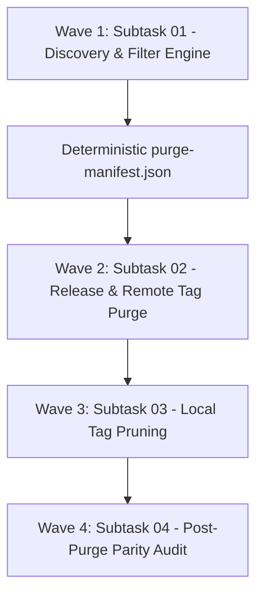

# Master Plan: Git Tag & GitHub Release Page Management & Pruning

**Application:** Antigravity Manager (`AGM`)  
**Target Repository:** `alimtvnetwork/Antigravity-Manager`  
**Task ID:** `git-tag-and-release-page-management`  
**Spec Link:** [01-architecture-spec.md](02-spec/21-app/git-tag-and-release-page-management/01-architecture-spec.md)  
**Guidelines:** [AGENTS.md](AGENTS.md) | [02-spec/02-coding-guidelines/](02-spec/02-coding-guidelines/)

---

## 1. Executive Summary

This master plan orchestrates the audit, inventorying, filtering, and deletion of intermediate development tags and GitHub Release pages across `alimtvnetwork/Antigravity-Manager`. 

To maintain clean repository hygiene while ensuring complete preservation of historical stability and designated milestone builds:
- **Historical Baseline Floor:** Any tag/release created at or before version `4.160.0` (i.e. `SemVer <= 4.160.0`) must remain untouched.
- **Whitelisted Releases (Strict 4 Versions):** The following four specific milestone versions created after `4.160.0` are strictly whitelisted and preserved:
  1. `v4.190.0`
  2. `v4.206.0`
  3. `v4.225.0`
  4. `v4.226.0`
- **Purge Target:** All other tags and releases with `SemVer > 4.160.0` that are not in the whitelist will be removed from GitHub Releases, remote Git references on `origin`, and local Git tag stores.
- **Tooling Execution Ladder:** GitMap (`v6.563.0`) lacks native tag/release pruning subcommands. All pruning operations route through the authenticated CLI fallback ladder (`gh release delete <tag> --yes` followed by `git push origin --delete <tag>` and `git tag -d <tag>`).

---

## 2. Subtasks Breakdown

### Subtask 01: Inventory, Parse SemVer, and Filter Tags and Releases
- **File:** [.ai-memory/plans/subtasks/git-tag-and-release-page-management/01-inventory-and-filter-tags-and-releases.md](.ai-memory/plans/subtasks/git-tag-and-release-page-management/01-inventory-and-filter-tags-and-releases.md)
- **Owner:** Worker 01 / Discovery Lead
- **Status:** COMPLETED
- **Key Responsibilities:**
  1. Inventory all remote tags from `origin` and GitHub release pages via `gh release list --repo alimtvnetwork/Antigravity-Manager --limit 1000`.
  2. Parse and normalize versions into standard Semantic Versioning components.
  3. Partition all tags into three deterministic categories:
     - `PRESERVED_HISTORICAL` (`SemVer <= 4.160.0`)
     - `PRESERVED_WHITELIST` (`v4.190.0`, `v4.206.0`, `v4.225.0`, `v4.226.0`)
     - `PURGE_TARGET` (`SemVer > 4.160.0` and not whitelisted)
  4. Validate positive boolean invariants (`is_whitelisted`, `is_post_cutoff`, `is_purge_target`).
  5. Generate deterministic `purge-manifest.json` artifact for downstream execution.

### Subtask 02: Delete GitHub Releases and Remote Tags
- **File:** [.ai-memory/plans/subtasks/git-tag-and-release-page-management/02-delete-github-releases-and-remote-tags.md](.ai-memory/plans/subtasks/git-tag-and-release-page-management/02-delete-github-releases-and-remote-tags.md)
- **Owner:** Worker 02 / Operations Lead
- **Status:** COMPLETED
- **Key Responsibilities:**
  1. Ingest verified `purge-manifest.json`.
  2. Perform pre-flight safety assertions (fail-stop check against whitelist and historical boundary).
  3. Execute Tier 1 Deletion: Remove GitHub Releases via `gh release delete <tag> --yes` for all items with `has_github_release = true`.
  4. Execute Tier 2 Deletion: Remove remote Git tag references via `git push origin --delete <tag>` for all items with `is_remote_tag_present = true`.
  5. Enforce sliding rate limit throttling (200ms per operation) to respect GitHub API thresholds.
  6. Record real-time execution results into `audit-log.json`.

### Subtask 03: Local Tag Pruning & Working Tree Synchronization
- **File:** [.ai-memory/plans/subtasks/git-tag-and-release-page-management/03-prune-local-tags-and-verify-retention.md](.ai-memory/plans/subtasks/git-tag-and-release-page-management/03-prune-local-tags-and-verify-retention.md)
- **Owner:** Worker 03 / Repository Hygiene
- **Status:** COMPLETED
- **Key Responsibilities:**
  1. Identify local tag refs in `.git/refs/tags/` matching the purged targets.
  2. Execute Tier 3 Deletion: Delete local tags via `git tag -d <tag>`.
  3. Execute tag ref synchronization: `git fetch --prune --prune-tags origin`.
  4. Ensure working tree reflects clean remote tag namespace.

### Subtask 04: Post-Purge Verification, Parity Audit & Documentation
- **File:** [.ai-memory/plans/subtasks/git-tag-and-release-page-management/04-document-gitmap-cache-task-and-parity.md](.ai-memory/plans/subtasks/git-tag-and-release-page-management/04-document-gitmap-cache-task-and-parity.md)
- **Owner:** Quality Verification Lead
- **Status:** COMPLETED
- **Key Responsibilities:**
  1. Query GitHub API and verify exactly 0 unapproved releases exist with version `> 4.160.0`.
  2. Verify that `v4.190.0`, `v4.206.0`, `v4.225.0`, and `v4.226.0` are intact and accessible on GitHub Releases and remote tags.
  3. Verify that `v4.160.0` and earlier historical tags are intact.
  4. Compile final audit report detailing all purged resources and verified milestones.

---

## 3. Execution Waves & Dependency Graph

| Wave | Task | Dependencies | Key Output |
|---|---|---|---|
| **Wave 1** | Subtask 01 | Repository access | `purge-manifest.json` (Catalog of targets) |
| **Wave 2** | Subtask 02 | Subtask 01 manifest approval | Cleaned GitHub Releases & Remote `origin` tags |
| **Wave 3** | Subtask 03 | Subtask 02 completion | Synchronized local Git tag repository |
| **Wave 4** | Subtask 04 | Subtask 03 completion | Final verification report & audit ledger |

---

## 4. Architectural Invariants Checklist

- [x] **Repository Scope:** `origin` matches `alimtvnetwork/Antigravity-Manager`.
- [x] **Historical Floor:** Zero tags `<= 4.160.0` targeted for deletion (`is_historical = true`).
- [x] **Strict Whitelist (4 versions):** `v4.190.0`, `v4.206.0`, `v4.225.0`, `v4.226.0` are immune.
- [x] **Positive Booleans:** Variable names follow positive boolean conventions (`is_whitelisted`, `is_post_cutoff`, `is_purge_target`).
- [x] **Deletion Order:** GitHub Release deleted before remote Git tag reference.
- [x] **Relative Paths Only:** All file references use relative paths without machine-specific roots.
