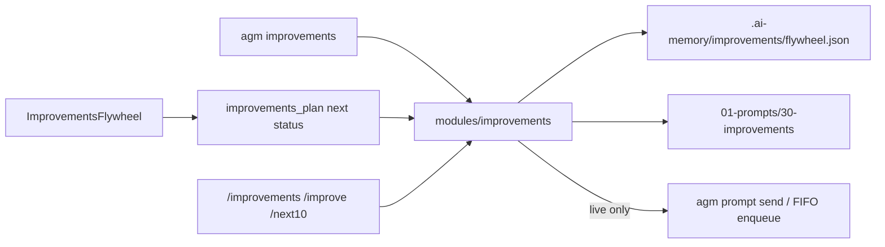

# Master Plan 235: Add New Option for 100 Improvements

## Status: PENDING
**Slug**: `add-new-option-for-100-improvements`
**Sequence**: `235`
**Spec Reference**: `02-spec/21-app/235-add-new-option-for-100-improvements/`
**Created**: 2026-10-29

## User Request (Verbatim)

Add a first-class option to PLAN 100 improvements and IMPLEMENT them 10 at a time as a sequence of thought, from CLI, UI, and Telegram. Reuse the existing flywheel in `01-prompts/30-improvements/` (`01` UI, `02` code, `03` system, `04` detail, `05` ideas, `06` check-pending, `07` implement-next-10) and skills `.agents/skills/implement-next-10-improvements/` plus `execute-parent-task-with-n-steps-v6`. Do NOT invent a second methodology.

## Executive Summary

Expose the Category 30 continuous-improvement flywheel as one shared engine with three inbound options: CLI `agm improvements`, Telegram-page UI pills, and Telegram bot verbs. `plan` materializes ten batch stubs (100 items / 10 per batch) and may dispatch the matching discovery prompt. `next` / `next-10` claims the next pending batch and dispatches `01-prompts/30-improvements/07-implement-next-10-improvements.md`. Ledger lives at `.ai-memory/improvements/flywheel.json`. E2E is `--dry-run` so Default and `v2-3127` are never stopped.

## Architecture (shared)



- Engine: `src-tauri/src/modules/improvements/` — `FlywheelState`, `ImprovementKind` (`Ui`, `Code`, `System`, `Ideas`, `All`), `BatchRecord`, `plan_flywheel`, `next_batch`, `status_report`, `check_pending`.
- Ledger fields: `wave`, `kind`, `total=100`, `batch_size=10`, `next_batch` 1..10, `batches[]` with `pending|running|done`.
- Prompt map (repo-relative):
  - `Ui` → `01-prompts/30-improvements/01-next-100-ui-improvements.md`
  - `Code` → `01-prompts/30-improvements/02-next-100-code-improvements.md`
  - `System` → `01-prompts/30-improvements/03-next-100-whole-system-improvements.md`
  - `Ideas` → `01-prompts/30-improvements/05-next-100-ideas-for-improvements.md`
  - `detail` → `01-prompts/30-improvements/04-next-detail-out-100-improvements.md`
  - `check` → `01-prompts/30-improvements/06-check-pending-improvements.md`
  - `next-10` → `01-prompts/30-improvements/07-implement-next-10-improvements.md`
- Live dispatch reuses `agm prompt send` / FIFO enqueue and `01-prompts/14-execute/02-execute-parent-task-with-n-steps-v6.md`. `--dry-run` never sends.

## Modular Subtasks (independently revertable)

Each subtask owns an exclusive file box. Reverting one commit must not require editing another subtask's files. Subtask 01 is the foundation (engine + CLI). Subtasks 02 and 03 call public engine APIs only and are independently revertable against each other. Revert 01 only before 02/03, or revert 02 and 03 first.

| # | Task | Plan file | Depends on | Revert unit |
| :--- | :--- | :--- | :--- | :--- |
| 01 | CLI engine | `.ai-memory/plans/subtasks/235-add-new-option-for-100-improvements/01-cli-engine.md` | none | Engine + `agm improvements` + help |
| 02 | UI option | `.ai-memory/plans/subtasks/235-add-new-option-for-100-improvements/02-ui-option.md` | 01 | `ImprovementsFlywheel` + Tauri invokes |
| 03 | Telegram inbound | `.ai-memory/plans/subtasks/235-add-new-option-for-100-improvements/03-telegram-inbound.md` | 01 | Verbs, bot commands, `im:` buttons, help |
| 04 | E2E (parent gate) | this file, section **Task 04 — E2E** | 01, 02, 03 | Evidence only; no extra owned sources |

1. [ ] **Task 01 — CLI engine**: module, help, `main.rs` wiring, flywheel state.
2. [ ] **Task 02 — UI option**: `ImprovementsFlywheel`, Tauri invokes, hover shade.
3. [ ] **Task 03 — Telegram inbound**: verbs, `setMyCommands`, callback buttons, help text.
4. [ ] **Task 04 — E2E**: dry-run `agm improvements --help`, `status --json`, `plan --dry-run`, `next --dry-run`. Never stop Default / `v2-3127`.

## Task 04 — E2E (parent gate, no extra subtask file)

Run after 01–03. Isolated dry-run only.

```text
agm improvements --help
agm improvements status --json
agm improvements plan --dry-run
agm improvements next --dry-run
agm improvements next-10 --dry-run
```

Pass criteria:

- Help lists `plan`, `next-10` / `next`, `status`, `check`, `detail`.
- `--json` status envelope includes `Kind`, `Wave`, `Total`, `BatchSize`, `NextBatch`, `Batches`.
- `--dry-run` plan/next print the intended batch action and do not enqueue or send a prompt.
- Default PID and `v2-3127` still running.
- Telegram unit tests assert `im:pl` / `im:n10` / `im:st` / `im:ck` each ≤ 60 bytes and `/help` contains `/improvements`.
- UI: Plan / Next 10 / Status pills sit in a `rounded-full` capsule using `.agm-hover-shade` with no translate.

Do not run `cargo test --lib` or `cargo check --bin agm` on this host. Write tests; CI compiles.

## Invariants

- Caller IDE Default and `v2-3127` never stopped.
- FIFO restore and enqueue: `ORDER BY created_at ASC, id ASC`. Batch claim is lowest pending `batch_index`.
- GitMap-only search during implementation.
- No unused `mut` except loop counters.
- Strict relative Git paths in every doc and commit.
- Sole attribution `@aukgit` (`(Thanks to @aukgit)`).
- `--dry-run` never dispatches prompts.
- No silent errors (`AppError`, `captureError`, `trackWarning`, `record_ignored` + justification).
- Do not invent a second flywheel.

## Spec files

- `02-spec/21-app/235-add-new-option-for-100-improvements/01-architecture-spec.md`
- `02-spec/21-app/235-add-new-option-for-100-improvements/02-component-spec.md`
- `02-spec/21-app/235-add-new-option-for-100-improvements/03-ai-instructions.md`

## Out of scope

- Implementing the 100 improvement items themselves.
- Rewriting `01-prompts/30-improvements/` prompt bodies.
- Minor/version bump, changelog, tag, or `gitmap cpr` (later release task).
- Stopping, switching, or deleting Default / `v2-3127`.
