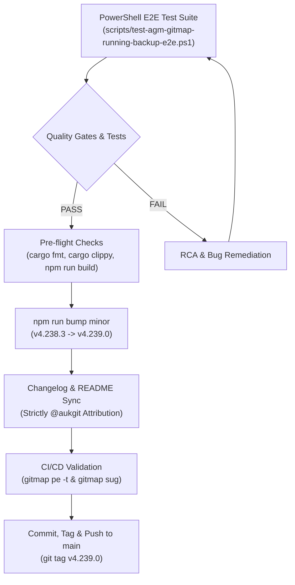

# Subtask 06: PowerShell E2E Suite & Minor Release Ceremony

## 1. Objective

Implement the comprehensive PowerShell end-to-end verification script `scripts/test-agm-gitmap-running-backup-e2e.ps1`, validate the 8-stage running prompt backup and restoration lifecycle across AGM and GitMap CLI routes, and execute the formal minor version release ceremony (`v4.239.0`) adhering to strict contributor attribution (`@aukgit`), README synchronization, and CI/CD quality gates.

---

## 2. Prerequisite State & Invariants

- Subtasks 01 through 05 completed and verified.
- Target files:
  - `scripts/test-agm-gitmap-running-backup-e2e.ps1`
  - `package.json`
  - `CHANGELOG.md`
  - `CHANGELOG_EN.md`
  - `README.md`
  - `README_EN.md`
- **Caller IDE Self-Preservation**: Strictly protect developer session (`default-copy-5597`, PID 11588). Never invoke destructive commands (`instances stop`, `instances rm`, `switch`) against the caller session.
- **Strictly Relative Paths Invariant**: All file references, documentation links, command templates, and test scripts must record strictly repository-relative Git paths (e.g., `02-spec/...`, `.ai-memory/...`, `scripts/...`, `src/...`, `src-tauri/...`). Absolute paths are strictly forbidden.
- **Strict Contributor Attribution**: Attribution in changelogs and release notes must attribute strictly `@aukgit` (`(Thanks to @aukgit)`). No other GitHub user handles may appear.
- **FIFO Restore & Queue Invariant**: All prompt backup, restore, dispatch, and queue processing queries across SQLite databases must enforce strict First-In-First-Out ordering using `ORDER BY created_at ASC, id ASC`.

---

## 3. Detailed Implementation Steps



### Phase 1: PowerShell E2E Test Suite Implementation (`scripts/test-agm-gitmap-running-backup-e2e.ps1`)

Author the script in `scripts/test-agm-gitmap-running-backup-e2e.ps1` containing the following execution sequence:

1. **Environment Setup & Caller Protection**:
   ```powershell
   param(
       [switch]$VerboseOutput,
       [int]$CallerSessionPid = 32
   )
   $ErrorActionPreference = "Continue"
   $PSNativeCommandUseErrorActionPreference = $false
   [Console]::OutputEncoding = [System.Text.Encoding]::UTF8

   $ScriptDir = Split-Path -Parent $MyInvocation.MyCommand.Path
   $RootDir = Split-Path -Parent $ScriptDir
   $env:AGM_SKIP_AGY_SPAWN = "1"
   ```

2. **Phase 1.1: Transient Sandbox Creation (Gate G1)**:
   - Create isolated sandbox profile: `agm instances test-create test-backup-sandbox --json`.
   - Validate JSON response: `success = true`, `instance_id = "test-backup-sandbox"`, dedicated directory created.
   - Verify caller instance PID remains completely unharmed.

3. **Phase 1.2: Instance & Sequence Enumeration (Gate G2)**:
   - Run `agm running --json`.
   - Assert returned JSON contains `instances` array with valid sequence numbers (`#1`, `#2`).
   - Validate presence of dual sequence IDs (`[AGM:P001 | GM:#1]`, `[AGM:C001 | GM:<cid>]`).

4. **Phase 1.3: Configurable Word Truncation (Gate G3)**:
   - Execute `agm running --words 100` and `agm running --words 200`.
   - Assert snippet length in words does not exceed specified limit.
   - Assert trailing ellipsis `...` appended when prompt exceeds limit.

5. **Phase 1.4: Multimodal Prompt Seeding with Images (Gate G4)**:
   - Generate synthetic prompt text containing `[TEST_RUNNING_BACKUP_TOKEN]`.
   - Attach sample image payload (Base64 data URI and local test screenshot path).
   - Enqueue into `repo_prompts.db:active_prompts` with `status = 'running'`, `has_images = 1`, and `images_payload` populated.

6. **Phase 1.5: Atomic Backup with Step-by-Step Image Tracing (Gate G5)**:
   - Execute `agm backup running test-backup-sandbox`.
   - Assert output contains real-time progress steps:
     - `[STEP 1/4] Scanning active workspaces for running prompts...`
     - `[STEP 2/4] Extracting multimodal image payloads and screenshot tokens...`
     - `[STEP 3/4] Writing atomic snapshot batch to split SQLite database...`
     - `[STEP 4/4] Writing .antigravity_resume_task.<inst>.json workspace seed...`
   - Verify row inserted into `backup-prompts.db:prompt_backups` with `is_restored = 0` and `has_images = 1`.

7. **Phase 1.6: Active Queue Eviction Simulation (Gate G6)**:
   - Clear test prompt from `repo_prompts.db:active_prompts` to simulate account switch or IDE crash.
   - Verify `agm running -i test-backup-sandbox --json` reports 0 active prompts.

8. **Phase 1.7: Positional Restore with FIFO Order Validation (Gate G7)**:
   - Execute `agm restore running test-backup-sandbox`.
   - Assert output contains real-time restore steps:
     - `[STEP 1/4] Reading latest unrestored backup batch from SQLite...`
     - `[STEP 2/4] Verifying multimodal image payloads and local paths...`
     - `[STEP 3/4] Re-enqueuing prompts into repo_prompts.db in FIFO stack order...`
     - `[STEP 4/4] Seeding .antigravity_resume_task.json and signaling IDE watcher...`
   - Query `repo_prompts.db:active_prompts`:
     - Assert prompt restored with `status = 'queued'` or `'dispatched'`.
     - Assert `has_images = 1` and image payload preserved intact.
     - Assert timestamp ordering satisfies strict FIFO rule: `ORDER BY created_at ASC, id ASC`.

9. **Phase 1.8: GitMap Delegation Parity (Gate G8)**:
   - If `gitmap` CLI binary is available:
     - Test `gitmap agy running --json` matches AGM output.
     - Test `gitmap agy ff` triggers fast-forward delegation.
     - Test `gitmap agy backup rp` and `gitmap ag restore rp test-backup-sandbox`.

10. **Phase 1.9: Sandbox Teardown & Hygiene (Gate G9)**:
    - Execute `agm instances test-clean test-backup-sandbox --json`.
    - Verify complete removal of transient test folders.
    - Confirm zero lingering worker processes.

---

### Phase 2: Pre-Flight Quality Gates

Execute all mandatory pre-flight checks locally:

```bash
# Gate 1: Rust Code Formatting
cd src-tauri && cargo fmt -- --check

# Gate 2: Comprehensive Clippy Linting & Compilation
cd src-tauri && cargo clippy --all-targets --all-features

# Gate 3: React Frontend Typecheck & Production Build
npm run build

# Gate 4: Execute PowerShell E2E Suite
powershell -ExecutionPolicy Bypass -File scripts/test-agm-gitmap-running-backup-e2e.ps1
```

---

### Phase 3: Version Bump & Release Ceremony Execution

1. **Step 3.1: Minor Version Bump**:
   ```bash
   npm run bump minor
   ```
   - Increments version from `4.238.3` to `4.239.0`.
   - Synchronizes manifests across `package.json`, `Cargo.toml`, `Cargo.lock`, `tauri.conf.json`, `common.rs`, and `releases-manifest.json`.
   - Generates release block skeletons in `CHANGELOG.md` and `CHANGELOG_EN.md`.

2. **Step 3.2: Changelog Documentation (Strict `@aukgit` Attribution)**:
   Update `CHANGELOG.md` and `CHANGELOG_EN.md` under `## [v4.239.0] - 2026-10-20`:
   ```markdown
   ## [v4.239.0] - 2026-10-20

   ### Added
   - **Running Prompts & Instance Sequence Enumeration**: Added `agm running [--json]` enumerating sandbox instances with sequence numbers (`#1`, `#2`), active IDE processes, dual project sequences (`[AGM:P001 | GM:#1]`), dual conversation sequences (`[AGM:C001 | GM:<cid>]`), configurable word previews, and attached image counts. (Thanks to @aukgit)
   - **Configurable Word Truncation Settings**: Added `prompt_preview_max_words` (`100..=200`, default `100`) to `AppConfig` and frontend Settings, enabling customizable prompt preview density across CLI and UI views. (Thanks to @aukgit)
   - **Positional Running Prompt Backup & Restore with Image Tracing**: Upgraded `agm backup running [instance]` and `agm restore running [instance]` to strip positional `"running"` modifiers, resolve instance targets, stream 4-step real-time progress logging, trace multimodal image attachments, and enforce strict FIFO restoration (`ORDER BY created_at ASC, id ASC`). (Thanks to @aukgit)
   - **GitMap AGY Delegation Parity**: Implemented GitMap parity routes for `gitmap agy running [--json]`, `gitmap agy ff`, `gitmap agy backup rp`, and `gitmap ag restore rp [instance]` delegating cleanly to AGM. (Thanks to @aukgit)
   - **Terminal Help Segments & UI Cheatsheet**: Added comprehensive help banners in `help_text.rs` (`running --help`, `backup running --help`, `restore running --help`), machine-readable `help --json` schemas, and interactive dark-glass click-to-copy cheatsheets in the desktop UI. (Thanks to @aukgit)
   - **PowerShell End-to-End Verification Suite**: Added `scripts/test-agm-gitmap-running-backup-e2e.ps1` covering 9 verification gates (G1 through G9), transient test sandboxing, and multimodal image preservation. (Thanks to @aukgit)
   ```

3. **Step 3.3: README Changelog Synchronization**:
   Synchronize `README.md` (under `## 📝 更新日志`) and `README_EN.md` (under `## 📝 Changelog`) with the release summary above.

4. **Step 3.4: CI/CD Telemetry Inspection**:
   ```bash
   # Inspect CI/CD pipeline telemetry
   gitmap pe -t

   # Verify zero pending suggestions
   gitmap sug
   ```

5. **Step 3.5: Git Tagging & Release Push**:
   ```bash
   git add .
   git commit -m "chore(release): bump version to v4.239.0"
   git tag v4.239.0
   git push origin main
   git push origin v4.239.0
   ```

---

## 4. Test Assertions & Verification Matrix

| Check ID | Target Command / DB Query | Expected Outcome | Failure Remediation |
| :--- | :--- | :--- | :--- |
| **T01** | `agm instances test-create test-backup-sandbox` | Exit code 0, isolated folder exists | Inspect `AppError::Io` permissions |
| **T02** | `agm running --json` | Valid JSON, `instances` array populated | Verify `cmd_running_prompts` JSON output |
| **T03** | `agm running --words 100` | Word count $\le 100$, ends with `...` | Verify `truncate_words` boundary logic |
| **T04** | `repo_prompts.db:active_prompts` | `has_images = 1`, payload valid | Inspect multimodal image extraction |
| **T05** | `agm backup running test-backup-sandbox` | Emits steps 1/4..4/4, exit code 0 | Inspect `cmd_backup_running_prompts` |
| **T06** | `backup-prompts.db:prompt_backups` | Batch created, `is_restored = 0` | Check SQLite write pragma & lock |
| **T07** | `agm restore running test-backup-sandbox` | Emits steps 1/4..4/4, exit code 0 | Check positional argument parsing |
| **T08** | Restored prompt timestamp query | `ORDER BY created_at ASC, id ASC` | Enforce FIFO query order in DB |
| **T09** | `gitmap agy running --json` | Exit code 0, matches AGM JSON | Check GitMap command delegation path |
| **T10** | `agm instances test-clean test-backup-sandbox` | Sandbox deleted, caller IDE unharmed | Check conscious PID matcher safety |

---

## 5. Rollback Procedures

If any verification gate fails during release testing:
1. **Revert Version Bump**:
   ```bash
   git checkout -- package.json package-lock.json src-tauri/Cargo.toml src-tauri/Cargo.lock src-tauri/tauri.conf.json src-tauri/src/bin/agm/common.rs releases-manifest.json CHANGELOG.md CHANGELOG_EN.md
   ```
2. **Clean Stale Sandboxes**:
   ```bash
   cargo run --bin agm -- instances test-clean test-backup-sandbox --json
   ```
3. **Purge Test Artifacts**:
   ```powershell
   powershell -ExecutionPolicy Bypass -File scripts/dev-tool-clear.ps1
   ```
