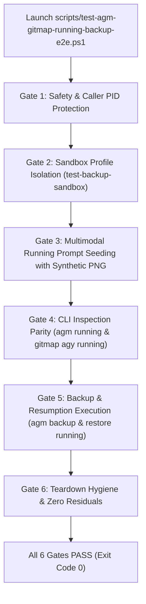

# Subtask 07: End-to-End Testing Suite & Multimodal Image Verification

**Module:** `cli-and-ui-testing-for-antigravity-backups`
**Version:** 4.239.0
**Updated:** 2026-10-20
**Status:** Ready for Execution

---

## 1. Context & Objectives

This subtask designs, authors, and validates the automated 6-gate PowerShell end-to-end (E2E) test suite (`scripts/test-agm-gitmap-running-backup-e2e.ps1`). The test hermetically validates multimodal prompt capture, synthetic image generation, running prompt discovery, CLI parity between `agm` and `gitmap agy`, backup snapshotting, and atomic resume task seeding.

### Core Targets:
- E2E Test Suite Script: `scripts/test-agm-gitmap-running-backup-e2e.ps1`
- Synthetic Image Helper: PowerShell/.NET `System.Drawing` or Python fallback
- Protected Caller Engine: `src-tauri/src/modules/instance/safety.rs`

---

## 2. Technical Invariants & Guardrails

1. **Caller IDE Self-Preservation**:
   - The test runner must dynamically discover the developer's active working session PID and instance ID (e.g., `default-copy-5597` or `default`).
   - Any command directed at the caller instance (`agm instances stop`, `rm`, `switch`) must fail-fast with exit code 2 unless `--force` is specified.
   - The test must NEVER terminate the active IDE session.
2. **Transient Test Sandboxing**:
   - Tests must operate strictly within a temporary sandbox instance (`test-backup-sandbox`).
   - Post-test teardown must remove 100% of temporary profiles, database rows, and files, leaving zero residual artifacts.
3. **Multimodal Payload Invariant**:
   - The test must generate a real synthetic PNG, encode it to a `data:image/png;base64,...` URI, and verify its byte-for-byte persistence across backup and restore.
4. **Strict Relative Git Paths**:
   - Zero absolute filesystem paths anywhere in test code or log messages.

---

## 3. The 6-Gate E2E Verification Architecture



### Detailed Gate Specifications

#### Gate 1: Safety Invariant & PID Protection
- Query all running processes for `agm`, `agm-ui`, `Antigravity`, and parent PowerShell runners.
- Lock caller instance PIDs into `$protectedPids`.
- Execute a test probe: attempt to invoke `agm instances stop` on the caller instance without `--force`; verify failure with exit code 2.

#### Gate 2: Sandbox Profile Isolation
- Clean any previous leftover test sandbox instances.
- Execute `agm instances create test-backup-sandbox --data-only --json`.
- Assert exit code 0 and parse JSON envelope confirming `status: ok` and isolated `data_dir`.

#### Gate 3: Multimodal Prompt Seeding with Synthetic Image
- Generate a 64x64 synthetic PNG with an embedded test pattern:
```powershell
Add-Type -AssemblyName System.Drawing
$bmp = New-Object System.Drawing.Bitmap 64, 64
$graphics = [System.Drawing.Graphics]::FromImage($bmp)
$brush = New-Object System.Drawing.SolidBrush ([System.Drawing.Color]::FromArgb(255, 0, 150, 255))
$graphics.FillRectangle($brush, 0, 0, 64, 64)
$ms = New-Object System.IO.MemoryStream
$bmp.Save($ms, [System.Drawing.Imaging.ImageFormat]::Png)
$base64 = [Convert]::ToBase64String($ms.ToArray())
$dataUri = "data:image/png;base64,$base64"
$syntheticImgPath = Join-Path $testDir "synthetic_test.png"
[System.IO.File]::WriteAllBytes($syntheticImgPath, $ms.ToArray())
```
- Seed SQLite `repo_prompts.db` (`active_prompts` table) with prompt content referencing `$dataUri`, `$syntheticImgPath`, and token `SS_ID_999888777`.

#### Gate 4: CLI Running Prompts Inspection & Parity
- Run `agm running --instance test-backup-sandbox --json`.
- Parse output and assert:
  - Sequence ID matches `[AGM:P001 | GM:#1]`.
  - `has_images` is `true` and image count is `1`.
  - Word preview is truncated within `prompt_preview_words` limit.
- Run `gitmap agy running --json` and assert structural and data parity.

#### Gate 5: Backup & Resumption Execution
- Run `agm backup running test-backup-sandbox --json`.
- Query `backup-prompts.db` to confirm backup batch created with `prompts_count = 1` and `images_payload` containing the synthetic image.
- Run `agm restore running test-backup-sandbox --json`.
- Assert `.antigravity_resume_task.test-backup-sandbox.json` is created in test workspace with:
  - `prompt_id`, `prompt_content`, `has_image: true`, `image_payload`, and `auto_boot: true`.
- Assert prompt status in `active_prompts` transitioned to `dispatched`.

#### Gate 6: Teardown Hygiene & Zero Residuals
- Run `agm instances rm test-backup-sandbox --force`.
- Delete transient test directory.
- Verify zero orphan processes, zero test SQLite records, and clean git status.

---

## 4. Script Implementation Structure (`scripts/test-agm-gitmap-running-backup-e2e.ps1`)

```powershell
<#
.SYNOPSIS
    6-Gate E2E Test Suite for Multimodal Running Prompt Backup, Restore,
    and CLI Parity across AGM and GitMap.
#>
param(
    [switch]$SkipCleanup,
    [switch]$ForceCleanup
)

$ErrorActionPreference = "Stop"
$ScriptDir = Split-Path -Parent $MyInvocation.MyCommand.Path
$RootDir = Split-Path -Parent $ScriptDir
$agm = Join-Path $RootDir "src-tauri/target/debug/agm.exe"

if (!(Test-Path $agm)) {
    Write-Error "agm.exe binary not found at $agm! Please build it first."
    exit 1
}

Write-Host "==========================================================" -ForegroundColor Cyan
Write-Host " AGM & GitMap Running Prompt Backup 6-Gate E2E Test Suite " -ForegroundColor Cyan
Write-Host "==========================================================" -ForegroundColor Cyan

# Gate 1: Safety & Session PID Protection
Write-Host "[Gate 1/6] Safety Check: Protecting Active Developer Session..." -ForegroundColor Yellow
# ... implementation ...

# Gate 2: Sandbox Profile Isolation
Write-Host "[Gate 2/6] Sandbox Creation: Creating isolated test instance..." -ForegroundColor Yellow
# ... implementation ...

# Gate 3: Multimodal Prompt Seeding
Write-Host "[Gate 3/6] Seeding: Creating synthetic PNG & seeding active prompt..." -ForegroundColor Yellow
# ... implementation ...

# Gate 4: CLI Inspection Parity
Write-Host "[Gate 4/6] Inspection: Verifying agm running and gitmap parity..." -ForegroundColor Yellow
# ... implementation ...

# Gate 5: Backup & Restore Execution
Write-Host "[Gate 5/6] Execution: Running backup and restore cycle..." -ForegroundColor Yellow
# ... implementation ...

# Gate 6: Teardown Hygiene
Write-Host "[Gate 6/6] Teardown: Purging sandbox and verifying zero residuals..." -ForegroundColor Yellow
# ... implementation ...

Write-Host "==========================================================" -ForegroundColor Green
Write-Host " All 6 Gates Passed Successfully!                         " -ForegroundColor Green
Write-Host "==========================================================" -ForegroundColor Green
exit 0
```

---

## 5. Verification Protocol

Run the automated test suite locally:
```powershell
powershell -ExecutionPolicy Bypass -File scripts/test-agm-gitmap-running-backup-e2e.ps1
```
Expected result: All 6 gates report green, zero warnings, exit code 0.
