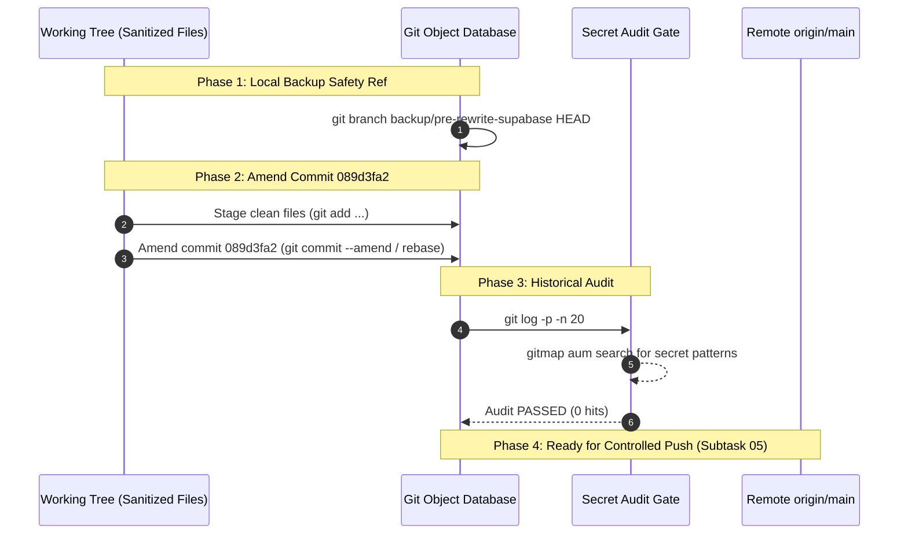

# 04 — Git History Rewriting & Trace Eradication Protocol

## 1. Context & Objectives

The user instruction mandates:
> "The previous files would be replaced with the current files in the Git history, so that the history never remains there. They cannot find the trace of the Superbase credential. Do you understand?"

Git commits are cryptographically linked, immutable trees. Adding a new cleanup commit on top of HEAD leaves the preceding commit history intact. In particular, commit `089d3fa2` ("feat(supabase): dual cluster connection robustification, error observability & public prompt image sharing") introduced files with live connection parameters into the repository. Anyone running `git log -p`, inspecting raw commit blobs, or cloning the repository can retrieve leaked credentials from Git commit history.

This subtask defines the exact protocol to rewrite the Git commit history. By replacing the contents of the affected files at the point of introduction in commit `089d3fa2` (and any intermediate commits), the resulting Git history contains only clean, sanitized code. All historical traces of publishable keys, project IDs, and live endpoints are eradicated from the commit graph.

## 2. Dependencies & Pre-Conditions

This subtask MUST NOT be executed until the following prerequisite subtasks have completed:
1. **Subtask 01** (`01-repo-secrets-vault-and-oneliner.md`): External vault files in `../repo-secrets/` validated and `scripts/import-supabase-credentials.ps1` authored.
2. **Subtask 02** (`02-source-and-scripts-sanitization.md`): Source code in `src-tauri/` and scripts in `scripts/` sanitized with placeholder defaults and dynamic CLI lookups.
3. **Subtask 03** (`03-specs-memory-and-changelogs-sanitization.md`): Documentation, task plans, and changelogs scrubbed with canonical redactions (`[REDACTED_LOVABLE_KEY]`, `[REDACTED_PERSONAL_KEY]`, `[REDACTED_LOVABLE_URL]`, `[REDACTED_PERSONAL_URL]`).

Once Subtasks 01, 02, and 03 are complete, the working tree contains the pristine, final-state versions of all affected files.

## 3. Rewriting Strategy: File Replacement at Commit Level

The core objective is to replace the files committed in `089d3fa2` with their corresponding sanitized versions so that `089d3fa2` never introduces secret strings into the commit graph.



## 4. Execution Steps

### Step 1: Establish Local Recovery Ref
Before executing any history manipulation, create a safety branch reference to guarantee instantaneous rollback if needed:
```bash
git branch backup/pre-rewrite-supabase HEAD
```

### Step 2: Verify Working Tree Hygiene
Confirm that all sensitive values in tracked files have been replaced with sanitized versions across:
- `src-tauri/src/modules/supabase_sync/config_a.rs`
- `src-tauri/src/modules/json_envelope/tests.rs`
- `scripts/verify-supabase-and-ui-ux.ps1`
- `scripts/setup-supabase.ps1`
- `scripts/supabase-endpoints.json`
- `scripts/supabase-accounts.json`
- `02-spec/21-app/superbase-information-removal/01-architecture-spec.md`
- `02-spec/21-app/supabase-connection-and-ui-ux-enhancement/01-architecture-spec.md`
- `.ai-memory/plans/` and subtasks
- `changelog.md` and `changelog_en.md`

### Step 3: Stage Sanitized Files
Stage all sanitized files into the Git index:
```bash
git add src-tauri/ scripts/ 02-spec/ .ai-memory/ changelog.md changelog_en.md
```

### Step 4: Execute Commit History Amendment
Determine the position of commit `089d3fa2` relative to HEAD:

- **Case A: Commit `089d3fa2` is HEAD**:
  Directly amend the commit with the staged clean files:
  ```bash
  git commit --amend --no-edit
  ```

- **Case B: Commit `089d3fa2` is an earlier ancestor**:
  Initiate an interactive rebase targeting the parent of `089d3fa2`:
  ```bash
  git rebase -i 089d3fa2~1
  ```
  In the rebase todo list:
  1. Change the command for `089d3fa2` from `pick` to `edit`.
  2. Save and exit the editor.
  3. Git pauses at `089d3fa2`.
  4. Apply and stage the sanitized files: `git add .`
  5. Amend the commit: `git commit --amend --no-edit`
  6. Resume rebase: `git rebase --continue`

### Step 5: Historical Trace Eradication Audit
Verify that the rewritten commit history contains zero traces of the leaked credentials:
```bash
# 1. Audit for publishable key fragments across recent commit diffs
git log -p -n 20 | gitmap aum search "sb_publishable_[REDACTED"
git log -p -n 20 | gitmap aum search "sb_publishable_[REDACTED"

# 2. Audit for leaked project URLs and IDs
git log -p -n 20 | gitmap aum search "[REDACTED_LOVABLE_REF]"
git log -p -n 20 | gitmap aum search "[REDACTED_PERSONAL_REF]"
```
Every query MUST return `0 hit(s)`. If any query returns a non-zero hit count, locate the offending commit and re-run targeted rebase.

## 5. Rollback & Disaster Recovery Protocol

If any conflict, divergence, or unexpected history distortion occurs during the rebase:
```bash
# Abort any in-progress rebase
git rebase --abort

# Reset working tree and branch back to the pre-rewrite safety checkpoint
git reset --hard backup/pre-rewrite-supabase
```
This guarantees zero risk of losing code changes or working tree modifications.

## 6. Constraints & Invariants

- **No Git Commands During Planning**: This subtask document specifies the execution protocol. No git manipulation commands may be executed until Subtasks 01, 02, and 03 are complete and verified.
- **Strictly Relative Paths**: All paths in scripts and documentation MUST use relative paths (e.g., `src-tauri/`, `scripts/`, `02-spec/`).
- **No Credentials in Commit Messages**: Commit descriptions and amend notes must strictly use neutral language (e.g., "feat(supabase): dual cluster connection robustification, error observability & public prompt image sharing") and never reference key strings.
- **Atomic History Replacement**: After history amendment, `089d3fa2` (and its rewritten SHA) must appear in git log with pristine code that introduces only dummy defaults and dynamic CLI resolution.

## 7. Out of Scope

- Remote force push to `origin/main` (handled under Subtask 05).
- Local pre-flight test suites and cargo clippy checks (handled under Subtask 05).

## 8. Done When

- [ ] Safety backup branch `backup/pre-rewrite-supabase` is recorded.
- [ ] Working tree is confirmed 100% sanitized with clean replacements.
- [ ] Commit history is amended so that the introduction commit contains only sanitized files.
- [ ] Historical audit (`git log -p`) confirms 0 occurrences of secret strings across the recent commit history.
- [ ] Rewritten history is clean, compiling, and ready for Subtask 05 zero-secret gate and push.
