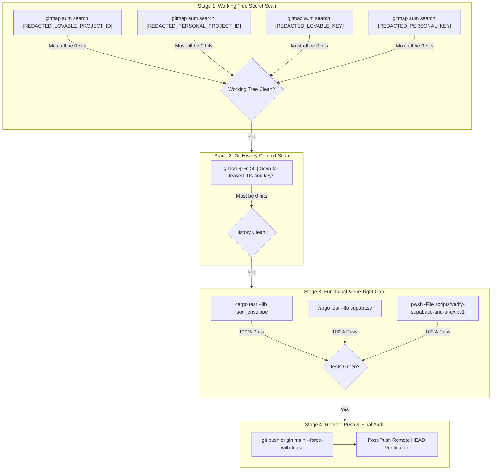

# 05 — Zero-Secret Verification Gate & Remote Push Protocol

## 1. Context & Objectives

This subtask constitutes the final, non-negotiable quality and security gate for the **Superbase Information Removal** initiative. Before any code is pushed to remote branches or considered complete, automated verification must prove two orthogonal properties:
1. **Absolute Zero Secrets (Working Tree & Git History)**: The working tree and the rewritten Git commit history contain zero occurrences of the target project identifiers and publishable anon keys.
2. **Zero Functional Regression**: All unit tests, integration test scripts, URL normalizers, and dynamic discovery routines continue to pass 100%.

Only upon achieving complete, green verification on both criteria is the operator or automated runner authorized to push the sanitized commit history to `origin/main` using `--force-with-lease`.

Strictly relative paths are used throughout. All secrets in this document are strictly redacted.

---

## 2. Multi-Stage Verification Protocol



---

## 3. Detailed Verification Steps

### 3.1 Stage 1: Working Tree Zero-Secrets Audit
Using `gitmap aum search` (strict ban on `rg`, `grep`, `git grep`), execute the 4 canonical secret scans across the entire workspace:

```powershell
# 1. Primary Project Identifier Query
gitmap aum search [REDACTED_LOVABLE_PROJECT_ID]

# 2. Secondary Project Identifier Query
gitmap aum search [REDACTED_PERSONAL_PROJECT_ID]

# 3. Primary Publishable Key Fragment Query
gitmap aum search [REDACTED_LOVABLE_KEY]

# 4. Secondary Publishable Key Fragment Query
gitmap aum search [REDACTED_PERSONAL_KEY]
```

- **Pass Condition**: Each command prints `Search completed: 0 hit(s) across N file(s)`.
- **Fail Condition**: Any hit > 0. Stop execution immediately and return to Subtask 02 or Subtask 03 for remediation.

### 3.2 Stage 2: Git History Commit Graph Audit
Following the history rewrite executed in Subtask 04, verify that no commit in the recent commit graph contains leaked artifacts:

```powershell
# Inspect the last 50 commits in patch mode and ensure 0 secret hits
git log -p -n 50 > .git/patch_audit.tmp
# Scan temporary patch audit file using gitmap
gitmap aum search [REDACTED_LOVABLE_PROJECT_ID] .git/patch_audit.tmp
gitmap aum search [REDACTED_PERSONAL_PROJECT_ID] .git/patch_audit.tmp
gitmap aum search [REDACTED_LOVABLE_KEY] .git/patch_audit.tmp
gitmap aum search [REDACTED_PERSONAL_KEY] .git/patch_audit.tmp
Remove-Item .git/patch_audit.tmp -Force
```

- **Pass Condition**: Zero matches across all recent commit patches.

### 3.3 Stage 3: Functional Unit & Integration Verification
Execute the test suites to guarantee that mock substitutions and dynamic config logic behave as specified:

```powershell
# 1. Rust JSON Envelope tests (verifying synthetic baseUrl interpolation)
cargo test --lib json_envelope

# 2. Rust Supabase core tests (verifying URL normalization & config structures)
cargo test --lib supabase

# 3. PowerShell Verification Suite (verifying negative leak tests & stack trace logging)
pwsh -File scripts/verify-supabase-and-ui-ux.ps1
```

- **Pass Condition**: All tests exit with exit code 0 and all assertions report PASS.

### 3.4 Stage 4: Pre-flight Compilation Checks
Run standard pre-flight gates as mandated by `AGENTS.md`:

```powershell
# Rust formatting check
cd src-tauri; cargo fmt -- --check; cd ..

# Rust clippy lint gate
cd src-tauri; cargo clippy --all-targets --all-features; cd ..
```

---

## 4. Remote Push Execution Protocol

Once Stages 1 through 3 are 100% verified:

1. **Verify Local Tip**:
   - Check current branch: `git branch --show-current` (must be `main` or designated release branch).
   - Check local commits: `git log -n 5 --oneline`.
2. **Execute Force-Push with Lease**:
   ```bash
   git push origin main --force-with-lease
   ```
   > [!IMPORTANT]
   > Always use `--force-with-lease` rather than raw `--force` to ensure no concurrent collaborator commits are inadvertently clobbered.
3. **Verify Remote Tracking State**:
   ```bash
   git fetch origin main
   git log -n 1 origin/main
   ```

---

## 5. Post-Push Incident Closure & Ledger Synchronization

1. **Mark Subtasks Completed**: Update status fields across all subtasks under `.ai-memory/plans/subtasks/superbase-information-removal/` to `status: completed`.
2. **Synchronize Master Plan**: Update `.ai-memory/plans/superbase-information-removal.md` status to `COMPLETED`.
3. **Persist Session Learnings**: Record in `.ai-memory/` that all future third-party connection endpoints must default to template placeholders or dynamic external vault discovery (`repo-secrets`), preventing future hardcoding regressions.
4. **Clean Temporary Refs**: Delete local rollback ref `backup/pre-rewrite-supabase` once remote CI pipeline is fully green.
