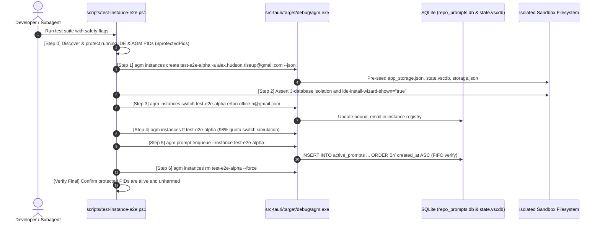

# Subtask 02 Plan: Binary Alignment, E2E Verification & Pre-Flight Quality Gates

- **Document ID:** `.ai-memory/plans/subtasks/ui-and-ux-enhancements-for-antigravity-manager/02-binary-alignment-and-e2e.md`
- **Parent Task:** `ui-and-ux-enhancements-for-antigravity-manager`
- **Target Codebase:**
  - `src-tauri/tauri.conf.json`
  - `src-tauri/Cargo.toml`
  - `package.json`
  - `install.ps1`
  - `install.sh`
  - `scripts/test-instance-e2e.ps1`
  - `scripts/test-instance-isolation.ps1`
  - `src-tauri/src/modules/process_cleaner.rs`
- **Lead Author:** Spec 02 & Subtask Planner
- **Status:** `READY_FOR_EXECUTION`

---

## 1. Architectural Scope & Objectives

The purpose of Subtask 02 is to execute binary target alignment, end-to-end multi-instance isolation verification, and comprehensive pre-flight quality checks for Antigravity-Manager:

1. **Main UI Binary Target Renaming:**
   - Transition the primary desktop application binary name from legacy `agm-alim` to `Antigravity Manager (AGM)-ui.exe` (Windows executable branding) and `agm-ui` (Cargo binary target and Linux/macOS executable).
   - Maintain the independent high-speed terminal CLI binary `agm` (`src-tauri/src/bin/agm/main.rs`), ensuring zero degradation to CLI suites and scripting interfaces.
   - Synchronize all packaging manifests, build scripts, installer ladders (`install.ps1`, `install.sh`), and process watchdogs.
2. **Comprehensive End-to-End Test Suite Execution:**
   - Execute and validate `scripts/test-instance-e2e.ps1` and `scripts/test-instance-isolation.ps1`.
   - Verify sandboxed instance creation, 3-database credential isolation (`state.vscdb`, `app_storage.json`, `storage.json`), account switching, 98% quota rotation, prompt enqueuing, and prompt tree copy.
   - Guarantee the Protected PID Invariant (main IDE and primary AGM sessions remain 100% undisturbed).
3. **Pre-Flight Quality Gates Certification:**
   - Enforce the mandatory local pre-flight triad: `cargo fmt -- --check`, `cargo clippy --all-targets --all-features`, and `npm run build`.
   - Guarantee zero silent errors, full AppError propagation, and zero residual test artifacts.

---

## 2. Main UI Binary Target Renaming Specification

### 2.1 Manifest Modifications Matrix

```
┌────────────────────────────────────────────────────────────────────────┐
│                   Binary Target Renaming Alignment                     │
└────────────────────────────────────────────────────────────────────────┘

 [ src-tauri/Cargo.toml ]          [ src-tauri/tauri.conf.json ]
 ┌──────────────────────┐          ┌───────────────────────────┐
 │ name = "agm-ui"      │          │ "mainBinaryName": "agm-ui"│
 │ default-run="agm-ui" │          │ "productName": "Antigravity│
 │ [[bin]]              │          │  Manager Tools"           │
 │ name = "agm-ui"      │          └─────────────┬─────────────┘
 │ path = "src/main.rs" │                        │
 └──────────┬───────────┘                        │
            │                                    │
            ▼                                    ▼
    [ Target Binaries ]                   [ Installers & Watchdogs ]
    - Desktop UI: agm-ui (or .exe)        - install.ps1: BinaryName="Antigravity Manager (AGM)-ui.exe"
    - CLI Binary: agm (unchanged)         - install.sh: BINARY_NAME="agm-ui"
                                          - scripts/test-instance-e2e.ps1
```

#### A. `src-tauri/tauri.conf.json`
- Update `"mainBinaryName"`:
  ```json
  {
    "$schema": "https://schema.tauri.app/config/2",
    "productName": "Antigravity Manager Tools",
    "mainBinaryName": "agm-ui",
    "version": "4.204.0",
    "identifier": "com.alimtvnetwork.antigravity-tools"
  }
  ```
- Tauri will produce the executable named `agm-ui.exe` (or `Antigravity Manager (AGM)-ui.exe` if mapped via product packaging settings).

#### B. `src-tauri/Cargo.toml`
- Rename the package and primary binary while preserving the `agm` CLI binary:
  ```toml
  [package]
  name = "agm-ui"
  version = "4.204.0"
  default-run = "agm-ui"
  description = "Antigravity Manager Tools"
  authors = ["Alim <alim.karim@riseup-asia.com> (sponsored by RISEUP ASIA LLC)"]
  license = "CC-BY-NC-SA-4.0"
  edition = "2021"

  [lib]
  name = "antigravity_tools_lib"
  crate-type = ["rlib"]

  [[bin]]
  name = "agm-ui"
  path = "src/main.rs"
  test = false

  [[bin]]
  name = "agm"
  path = "src/bin/agm/main.rs"
  test = false
  ```

#### C. `package.json`
- Update the package name:
  ```json
  {
    "version": "4.204.0",
    "name": "agm-ui",
    "description": "Antigravity Manager Tools",
    "type": "module",
    "private": true
  }
  ```

#### D. `install.ps1` (Windows PowerShell Installer)
- Update target executable definitions and backward-compatible discovery ladders:
  ```powershell
  $BinaryName = "Antigravity Manager (AGM)-ui.exe"
  $FallbackBinaryName = "agm-ui.exe"
  $LegacyBinaryNames = @("agm-alim.exe", "Antigravity-Tools.exe")
  ```
- In process termination and discovery routines:
  ```powershell
  $userAgmProcesses = Get-Process | Where-Object { 
      $_.Name -match '(?i)(agm-alim|agm-ui|Antigravity Manager)' -or $_.Name -eq "agm" 
  }
  ```
- Shortcut generation on Desktop and Start Menu:
  - Label: `"Antigravity Manager (AGM)"`
  - Target: `Join-Path $InstallDir "Antigravity Manager (AGM)-ui.exe"` (or `agm-ui.exe`).

#### E. `install.sh` (Linux / macOS Shell Installer)
- Update binary and asset references:
  ```bash
  BINARY_NAME="agm-ui"
  LEGACY_NAMES=("agm-alim" "Antigravity-Tools")
  ```
- Package asset name patterns:
  - Debian: `agm-ui_${ver}_${DEB_ARCH}.deb`
  - RPM: `agm-ui-${ver}-1.${RPM_ARCH}.rpm`
  - AppImage: `agm-ui_${ver}_${appimage_arch}.AppImage`
  - macOS App Bundle: `Antigravity Manager.app` containing `Contents/MacOS/agm-ui`

#### F. Process Cleaner & Safety Watchdogs
- In `scripts/test-instance-e2e.ps1`:
  ```powershell
  # Safety Invariant Check: Identify & Protect Running Main Antigravity IDE and AGM processes
  $userAgmProcesses = Get-Process | Where-Object { 
      $_.Name -match '(?i)(agm-alim|agm-ui|Antigravity Manager)' -or $_.Name -eq "agm" 
  }
  ```
- In `src-tauri/src/modules/process_cleaner.rs`:
  - Enhance `is_agm_process` matcher to include `agm-ui`, `agm-ui.exe`, and `Antigravity Manager (AGM)-ui.exe` alongside legacy identifiers.

---

## 3. End-to-End Test Suite Execution Plan

### 3.1 Verification Flow: `scripts/test-instance-e2e.ps1`



### 3.2 Step-by-Step Test Invariants

| Phase | Script Target | Command / Check | Critical Assertion |
|---|---|---|---|
| **Phase 0: Safety Check** | `test-instance-e2e.ps1` | Inspect running PIDs | Default Antigravity IDE and primary AGM processes identified; recorded in `$protectedPids`; never terminated |
| **Phase 1: Creation** | `test-instance-e2e.ps1` | `agm instances create test-e2e-alpha -a <email> --json` | JSON output parses cleanly; returned `id`, `data_dir`, and `bound_email` match inputs |
| **Phase 2: 3-DB Isolation** | `test-instance-e2e.ps1` | Filesystem inspect | `app_storage.json` exists with `"ide-install-wizard-shown": "true"`; `state.vscdb` initialized; `storage.json` contains unique machineId |
| **Phase 3: Account Switch** | `test-instance-e2e.ps1` | `agm instances switch test-e2e-alpha <new_email>` | Registry updates bound email; no credentials leak into default profile |
| **Phase 4: Fast-Forward** | `test-instance-e2e.ps1` | `agm instances ff test-e2e-alpha` | 98% quota threshold trigger chooses optimal candidate; fast-forwards active profile |
| **Phase 5: FIFO Enqueue** | `test-instance-e2e.ps1` | Prompt backup & dispatch queries | Prompts inserted with timestamps `t1 < t2`; dispatch processes in strict `ORDER BY created_at ASC, id ASC` |
| **Phase 6: Prompt Tree Copy**| Tree & Clipboard | Copy interaction on ConversationNode | `copyToClipboard` executes with Stage 1/2/3 fallback; dual MIME rich HTML payload validated |
| **Phase 7: Isolation Suite** | `test-instance-isolation.ps1` | Full execution | Independent home directory, sandbox AppData/Roaming, and wizard bypass validated |
| **Phase 8: Teardown** | `test-instance-e2e.ps1` | `agm instances rm test-e2e-alpha` | Test instance removed from registry and disk; `$protectedPids` remain 100% healthy |

---

## 4. Pre-Flight Quality Gate Certification

Before any code modifications or PR submissions, the changes must pass the local pre-flight gates:

```
┌────────────────────────────────────────────────────────────────────────┐
│                        Pre-Flight Quality Gate                         │
└────────────────────────────────────────────────────────────────────────┘

  [ Gate 1: Rust Formatting ]
  cd src-tauri && cargo fmt -- --check
  └── Verifies formatting across all src-tauri modules without drift

  [ Gate 2: Rust Clippy Gate ]
  cd src-tauri && cargo clippy --all-targets --all-features
  └── Strict zero-warning compilation gate covering main, lib, and agm bin

  [ Gate 3: Frontend Build Gate ]
  npm run build
  └── TypeScript compiler (tsc) + Vite production bundle generation
```

### 4.1 Gate Invariants
1. **No Silent Errors:**
   - In Rust (`src-tauri/src/`): Every fallible operation routes into `AppError` (`src-tauri/src/error.rs`) or uses `crate::error::record_ignored` with a justification comment. Zero bare `let _ = <fallible>`.
   - In TypeScript (`src/`): Failures route to `useErrorStore.getState().captureException` or `trackWarning`. Zero empty `catch {}`.
2. **Relative Paths Invariant:**
   - Strict relative Git paths only; total prohibition on absolute filesystem paths across codebase and specs.
3. **Zero-CI Quarantine:**
   - Clean git status; no temporary files or test database remnants left in workspace.

---

## 5. Execution Checklist & Phased Action Plan

### Phase 1: Binary Naming Configuration
- [ ] Update `src-tauri/tauri.conf.json` with `"mainBinaryName": "agm-ui"`.
- [ ] Update `src-tauri/Cargo.toml` with `name = "agm-ui"` and `default-run = "agm-ui"`.
- [ ] Update `package.json` with `"name": "agm-ui"`.
- [ ] Update `install.ps1` and `install.sh` binary name definitions and discovery ladders.
- [ ] Update process cleaner matching in `src-tauri/src/modules/process_cleaner.rs`.

### Phase 2: Local Pre-Flight Checks
- [ ] Run `cd src-tauri && cargo fmt -- --check`.
- [ ] Run `cd src-tauri && cargo clippy --all-targets --all-features`.
- [ ] Run `npm run build`.

### Phase 3: End-to-End Suite Verification
- [ ] Run `powershell -ExecutionPolicy Bypass -File scripts/test-instance-isolation.ps1`.
- [ ] Run `powershell -ExecutionPolicy Bypass -File scripts/test-instance-e2e.ps1`.
- [ ] Verify output logs and ensure Protected PIDs remain active.
- [ ] Confirm clean post-test status with zero unmanaged test instances.
