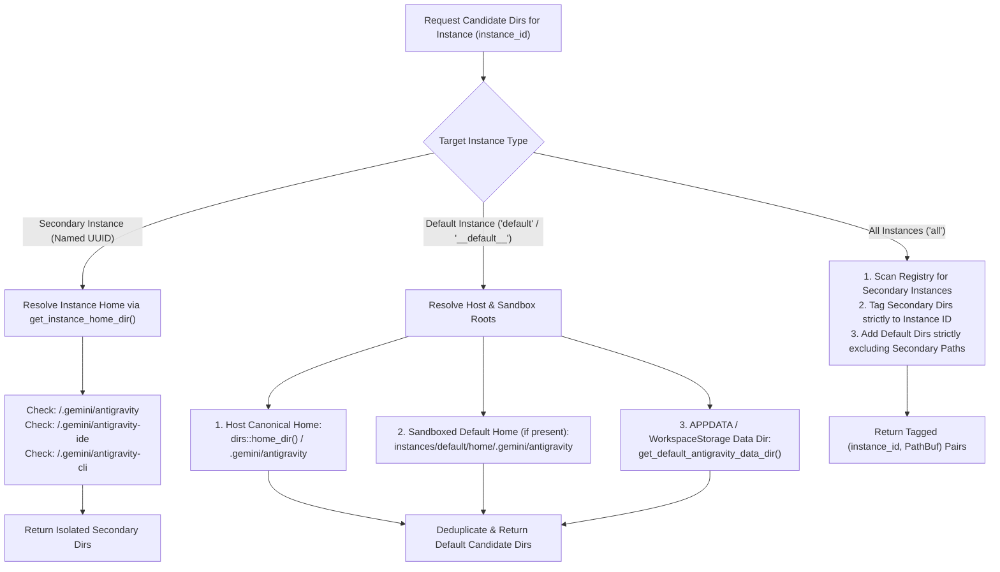

# Subtask Plan: Running Prompts Candidate Directory & Storage Resolution

- **Subtask ID**: `Task-01`
- **Plan File**: `.ai-memory/plans/subtasks/verify-running-prompts-instance-prompts-section/01-running-prompts-path-discovery.md`
- **Owner**: Worker 01
- **Target Files**:
  - `src-tauri/src/modules/repo_db/gemini_dirs.rs`
  - `src-tauri/src/modules/repo_db/tree_collect.rs`
- **Related Files**:
  - `src-tauri/src/modules/repo_db/tree_phases.rs`
  - `src-tauri/src/modules/instance/storage.rs`
- **Status**: PENDING
- **Attribution**: Strictly `@aukgit` (`(Thanks to @aukgit)`)

---

## 1. Overview & Objective

The objective of Task-01 is to establish a deterministic, complete, and sandboxed candidate directory resolution pipeline for Antigravity-Manager's Prompt Tree View and Running Prompts Detection engine. 

Antigravity stores workspace states and conversation transcripts across multiple operating system and profile-specific paths:
1. `$env:APPDATA\Antigravity\User\workspaceStorage` (Windows workspace registry)
2. `~/.gemini/antigravity/` (Default conversation database and brain transcripts)
3. `instances/<id>/home/.gemini/antigravity/` (Cloned instance conversation databases)
4. `instances/<id>/data/User/workspaceStorage` (Cloned instance workspace storage)

When candidate directories are incomplete or misrouted, AGM cannot locate active conversation summaries or project workspaces, displaying "No Projects Found in this Profile" or "Running: 0". Task-01 ensures exhaustive candidate path discovery while preserving strict instance isolation.

---

## 2. Candidate Directory Resolution Architecture



### 2.1 Candidate Directory Matrix

| Target Instance | Candidate Path Location | Contained Artifacts | Ownership Tag |
| :--- | :--- | :--- | :--- |
| **Default** | `%USERPROFILE%\.gemini\antigravity\` | `conversation_summaries.db`, `brain/<cid>/` | `default` |
| **Default** | `%USERPROFILE%\.gemini\antigravity-ide\` | IDE-specific extensions & logs | `default` |
| **Default** | `%USERPROFILE%\.gemini\antigravity-cli\` | CLI autonomous agent transcripts | `default` |
| **Default** | `%APPDATA%\Antigravity\User\workspaceStorage\` | Workspace folder definitions (`workspace.json`) | `default` |
| **Default** | `<instances_dir>\default\home\.gemini\antigravity\` | Sandboxed fallback if installed in portable mode | `default` |
| **Cloned Profile** | `<instances_dir>\<id>\home\.gemini\antigravity\` | Cloned `conversation_summaries.db`, `brain/<cid>/` | `<id>` |
| **Cloned Profile** | `<instances_dir>\<id>\data\User\workspaceStorage\` | Cloned workspace folder definitions | `<id>` |

---

## 3. Step-by-Step Implementation Guide

### 3.1 Step 1: Refactor `gemini_dirs_for_instance` in `src-tauri/src/modules/repo_db/gemini_dirs.rs`
1. **Host Canonical Home Resolution**:
   - Ensure `get_canonical_host_home()` correctly strips any `.antigravity_tools` virtual directory wrappers.
   - Collect `.gemini/antigravity`, `.gemini/antigravity-ide`, and `.gemini/antigravity-cli`.
2. **Secondary Instance Path Resolution**:
   - When `instance_id` is a named instance (not `"default"` or `"__default__"`), invoke `crate::modules::instance::get_instance_home_dir(instance_id)`.
   - Ensure the returned paths exist before adding them to the candidates list.
   - Ensure no default host `.gemini` paths bleed into secondary instance results.
3. **Affirmative Boolean & Error Propagation**:
   - Use affirmative conditions: `is_named_instance`, `has_canonical_home`, `has_sandbox_dir`.

### 3.2 Step 2: Enhance `gemini_dirs_tagged` in `src-tauri/src/modules/repo_db/gemini_dirs.rs`
1. When target is `"all"`, iterate through all registered instances loaded via `crate::modules::instance::load_registry()`.
2. First collect secondary instance directories into a `HashSet<PathBuf>` to register known sandbox paths.
3. When adding default directories, strictly verify that no directory in `secondary_dirs` is included under the `default` tag.
4. Normalize all returned instance IDs (`"__default__"` -> `"default"`).

### 3.3 Step 3: Implement Resilient Collection in `src-tauri/src/modules/repo_db/tree_collect.rs`
1. In `collect_tree_conversation_items(target)`:
   - Call `gemini_dirs_tagged(target)` to retrieve all `(owning_inst_id, base_dir)` tuples.
   - For each base directory, check for `conversation_summaries.db`.
   - Open SQLite connection using read-only and immutable flags (`rusqlite::OpenFlags::SQLITE_OPEN_READ_ONLY | rusqlite::OpenFlags::SQLITE_OPEN_URI`).
   - Set `busy_timeout` pragma to 3000ms using `crate::error::record_ignored` with justification.
2. Query `conversation_summaries`:
   - Retrieve up to 200 rows sorted by `last_modified_time DESC`.
   - Fields: `conversation_id`, `title`, `preview`, `status`, `not_fully_idle`, `workspace_uris`, `last_modified_time`.
3. Normalize workspace URIs:
   - Decode file URIs using `decode_uri_to_path`.
   - Normalize filesystem paths using `normalize_path_for_compare`.
4. Ensure each conversation is strictly associated with `norm_owning_inst` in `convs_by_inst_and_path`.

### 3.4 Step 4: Ensure Workspace Storage Project Fallback Integration
1. In `src-tauri/src/modules/repo_db/tree_phases.rs`:
   - Verify that when `workspaceStorage/*/workspace.json` is missing or contains empty folders, `discover_fallback_projects` extracts valid project paths from `workspace_uris` in `conversation_summaries.db`.
   - Synthesize `RunningProject` structs with `repo_path` and `repo_name` extracted from decoded URIs.

---

## 4. Acceptance Criteria

- **AC-01**: `gemini_dirs_for_instance("default")` returns host `.gemini/antigravity` and any sandbox default paths without panicking or returning duplicate entries.
- **AC-02**: `gemini_dirs_for_instance("<clone-id>")` returns strictly `<instances_dir>/<clone-id>/home/.gemini/antigravity` paths and zero host default paths.
- **AC-03**: `gemini_dirs_tagged(None)` or `gemini_dirs_tagged(Some("all"))` tags each directory strictly with its owning instance ID, eliminating cross-instance bleed.
- **AC-04**: `collect_tree_conversation_items` successfully ingests conversations from `conversation_summaries.db` across all discovered directories, handling URI escaping properly.
- **AC-05**: Code adheres to Rust formatting and clippy rules, contains no bare unwrap/expect, and uses strict relative git paths in all error and audit messages.

---

## 5. Verification Commands

1. **Rust Formatting & Clippy**:
   ```powershell
   cd src-tauri
   cargo fmt -- --check
   cargo clippy --all-targets --all-features
   ```

2. **Targeted Module Unit Tests**:
   ```powershell
   cd src-tauri
   cargo test modules::repo_db::gemini_dirs -- --nocapture
   ```

3. **Per-Instance Liveness Integration Tests**:
   ```powershell
   cd src-tauri
   cargo test per_instance_prompt_liveness_test -- --nocapture
   ```
