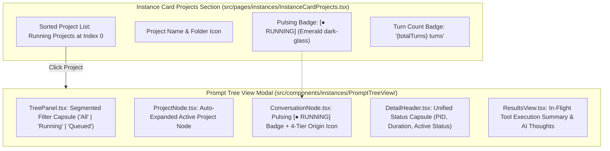

# Subtask Plan: Prompt Tree View UI Running State Rendering & Filter Hardening

- **Subtask ID**: `Task-03`
- **Plan File**: `.ai-memory/plans/subtasks/verify-running-prompts-instance-prompts-section/03-ui-prompt-tree-visibility-enhancement.md`
- **Owner**: Worker 01
- **Target Files**:
  - `src/components/instances/PromptTreeView/PromptTreeViewModal.tsx`
  - `src/pages/instances/InstanceCardProjects.tsx`
- **Related UI Files**:
  - `src/components/instances/PromptTreeView/TreePanel.tsx`
  - `src/components/instances/PromptTreeView/ProjectNode.tsx`
  - `src/components/instances/PromptTreeView/ConversationNode.tsx`
  - `src/components/instances/PromptTreeView/DetailHeader.tsx`
  - `src/components/instances/PromptTreeView/ResultsView.tsx`
  - `src/components/instances/PromptTreeViewModal.tsx`
- **Status**: PENDING
- **Attribution**: Strictly `@aukgit` (`(Thanks to @aukgit)`)

---

## 1. Overview & Objective

The objective of Task-03 is to enhance the user interface of the Antigravity-Manager instance card projects section and the Prompt Tree View modal to provide immediate, prominent, and real-time visual feedback for running prompts.

When an AI prompt is executing in the Antigravity IDE:
1. The owning instance card in `InstanceCardProjects.tsx` must elevate running projects to the top and render a pulsing green `[● RUNNING]` pill badge alongside total turn counts.
2. Clicking a project must deep-link directly into `PromptTreeViewModal.tsx`, automatically expanding the project and selecting the in-flight conversation.
3. The Prompt Tree View modal must display real-time execution indicators: pulsing status capsules, live turn counts, in-flight tool call summaries (`run_command`, `write_to_file`), and AI thinking/reasoning blocks.
4. Filter tabs (`Running`, `All`, `Queued`) must strictly isolate active in-flight tasks without dropping active subagents or exhibiting ghost flickering.

---

## 2. Visual Hierarchy & Indicator Specifications



### 2.1 Visual Indicator Matrix

| Component | Visual Element | Styling / CSS Specification | Behavior |
| :--- | :--- | :--- | :--- |
| **InstanceCardProjects** | `[● RUNNING]` Pill Badge | `px-1 py-0.2 rounded-[4px] text-[9px] font-bold bg-[#1af18d]/15 text-emerald-700 dark:text-[#1af18d] border border-[#1af18d]/30` | Rendered only when `inst.is_running && proj.is_running`; pulses via inner dot |
| **InstanceCardProjects** | Pulsing Dot | `w-1 h-1 rounded-full bg-[#1af18d] shadow-[0_0_4px_rgba(26,241,141,0.9)] animate-pulse` | Constant liveness pulse |
| **InstanceCardProjects** | Turn Counter | `px-1.5 py-0.2 rounded-[4px] text-[9px] font-mono text-slate-500 dark:text-slate-400 bg-gray-100 dark:bg-[#0c2438]` | Sum of all `step_count` turns in project |
| **ConversationNode** | Conversation Row Running Pill | `px-1.5 py-0.2 rounded-full text-[8.5px] font-bold font-mono border animate-pulse bg-emerald-500/15 text-emerald-700 dark:text-[#1af18d] border-emerald-500/40` | Live indicator next to conversation title |
| **DetailHeader** | Unified Status Capsule | `inline-flex items-center gap-1.5 px-2 py-0.5 rounded-full text-[9.5px] font-bold font-mono bg-emerald-500/15 text-emerald-700 dark:text-[#1af18d] border border-emerald-500/40 animate-pulse` | Displays `RUNNING`, instance PID, and elapsed timer `MM:SS` |
| **ResultsView** | In-Flight Tool Summary | `font-mono text-xs p-3 rounded-lg bg-slate-900 text-emerald-300 border border-emerald-500/30 overflow-x-auto` | Displays tool name, formatted parameters, and execution status |

---

## 3. Step-by-Step Implementation Guide

### 3.1 Step 1: Polish & Audit `InstanceCardProjects.tsx`
1. **Instance Ownership Scoping**:
   - Filter `projectTreeNodes` with `isNodeOwnedByInstance(node, inst.config)`.
   - Ensure cloned profiles match strictly against `inst.config.id` or `seq_num`, and default instances match `default` / `__default__`.
2. **Project Sorting Algorithm**:
   - Primary Sort: Actively running projects (`inst.is_running && proj.is_running`) placed at index 0.
   - Secondary Sort: For projects tied in running status, sort by newest conversation timestamp (`last_modified`).
   - Tie-Breaker: Alphabetical by `repo_name`.
3. **Turn Count Aggregation**:
   - Sum steps across conversations: `proj.conversations?.reduce((sum, c) => sum + Math.max(c.step_count || 1, 1), 0) || 0`.
4. **Deep-Linking Interaction**:
   - On click, invoke `setPromptTreeInstance` passing `{ id: inst.config.id, name: inst.config.name, projectId: proj.project_id, seqNum: inst.config.seq_num, executablePath: inst.config.executable_path }`.

### 3.2 Step 2: Enhance Running Filter in `TreePanel.tsx`
1. In `TreePanel.tsx`, ensure the segmented `Running` filter button:
   - Filters projects to those containing at least one genuine running conversation (`c.is_running && !isGhostConversation(c)`).
   - Preserves running subagent conversations beneath parent projects.
   - Accurately reports running count badge in the filter tab.

### 3.3 Step 3: Verify Auto-Selection in `usePromptTreeData.ts`
1. When `PromptTreeViewModal` opens:
   - If `initialSelectedProjectId` is provided, find that project in `treeData`, expand it, and select its active running conversation.
   - If no project is provided, find the first project with `is_running === true` and auto-select its running conversation.
   - If no running conversation exists, select the newest conversation overall.

### 3.4 Step 4: Tool Call & Step Summary Visualization in `DetailHeader.tsx` & `ResultsView.tsx`
1. In `DetailHeader.tsx`:
   - Render the pulsing status capsule when `conv.is_running && !isGhostConversation(conv)`.
   - Render active PID and live elapsed timer formatted as `formatDuration(elapsedSeconds)`.
2. In `ResultsView.tsx`:
   - If `execution_results` contains `"In-Flight Tool Execution:"`, render an interactive terminal block with syntax highlighting and action badge.
   - If `latest_step_summary` contains `"Thinking"`, render an AI reasoning block with thinking snippet.

---

## 4. Acceptance Criteria

- **AC-01**: An actively running project displays the pulsing emerald `[● RUNNING]` badge in `InstanceCardProjects.tsx` and sorts to index 0.
- **AC-02**: Clicking any project card in `InstanceCardProjects.tsx` opens `PromptTreeViewModal` with that project expanded and the active conversation selected.
- **AC-03**: `ConversationNode.tsx` renders the animated green `[● RUNNING]` pill badge on running turns, and ignores ghost conversations (untitled with 0 words).
- **AC-04**: `DetailHeader.tsx` displays the active PID and live elapsed execution timer.
- **AC-05**: Clicking the `Running` filter tab in `TreePanel.tsx` isolates running conversations without dropping active subagents.
- **AC-06**: Frontend tests pass with 100% success (`node scripts/run-frontend-tests.mjs instanceRunningPrompts`).
- **AC-07**: Production frontend build completes with zero errors (`npm run build`).

---

## 5. Verification Commands

1. **Frontend Running Prompts Unit & Integration Tests**:
   ```powershell
   node scripts/run-frontend-tests.mjs instanceRunningPrompts
   ```

2. **Frontend Type Check & Production Build**:
   ```powershell
   npm run build
   ```

3. **End-to-End Visual Verification**:
   - Launch application via `cargo tauri dev` or inspect running instance card.
   - Dispatch prompt in Antigravity IDE and confirm immediate visibility of green `[● RUNNING]` badge in the card projects section.
