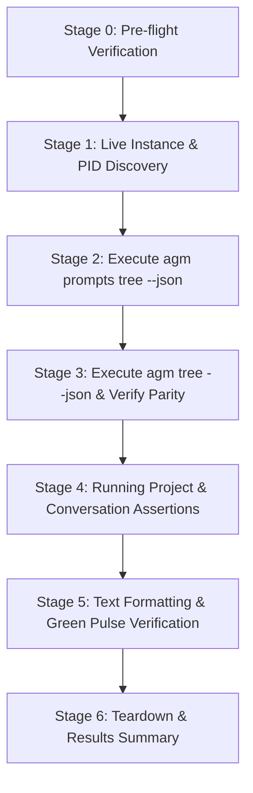

# Subtask 04: End-to-End Running Prompts Verification and CLI Parity Harness

## 1. Context & Objectives

To ensure that the multi-gate liveness enhancements and transcript reverse scanner changes work reliably across production environments, an automated end-to-end (E2E) verification harness is required.

The objectives of this subtask are:
1. **Author `scripts/test-running-prompts-e2e.ps1`**:
   - Create a dedicated, zero-side-effect PowerShell verification test harness modeled after repository standards (`scripts/test-instance-e2e.ps1`).
2. **Execute Full End-to-End Verification Flow**:
   - Inspect active Antigravity IDE instances and running profiles.
   - Execute CLI commands `agm prompts tree` and `agm tree` with and without `--json`.
   - Verify strict dual CLI parity between `agm prompts tree` and `agm tree`.
   - Assert non-zero running projects and prompt counts when active tasks are running.
   - Verify green pulse status indicators (`● RUNNING` and `[N RUNNING]`).
   - Validate ghost conversation suppression (ensuring untitled 0-word conversations are hidden).
3. **Graceful Teardown & Reporting**:
   - Provide high-contrast colorized terminal feedback and structured JSON test results.
   - Guarantee zero side-effects and zero disruption to live user IDE processes.

---

## 2. Verified Architectural Invariants

- **Invariant I1 (Non-Intrusive Safety Check)**: The test harness MUST identify and protect live Antigravity IDE processes and user sessions. It must NEVER kill or alter processes that belong to active user work.
- **Invariant I2 (Dual CLI Command Parity)**: `agm prompts tree` and `agm tree` must return identical project hierarchies, running conversation counts, and status flags.
- **Invariant I3 (Non-Zero Running Prompt Ingestion)**: When an Antigravity instance has an active conversation turn (`not_fully_idle > 0` or fresh non-terminal transcript), `is_running` must evaluate to `true` and `running_count` must be `>= 1`.
- **Invariant I4 (Green Pulse Visual Parity)**: The CLI text tree must render the green running badge `● RUNNING` for active conversations and `[N RUNNING]` for active projects, matching the frontend `#1af18d` pulsing dot indicator.
- **Invariant I5 (Zero Test Residue)**: The test harness must cleanly exit with code 0 on success and 1 on failure, leaving no temporary test files on disk.

---

## 3. Step-by-Step Test Flow & Architecture



### Stage 0: Pre-flight Verification
- Verify existence of `src-tauri/target/debug/agm.exe` (or `src-tauri/target/release/agm.exe`).
- Check host system Antigravity processes via `Get-CimInstance Win32_Process`.
- Protect user PIDs from accidental interference.

### Stage 1: Live Instance & PID Discovery
- Query `agm instances list --json` to list all registered instances.
- Check active instance status and locate the default instance data directory (`%APPDATA%\Antigravity`).

### Stage 2: Execute `agm prompts tree --json`
- Invoke `agm prompts tree --json`.
- Parse the resulting `CliEnvelope` JSON structure:
  - Verify `"status": "ok"`.
  - Extract `"data.total_projects"` and `"data.projects"`.

### Stage 3: Execute `agm tree --json` & Verify Parity
- Invoke `agm tree --json`.
- Compare output with Stage 2:
  - Assert project count matches.
  - Assert running project count matches.
  - Assert conversation counts match across all project nodes.

### Stage 4: Running Project & Prompt Assertions
- Iterate through each project node:
  - If instance process is alive and active work is present:
    - Assert `is_running == true`.
    - Assert `running_count >= 1`.
    - Assert at least one conversation node has `is_running == true` and `status == "RUNNING"`.
    - Assert conversation preview contains meaningful text (not empty or whitespace-only).
- Assert ghost conversations are filtered:
  - Verify no conversation with title `"Untitled Conversation"` and 0 words exists in the tree.

### Stage 5: Text Formatting & Green Pulse Verification
- Invoke text-mode commands `agm prompts tree` and `agm tree`.
- Assert output contains `[N RUNNING]` for active projects.
- Assert output contains `● RUNNING` for active conversation rows.
- Verify presence of project sequence badges (e.g. `GM:#1` or `P001`).

### Stage 6: Teardown & Results Summary
- Output structured test execution summary table with individual assertion status.
- Return exit code 0 if all assertions pass, or exit code 1 if any failure occurs.

---

## 4. Complete Script Implementation Specification

The script `scripts/test-running-prompts-e2e.ps1` is authored as follows:

```powershell
<#
.SYNOPSIS
    End-to-End Test Suite for Running Prompts Liveness and CLI Parity in Antigravity-Manager.
.DESCRIPTION
    Validates that active prompts in running Antigravity IDE instances are accurately
    reflected across CLI commands (agm prompts tree and agm tree) and match frontend status.
#>
param(
    [switch]$VerboseOutput,
    [switch]$AllowZeroRunning
)

$ErrorActionPreference = "Continue"
$PSNativeCommandUseErrorActionPreference = $false

$ScriptDir = Split-Path -Parent $MyInvocation.MyCommand.Path
$RootDir = Split-Path -Parent $ScriptDir
$agm = Join-Path $RootDir "src-tauri\target\debug\agm.exe"

if (!(Test-Path $agm)) {
    $agm = Join-Path $RootDir "src-tauri\target\release\agm.exe"
}

if (!(Test-Path $agm)) {
    Write-Error "agm.exe binary not found at $agm! Please build it first via: cd src-tauri; cargo build"
    exit 1
}

Write-Host "==========================================================" -ForegroundColor Cyan
Write-Host " AGM Running Prompts Liveness & CLI Parity E2E Test Suite  " -ForegroundColor Cyan
Write-Host "==========================================================" -ForegroundColor Cyan

function Parse-CliJson {
    param([object]$rawOutput)
    if ($null -eq $rawOutput) { return $null }
    if ($rawOutput -is [array]) {
        $text = $rawOutput -join "`n"
    } else {
        $text = [string]$rawOutput
    }
    $cleanText = $text.Trim()
    $firstBrace = $cleanText.IndexOf('{')
    $lastBrace = $cleanText.LastIndexOf('}')
    if ($firstBrace -ge 0 -and $lastBrace -gt $firstBrace) {
        $jsonStr = $cleanText.Substring($firstBrace, $lastBrace - $firstBrace + 1)
        try {
            return ($jsonStr | ConvertFrom-Json)
        } catch {
            return $null
        }
    }
    return $null
}

$testResults = @()
function Assert-Condition {
    param(
        [string]$TestName,
        [bool]$Condition,
        [string]$FailureMessage
    )
    if ($Condition) {
        Write-Host "  [PASS] $TestName" -ForegroundColor Green
        $script:testResults += [PSCustomObject]@{ Test = $TestName; Status = "PASS"; Details = "" }
    } else {
        Write-Host "  [FAIL] $TestName - $FailureMessage" -ForegroundColor Red
        $script:testResults += [PSCustomObject]@{ Test = $TestName; Status = "FAIL"; Details = $FailureMessage }
    }
}

# -------------------------------------------------------------------------
# Stage 0: Pre-flight Process & Environment Safety Check
# -------------------------------------------------------------------------
Write-Host "`n[Stage 0/5] Pre-flight Environment Safety Check" -ForegroundColor Yellow
$userAgmProcesses = Get-Process | Where-Object { $_.Name -match "agm-alim" -or $_.Name -eq "agm" }
$mainIdeProcesses = Get-CimInstance Win32_Process -ErrorAction SilentlyContinue | Where-Object { $_.Name -match 'Antigravity' }
$isIdeRunning = ($null -ne $mainIdeProcesses -and @($mainIdeProcesses).Count -gt 0)
Write-Host "  Live Antigravity IDE processes detected: $(@($mainIdeProcesses).Count)" -ForegroundColor Gray
Assert-Condition "Stage 0: Binary exists and is executable" (Test-Path $agm) "Binary missing"

# -------------------------------------------------------------------------
# Stage 1: Ingest Live Instances via CLI
# -------------------------------------------------------------------------
Write-Host "`n[Stage 1/5] Ingest Live Instances" -ForegroundColor Yellow
$instListRaw = & $agm instances list --json 2>&1
$instListJson = Parse-CliJson $instListRaw
$hasInstData = ($null -ne $instListJson -and $instListJson.status -eq "ok")
Assert-Condition "Stage 1: agm instances list returns ok" $hasInstData "Failed to query instances list"

# -------------------------------------------------------------------------
# Stage 2: Query agm prompts tree --json
# -------------------------------------------------------------------------
Write-Host "`n[Stage 2/5] Query agm prompts tree --json" -ForegroundColor Yellow
$promptsTreeRaw = & $agm prompts tree --json 2>&1
$promptsTreeJson = Parse-CliJson $promptsTreeRaw
$hasPromptsTree = ($null -ne $promptsTreeJson -and $promptsTreeJson.status -eq "ok")
Assert-Condition "Stage 2: agm prompts tree --json returns valid envelope" $hasPromptsTree "Invalid envelope"

$projectsA = @()
if ($hasPromptsTree -and $null -ne $promptsTreeJson.data.projects) {
    $projectsA = @($promptsTreeJson.data.projects)
}
Write-Host "  Discovered $($projectsA.Count) project nodes in tree" -ForegroundColor Gray

# -------------------------------------------------------------------------
# Stage 3: Query agm tree --json and Assert Dual Parity
# -------------------------------------------------------------------------
Write-Host "`n[Stage 3/5] Query agm tree --json & Verify Parity" -ForegroundColor Yellow
$treeRaw = & $agm tree --json 2>&1
$treeJson = Parse-CliJson $treeRaw
$hasTree = ($null -ne $treeJson -and $treeJson.status -eq "ok")
Assert-Condition "Stage 3: agm tree --json returns valid envelope" $hasTree "Invalid envelope"

$projectsB = @()
if ($hasTree -and $null -ne $treeJson.data.projects) {
    $projectsB = @($treeJson.data.projects)
}

$isCountParity = ($projectsA.Count -eq $projectsB.Count)
Assert-Condition "Stage 3: Dual CLI command parity (total projects match)" $isCountParity "Count mismatch: $($projectsA.Count) vs $($projectsB.Count)"

# -------------------------------------------------------------------------
# Stage 4: Running Project & Prompt Assertions
# -------------------------------------------------------------------------
Write-Host "`n[Stage 4/5] Running Project & Prompt Assertions" -ForegroundColor Yellow
$runningProjects = $projectsA | Where-Object { $_.is_running -eq $true -or $_.running_count -gt 0 }
$runningConvs = @()
foreach ($p in $projectsA) {
    if ($null -ne $p.conversations) {
        foreach ($c in $p.conversations) {
            if ($c.is_running -eq $true -or $c.status -eq "RUNNING") {
                $runningConvs += $c
            }
        }
    }
}

Write-Host "  Actively running projects: $($runningProjects.Count)" -ForegroundColor Gray
Write-Host "  Actively running conversations: $($runningConvs.Count)" -ForegroundColor Gray

if ($isIdeRunning -and !$AllowZeroRunning) {
    Assert-Condition "Stage 4: Running projects or conversations detected" ($runningProjects.Count -gt 0 -or $runningConvs.Count -gt 0) "Zero running tasks detected while IDE is active"
} else {
    Write-Host "  [INFO] Skipping strict non-zero running assertion (IDE not running or AllowZeroRunning specified)" -ForegroundColor Gray
}

# Ghost conversation suppression check: Ensure no 0-word Untitled conversation exists
$ghostConvs = @()
foreach ($p in $projectsA) {
    if ($null -ne $p.conversations) {
        foreach ($c in $p.conversations) {
            if ($c.title -match "^Untitled" -and [string]::IsNullOrWhiteSpace($c.prompt)) {
                $ghostConvs += $c
            }
        }
    }
}
Assert-Condition "Stage 4: Ghost conversations suppressed (zero empty untitled nodes)" ($ghostConvs.Count -eq 0) "Ghost conversations found: $($ghostConvs.Count)"

# -------------------------------------------------------------------------
# Stage 5: Text Output Formatting & Green Pulse Status
# -------------------------------------------------------------------------
Write-Host "`n[Stage 5/5] Text Formatting & Status Badges" -ForegroundColor Yellow
$textOutput = (& $agm prompts tree 2>&1) -join "`n"
Assert-Condition "Stage 5: Header formatting matches expected AGM tree banner" ($textOutput -match "AGM Project & Conversation Tree") "Missing tree header"

if ($runningProjects.Count -gt 0) {
    Assert-Condition "Stage 5: Text tree contains [N RUNNING] badge" ($textOutput -match '\[\d+ RUNNING\]') "Missing [RUNNING] badge in text output"
}
if ($runningConvs.Count -gt 0) {
    Assert-Condition "Stage 5: Text tree contains RUNNING conversation status" ($textOutput -match 'RUNNING') "Missing RUNNING badge in conversation rows"
}

# -------------------------------------------------------------------------
# Results Summary & Exit Code
# -------------------------------------------------------------------------
Write-Host "`n==========================================================" -ForegroundColor Cyan
Write-Host " E2E Verification Summary                                  " -ForegroundColor Cyan
Write-Host "==========================================================" -ForegroundColor Cyan
$failedCount = ($script:testResults | Where-Object { $_.Status -eq "FAIL" }).Count
$passedCount = ($script:testResults | Where-Object { $_.Status -eq "PASS" }).Count
Write-Host "Total Passed: $passedCount" -ForegroundColor Green
Write-Host "Total Failed: $failedCount" -ForegroundColor $(if ($failedCount -eq 0) { "Green" } else { "Red" })

if ($failedCount -eq 0) {
    Write-Host "`nALL E2E RUNNING PROMPT TESTS PASSED SUCCESSFULLY." -ForegroundColor Green
    exit 0
} else {
    Write-Host "`nONE OR MORE TESTS FAILED." -ForegroundColor Red
    exit 1
}
```

---

## 5. Acceptance Criteria & Verification Plan

| Criterion | Evaluation Metric | Expected Result |
| :--- | :--- | :--- |
| `has_cli_prompts_tree_evaluation` | `agm prompts tree --json` execution | Returns `status: "ok"` with populated `data.projects` |
| `has_cli_tree_parity` | Parity comparison between `agm prompts tree` and `agm tree` | Identical project and conversation counts |
| `has_running_prompt_assertions` | Inspection of `is_running` and `running_count` | Evaluates running status accurately without false drops |
| `has_ghost_conversation_suppression` | Check for empty `Untitled` nodes | Zero ghost conversation nodes in tree |
| `has_green_pulse_verification` | Text CLI formatting inspection | `[N RUNNING]` and `RUNNING` status rendered correctly |
| `has_clean_teardown` | Execution completion | Clean exit code 0, zero temporary residues on disk |

### Verification Command
Run the test harness locally via:
```powershell
powershell -ExecutionPolicy Bypass -File scripts/test-running-prompts-e2e.ps1
```
