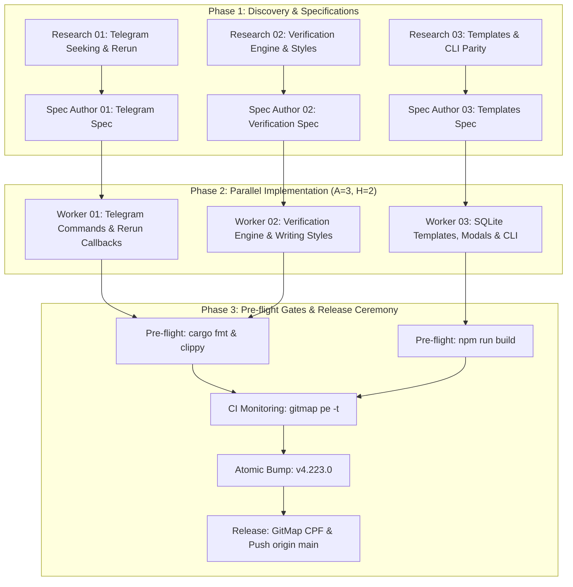

# Master Execution Plan: Telegram Seeking, Interactive Rerun, Diverse Verification Styles & CLI Templates

**Release Milestone:** `v4.223.0`  
**Task Slug:** `telegram-prompt-rerun-verification-templates`  
**Parent Task ID:** `13` in `.ai-memory/temp-agents/13-telegram-prompt-rerun-verification-templates/agent-task.db`  
**Concurrency Engine:** Parameter-driven $A = 3, H = 2$  
**Primary Developer / Attribution Invariant:** `@aukgit` (`(Thanks to @aukgit)`)

---

## 1. Executive Summary & Problem Classification

The user requested four unified capabilities across the Telegram inbound remote control daemon, verification workflow, and prompt template management:
1. **Telegram Conversation Seeking & Interactive Rerun Interface:**
   - Implement conversational seeking via Telegram commands (`/seek`, `/conversations`, `/prompts`, `/rerun`).
   - Surface running prompt counts, active instance identifiers, dual sequence tokens (`[AGM:P001 | GM:#1]`, `[AGM:C001 | GM:<cid>]`), and at least 200 words of preview text clamped via `extract_prompt_words_preview`.
   - Support Telegram Bot API 7.2+ `<blockquote expandable>` collapsing multi-line prompt turns into a 3-line preview with native expand toggles.
   - Attach interactive inline keyboards (`InlineKeyboardMarkup`) with compact `callback_data` (≤ 60 bytes, satisfying RCA 15) allowing operators to rerun or verify specific prompt turns directly back to active IDE instances.
2. **Verification Chapter Engine with Diverse Writing Styles & Multi-Round Repetition (2x / 3x):**
   - Provide a dedicated verification segment where operators can inspect instances, review conversation prompts, and select turns to dispatch for verification 2 times or 3 times (`2x` or `3x`).
   - Implement 4 distinct, grounded writing styles:
     * `root-cause-auditor` (Strict Root-Cause Auditor): Demands 4-part RCA, reproduction trace, and architectural prevention invariants.
     * `socratic-skeptic` (Socratic Skeptic / Devil's Advocate): Aggressively challenges premature claims of success; poses probing questions on edge cases, race conditions, nulls, timeouts, and unverified assumptions.
     * `spec-gatekeeper` (Acceptance Criteria Gatekeeper): Demands 1:1 bidirectional line-by-line verification against spec checkboxes (`02-spec/...`) and verbatim user prompt.
     * `release-blocker` (Production Release Blocker Inspector): Enforces 14-location SemVer sync, strict `@aukgit` attribution, pre-flight checks, and error visibility.
   - Enforce 500ms safety throttling between repeated rounds to prevent `.antigravity_resume_task.json` file overwrite collisions.
3. **Editable "Resend As" Titles & Custom Templates (UI & CLI Parity):**
   - Provide a customizable library of "Resend As" title patterns (`[Verify] {title}`, `[Fix] {title}`, `[Rerun] {title}`, `[Audit] {title}`) and suffix templates.
   - Store templates in SQLite `repo_prompts.db` tables `prompt_suffix_templates` and `prompt_resend_as_templates`.
   - Provide full UI management modals (`SuffixTemplateModal.tsx`, `ResendAsModal.tsx`) with localStorage fallback.
   - Provide full terminal CLI parity (`agm prompt template list/add/get/remove/set-default`, `agm prompt resend-as list/add/remove`).
   - Enforce CLI Subcommand Whitelist Invariant in `src-tauri/src/bin/agm/common.rs` to prevent template commands from leaking into raw prompt dispatches.
4. **Pre-flight Quality Gates, Zero-CI Verification & Release Ceremony:**
   - Execute pre-flight quality gates (`cargo fmt`, `cargo clippy --lib --all-features`, `npm run build`).
   - Monitor CI/CD telemetry via `gitmap pe -t` until green.
   - Bump minor version to `v4.223.0` via `npm run bump minor`.
   - Update `CHANGELOG.md`, `CHANGELOG_EN.md`, `README.md`, `README_EN.md` with strict `@aukgit` attribution.
   - Tag `v4.223.0` and push to `origin/main`.

---

## 2. Specification References

| Area | Specification Path | Subtask Plan Path |
| :--- | :--- | :--- |
| **Telegram Seeking & Interactive Rerun** | `02-spec/21-app/telegram-prompt-rerun-verification-templates/01-telegram-seeking-and-rerun-spec.md` | `.ai-memory/plans/subtasks/telegram-prompt-rerun-verification-templates/01-telegram-seeking-and-rerun.md` |
| **Verification Engine & Writing Styles** | `02-spec/21-app/telegram-prompt-rerun-verification-templates/02-verification-engine-and-writing-styles-spec.md` | `.ai-memory/plans/subtasks/telegram-prompt-rerun-verification-templates/02-verification-engine-and-writing-styles.md` |
| **Editable Titles & Templates (UI & CLI)** | `02-spec/21-app/telegram-prompt-rerun-verification-templates/03-editable-titles-and-templates-ui-cli-spec.md` | `.ai-memory/plans/subtasks/telegram-prompt-rerun-verification-templates/03-editable-titles-and-templates-ui-cli.md` |

---

## 3. Worker File Allocations (Disjoint File Invariant)

To guarantee zero write conflicts and prevent file corruption during parallel execution, the codebase is partitioned into strictly disjoint worker file sets:

- **Worker 01 (Telegram Remote Control):**
  - `src-tauri/src/modules/telegram_inbound/processing.rs`
  - `src-tauri/src/modules/telegram_inbound/reports_b.rs`
  - `src-tauri/src/modules/telegram_inbound/send_flow.rs`
  - `src-tauri/src/modules/telegram_inbound/mod.rs`
  - `src/components/settings/TelegramSettings.tsx`
- **Worker 02 (Verification Engine & Writing Styles):**
  - `src/components/instances/PromptTreeView/verificationTemplates.ts`
  - `src/components/instances/PromptTreeView/VerificationModal.tsx`
  - `src/components/instances/PromptTreeView/usePromptTreePromptActions.ts`
  - `src-tauri/src/modules/repo_db/verification.rs`
- **Worker 03 (Editable Titles, Templates & CLI Parity):**
  - `src-tauri/src/modules/suffix_templates.rs`
  - `src-tauri/src/bin/agm/prompt_cmds.rs`
  - `src-tauri/src/bin/agm/common.rs`
  - `src-tauri/src/commands/project_cmds.rs`
  - `src/components/instances/PromptTreeView/SuffixTemplateModal.tsx`
  - `src/components/instances/PromptTreeView/ResendAsModal.tsx`
- **Lead Orchestrator (Quality Gates & Release):**
  - Pre-flight quality gates: `cargo fmt`, `cargo clippy`, `npm run build`
  - CI/CD telemetry monitoring: `gitmap pe -t`
  - Version bump to `v4.223.0`
  - Attribution audit & release ceremony (`@aukgit` only)

---

## 4. Execution Phases

---

## 5. Architectural Invariants

- **I1: FIFO Queue Order Invariant:** All prompt restoration, dispatch, and queue processing queries across SQLite databases MUST enforce strict First-In-First-Out ordering using `ORDER BY created_at ASC, id ASC`.
- **I2: 60-Byte Telegram Callback Cap (RCA 15):** All `callback_data` payloads attached to Telegram inline keyboard buttons must be strictly $\le 60$ bytes to prevent Telegram Bot API HTTP 400 rejection.
- **I3: No Raw Search Ban:** Total ban on `rg`, `ripgrep`, `grep`, `git grep`, `Select-String`, and `findstr`. All symbol searches must use GitMap (`gitmap aum search`, `gitmap find`, `gitmap cat`).
- **I4: Strict `@aukgit` Attribution:** Release changelogs and notes must credit exclusively `@aukgit` (`(Thanks to @aukgit)`). Zero other GitHub user handles (`@...`).
- **I5: CLI Subcommand Whitelist Invariant:** Update `is_prompt_subcommand()` in `src-tauri/src/bin/agm/common.rs` so subcommands like `template`, `templates`, `suffix`, `resend-as` are never dispatched to the IDE as raw prompt text.
- **I6: Safety Throttling Invariant:** 500ms safety sleep between repeated verification rounds (2x/3x) to prevent file system race conditions in `.antigravity_resume_task.json`.
