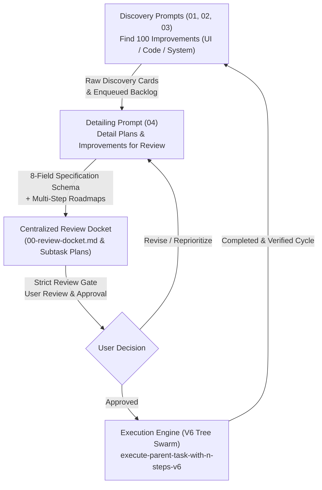

# Improvements Prompts (`30-improvements`) — Index & Catalog

> [!IMPORTANT]
> Category: `30-improvements`  
> Architecture: Canonical V6 Continuous Improvement Flywheel & Multi-Agent Protocol  
> Scope: System-Wide UX Optimization, Codebase Quality, UI/UX Materiality, Multi-Step Plan Detailing, and Review-First Governance  

---

## Overview

The `30-improvements` prompt category establishes an autonomous, recurring continuous improvement flywheel and rigorous plan-detailing engine across the Prompt Architect meta-repository and connected fleet. Each prompt in this category conducts deep architectural audits, identifies high-leverage improvements focused strictly on user and developer experience, and details them into actionable, bite-sized plans and review dockets before execution.

All improvements adhere to the structured **8-Part Specification Schema**, enforce the **Zero Harm / Regression Safety Matrix**, provide backward compatibility guarantees, and include concrete, copy-paste ready implementation blueprints.

> [!NOTE]
> **Continuous Improvement Flywheel Invariant:**  
> Running discovery prompts in this category persists the identified 100 improvement items into `.ai-memory/plans/pending/XX-<slug>.md` along with subtasks in `.ai-memory/plans/subtasks/XX-<slug>/`. Detailing prompts then expand these candidates into exhaustive multi-step execution roadmaps and review dockets, turning continuous quality enhancement into an automated, self-sustaining pipeline.
>
> **Strict Relative Git Paths Only:** All file paths, markdown links, and subtask citations must strictly use relative paths from the repository root (e.g. `02-spec/...`, `.ai-memory/...`, `cmd/...`). Absolute filesystem paths and `file:///` URIs are totally banned.

---

## Directory Index & Catalog

| Prompt File | Version | Scope | Key Capabilities |
| :--- | :--- | :--- | :--- |
| [`01-next-100-ui-improvements.md`](01-next-100-ui-improvements.md) | V6 / 1.0.0 | UI/UX & Design Tokens | 100 UI-level UX improvements covering design token registries, typography clamp formulas, WCAG AAA contrast, glassmorphic depth, virtualized trees, and presenter HUDs. |
| [`02-next-100-code-improvements.md`](02-next-100-code-improvements.md) | V6 / 1.0.0 | Codebase Quality & Hygiene | 100 codebase-level improvements enforcing monadic Result envelopes, domain `*appfault.AppError`, positive booleans, parameter structs, map dispatch tables, and value semantics. |
| [`03-next-100-whole-system-improvements.md`](03-next-100-whole-system-improvements.md) | V6 / 1.0.0 | Whole-System Architecture | 100 whole-system improvements across 10 UX clusters: DX/CLI ergonomics, UI tokens, agent swarms, prompt architecture, fleet sync, code quality, performance, diagnostics, test isolation, and spec governance. |
| [`04-next-detail-out-100-improvements.md`](04-next-detail-out-100-improvements.md) | V6 / 1.0.0 | Multi-Step Detailing & Review Dockets | Autonomously details out active, pending, and completed plans and discovered improvements into exhaustive multi-step execution roadmaps, structural contracts, dependency graphs, and review dockets with strict review-first gating (no immediate execution without user review). |

---

## The Review-First Gate: Mandatory Pre-Execution Protocol

A cornerstone invariant of the `30-improvements` category is the **Review-First Gate**:

> [!CAUTION]
> **Total Ban on Immediate / Unreviewed Code Execution:**  
> When running improvement discovery or detailing prompts, agents are **STRICTLY PROHIBITED** from immediately applying code changes, modifying source files, running builds, or executing automated refactoring waves.  
> All improvements and detailed plans must be presented and enqueued for review. Code execution is strictly blocked pending explicit user review and sign-off.

### Why Review-First Gating Is Mandatory:
1. **Zero Unintended Mutations:** Complex codebases require careful scrutiny of caller blast radius, API surface stability, and architectural boundary integrity before any refactoring begins.
2. **Deterministic Risk Governance:** The centralized Review Docket (`02-spec/21-app/XX-<slug>/00-review-docket.md`) maps out risk tiers (Low/Medium/High/Critical), rollback complexity, and backward compatibility shims (e.g. `type Fault = AppError`) prior to code touch.
3. **Multi-Stage Dependency Clarity:** Stakeholders review the proposed Directed Acyclic Graph (DAG) of execution waves, ensuring prerequisite data structures, types, and error envelopes land before dependent modules are modified.
4. **Transparent User Control:** The user retains full control over project direction, approving, modifying, or prioritizing subtasks before any background worker swarm touches production code.

---

## Synergy: Finding 100 Improvements vs. Detailing Them for Review

The four prompts within this category form a closed-loop, highly complementary continuous improvement flywheel:



### Operational Synergy Breakdown:
- **Discovery Prompts (`01`, `02`, `03`) — Broad Architectural Radar:**  
  Systematically scan the repository across UI/UX, codebase quality, or whole-system ergonomics to surface 100 grounded improvement opportunities. They capture the macro view and seed the backlog in `.ai-memory/plans/pending/`.
- **Detailing Prompt (`04`) — Micro Precision & Structural Contracts:**  
  Ingests raw discovery candidates or pending backlogs, inspects the codebase using GitMap high-speed streaming search, and expands each item into an exhaustive 8-Field Specification Card with concrete code blueprints, exact caller counts, and binary verification criteria.
- **Review Docket Assembly (`00-review-docket.md`) — Risk & Dependency Governance:**  
  Consolidates all detailed items into a unified review docket with an executive scorecard, risk matrix, and dependency DAG, clearly marking status as `PENDING USER REVIEW`.
- **Handoff to Execution Engines — Safe, Confined Implementation:**  
  Once the user reviews and signs off, the enqueued subtasks in `.ai-memory/plans/subtasks/XX-<slug>/` are executed wave-by-wave using canonical execution engines like [`execute-parent-task-with-n-steps-v6`](file;.agents/skills/execute-parent-task-with-n-steps-v6), ensuring 100% adherence to the agreed blueprint.

---

## The 10 System UX Clusters (Whole System)

The whole-system improvements catalog (`03-next-100-whole-system-improvements.md`) organizes 100 concrete enhancements across 10 distinct operational clusters (10 items each):

1. **Cluster 01: Developer Experience (DX) & CLI Ergonomics (`SYS-IMP-001` – `SYS-IMP-010`):** Typo-tolerant command suggestions, terminal auto-scaling, shell completion installers, live spinners, color formatting, environment health preflights, and workspace root auto-discovery.
2. **Cluster 02: UI/UX, Design Tokens & Materiality (`SYS-IMP-011` – `SYS-IMP-020`):** Unified design tokens, WCAG AAA contrast ramps, fluid typography clamp scales, virtualized tree lists, glassmorphic surfaces, scroll-spy docs preview, and zero-FOUC theme hydration.
3. **Cluster 03: Autonomous Agent Orchestration & Heatmap Telemetry (`SYS-IMP-021` – `SYS-IMP-030`):** SQLite WAL task queues, file lease contention locks, deadlock autopsy, live terminal tree matrix, shared memory bus, dynamic hand capacity, and pre/post-action telemetry pairing.
4. **Cluster 04: Prompt Engineering & Instruction Architecture (`SYS-IMP-031` – `SYS-IMP-040`):** V6 parameterized template engine, above-precedence verification, IDE skill link synthesis, lossless verbatim capture, negative guardrails, and token density optimization.
5. **Cluster 05: Multi-Repository Fleet Synchronization & Boundaries (`SYS-IMP-041` – `SYS-IMP-050`):** Parallel multi-repo sync, 5 non-negotiable boundary guardrails, pre-flight safety backup branches, zero secrets offloading (`gitmap rs`), and reusable script vault distribution (`gitmap rc`).
6. **Cluster 06: Cross-Language Code Quality & Immutability (`SYS-IMP-051` – `SYS-IMP-060`):** Monadic Result wrappers, domain `*appfault.AppError`, positive boolean standards, parameter structs, map dispatch tables, and allocation-free string utilities (`EqualFoldAny`).
7. **Cluster 07: Performance, Caching & Resource Efficiency (`SYS-IMP-061` – `SYS-IMP-070`):** Zero-disk memory streaming (`gitmap cat`), SQLite WAL tuning, SIMD-accelerated AUM search, shared engine caching, lazy regex compilation, and stack value semantics.
8. **Cluster 08: Diagnostics, Observability & Error Management (`SYS-IMP-071` – `SYS-IMP-080`):** 4-part RCA engine, pipeline error extractor (`gitmap pe -t`), contextual stack trace truncation, non-polling ETA waiting, zero-storage summaries, and backward-compatible shims (`type Fault = AppError`).
9. **Cluster 09: Testing, Verification & Regression Isolation (`SYS-IMP-081` – `SYS-IMP-090`):** Destructive OS call mocking, temporary E2E test isolation, surgical micro-linters, in-memory test fixtures, behavioral AAA naming, smart incremental test runners, and installer smoke tests.
10. **Cluster 10: Documentation, Memory & Spec Governance (`SYS-IMP-091` – `SYS-IMP-100`):** Strict relative path linters, lowercase filename governance, 3-tier application specs, lean subtask queues, memory consolidation, index deadman switches, and the continuous improvement flywheel.

---

## 8-Part Structured Specification Schema

Every improvement generated or detailed under Category 30 adheres to the strict 8-part schema:

1. **Identifier & Subsystem:** `SYS-IMP-NNN` or `PLAN-DET-NNN`, Subsystem, and Target Boundaries.
2. **System-Level User Experience (UX) Impact:** Cognitive load reduction, workflow velocity, error clarity.
3. **Cause (Current Deficiency / Root Friction):** Root cause analysis in 1-2 sharp sentences.
4. **Effect (Target State & Behavioral Outcome):** Quantitative metrics and target behavioral state.
5. **Zero Harm / Regression Safety Matrix:** Confinement rules, no-build/no-test rules, and zero secrets invariants.
6. **Backward Compatibility Guarantee:** CLI flags preservation, non-breaking API signatures, and deprecation shims.
7. **Concrete Implementation Blueprint:** Concise code snippet, configuration diff, or schema enhancement.
8. **Binary Verification & Acceptance Criteria:** Exact GitMap command or test check returning exit code 0.

---

## Companion Skills

Each prompt in this category is accompanied by symmetric, production-grade skills installed in both Antigravity Agents and Cursor IDE:

- **Antigravity Agents:**
  - [`next-100-ui-improvements`](file;.agents/skills/next-100-ui-improvements)
  - [`next-100-code-improvements`](file;.agents/skills/next-100-code-improvements)
  - [`next-100-whole-system-improvements`](file;.agents/skills/next-100-whole-system-improvements)
  - [`next-detail-out-100-improvements`](file;.agents/skills/next-detail-out-100-improvements)
- **Cursor IDE:**
  - [`next-100-ui-improvements`](file;.cursor/skills/next-100-ui-improvements)
  - [`next-100-code-improvements`](file;.cursor/skills/next-100-code-improvements)
  - [`next-100-whole-system-improvements`](file;.cursor/skills/next-100-whole-system-improvements)
  - [`next-detail-out-100-improvements`](file;.cursor/skills/next-detail-out-100-improvements)

---

## Directory Tree

```text
01-prompts/30-improvements/
├── 01-next-100-ui-improvements.md
├── 02-next-100-code-improvements.md
├── 03-next-100-whole-system-improvements.md
├── 04-next-detail-out-100-improvements.md
└── readme.md
```
