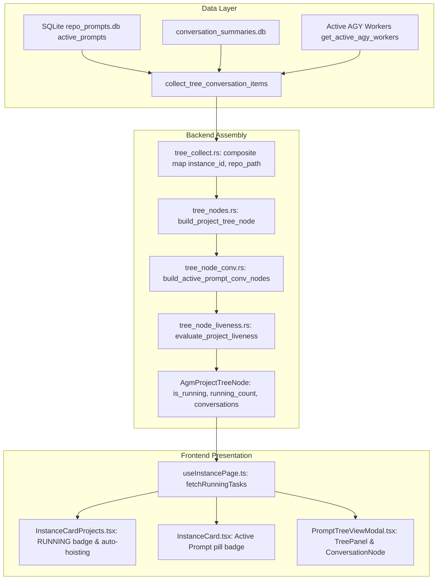

# Architecture Spec: 07-verify-running-prompts-instance-section

## 1. Overview
This specification documents and validates the architectural guarantees governing running prompt tracking, instance isolation, and liveness verification in Antigravity-Manager.

## 2. Data Flow Architecture

## 3. Core Subsystem Invariants

### 3.1 Composite Tuple Partitioning
Active prompts and conversation summaries are indexed in memory using composite keys:
`(normalized_instance_id, normalized_repo_path)`
This ensures complete instance sandboxing: active prompts running in instance `default-copy-8159` cannot bleed into `default` or vice versa.

### 3.2 Dead-Process Gating
Process liveness is strictly enforced before marking any prompt or project as running:
- For default instance: `crate::modules::process::is_antigravity_running(None)`
- For cloned instances: `crate::modules::instance::is_instance_running(&inst.id, &inst.data_dir, inst.pid)`
If the instance process is dead, `is_inst_alive` is `false`, immediately forcing all conversations and the project to `IDLE`.

### 3.3 Empirical Liveness Confirmation
In `build_active_prompt_conv_nodes`, a prompt record with status `running`, `in_flight`, or `dispatched` is only stamped `is_running: true` if:
1. `has_active_worker`: An active worker PID is alive on the operating system, OR
2. `has_non_idle_summary`: An empirical conversation record in `conversation_summaries.db` has `sum_status.contains("RUNNING") && not_idle > 0` with zero idle markers (`IDLE`, `COMPLETED`, `FAILED`, `CANCELLED`).
3. TTL threshold: `now - ap.updated_at <= max_allowed_ttl` (45s, or 300s if an active worker exists).

### 3.4 FIFO Restore & Query Discipline
All queries against `active_prompts` enforce `ORDER BY created_at ASC, id ASC`.
