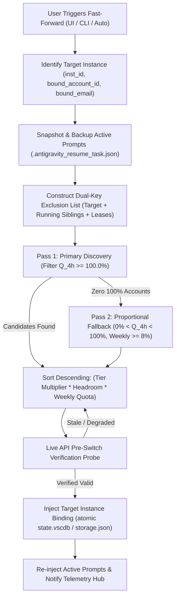

# Specification: Fast-Forward Logic and AI Improvement Implementation Blueprints

- **Spec ID**: `02-spec/21-app/156-fast-forward-logic-and-improvement-detailing`
- **Feature**: Fast-Forward (FF) Account Auto-Switching Architecture, In-Use & Reduced-Quota Collision Elimination, and File-by-File AI Implementation Blueprints
- **Status**: Approved & Implemented
- **Owner**: Antigravity Development Team (@aukgit)
- **Target Release**: v4.250.0+

---

## 1. Executive Summary & Problem Classification

The Fast-Forward (`FF`) feature is Antigravity-Manager's automated profile and account switching mechanism, designed to transfer an active IDE instance seamlessly to the optimal account from the pool.

### 1.1 The Fast-Forward Reselection Bug
During real-world workflows with multiple IDE instances, users reported that clicking Fast-Forward on an instance repeatedly selected an account that:
1. **Was already bound and in active use** by that very instance or a sibling running instance (e.g. `dav***@gmail.com` on instance `#2 v2` with ID `v2-3127`), resulting in redundant self-rotations or cross-instance identity collisions.
2. **Had reduced 4-hour quota** (e.g., 63%, 98%, or 1% remaining) despite other accounts in the pool possessing pristine 100% 4-hour quotas.

### 1.2 Root Cause Analysis
1. **False 100% Override via `is_account_period_finished`**:
   In `src-tauri/src/modules/auto_switcher/selection.rs` and `scoring.rs`, `is_account_period_finished` checked whether *any* model or bucket in `acc.quota` had an expired `reset_time <= now_sec`. Because historical or unrelated models in Google API payloads retain past reset timestamps, this evaluated to `true`, artificially overriding the account's quota to `100.0` (`let quota = if is_period_finished { 100.0 } else { ... };`), bypassing the real reduced 4-hour quota (e.g. 63%).
2. **Email-Only Binding Disconnect**:
   In both backend (`src-tauri/src/modules/auto_switcher/manual.rs`, `instances.rs`) and frontend (`src/stores/useInstanceStore/smart.ts`), active in-use exclusions filtered primarily by `bound_account_id`. Instances bound via `bound_email` without an explicit `bound_account_id` were omitted from exclusion lists, allowing them to be picked as candidates.
3. **Primary Pass Quota Invariant Breach**:
   The primary candidate pass allowed accounts with $<100\%$ 4-hour quota to enter the candidate pool if `hasResetTimePassed` evaluated to `true`.

---

## 2. Core System Invariants

### Invariant 1: Strict 100% 4-Hour Quota Primacy
- **Primary Scoring Rule**: In the primary candidate pool, an account whose 4-hour rolling window quota is reduced by even 1% or 2% ($Q_{4\text{h}} < 100.0\%$) **MUST SCORE `0.0`**.
- **No Synthetic 100% Overrides**: Recorded quota values $<100.0\%$ must never be artificially inflated to `100.0` based on passive timestamp comparisons.
- **Two-Pass Allocation**:
  - **Pass 1 (Primary)**: Only accounts with genuine $Q_{4\text{h}} \ge 100.0\%$ are eligible.
  - **Pass 2 (Proportional Fallback)**: If and **ONLY IF** zero accounts with $100\%$ quota exist in the entire candidate pool, the algorithm activates the proportional fallback pass:
    $$\text{Score}_{\text{fallback}} = \left(\frac{Q_{4\text{h}}}{100.0}\right) \times \text{Score}_{\text{weekly}}$$
    where accounts with weekly quota $< 8.0\%$ strictly evaluate to `0.0`.

### Invariant 2: Total Dual-Key In-Use Exclusion (ID + Email)
- Any account currently bound to or in active use by:
  1. The target instance requesting the Fast-Forward (cannot switch to itself).
  2. Any actively running sibling instance on the host machine.
  3. Any active remote lease recorded in `workspace_lease_manager`.
  **MUST BE EXCLUDED** by both its internal UUID (`account_id`) and its normalized email (`account_email.toLowerCase()`).
- In-use accounts evaluate to `activeFactor = 0`, forcing final score $= 0.0$ and immediate exclusion from candidate ranking.

---

## 3. Fast-Forward Architecture & Data Flow



---

## 4. Backend Implementation Specifications

### 4.1 `src-tauri/src/modules/auto_switcher/scoring.rs`
- **`score_candidate_account`**:
  ```rust
  pub fn score_candidate_account(acc: &Account, target_model: &str, now_sec: i64) -> f64 {
      if acc.disabled || acc.proxy_disabled {
          return 0.0;
      }
      let q_4h = calculate_4h_window_quota(acc, target_model).unwrap_or(0.0);
      // Primary 100% 4-Hour Quota Gate:
      // Any reduction (< 100%) strictly returns 0.0
      if q_4h < 100.0 {
          return 0.0;
      }
      calculate_weekly_base_score(acc, target_model, now_sec)
  }
  ```

### 4.2 `src-tauri/src/modules/auto_switcher/selection.rs`
- In `select_candidate_profiles`:
  1. Add both `bound_account_id` AND `bound_email` of `current_instance_id` into `effective_exclusions`.
  2. Resolve all running sibling instances' `bound_account_id` and `bound_email` via `account::get_account_by_email` and `account::load_account`, inserting both into `effective_exclusions`.
  3. Enforce real `calculate_candidate_quota` check without false `is_period_finished` overrides when quota is $<100\%$.

### 4.3 `src-tauri/src/modules/auto_switcher/manual.rs`
- In `trigger_manual_rotation_for_instance`:
  1. Populate `excluded` with target instance's `bound_account_id` and `bound_email`.
  2. Populate `excluded` with all running siblings' IDs and emails.

### 4.4 `src-tauri/src/modules/auto_switcher/instances.rs`
- In `get_active_in_use_account_ids()`:
  1. Check both `inst.bound_account_id` and `inst.bound_email`.
  2. For `inst.bound_email`, lookup `account::get_account_by_email(&email)` to add the account's UUID.
  3. Include the email string in in-use tracking to guard string-based checks.

---

## 5. Frontend Implementation Specifications

### 5.1 `src/services/instanceService/scoring.ts`
- **`calculateMultiplicativeScore`**:
  - Strictly check `if (fourHourQuotaPercent < 100 || activeFactor === 0) return { score: 0, activeFactor: 0, ... };`.
  - Remove passive `hasResetTimePassed` bypass on reduced quota.
- **`rankSmartCandidates`**:
  - Filter `primaryEligible` strictly with `q4h >= 100`.
  - Only execute fallback pass when `primaryEligible.length === 0`.

### 5.2 `src/stores/useInstanceStore/smart.ts`
- In `smartRotateProfileAccount`:
  - Check both `bound_account_id` and `bound_email` when collecting `activeInUseAccountIds`.
  - Resolve current instance's account by email if `bound_account_id` is missing.
  - Reject any candidate whose ID or email matches active in-use accounts or current instance.

---

## 6. AI Implementation Blueprints for Cataloged Improvements

The cataloged 200 improvements are decomposed into structured, file-anchored journeys in:
- `02-spec/21-app/156-fast-forward-logic-and-improvement-detailing/ai-journeys.md`
- Subtasks in `.ai-memory/plans/subtasks/156-fast-forward-logic-and-improvement-detailing/`

Each journey defines:
1. Target File(s)
2. Exact Subsystem Impact & Blast Radius
3. AI Implementation Journey (Numbered steps)
4. Code Anchors & Exact Modification Logic
