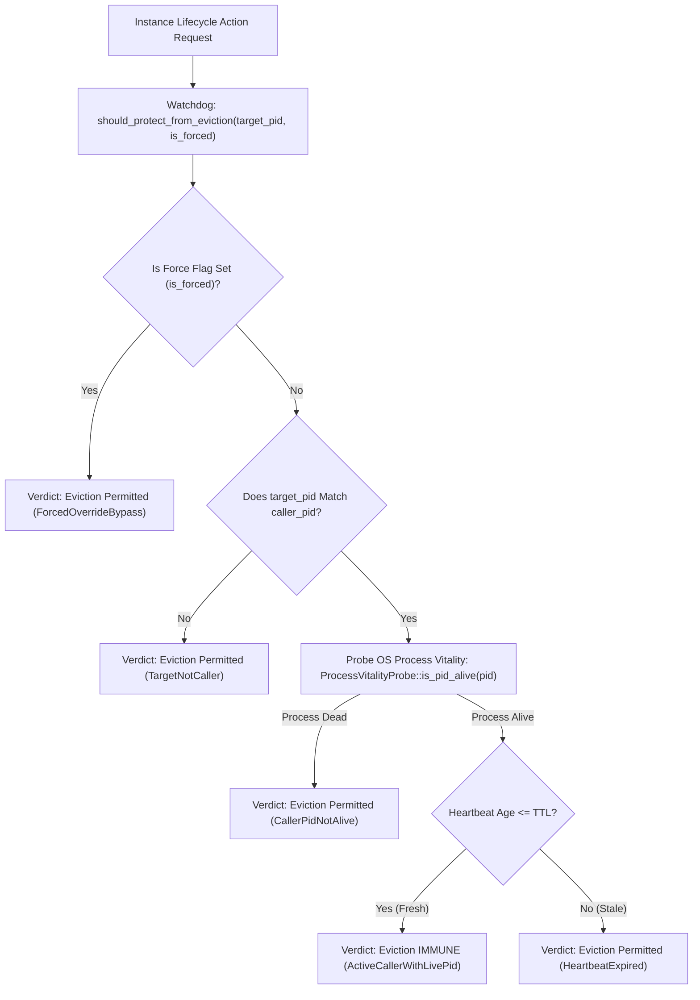

# Component Specification: Caller IDE Vitality Heartbeat & Eviction Watchdog (Imp-661)

- **Step Index**: Step 247 of 255 (Sequence 207)
- **Target Implementation**: `src-tauri/src/modules/instance/caller_ide_heartbeat_watchdog.rs`
- **Target Test Suite**: `src-tauri/src/modules/instance/tests_caller_ide_heartbeat_watchdog.rs`
- **Specification Path**: `02-spec/21-app/207-implementing-next-five-tasks/02-component-spec.md`
- **Referenced Architecture**: `AGENTS.md` (Caller IDE Self-Preservation & Transient Test Sandboxing)

---

## 1. Executive Summary & Problem Classification

In multi-instance environments and auto-switching configurations, background daemons, scheduled tasks, CLI commands (`agm instances stop`, `rm`, `switch`), and quota-balancing routines continuously evaluate instance lifecycle states. Under heavy workloads or quota-exhaustion transitions, uncoordinated eviction routines could inadvertently evict, starve, or terminate the active IDE session hosting the developer.

`AGENTS.md` strictly dictates the **Caller IDE Self-Preservation Invariant**:
> "Automated tests, CLI commands, and auto-switcher daemons MUST detect the caller's active IDE process (`detect_caller_instance_id()`) to prevent terminating the developer's working IDE session. Commands targeting the caller instance (`agm instances stop`, `rm`, `switch`) must fail-fast with exit code 2 unless `--force` is explicitly provided."

The `CallerIdeHeartbeatWatchdog` component provides runtime vitality tracking, monotonic heartbeat monitoring, and deterministic eviction protection gating. By cross-referencing process vitality (`ProcessVitalityProbe::is_pid_alive`) with recent heartbeat timestamps, the watchdog ensures that active developer sessions maintain unbreakable eviction immunity while allowing stale or dead sessions to be gracefully reclaimed.

---

## 2. Architectural Design & Flow

The watchdog operates as a non-blocking, queryable guard consulted by lifecycle managers prior to executing eviction or termination actions:



---

## 3. Heartbeat Loop Lifecycle & TTL State Machine

The watchdog tracks state transitions across four distinct lifecycle phases:

```mermaid
stateDiagram-v2
    [*] --> Uninitialized: Watchdog instantiated without caller PID
    Uninitialized --> HealthyActive: register_caller(pid) / with_caller(pid)
    HealthyActive --> HealthyActive: record_heartbeat() [Age <= TTL]
    HealthyActive --> StaleHeartbeat: Age > TTL (Heartbeat Timeout)
    StaleHeartbeat --> HealthyActive: record_heartbeat() [Heartbeat Resumed]
    HealthyActive --> DeadProcess: ProcessVitalityProbe::is_pid_alive(pid) == false
    StaleHeartbeat --> DeadProcess: ProcessVitalityProbe::is_pid_alive(pid) == false
    DeadProcess --> [*]: unregister_caller() / Process Reclaimed
```

### TTL Configurations
- `DEFAULT_HEARTBEAT_TTL_MS`: `30,000` ms (30 seconds)
- `MIN_HEARTBEAT_TTL_MS`: `1,000` ms (1 second)
- `MAX_HEARTBEAT_TTL_MS`: `300,000` ms (5 minutes)

---

## 4. Eviction Immunity Rules & Evaluation Ladder

When `should_protect_from_eviction(&self, target_pid: u32, is_forced: bool)` is queried, the evaluation follows a strict priority ladder:

1. **Forced Override Gate**: If `is_forced` is `true`, self-preservation immunity is overridden. Returns `false` with reason `ForcedOverrideBypass`.
2. **Target Matching Gate**: If `target_pid` does not match the registered `caller_pid` (or no caller is tracked), the target is not the caller. Returns `false` with reason `TargetNotCaller` or `NoCallerConfigured`.
3. **Kernel Vitality Gate**: The watchdog queries `ProcessVitalityProbe::is_pid_alive(target_pid)`. If the OS reports the PID has exited or terminated, the caller session is dead. Returns `false` with reason `CallerPidNotAlive`.
4. **Heartbeat Freshness Gate**: The elapsed time since `last_heartbeat_timestamp_ms` is computed. If elapsed time is within `heartbeat_ttl_ms`, the caller session is verified active. Returns `true` with reason `ActiveCallerWithLivePid`. If expired, returns `false` with reason `HeartbeatExpired`.

---

## 5. ProcessVitalityProbe Integration

Rather than invoking resource-heavy system scans (e.g., full sysinfo process enumerations), the watchdog integrates directly with `src-tauri/src/modules/instance/process_vitality_probe.rs`:
- **Windows**: Invokes `OpenProcess(PROCESS_QUERY_LIMITED_INFORMATION, 0, pid)` followed by `GetExitCodeProcess`, verifying exit code equals `STILL_ACTIVE` (`259`).
- **Unix / macOS**: Dispatches zero-signal probe `libc::kill(pid as libc::pid_t, 0) == 0`.

This yields sub-millisecond check latency with zero memory allocations.

---

## 6. Structural Contracts & Types

### 6.1 `CallerEvictionDecisionType`
```rust
#[derive(Debug, Clone, Copy, PartialEq, Eq, Serialize, Deserialize)]
pub enum CallerEvictionDecisionType {
    ProtectedActiveCaller,
    ProtectedFreshHeartbeat,
    EvictionPermittedForcedOverride,
    EvictionPermittedDifferentTarget,
    EvictionPermittedCallerDead,
    EvictionPermittedHeartbeatStale,
    EvictionPermittedNoCallerTracked,
}
```

### 6.2 `WatchdogVitalityStateType`
```rust
#[derive(Debug, Clone, Copy, PartialEq, Eq, Serialize, Deserialize)]
pub enum WatchdogVitalityStateType {
    HealthyActive,
    StaleHeartbeat,
    DeadProcess,
    Uninitialized,
}
```

### 6.3 `EvictionProtectionReasonType`
```rust
#[derive(Debug, Clone, Copy, PartialEq, Eq, Serialize, Deserialize)]
pub enum EvictionProtectionReasonType {
    ActiveCallerWithLivePid,
    ForcedOverrideBypass,
    TargetNotCaller,
    CallerPidNotAlive,
    HeartbeatExpired,
    NoCallerConfigured,
}
```

### 6.4 `CallerIdeHeartbeatReport`
Structured report serialized for telemetry, IPC query commands, and CLI output:
```rust
#[derive(Debug, Clone, PartialEq, Eq, Serialize, Deserialize)]
pub struct CallerIdeHeartbeatReport {
    pub caller_pid: Option<u32>,
    pub is_alive: bool,
    pub is_eviction_immune: bool,
    pub last_heartbeat_age_ms: u64,
    pub protection_reason: String,
    pub vitality_state: WatchdogVitalityStateType,
    pub decision_type: CallerEvictionDecisionType,
}
```

### 6.5 `CallerIdeHeartbeatWatchdog`
Core controller providing public evaluation APIs:
- `pub fn new() -> Self`
- `pub fn with_caller(caller_pid: u32) -> Self`
- `pub fn with_caller_and_ttl(caller_pid: u32, ttl_ms: u64) -> Self`
- `pub fn register_caller(&mut self, caller_pid: u32)`
- `pub fn unregister_caller(&mut self)`
- `pub fn record_heartbeat(&mut self)`
- `pub fn record_heartbeat_at(&mut self, timestamp_ms: u64)`
- `pub fn should_protect_from_eviction(&self, target_pid: u32, is_forced: bool) -> bool`
- `pub fn generate_report(&self) -> CallerIdeHeartbeatReport`

---

## 7. Error Handling & Invariant Discipline

- **No Silent Errors Invariant**: System clock retrieval is fallible due to potential monotonic skew or clock adjustments. Duration calculation errors are routed through `crate::error::record_ignored` with explicit `// Justification:` comments, falling back safely to timestamp continuity.
- **Positive Booleans Exclusively**: `is_alive`, `is_eviction_immune`, `is_forced`, `is_heartbeat_fresh`, `is_protected`, avoiding negative or double-negative naming.
- **Strictly Relative Paths**: All references adhere to repository-relative notation (`src-tauri/src/modules/instance/...`).
- **Bounded Functions**: Every helper and implementation function adheres to the 8–15 line limit.

---

## 8. Verification Matrix & Acceptance Criteria

| Scenario | Target PID | Caller PID | Heartbeat State | `is_forced` | OS Vitality | Expected Protection | Expected Reason |
| :--- | :--- | :--- | :--- | :--- | :--- | :--- | :--- |
| Normal Active Session | `1234` | `1234` | Age: 5s (Fresh) | `false` | Alive | `true` (Protected) | `ActiveCallerWithLivePid` |
| Forced CLI Eviction | `1234` | `1234` | Age: 5s (Fresh) | `true` | Alive | `false` (Evictable) | `ForcedOverrideBypass` |
| Different Target Instance | `5678` | `1234` | Age: 5s (Fresh) | `false` | Alive | `false` (Evictable) | `TargetNotCaller` |
| Stale Heartbeat (> TTL) | `1234` | `1234` | Age: 45s (Stale) | `false` | Alive | `false` (Evictable) | `HeartbeatExpired` |
| Dead Caller Process | `1234` | `1234` | Age: 5s (Fresh) | `false` | Dead | `false` (Evictable) | `CallerPidNotAlive` |
| No Caller Configured | `1234` | `None` | N/A | `false` | N/A | `false` (Evictable) | `NoCallerConfigured` |
