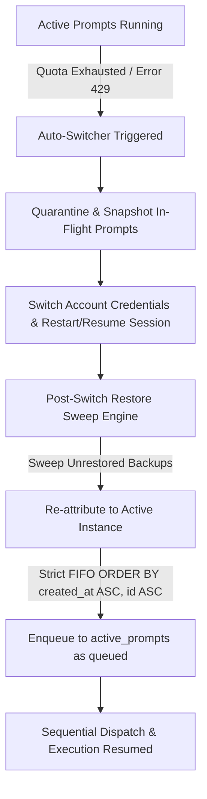

# Specification 220: Architecture Spec — GitMap and Antigravity Tools Manager Updates and Testing
Sequence: 220
Batch: Steps 311–315
Improvements: `Imp-725` through `Imp-729`

## 1. Executive Summary & Problem Classification
During automated operation of Antigravity Tools Manager, account quota exhaustion / credit expiration triggers automated account switching via the auto-switcher daemon. However, two critical friction points occur:
1. **Prompt Restore Failure on Quota Exhaustion**: In-flight prompts that were executing (`running`) or staged (`pending`) when the credit expired are abruptly interrupted as the previous IDE session or backend connection terminates. In some cases, the prompt backup database records these prompts, but the post-switch restore sweep fails to re-inject them into the newly authenticated session, leaving prompts stranded or closed.
2. **Rerun Randomizer Selection Friction**: In Prompt Tree View, clicking Rerun should automatically pick a randomizer variation option from verified nudge templates (style variations, prompt re-framing, dynamic prefixes) rather than requiring repeated manual modal interactions.
3. **GitMap Code Quality & CG Execute Standards**: Continuous maintenance of GitMap's Go architecture adhering strictly to 8-Pillar coding standards (value semantics, structured *apperror returns, PascalCase enums, positive booleans, 300-line file caps).

## 2. Architecture & Data Flow

## 3. High-Priority Guarantees & Invariants
- **Zero Prompt Loss Guarantee**: Every prompt in `running` or `pending` mode during account rotation must be preserved with its original `created_at` timestamp.
- **Strict FIFO Ordering**: All queries across `active_prompts`, `prompt_backups`, and `repo_prompts` enforce `ORDER BY created_at ASC, id ASC`.
- **Caller IDE Immunity**: CLI and auto-switch commands must never terminate active developer IDE sessions (`detect_caller_instance_id()`).
- **Zero Builds / Zero Tests Rule**: No compilation or test runs during code authoring; E2E tests are deferred exclusively to Phase 3.
