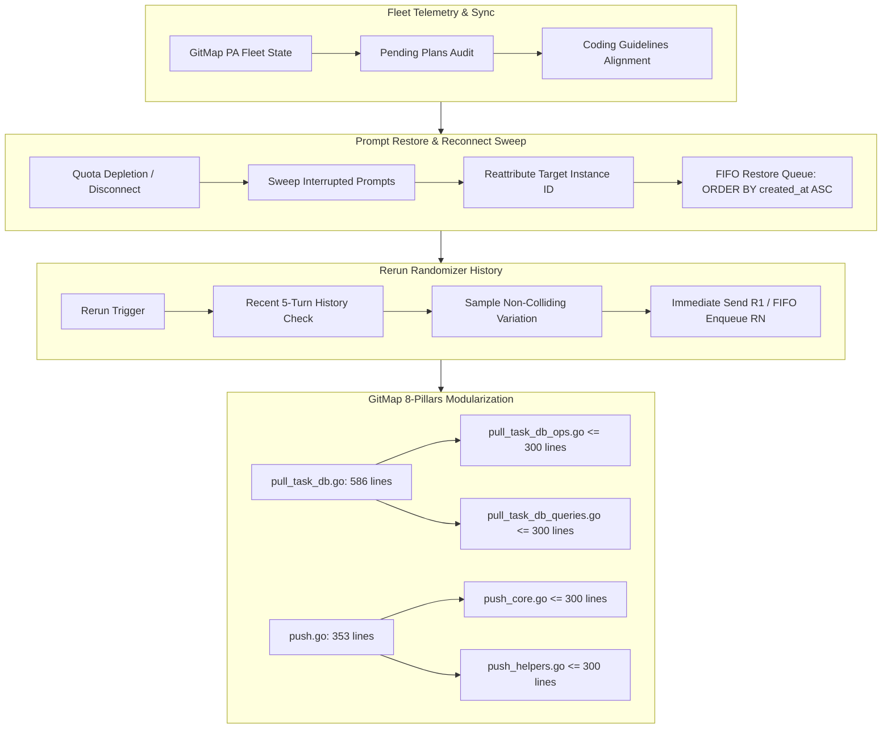

# Specification: Task 221 - GitMap and Antigravity Tools Manager Updates & Testing
## Architecture Specification

### 1. Overview & Context
This specification defines the architectural enhancements for Batch Sequence 221 (Steps 316–320, Improvements `Imp-730` through `Imp-734`).
The objectives are:
1. **Fleet Synchronization & Guideline Audit (`Imp-730`)**: Verify fleet synchronization across all repositories using GitMap, audit pending plans in `.ai-memory/plans/` and GitMap plans, and uphold coding guideline rules (zero builds/tests during authoring, strictly relative paths, FIFO prompt queues).
2. **Account Auto-Switching & Prompt Restore Resiliency (`Imp-731`)**: Implement a live reconnect and crash-recovery reconciliation engine in Rust (`src-tauri/src/prompts/restore.rs`). When an instance disconnects or reconnects, or when quota exhaustion closes active sessions, all interrupted/pending prompt backups must be audited, reattributed to the active instance ID, and dispatched in strict FIFO sequence (`ORDER BY created_at ASC, id ASC`).
3. **Rerun Randomizer History & Diversity Engine (`Imp-732`)**: Implement a multi-turn history tracker for prompt rerun variations in TypeScript (`src/hooks/usePromptTreePromptActions.ts` and `src/components/prompts/DetailHeader.tsx`). Ensure the auto-picked nudge variation ("Is it finished?", "Is it released?", "Is it completed?", "Are you confident?", "Did all tests pass?") avoids repeating any variation used in the last 5 turns.
4. **GitMap Code Quality & Modularization (`Imp-733`)**: Modularize oversized files in `d:/work/gitmap/cli/cmdpull` (`pull_task_db.go` - 586 lines, `push.go` - 353 lines) into focused single-responsibility files strictly $\le 300$ lines, enforcing monadic `*apperror.AppError` return patterns and value semantics.
5. **Master Deferred E2E Plan & Verification Suite (`Imp-734`)**: Extend and execute the master end-to-end integration test suite (`scripts/test-agm-gitmap-running-backup-e2e.ps1`) covering reconnect prompt sweep, rerun diversity, and GitMap `cmdpull` modularization with zero builds/tests during refactoring.

### 2. Architecture Diagram

### 3. Non-Negotiable Invariants
- **FIFO Restore Invariant**: All restore queries in `restore.rs` and `active_prompts` must use `ORDER BY created_at ASC, id ASC`.
- **Zero Builds / Zero Tests Rule**: No `cargo test`, `npm test`, or `go test` executed during authoring. Phase 3 executes full gates.
- **Strictly Relative Paths**: No absolute filesystem paths in specifications, plans, commit messages, or changelogs.
