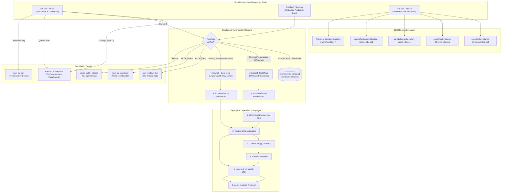
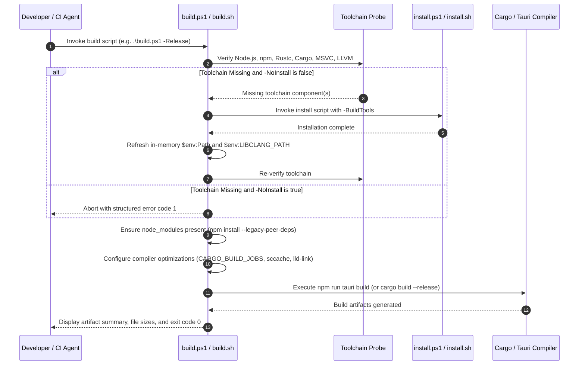
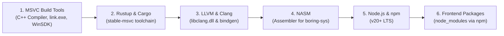

# Architecture Specification: Root Runners Suite & Toolchain Self-Healing Architecture

> **/goal** Architect and establish the unified root runner suite (`run.ps1` / `run.sh`, `build.ps1` / `build.sh`, `e2e.ps1` / `e2e.sh`), topological prerequisite self-healing via `install.ps1` / `install.sh`, default drive normalization (C: drive default for LLVM/tools), and persistent SQLite toolchain verification tracking.  
> **/learn** Standardize single-responsibility root scripts, non-interactive self-healing ladders, in-session environment variable propagation, caller IDE self-preservation, and structured ANSI telemetry across Windows, Linux, and macOS.

**Module:** `224-repository-setup-and-installation-instructions`  
**Parent Task:** `224`  
**Version:** `1.0.0`  
**Status:** `Approved / Active`  
**Author:** `@aukgit`  
**AI Confidence:** `Production-Ready`  
**Ambiguity:** `None`  

---

## 1. Executive Summary

This architecture specification standardizes the developer and automation interface at the root of the repository. Previously, root operations relied on overloaded commands inside `run.ps1` and `run.sh` which coupled development servers, production packaging, CLI routing, and partial toolchain detection into single scripts without dedicated build or end-to-end testing entrypoints. Furthermore, LLVM installation in Windows defaulted to the `D:` drive if present, violating system drive conventions, and lacked automated fallback to full toolchain provisioning.

To resolve these discrepancies, this specification defines the architectural contracts for:
1. **The Root Runner Suite**: Three dedicated pairs of cross-platform runners:
   - `run.ps1` / `run.sh`: Development runner, hot-reload server, CLI command router (`agm ...`), and fast binary launcher.
   - `build.ps1` / `build.sh`: Dedicated production compilation runner (`npm run tauri build` / `cargo build --release`), enforcing topological prerequisite detection and non-interactive self-healing.
   - `e2e.ps1` / `e2e.sh`: Dedicated end-to-end test execution harness running local test suites with structured ANSI progress reporting, caller IDE self-preservation, and transient sandbox lifecycle management.
2. **Topological Toolchain Self-Healing**:
   - Automated detection of missing compilation tools.
   - Seamless invocation of `install.ps1 -BuildTools` (Windows) or `install.sh --build-tools` (Linux/macOS) in topological dependency order:
     `MSVC -> Rust/Cargo -> LLVM/Clang -> NASM -> Node.js/npm -> Frontend Packages`.
   - In-process session environment refreshing without requiring the developer or agent to restart the active shell.
3. **Default Drive Normalization**:
   - Correction of hardcoded `D:\` drive defaults in `scripts/install-rust-toolchain.ps1` and `install.ps1`.
   - Defaulting tool installations (specifically LLVM) to the system drive (`C:\Program Files\LLVM` or `%LOCALAPPDATA%\Programs\LLVM`), while allowing explicit drive override via parameterization.
4. **Toolchain Verification & SQLite Tracking**:
   - Persistent tracking of verified compiler versions and binary locations in `.ai-memory/toolchain.db` to eliminate redundant multi-second installer re-runs.

---

## 2. Root Runner Suite Architecture

### 2.1 Component Architecture Diagram

The following Mermaid diagram illustrates the relationship between the root runner scripts, toolchain installers, and the underlying build artifacts:



---

## 3. Dedicated Runner Contracts

### 3.1 `build.ps1` & `build.sh` (Dedicated Build Runner)

The `build.ps1` and `build.sh` scripts are responsible exclusively for producing compiled production binaries and installers. They must never start development watch-servers or launch GUI applications.

#### 3.1.1 Parameter Catalog

| Parameter (PowerShell) | Flag (POSIX Bash) | Type | Default | Description |
| :--- | :--- | :--- | :--- | :--- |
| `-Release` | `--release`, `-r` | Switch | `true` | Compile production-optimized release binaries and installers. |
| `-Debug` | `--debug`, `-d` | Switch | `false` | Compile unoptimized debug binary with debug symbols. |
| `-CliOnly` | `--cli-only` | Switch | `false` | Compile only the standalone CLI binary (`agm`) via Cargo. |
| `-FrontendOnly` | `--frontend-only` | Switch | `false` | Run frontend build (`npm run build`) without invoking Rust. |
| `-NoInstall` | `--no-install` | Switch | `false` | Fail immediately if toolchains are missing instead of auto-installing. |
| `-Drive` | `--drive <D>` | String | `"C:"` (Win) | Target drive for toolchain installation if self-healing is triggered. |
| `-Clean` | `--clean` | Switch | `false` | Perform `cargo clean` and remove `dist/` before compiling. |
| `-VerboseMode` | `--verbose`, `-v` | Switch | `false` | Output full compiler warnings, cargo verbose flags, and timing. |
| `-DryRun` | `--dry-run` | Switch | `false` | Validate prerequisites and print commands without compiling. |

#### 3.1.2 Execution Lifecycle



---

### 3.2 `e2e.ps1` & `e2e.sh` (Dedicated End-to-End Test Runner)

The `e2e.ps1` and `e2e.sh` scripts are responsible for orchestrating end-to-end integration and smoke test suites across local environments, providing clean ANSI status tables and preventing lingering background processes.

#### 3.2.1 Parameter Catalog

| Parameter (PowerShell) | Flag (POSIX Bash) | Type | Default | Description |
| :--- | :--- | :--- | :--- | :--- |
| `-Suite` | `--suite <s>`, `-s` | String | `"all"` | Test suite selector: `all`, `instance`, `lifecycle`, `switcher`, `prompts`, `smoke`. |
| `-Filter` | `--filter <f>`, `-f` | String | `""` | Substring match to filter specific test case names. |
| `-TargetBinary` | `--target <p>` | String | `""` | Path to precompiled `agm` or `agm-alim` binary; compiles debug if omitted. |
| `-SkipCleanup` | `--skip-cleanup` | Switch | `false` | Retain temporary test sandbox directories and SQLite databases for post-mortem analysis. |
| `-VerboseMode` | `--verbose`, `-v` | Switch | `false` | Stream unbuffered test stdout/stderr rather than capturing summaries. |
| `-Bail` | `--bail` | Switch | `false` | Abort test execution immediately upon the first test case failure. |

#### 3.2.2 Core Invariants for E2E Execution

1. **Caller IDE Self-Preservation**:
   - The test harness MUST invoke `detect_caller_instance_id()` before executing any lifecycle commands (`stop`, `switch`, `clean`).
   - If a test attempts to target or terminate the caller's running development instance, the test runner must skip the operation or mock the target, preventing IDE crashes for the active developer.
2. **Transient Test Sandboxing**:
   - All tests creating instances or database records MUST use unique transient directories:
     `.temp/test-sandbox-<timestamp>-<random-id>/`
   - A `try { ... } finally { ... }` (PowerShell) or `trap cleanup EXIT` (Bash) handler guarantees 100% removal of sandbox processes and filesystem artifacts.
3. **Structured ANSI Reporting**:
   - Output must clearly separate test cases using formatted headers, execution timing, and a final summary dashboard showing Total, Passed, Failed, and Skipped counts.

---

### 3.3 `run.ps1` & `run.sh` Alignment & Evolution

The primary role of `run.ps1` and `run.sh` is developer velocity. To eliminate redundancy and prevent drift:
1. **Delegation of Production Builds**:
   - When `run.ps1 -Build` or `run.sh --build` is invoked, it MUST delegate directly to `build.ps1` / `build.sh` passing all relevant arguments.
2. **CLI Subcommand Router Preservation**:
   - Retains fast dispatch for CLI commands (`agm`, `instances`, `switch`, `prompt`, `backup`, `restore`, etc.) to run directly via `cargo run --bin agm --manifest-path src-tauri/Cargo.toml -- <args>` without launching the UI.
3. **Unified Toolchain Verification**:
   - Utilizes the same lightweight detection logic as `build.ps1` to trigger toolchain self-healing before attempting `npm run tauri dev`.

---

## 4. Topological Dependency Order & Self-Healing Contract

### 4.1 Dependency Hierarchy

Compiling Antigravity-Manager requires both low-level native compilers and modern web runtimes. On Windows, native compilation has strict prerequisites that must be satisfied in exact topological order:



If an earlier dependency is missing, subsequent dependencies will either fail to install or produce broken build environments:
- **Rust requires MSVC**: On Windows `x86_64-pc-windows-msvc`, Rust depends on the MSVC linker (`link.exe`) and Windows SDK libraries (`kernel32.lib`).
- **bindgen requires LLVM**: Low-level crates (such as OpenSSL or boring-sys bindings) require `libclang.dll` and the `LIBCLANG_PATH` environment variable.
- **Crypto assemblies require NASM**: High-performance cryptographic primitives compiled via `boring-sys` require `nasm.exe` in `PATH`.
- **Frontend requires Node.js/npm**: Tauri loads web assets built via Vite/React.

### 4.2 In-Session Environment Propagation Contract

When `build.ps1` or `run.ps1` triggers `install.ps1 -BuildTools`, the installer updates the Windows User Registry (`HKCU\Environment`). However, child processes spawned by a running PowerShell session inherit the parent process's static environment.

To avoid requiring a shell restart:
1. `install.ps1` exports updated environment entries to stdout or returns a structured manifest.
2. The caller runner (`build.ps1` / `run.ps1`) dynamically refreshes in-memory environment variables:
   ```powershell
   # Synchronize Path from User and Machine registries
   $userPath = [Environment]::GetEnvironmentVariable("Path", "User")
   $machinePath = [Environment]::GetEnvironmentVariable("Path", "Machine")
   $env:Path = "$userPath;$machinePath"

   # Ensure Cargo bin is in Path
   $cargoBin = Join-Path $env:USERPROFILE ".cargo\bin"
   if ((Test-Path $cargoBin) -and ($env:Path -notlike "*$cargoBin*")) {
       $env:Path = "$cargoBin;$env:Path"
   }

   # Synchronize LIBCLANG_PATH
   $libClangUser = [Environment]::GetEnvironmentVariable("LIBCLANG_PATH", "User")
   if ($libClangUser) {
       $env:LIBCLANG_PATH = $libClangUser
   }
   ```
3. On Unix, `build.sh` and `run.sh` re-source `~/.cargo/env` and `~/.bashrc` / `~/.profile`.

---

## 5. Default Drive & Path Normalization

### 5.1 LLVM Extraction Root Cause & Fix

In legacy revisions of `scripts/install-rust-toolchain.ps1` (line 440):
```powershell
# PROBLEMATIC LEGACY CODE:
$targetUnpack = if (Test-Path "D:\") { "D:\LLVM" } else { "$env:ProgramFiles\LLVM" }
```
This logic unconditionally extracted LLVM to `D:\LLVM` whenever a `D:` drive was detected, regardless of whether `D:` was a secondary data drive, removable storage, or optical media.

#### 5.1.1 Corrected Extraction Contract
The installation root must default to the system drive (`C:`) unless the user explicitly passes `-Drive <Letter>`:

```powershell
# CORRECTED NORMALIZED CONTRACT:
param(
    [string]$TargetDrive = ""
)

$systemDrive = if ($env:SystemDrive) { $env:SystemDrive } else { "C:" }
$resolvedDrive = if ($TargetDrive) { $TargetDrive.TrimEnd('\') } else { $systemDrive }

$targetUnpack = if ($resolvedDrive -eq $systemDrive) {
    Join-Path $env:ProgramFiles "LLVM"
} else {
    Join-Path "$resolvedDrive\" "LLVM"
}
```

If administrative privileges are unavailable for writing to `$env:ProgramFiles\LLVM`, the fallback target is:
`$env:LOCALAPPDATA\Programs\LLVM`

---

## 6. SQLite Toolchain Verification Tracking (`toolchain.db`)

To ensure millisecond startup times for `build.ps1` and `run.ps1`, toolchain verification results must be cached in SQLite.

### 6.1 Database Location & Schema

- **Database File**: `.ai-memory/toolchain.db`
- **Table Definition**:
  ```sql
  CREATE TABLE IF NOT EXISTS toolchain_cache (
      component_id TEXT PRIMARY KEY,
      binary_name TEXT NOT NULL,
      detected_path TEXT NOT NULL,
      version_output TEXT NOT NULL,
      is_valid INTEGER NOT NULL DEFAULT 1,
      last_verified_at TEXT NOT NULL
  );

  CREATE TABLE IF NOT EXISTS toolchain_runs (
      id INTEGER PRIMARY KEY AUTOINCREMENT,
      runner_name TEXT NOT NULL,
      action TEXT NOT NULL,
      status TEXT NOT NULL,
      details TEXT,
      created_at TEXT NOT NULL
  );
  ```

### 6.2 Cache Validation Rule

A cached entry is considered valid if:
1. `last_verified_at` is less than 24 hours old.
2. The file at `detected_path` exists on disk.
3. If valid, `build.ps1` skips full binary execution probes, reducing pre-build overhead from ~1.5s to <50ms.

---

## 7. Cross-Platform Parity Matrix

| Feature | Windows (`build.ps1`, `e2e.ps1`, `run.ps1`) | Linux / macOS (`build.sh`, `e2e.sh`, `run.sh`) |
| :--- | :--- | :--- |
| **Shell Syntax** | PowerShell 5.1+ / PowerShell Core 7+ | POSIX Bash (`#!/usr/bin/env bash`) |
| **Toolchain Installer** | `.\install.ps1 -BuildTools` | `./install.sh --build-tools` |
| **Native Compiler** | MSVC (`cl.exe`, `link.exe`) + Windows SDK | GCC / Clang + `build-essential` |
| **Assembler** | NASM (`nasm.exe`) via Choco/Direct | System assembler (`as` / `nasm`) |
| **Environment Sync** | In-process registry reload (`HKCU\Environment`) | Source `~/.cargo/env` |
| **Process Killer** | `taskkill.exe /F /PID` with breakaway check | `kill -15` with fallback `kill -9` |
| **ANSI Color Engine** | PowerShell `Write-Host -ForegroundColor` + ANSI | Raw terminal escape sequences (`\033[...]`) |

---

## 8. Verification & Architectural Non-Negotiables

1. **Strictly Relative Git Paths Invariant**:
   All paths in specifications, logs, and runner outputs must use repository-relative forward-slash paths (`02-spec/...`, `.ai-memory/...`, `scripts/...`). Absolute filesystem paths (`C:\...`, `D:\...`) are strictly prohibited.
2. **Zero Builds / Zero Tests Rule**:
   During the specification authoring phase, no compilation commands (`cargo build`, `tauri build`, `npm run build`) or unit/e2e test commands may be executed.
3. **No Silent Errors Invariant**:
   All runner scripts must handle errors explicitly. Failed commands must log clear diagnostic messages with exit code propagation. Silent failures via bare catch blocks or ignored exit codes are prohibited.
4. **Idempotence & Offline Reproducibility**:
   Invoking `build.ps1` or `build.sh` repeatedly on a properly provisioned machine must execute without network calls, utilizing cached tools and package stores.
