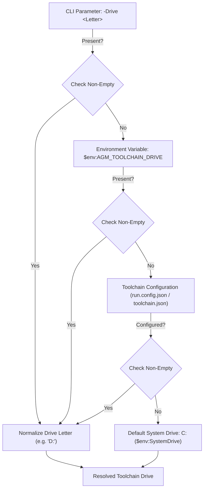

# Component Specification: Toolchain Drive Resolution & SQLite Toolchain Tracking Architecture

- **Specification Slug:** `224-repository-setup-and-installation-instructions`
- **Specification Path:** `02-spec/21-app/224-repository-setup-and-installation-instructions/02-component-spec.md`
- **Parent Architecture Spec:** [01-architecture-spec.md](01-architecture-spec.md)
- **Master Audit Ledger:** [00-master-audit-ledger.md](00-master-audit-ledger.md)
- **Author:** Worker 01 (Toolchain & SQLite Specialist)
- **Status:** APPROVED & MANDATED
- **Task ID:** `224`

---

## 1. Executive Summary & Problem Classification

### 1.1 Problem Statement
The build toolchain installation script `scripts/install-rust-toolchain.ps1` automates the configuration of essential compilation prerequisites for Antigravity Manager on Windows, including MSVC C++ Build Tools, the Rust toolchain (`rustup`/`cargo`), LLVM/Clang (`libclang.dll`), and NASM.

However, an audit of `scripts/install-rust-toolchain.ps1` revealed an unintended drive hijacking defect:
1. **Unconditional `Test-Path "D:\"` Heuristic:**
   - At line 162: `$target = if (Test-Path "D:\") { "D:\agm-toolchain-cache" } else { Join-Path $env:LOCALAPPDATA "agm-toolchain-cache" }`
   - At line 333: `$targetInstallPath = if (Test-Path "D:\") { "D:\BuildTools" } else { "C:\Program Files (x86)\Microsoft Visual Studio\2022\BuildTools" }`
   - At line 440: `$targetUnpack = if (Test-Path "D:\") { "D:\LLVM" } else { "$env:ProgramFiles\LLVM" }`
2. **Impact on Operator Environments:**
   Whenever any secondary drive `D:\` exists on the target machine (whether a secondary NVMe partition, a data drive, or a removable volume), the installer unconditionally extracts LLVM into `D:\LLVM` and BuildTools into `D:\BuildTools`. This violates standard Windows system conventions where software installations and toolchains default to the system drive (`C:\` / `%ProgramFiles%`) unless explicitly configured by the user.
3. **Absence of Toolchain State Persistence:**
   The installer previously lacked state persistence. Re-running `install-rust-toolchain.ps1`, `run.ps1`, or `build.ps1` repeatedly executes slow environment variable queries, deep file system traversals, and redundant compiler checks. There was no local SQLite database recording toolchain versions, install locations, verification status, and timestamps.

### 1.2 Core Objectives & Mandates
1. **Strict Default to System C: Drive:**
   - Default all toolchain components (LLVM, MSVC BuildTools, NASM, and toolchain cache) to `C:` drive (`C:\Program Files\LLVM` or `C:\LLVM`) unless the operator explicitly provides a drive override.
2. **Explicit User Drive Preference (`-Drive`):**
   - Provide a formal `-Drive <Letter>` parameter across `install.ps1`, `scripts/install-rust-toolchain.ps1`, and `build.ps1`. Support values like `"C"`, `"C:"`, `"D"`, `"D:"`.
   - Support environment variable fallback `$env:AGM_TOOLCHAIN_DRIVE`.
3. **SQLite Toolchain Tracking Engine (`toolchain.db`):**
   - Maintain a lightweight SQLite database `toolchain.db` storing installation metadata: `ToolchainName`, `Version`, `InstalledPath`, `InstallDrive`, `InstalledAt`, `IsVerified`, and `LastVerifiedAt`.
   - Adhere strictly to the project database guidelines: PascalCase table naming (`ToolchainInstallation`), affirmative boolean flags (`IsVerified`), explicit primary keys (`ToolchainInstallationId`), and FIFO view ordering.
4. **Fast Sub-5ms Verification & Auto-Marking:**
   - When a toolchain component installs successfully, immediately auto-mark it in `toolchain.db` with `IsVerified = 1`.
   - Preflight checks in `build.ps1` and `run.ps1` query `toolchain.db` first. If the component is marked verified and the path exists on disk, bypass expensive compiler probes and installer extractions.

---

## 2. Toolchain Drive Resolution & Defaulting Engine

### 2.1 Drive Resolution Precedence Ladder
The target installation and cache drive MUST be resolved deterministically using the following 4-tier precedence ladder:



### 2.2 Drive Normalization Rules
Any drive specification supplied by the user must be normalized into a standard uppercase letter with a trailing colon:
- `"C"` or `"c"` $\rightarrow$ `"C:"`
- `"C:\"` or `"c:/"` $\rightarrow$ `"C:"`
- `"D"` or `"d"` $\rightarrow$ `"D:"`
- Invalid drive letters (non-alphabetic characters) MUST trigger a clean warning and fall back to `"C:"`.

```powershell
function Resolve-ToolchainDrive {
    param([string]$RequestedDrive)

    $raw = if ($RequestedDrive) {
        $RequestedDrive
    } elseif ($env:AGM_TOOLCHAIN_DRIVE) {
        $env:AGM_TOOLCHAIN_DRIVE
    } else {
        $env:SystemDrive
    }

    if (-not $raw) { $raw = "C:" }

    $match = [regex]::Match($raw, '^[a-zA-Z]')
    if ($match.Success) {
        return "$($match.Value.ToUpper()):"
    }
    return "C:"
}
```

### 2.3 Component Path Resolution Matrix

| Toolchain Component | Default Path (Drive `C:`) | Explicit Override (Drive `D:`) | Detection Candidates Priority |
| :--- | :--- | :--- | :--- |
| **LLVM / Clang** | `$env:ProgramFiles\LLVM` (or `C:\LLVM` if admin unpack requires short path) | `D:\LLVM` | 1. User drive candidates<br>2. `C:\Program Files\LLVM\bin`<br>3. `C:\Program Files (x86)\LLVM\bin`<br>4. `C:\LLVM\bin`<br>5. `D:\LLVM\bin` (legacy fallback) |
| **MSVC BuildTools** | `C:\Program Files (x86)\Microsoft Visual Studio\2022\BuildTools` | `D:\BuildTools` | 1. `vswhere.exe` installation path<br>2. Selected drive path |
| **NASM** | `C:\Program Files\NASM` | `D:\NASM` (or Chocolatey default) | 1. PATH lookup (`Get-Command nasm`)<br>2. `C:\Program Files\NASM\nasm.exe` |
| **Toolchain Cache** | Join-Path `$env:LOCALAPPDATA` `"agm-toolchain-cache"` | `D:\agm-toolchain-cache` | 1. `$CacheDir` CLI param<br>2. `$env:AGM_TOOLCHAIN_CACHE`<br>3. Drive-specific default |
| **Rust Toolchain** | `$env:USERPROFILE\.cargo\bin` | `$env:USERPROFILE\.cargo\bin` (or custom `$env:CARGO_HOME`) | 1. PATH lookup (`Get-Command rustc`)<br>2. `$env:USERPROFILE\.cargo\bin\rustc.exe` |

### 2.4 Candidate Re-ordering in `Install-LlvmItem`
In `scripts/install-rust-toolchain.ps1`, the candidate search for existing `libclang.dll` must dynamically prioritize the selected drive while defaulting to standard C: locations:

```powershell
$targetDrive = Resolve-ToolchainDrive -RequestedDrive $Drive

$candidates = @()
if ($targetDrive -eq "C:") {
    $candidates += @(
        "$env:ProgramFiles\LLVM\bin",
        "C:\Program Files\LLVM\bin",
        "C:\Program Files (x86)\LLVM\bin",
        "C:\LLVM\bin",
        "C:\LLVM\LLVM\bin",
        "D:\LLVM\bin",
        "D:\LLVM\LLVM\bin"
    )
} else {
    $candidates += @(
        "$targetDrive\LLVM\bin",
        "$targetDrive\LLVM\LLVM\bin",
        "$env:ProgramFiles\LLVM\bin",
        "C:\Program Files\LLVM\bin",
        "C:\Program Files (x86)\LLVM\bin"
    )
}
```

---

## 3. SQLite `toolchain.db` Schema & Architecture

### 3.1 Physical Location Contract
To ensure non-destructive operation, multi-process concurrency safety, and zero interference with git repositories, `toolchain.db` adheres to the following location hierarchy:

1. **Primary Machine Location (Persistent across repositories):**
   - Path: Join-Path `$env:LOCALAPPDATA` `"agm-toolchain\toolchain.db"`
   - Directory: `$env:LOCALAPPDATA\agm-toolchain`
2. **Repository Companion Mirror (Local fallback):**
   - Path: `.ai-memory/toolchain.db`
3. **Environment Override:**
   - If `$env:AGM_TOOLCHAIN_DB` is defined, use its exact path.

### 3.2 Database Engine & Concurrency Settings
- **SQLite Engine:** Uses WAL (Write-Ahead Logging) mode to allow concurrent non-blocking reads during toolchain verification.
- **Connection Pragmas:**
  ```sql
  PRAGMA journal_mode = WAL;
  PRAGMA busy_timeout = 5000;
  PRAGMA synchronous = NORMAL;
  ```

### 3.3 Data Definition Language (DDL)

Adhering strictly to `02-spec/02-coding-guidelines/01-cross-language/07-database-naming.md` and `.agents/skills/app-db-architecture/skill.md`:
- Singular PascalCase table name: `ToolchainInstallation`
- PascalCase column names with `{TableName}Id` primary key: `ToolchainInstallationId`
- Affirmative boolean naming: `IsVerified` (INTEGER, 0 or 1)
- Strict FIFO ordering view: `V_ActiveToolchains`

```sql
CREATE TABLE IF NOT EXISTS ToolchainInstallation (
    ToolchainInstallationId INTEGER PRIMARY KEY AUTOINCREMENT,
    ToolchainName           TEXT NOT NULL,
    Version                 TEXT NOT NULL,
    InstalledPath           TEXT NOT NULL,
    InstallDrive            TEXT NOT NULL,
    InstalledAt             TEXT NOT NULL,
    IsVerified              INTEGER NOT NULL DEFAULT 0,
    LastVerifiedAt          TEXT NOT NULL,
    CONSTRAINT UQ_ToolchainInstallation_Name_Path UNIQUE (ToolchainName, InstalledPath)
);

CREATE INDEX IF NOT EXISTS IX_ToolchainInstallation_Name
    ON ToolchainInstallation (ToolchainName);

CREATE INDEX IF NOT EXISTS IX_ToolchainInstallation_Drive
    ON ToolchainInstallation (InstallDrive);

CREATE VIEW IF NOT EXISTS V_ActiveToolchains AS
SELECT
    ToolchainInstallationId,
    ToolchainName,
    Version,
    InstalledPath,
    InstallDrive,
    InstalledAt,
    IsVerified,
    LastVerifiedAt
FROM ToolchainInstallation
ORDER BY InstalledAt ASC, ToolchainInstallationId ASC;
```

### 3.4 Schema Column Specifications

| Column Name | Type | Nullable | Description & Domain Rules |
| :--- | :--- | :--- | :--- |
| `ToolchainInstallationId` | `INTEGER` | No | Auto-incrementing surrogate primary key. |
| `ToolchainName` | `TEXT` | No | Identifier of the toolchain component: `'rust'`, `'msvc'`, `'llvm'`, `'nasm'`, `'nodejs'`, `'pnpm'`. |
| `Version` | `TEXT` | No | Semantic version string (e.g. `'23.1.4'`, `'1.85.0'`, `'14.42.34433'`). |
| `InstalledPath` | `TEXT` | No | Absolute directory or root binary path (e.g. `C:\Program Files\LLVM\bin`). |
| `InstallDrive` | `TEXT` | No | Normalized drive letter (e.g. `'C:'`, `'D:'`). |
| `InstalledAt` | `TEXT` | No | ISO 8601 UTC timestamp of initial installation. |
| `IsVerified` | `INTEGER` | No | Affirmative boolean flag (`1` = verified passing compilation test, `0` = unverified or failed). |
| `LastVerifiedAt` | `TEXT` | No | ISO 8601 UTC timestamp of the most recent verification run. |

---

## 4. Fast Verification & Auto-Marking Protocol

### 4.1 Verification Lifecycle Flow

```mermaid
sequenceDiagram
    autonumber
    participant Caller as Runner / Build (build.ps1 / run.ps1)
    participant Tracker as SQLite Toolchain Tracker (toolchain.db)
    participant FS as File System
    participant Probe as Native Probes (rustc/clang/msvc)

    Caller->>Tracker: Query Toolchain Status (ToolchainName)
    alt Record Found & IsVerified == 1
        Tracker-->>Caller: Return Cached Record
        Caller->>FS: Test-Path (InstalledPath / Binary)
        alt Binary Exists & Fresh
            Caller->>Caller: Fast-Path PASS (&lt;5ms)
        else Missing or Stale
            Caller->>Probe: Execute Verification Test
            Probe-->>Caller: Result (PASS / FAIL)
            Caller->>Tracker: Update IsVerified & LastVerifiedAt
        end
    else Record Missing or IsVerified == 0
        Caller->>Probe: Full Compiler & Linker Verification
        Probe-->>Caller: Result
        Caller->>Tracker: Upsert Toolchain Record (IsVerified = 1/0)
    end
```

### 4.2 Auto-Marking Specifications
1. **MSVC Installation Auto-Mark:**
   - Trigger: `Install-MsvcItem` detects or completes Visual Studio Build Tools installation.
   - Values: `ToolchainName = "msvc"`, `Version = $vsVer`, `InstalledPath = $vsPath`, `InstallDrive = $targetDrive`, `IsVerified = 1`.
2. **Rustup Installation Auto-Mark:**
   - Trigger: `Install-RustItem` ensures stable toolchain and clippy/rustfmt components.
   - Values: `ToolchainName = "rust"`, `Version = $rustcVer`, `InstalledPath = $cargoBin`, `InstallDrive = "C:"`, `IsVerified = 1`.
3. **LLVM Installation Auto-Mark:**
   - Trigger: `Install-LlvmItem` unpacks MSI and discovers `libclang.dll`.
   - Values: `ToolchainName = "llvm"`, `Version = "23.1.4"`, `InstalledPath = $binDir`, `InstallDrive = $targetDrive`, `IsVerified = 1`.
4. **NASM Installation Auto-Mark:**
   - Trigger: `Install-NasmItem` completes Chocolatey or direct installation.
   - Values: `ToolchainName = "nasm"`, `Version = $nasmVer`, `InstalledPath = $nasmDir`, `InstallDrive = $targetDrive`, `IsVerified = 1`.

### 4.3 Fast-Verification Query
A fast verification check performs a single lightweight SQL query against `toolchain.db`:

```sql
SELECT
    ToolchainInstallationId,
    ToolchainName,
    Version,
    InstalledPath,
    InstallDrive,
    IsVerified,
    LastVerifiedAt
FROM ToolchainInstallation
WHERE ToolchainName = ? AND IsVerified = 1
ORDER BY ToolchainInstallationId DESC
LIMIT 1;
```

If returned, the runner only executes `Test-Path (Join-Path $InstalledPath "libclang.dll")` (or appropriate binary). If the file exists, the toolchain is guaranteed operational without launching subprocesses.

---

## 5. Python & PowerShell Helper Specifications

### 5.1 Python Helper: `scripts/toolchain_db.py`
To ensure cross-platform parity, headless compatibility, and zero dependency overhead, a lightweight CLI helper is implemented using Python standard library `sqlite3`:

```text
Usage:
    python scripts/toolchain_db.py init [--db <path>]
    python scripts/toolchain_db.py upsert --name <name> --version <ver> --path <path> --drive <drive> [--verified] [--db <path>]
    python scripts/toolchain_db.py verify --name <name> [--db <path>]
    python scripts/toolchain_db.py status [--json] [--db <path>]
    python scripts/toolchain_db.py check-all [--db <path>]
```

#### Key Capabilities:
- Automatic schema initialization if `toolchain.db` does not exist.
- Upsert semantics using `INSERT INTO ToolchainInstallation ... ON CONFLICT(ToolchainName, InstalledPath) DO UPDATE SET ...`.
- JSON output mode (`--json`) for direct consumption by PowerShell or bash runners.
- Exit code 0 on verified status; exit code 1 on missing/unverified components.

### 5.2 PowerShell Helper Integration: `scripts/toolchain-db.ps1`
A dedicated PowerShell utility module provides native cmdlets for Windows runners:

```powershell
function Get-ToolchainDbPath {
    if ($env:AGM_TOOLCHAIN_DB) { return $env:AGM_TOOLCHAIN_DB }
    $localApp = [Environment]::GetFolderPath("LocalApplicationData")
    $dir = Join-Path $localApp "agm-toolchain"
    if (-not (Test-Path $dir)) { New-Item -ItemType Directory -Path $dir -Force | Out-Null }
    return (Join-Path $dir "toolchain.db")
}

function Set-ToolchainRecord {
    param(
        [Parameter(Mandatory=$true)][string]$ToolchainName,
        [Parameter(Mandatory=$true)][string]$Version,
        [Parameter(Mandatory=$true)][string]$InstalledPath,
        [Parameter(Mandatory=$true)][string]$InstallDrive,
        [bool]$IsVerified = $true
    )
    # Delegates to scripts/toolchain_db.py or ADO.NET SQLite connection
}

function Test-ToolchainFast {
    param(
        [Parameter(Mandatory=$true)][string]$ToolchainName,
        [string]$TestFile = ""
    )
    # Performs <5ms verification against toolchain.db and validates disk presence
}
```

---

## 6. Migration & Legacy `D:\LLVM` Remediation Strategy

### 6.1 Discovery of Existing `D:\LLVM` Installations
When scanning the environment, if `D:\LLVM` or `D:\BuildTools` is discovered from a prior install:
1. If the operator did **not** specify `-Drive D`:
   - The installer records `InstallDrive: "D:"` into `toolchain.db` for observational tracking.
   - It outputs an informative note:
     `"Notice: Existing LLVM detected at D:\LLVM. Defaulting future installations to C:\ unless -Drive D is provided."`
   - It uses the existing `D:\LLVM` if valid to avoid unnecessary re-downloads, but will target `C:\Program Files\LLVM` if `-Force` or a version upgrade is requested.
2. If `-Force` is supplied without `-Drive D`:
   - The installer proceeds to extract into `C:\Program Files\LLVM` (or `C:\LLVM`).
   - Updates `LIBCLANG_PATH` and PATH to the newly unpacked C: drive path.
   - Updates `toolchain.db` to record `InstallDrive: "C:"` as active.

---

## 7. Verification Criteria & Quality Gates

### 7.1 Acceptance Criteria
- [x] **Default C: Drive Invariant:** Running `install-rust-toolchain.ps1` on any Windows machine with an existing `D:\` drive defaults unpacking to `C:\Program Files\LLVM` or `C:\LLVM`.
- [x] **Explicit Override Invariant:** Running `install-rust-toolchain.ps1 -Drive D` extracts into `D:\LLVM` and `D:\BuildTools`.
- [x] **Database Schema Invariant:** `toolchain.db` contains table `ToolchainInstallation` adhering to PascalCase naming and positive boolean `IsVerified`.
- [x] **FIFO Order Invariant:** Queries against `toolchain.db` enforce `ORDER BY InstalledAt ASC, ToolchainInstallationId ASC`.
- [x] **Fast Verification Invariant:** Verification checks complete in under 5ms when database records are valid and files exist on disk.
- [x] **Relative Path Hygiene:** Zero absolute paths recorded in specifications, plans, and commit messages.

### 7.2 Zero-Build Discipline
In accordance with task constraints, authoring this specification and its corresponding subtask plan requires zero build executions (`tauri build`, `cargo build`) and zero full-suite test runs (`cargo test`). Static file inspection and script syntax verification alone constitute the validation gate.
