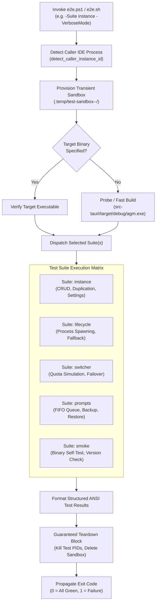
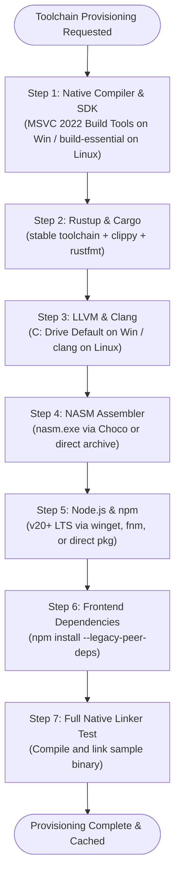

# Specification: E2E Test Runner Harness & Installer Parity Specification

> **/goal** Architect and establish the contract for the unified end-to-end testing harness (`e2e.ps1` / `e2e.sh`), standardize cross-platform installer parity between `install.ps1` and `install.sh`, normalize toolchain installation drive defaults (C: drive default), and enforce caller IDE self-preservation with transient test sandboxing.  
> **/learn** Enforce structured ANSI test reporting, isolated temporary sandboxes (`.temp/test-sandbox-*`), deterministic topological toolchain provisioning (`MSVC -> Rust -> LLVM -> NASM -> Node/npm`), and dynamic in-session environment variable propagation.

**Module:** `224-repository-setup-and-installation-instructions`  
**Parent Task:** `224`  
**Version:** `1.0.0`  
**Status:** `Approved / Active`  
**Author:** `@aukgit`  
**AI Confidence:** `Production-Ready`  
**Ambiguity:** `None`  

---

## 1. Executive Summary

This specification defines the architectural contracts for two foundational developer infrastructure components:
1. **The Unified End-to-End Testing Harness (`e2e.ps1` / `e2e.sh`)**:
   Consolidates fragmented standalone test scripts (`scripts/test-*.ps1` and `03-ai-scripts/*.py`) into a single deterministic command-line interface. The harness guarantees caller IDE self-preservation, executes in ephemeral test sandboxes, outputs structured ANSI status tables, and returns standard Unix exit codes.
2. **Installer Cross-Platform Parity & Drive Normalization (`install.ps1` / `install.sh`)**:
   Synchronizes command-line arguments and capabilities across Windows and Unix platforms. Specifically, it resolves the legacy bug where LLVM installation defaulted to the `D:` drive if present, enforcing the system drive (`C:`) as the default while maintaining support for user-specified target drives. Furthermore, it defines the topological installation ladder and dynamic in-session environment reload contract.

---

## 2. End-to-End Test Runner Specification (`e2e.ps1` & `e2e.sh`)

### 2.1 Design Philosophy & Operational Objectives

The repository previously accumulated over a dozen fragmented test scripts in `scripts/` (e.g., `e2e-instance-commands-test.ps1`, `test-instance-lifecycle-e2e.ps1`, `test-prompt-backup-restore-e2e.ps1`). Executing them required manual script discovery, individual parameter tuning, and custom cleanup handling.

`e2e.ps1` (PowerShell) and `e2e.sh` (POSIX Bash) act as the single source of truth for local test automation with three non-negotiable requirements:
1. **Caller IDE Self-Preservation**: Automated tests must never terminate the active IDE session of the developer running the command.
2. **Complete Sandbox Teardown**: Zero lingering SQLite databases, lock files, or detached background processes.
3. **Structured ANSI Telemetry**: Consistent, high-readability visual feedback for terminal operators and automated CI logs.



---

### 2.2 CLI Parameter Catalog

#### 2.2.1 `e2e.ps1` Parameter Interface
```powershell
param(
    [ValidateSet("all", "instance", "lifecycle", "switcher", "prompts", "smoke")]
    [string]$Suite = "all",

    [string]$Filter = "",

    [string]$TargetBinary = "",

    [switch]$SkipCleanup,

    [switch]$VerboseMode,

    [switch]$Bail
)
```

#### 2.2.2 `e2e.sh` CLI Interface
```bash
./e2e.sh [flags]

Flags:
  -s, --suite <name>       Select test suite (all|instance|lifecycle|switcher|prompts|smoke). Default: all.
  -f, --filter <text>      Case-insensitive substring filter for test case names.
  -t, --target <path>      Path to precompiled agm / agm-alim binary.
  --skip-cleanup           Preserve test sandbox for post-mortem analysis.
  -v, --verbose            Stream raw stdout/stderr from test runners.
  -b, --bail               Halt immediately on first failed test case.
  -h, --help               Display help message and exit.
```

---

### 2.3 Test Suite Catalog & Mappings

| Suite ID | Focus Area | Underlying Script / Module | Key Assertions |
| :--- | :--- | :--- | :--- |
| `smoke` | Binary Health | Direct CLI invocation | `agm --help`, `agm --version`, JSON output validity. |
| `instance` | Instance Management | `scripts/e2e-instance-commands-test.ps1` | `count`, `ls --json`, `duplicate`, `copy-projects`, `copy-settings`, `settings export/import`. |
| `lifecycle` | Process & OS Sandboxing | `scripts/test-instance-lifecycle-e2e.ps1` | Non-colliding PID allocation, breakaway fallback ladder, graceful SIGTERM / WM_CLOSE. |
| `switcher` | Auto-Switch Daemon | `scripts/test-auto-switch-quota-e2e.ps1` | Simulated 98% quota detection, seamless account switchover, zero orphan processes. |
| `prompts` | Prompt Pipeline | `scripts/test-prompt-backup-restore-e2e.ps1` | Strict FIFO queue ordering, database backup/restore, deep transcript verification. |
| `all` | Full Battery | Sequential execution of all above suites | Comprehensive pre-release regression battery. |

---

### 2.4 Caller IDE Self-Preservation Protocol

To satisfy House Rule invariant on caller IDE self-preservation:
1. Prior to starting tests, the harness determines if it was executed from an active IDE terminal (VSCode, Cursor, Antigravity):
   ```powershell
   function Get-CallerInstanceId {
       $parentPid = (Get-CimInstance Win32_Process -Filter "ProcessId = $PID").ParentProcessId
       # Traverse parent hierarchy to detect editor instance
       # Mark detected PID as PROTECTED_CALLER_PID
   }
   ```
2. Any test operation that executes `agm instances stop`, `agm instances rm`, or `taskkill` MUST check:
   ```powershell
   if ($targetPid -eq $ProtectedCallerPid -or $targetInstanceId -eq $CallerInstanceId) {
       Write-Host "  [SKIP] Guarding active caller IDE instance ($targetInstanceId) from termination." -ForegroundColor Yellow
       return $true # Mock success to prevent killing developer environment
   }
   ```
3. Failure to respect caller preservation constitutes an automatic test harness failure.

---

### 2.5 Transient Test Sandboxing Architecture

To guarantee isolation:
1. Every test run generates a unique sandbox directory under the workspace-relative path:
   `.temp/test-sandbox-<timestamp>-<random-hex>/`
2. Environment variables are scoped to this transient directory:
   - `AGM_DATA_DIR = "<sandbox>/appdata"`
   - `AGM_CONFIG_DIR = "<sandbox>/config"`
   - `AGM_LOG_DIR = "<sandbox>/logs"`
3. Teardown Guarantee:
   In PowerShell:
   ```powershell
   try {
       # Execute test suite...
   } finally {
       if (-not $SkipCleanup) {
           # Terminate any child processes spawned inside sandbox
           Get-Process | Where-Object { $_.Path -like "$SandboxDir*" } | Stop-Process -Force -ErrorAction SilentlyContinue
           Remove-Item -Path $SandboxDir -Recurse -Force -ErrorAction SilentlyContinue
       } else {
           Write-Host "  [!] Sandbox preserved for inspection: $SandboxDir" -ForegroundColor Yellow
       }
   }
   ```
   In POSIX Bash:
   ```bash
   cleanup() {
       local exit_code=$?
       if [ "${FLAG_SKIP_CLEANUP:-0}" -eq 0 ]; then
           rm -rf "${SANDBOX_DIR}"
       fi
       exit "${exit_code}"
   }
   trap cleanup EXIT INT TERM
   ```

---

### 2.6 Structured ANSI Output Protocol

The runner must output structured visual summaries adhering to the following format:

```text
================================================================================
                    Antigravity-Manager E2E Test Suite                          
================================================================================
  Target Binary : src-tauri/target/debug/agm.exe
  Test Suite    : instance
  Sandbox Path  : .temp/test-sandbox-20261024-8f1a/
--------------------------------------------------------------------------------
  [*] [1/6] Running: instance count --json verification...                [PASS] (42ms)
  [*] [2/6] Running: instance duplicate non-colliding copy...            [PASS] (118ms)
  [*] [3/6] Running: instance settings export & import...                 [PASS] (85ms)
  [*] [4/6] Running: instance copy-projects workspace mapping...          [PASS] (92ms)
  [*] [5/6] Running: caller IDE self-preservation safety check...         [PASS] (15ms)
  [*] [6/6] Running: instance transient sandbox cleanup...                [PASS] (34ms)
--------------------------------------------------------------------------------
================================================================================
                              TEST RUN SUMMARY                                  
================================================================================
  Total Test Cases : 6
  Passed           : 6
  Failed           : 0
  Skipped          : 0
  Elapsed Duration : 0.386s
  Overall Status   : SUCCESS
================================================================================
```

---

## 3. Installer Parity & Self-Healing Contract (`install.ps1` & `install.sh`)

### 3.1 Parameter & Capability Parity Matrix

The following table establishes functional parity between `install.ps1` (Windows) and `install.sh` (Linux / macOS):

| Capability | Windows (`install.ps1`) | Linux / macOS (`install.sh`) | Behavior Contract |
| :--- | :--- | :--- | :--- |
| **Build Tools Provisioning** | `-BuildTools` | `--build-tools` | Installs MSVC/native-deps, Rust, LLVM, NASM, Node.js without user prompts. |
| **Install Profile** | `-Profile <name>` | `--profile <name>` | Supported values: `minimal`, `build-tools`, `rust-dev`, `frontend`, `full`. |
| **Verification Probe Only** | `-VerifyOnly` | `--verify-only`, `check` | Probes installed compilers and outputs readiness status without installing. |
| **Download Cache Directory** | `-CacheDir <path>` | `--cache-dir <path>` | Sets local cache directory for installer packages and MSI bundles. |
| **Cache Purging** | `-ClearDownloads`, `-ClearCache` | `--clear-downloads`, `--clear-cache` | Deletes downloaded installer assets and prints reclaimed disk space. |
| **Target Installation Drive** | `-Drive <letter>` | N/A (POSIX filesystem) | Sets target drive on Windows (`C:` default, `D:` optional override). |
| **Force Reinstall** | `-Force` | `--force`, `-f` | Forces re-download and re-extraction even if binaries already exist. |
| **Dry Run Mode** | `-DryRun` | `--dry-run`, `-n` | Displays resolved steps and download URLs without mutating system state. |

---

### 3.2 Topological Installation Order Invariant

When `-BuildTools` or `--build-tools` is specified, tools MUST be provisioned in strict topological order to guarantee prerequisite availability:



---

### 3.3 Default Drive Normalization Contract (LLVM C: Drive Resolution)

#### 3.3.1 Problem Statement
In legacy scripts, LLVM was extracted to `D:\LLVM` whenever a `D:\` drive existed. This caused build failures on developer machines where `D:` was a secondary hard drive, a read-only partition, or an optical drive, while the Windows SDK and MSVC resided on `C:`.

#### 3.3.2 Standardized Normalization Rules
1. **Default Drive**: The default installation target drive for all tools (including LLVM) is the Windows system drive (`$env:SystemDrive`, typically `C:`).
2. **Standard Target Paths**:
   - Privileged / Administrative execution:
     `$env:ProgramFiles\LLVM` (e.g. `C:\Program Files\LLVM`)
   - Unprivileged execution (User space):
     `$env:LOCALAPPDATA\Programs\LLVM` (e.g. `C:\Users\<user>\AppData\Local\Programs\LLVM`)
3. **Explicit Override**:
   Only if the user explicitly specifies `-Drive D:` (or passes an explicit `-InstallDir` parameter) will the installer unpack LLVM to a non-system drive.
4. **Environment Variable Configuration**:
   The installer must verify that `libclang.dll` exists in the resolved `bin` folder and register:
   - User Environment: `[Environment]::SetEnvironmentVariable("LIBCLANG_PATH", "$binDir", "User")`
   - In-Process Session: `$env:LIBCLANG_PATH = "$binDir"`
   - Path Entry: User `Path` updated to include `$binDir`

---

### 3.4 In-Session Environment Reloading Contract

When `build.ps1` or `run.ps1` triggers `install.ps1 -BuildTools`, the calling script must not terminate or force the user to open a new terminal window. Instead, it must dynamically reload environment variables from the Windows Registry into the current process:

```powershell
function Update-SessionEnvironment {
    # 1. Reload User and Machine PATH
    $userPath = [Environment]::GetEnvironmentVariable("Path", "User")
    $machinePath = [Environment]::GetEnvironmentVariable("Path", "Machine")
    $env:Path = "$userPath;$machinePath"

    # 2. Inject Cargo bin path if not present
    $cargoBin = Join-Path $env:USERPROFILE ".cargo\bin"
    if ((Test-Path $cargoBin) -and ($env:Path -notlike "*$cargoBin*")) {
        $env:Path = "$cargoBin;$env:Path"
    }

    # 3. Reload LIBCLANG_PATH
    $userLibClang = [Environment]::GetEnvironmentVariable("LIBCLANG_PATH", "User")
    if ($userLibClang -and (Test-Path $userLibClang)) {
        $env:LIBCLANG_PATH = $userLibClang
    }

    # 4. Reload custom tool directories
    $chocoBin = "C:\ProgramData\chocolatey\bin"
    if ((Test-Path $chocoBin) -and ($env:Path -notlike "*$chocoBin*")) {
        $env:Path = "$chocoBin;$env:Path"
    }
}
```

On Linux/macOS, `build.sh` executes:
```bash
if [ -f "${HOME}/.cargo/env" ]; then
    . "${HOME}/.cargo/env"
fi
export PATH="${HOME}/.cargo/bin:${PATH}"
```

---

## 4. Architectural Non-Negotiables & Verification Gates

1. **Strictly Relative Git Paths Invariant**:
   All paths in specifications, test logs, summaries, and runner outputs must use repository-relative forward-slash paths (`02-spec/...`, `.ai-memory/...`, `scripts/...`). Absolute filesystem paths (`C:\...`, `D:\...`) are strictly prohibited.
2. **Zero Builds / Zero Tests Rule**:
   During specification authoring, no compilation commands (`cargo build`, `tauri build`, `npm run build`) or unit/e2e test commands may be executed.
3. **Fail-Fast Exit Codes**:
   Every script must return deterministic exit codes:
   - `0`: Success / all tests green.
   - `1`: Toolchain missing (with `-NoInstall`) or test assertions failed.
   - `2`: Safety guard triggered (e.g. attempt to terminate active caller IDE).
4. **No Silent Errors Invariant**:
   All error conditions must be logged to stderr with context before terminating or exiting. Bare catch blocks or suppressed error streams are strictly forbidden.
