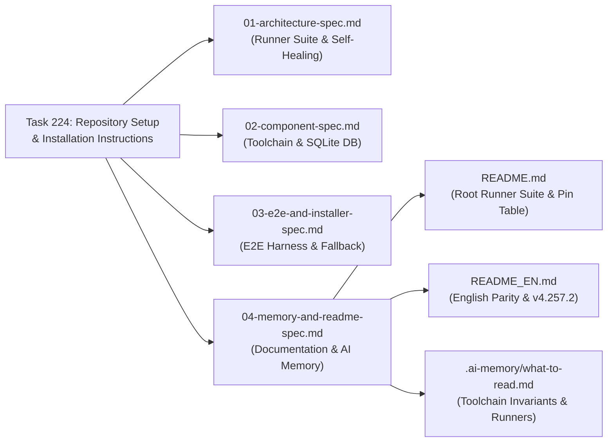

# Documentation & Memory Specification: Readme, AI Memory & Version Synchronization

> **/goal** Architect and define the exact synchronization requirements for `README.md`, `README_EN.md`, and `.ai-memory/what-to-read.md` to document the unified root runner suite (`run.ps1` / `run.sh`, `build.ps1` / `build.sh`, `e2e.ps1` / `e2e.sh`, `install.ps1` / `install.sh`), establish the C: drive default toolchain invariant, and record the SQLite toolchain tracking architecture.  
> **/learn** Maintain bilingual documentation parity, enforce canonical version source-of-truth alignment (`version.json`), eliminate stale historical release references, and codify memory invariants for future AI agents without breaking existing documentation structure.

**Module:** `224-repository-setup-and-installation-instructions`  
**Parent Spec:** [01-architecture-spec.md](01-architecture-spec.md)  
**Parent Task:** `224`  
**Step:** `04`  
**Version:** `1.0.0`  
**Status:** `Approved / Active`  
**Author:** `@aukgit`  
**AI Confidence:** `Production-Ready`  
**Ambiguity:** `None`  

---

## 1. Executive Summary & Purpose

Task 224 standardizes the root-level developer and automation experience for Antigravity-Manager by introducing dedicated single-responsibility runner scripts, topological toolchain self-healing, C: drive default normalization for LLVM/native tools, and SQLite-backed toolchain verification tracking (`.ai-memory/toolchain.db`).

For developers and autonomous AI agents working in this repository, these architectural invariants must be comprehensively and authoritatively documented. This specification defines:
1. **Repository Documentation Audit**: A rigorous comparative audit of `README.md`, `README_EN.md`, and `.ai-memory/what-to-read.md` identifying stale version badges, outdated installation commands, missing developer runner documentation, and gaps in AI memory.
2. **Root Runner Documentation Standard**: Clear, structured documentation for `run.ps1` / `run.sh`, `build.ps1` / `build.sh`, `e2e.ps1` / `e2e.sh`, and `install.ps1` / `install.sh` to be integrated into both Chinese and English READMEs.
3. **Version Pinning & Tag Synchronization**: Alignment of release tags, version badges, and version tables with the latest canonical release (`v4.257.2`).
4. **AI Memory Invariants**: Exact additions to `.ai-memory/what-to-read.md` establishing the root runner suite contracts, C: drive default toolchain unpacking, and SQLite verification cache precedence.

---

## 2. Documentation Audit & Discrepancy Findings

### 2.1 Audit of `README.md` (Primary Root Documentation)

| Section / Element | Current State | Identified Discrepancy / Required Remediation |
| :--- | :--- | :--- |
| **Top Version Badge** | `v4.257.2` | Matches `version.json` (`4.257.2`). Correct. |
| **Install Scripts (Option A)** | Contains `v4.72.0` in Bar 2 example:<br/>`irm https://.../v4.72.0/install.ps1 ... -Version "4.72.0"` | Stale historical release reference from early v4.x. Must be updated to target the active stable release `v4.257.2`. |
| **Version Pinning Table** | Table tops out at `v4.235.0` (2026-10-19). | Missing recent stable releases: `v4.257.2`, `v4.257.1`, `v4.257.0`, `v4.256.4`, `v4.256.2`, `v4.256.0`, `v4.255.0`, `v4.254.0`. Must prepend the latest verified releases to maintain rollback matrix integrity. |
| **Root Runner Suite Section** | Missing as a dedicated top-level or quickstart section. Only has partial historical references to `run.ps1`. | Developers and autonomous agents have no documented entrypoint explaining `build.ps1`, `e2e.ps1`, and their flags (`-Release`, `-CliOnly`, `-Drive`, `-Suite`). Must introduce a dedicated section: `## 🚀 Root Runner Suite & Developer Automation`. |
| **Toolchain C: Drive & SQLite Tracking** | Absent from README documentation. | Does not document that LLVM and MSVC install to the system drive (`C:`) by default, nor how `.ai-memory/toolchain.db` caches verification results. |

### 2.2 Audit of `README_EN.md` (English Documentation)

| Section / Element | Current State | Identified Discrepancy / Required Remediation |
| :--- | :--- | :--- |
| **Top Subtitle & Version Badge** | `(v4.257.1)` and badge `Version-4.257.1-blue` | Stale by one patch version; does not reflect canonical `4.257.2` in `version.json` and `package.json`. |
| **Install Scripts (Option A)** | Contains `v4.72.0` in PowerShell and Bash examples:<br/>`irm .../v4.72.0/install.ps1 ... -Version "4.72.0"` | Outdated pinned version. Must be updated to `4.257.2`. |
| **Root Runner Suite Section** | Missing. | English documentation lacks coverage of the new root runner suite (`build.ps1`, `e2e.ps1`, `run.ps1`, `install.ps1`). |
| **Docker & Pre-release Tags** | Mentions `v4.8.2-beta.0`. | Historical example in tips callout; acceptable as illustrative, but current version context should be clarified. |

### 2.3 Audit of `.ai-memory/what-to-read.md` (AI Agent Onboarding Memory)

| Section / Element | Current State | Identified Discrepancy / Required Remediation |
| :--- | :--- | :--- |
| **Header Timestamp** | `Last updated: 2026-10-17T03:05:00Z` | Outdated by 7 days. Does not reflect changes from 2026-10-18 through 2026-10-24. |
| **Changelog Section** | Latest entry is `2026-10-21T16:50:00Z` (Prompt Send preemption). | Missing Task 224: Root runner suite architecture, C: drive default toolchain unpacking, and SQLite toolchain verification tracking. |
| **Before Any Task (Always)** | Lists general guidelines, plan indexes, and skills. | Missing explicit directive to check `.ai-memory/toolchain.db` and utilize root `build.ps1` / `build.sh` instead of raw ad-hoc compilation scripts. |
| **Toolchain Invariants** | Not codified. | Future agents might attempt to extract LLVM to arbitrary drives (e.g. `D:\LLVM`) or reinstall toolchains without consulting the SQLite cache. |

---

## 3. Specification: Root Runner Suite Documentation

Both `README.md` and `README_EN.md` must include a dedicated section documenting the four core runner scripts. The following specification defines the content, code snippets, and parameter descriptions.

### 3.1 Structure & Layout

The section should be positioned immediately following the installation options and before the GUI/Usage sections:

```markdown
## 🚀 Root Runner Suite & Developer Automation

Antigravity Tools provides dedicated single-responsibility root runners for development, production builds, end-to-end testing, and toolchain provisioning across Windows, Linux, and macOS:

| Script (Windows) | Script (POSIX / Bash) | Primary Responsibility | Auto Self-Healing? |
| :--- | :--- | :--- | :---: |
| **`run.ps1`** | **`run.sh`** | Hot-reload development server (`npm run tauri dev`), Vite frontend server, or CLI passthrough router (`agm ...`). | ✅ Yes |
| **`build.ps1`** | **`build.sh`** | Dedicated production compiler (`npm run tauri build` / `cargo build --release`). Never launches UI. | ✅ Yes (via `install.ps1 -BuildTools`) |
| **`e2e.ps1`** | **`e2e.sh`** | Dedicated end-to-end testing harness with caller IDE self-preservation and sandboxed test isolation. | N/A (Runs on prebuilt binary) |
| **`install.ps1`** | **`install.sh`** | Universal toolchain and application provisioner. Defaults LLVM and compilers to **C: drive**. | ✅ Native Provisioner |
```

### 3.2 Detailed Usage Contracts to Document

#### 3.2.1 `run.ps1` / `run.sh` (Development & CLI Runner)
- **Default (Dev Mode)**: `.\run.ps1` (or `./run.sh`) starts Vite + Tauri hot-reloading development environment.
- **Frontend Only**: `.\run.ps1 -FrontendOnly` starts Vite on port 5173 without launching the Rust desktop window.
- **Debug Logging**: `.\run.ps1 -Debug` launches dev mode with `RUST_LOG=debug`.
- **CLI Subcommand Passthrough**: Any native CLI argument (`.\run.ps1 agm ...`, `.\run.ps1 switch`, `.\run.ps1 prompt`, `.\run.ps1 instances`, `.\run.ps1 dev-tool-clear`) automatically executes `cargo run --bin agm -- ...` without UI overhead.

#### 3.2.2 `build.ps1` / `build.sh` (Dedicated Production Builder)
- **Default Production Build**: `.\build.ps1` compiles the complete release bundle (Rust backend + Vite frontend + NSIS installer).
- **CLI Only**: `.\build.ps1 -CliOnly` compiles only the standalone `agm` binary (`target/release/agm.exe`), completing in seconds.
- **Frontend Only**: `.\build.ps1 -FrontendOnly` compiles the web assets via `tsc && vite build`.
- **Custom Toolchain Drive**: `.\build.ps1 -Drive "C:"` (defaults to `C:`, user can pass `D:` or other drive if desired).
- **Fast Toolchain Verification**: Reads `.ai-memory/toolchain.db` to verify Rust, MSVC, LLVM, NASM, and Node.js in <50ms. If any prerequisite is missing, triggers `install.ps1 -BuildTools` automatically.

#### 3.2.3 `e2e.ps1` / `e2e.sh` (End-to-End Test Harness)
- **Run All E2E Suites**: `.\e2e.ps1` runs the full test suite with structured ANSI progress tables.
- **Run Specific Suite**: `.\e2e.ps1 -Suite switcher` (options: `all`, `instance`, `lifecycle`, `switcher`, `prompts`, `smoke`).
- **Caller IDE Self-Preservation**: Automatically detects the active developer's IDE process via `detect_caller_instance_id()` and protects it from process termination.
- **Transient Sandboxes**: Creates and tears down isolated test directories (`.temp/sandbox-*`), guaranteeing zero orphan files.

#### 3.2.4 `install.ps1` / `install.sh` (Toolchain & Application Installer)
- **Toolchain Provisioning**: `.\install.ps1 -BuildTools` installs MSVC 2022 Build Tools, Rustup (stable-msvc), LLVM/Clang (C: drive default), NASM, and Node.js LTS in strict topological order.
- **Target Drive Parameter**: `-Drive "C:"` guarantees LLVM extracts to `C:\Program Files\LLVM` (or `%LOCALAPPDATA%\Programs\LLVM` without admin rights).
- **SQLite Registration**: Updates `.ai-memory/toolchain.db` with binary paths, version strings, and verification timestamps.

---

## 4. Specification: Version Pinning & Badge Alignment

### 4.1 Target Version Information

Based on repository manifests and Git tags:
- **Canonical Version**: `4.257.2` (from `version.json` and `package.json`)
- **Release Date**: `2026-10-24`
- **Stable Git Tags**: `v4.257.2`, `v4.257.1`, `v4.257.0`, `v4.256.4`, `v4.256.2`, `v4.256.0`
- **Preview Git Tags**: `v5.0.0-beta.2`, `v5.0.0-beta.1`, `v5.0.0-beta.0`

### 4.2 Pinning Table Update Specification (`README.md`)

The `<!-- STAMP:VERSION_PIN_TABLE_START -->` block in `README.md` must be updated to include recent stable releases at the top of the table:

```markdown
<!-- STAMP:VERSION_PIN_TABLE_START -->
| Target Release | Release Date | Quality Gate | Windows PowerShell (One-Liner) | Linux / macOS (Bash) | Git Tag Checkout |
| :--- | :---: | :---: | :--- | :--- | :--- |
| **v4.257.2** (Latest) | 2026-10-24 | 🟢 Verified | `irm https://raw.githubusercontent.com/alimtvnetwork/Antigravity-Manager/v4.257.2/install.ps1 \| iex` | `curl -fsSL https://raw.githubusercontent.com/alimtvnetwork/Antigravity-Manager/v4.257.2/install.sh \| bash` | `git checkout v4.257.2` |
| **v4.257.1** | 2026-10-24 | 🟢 Verified | `irm https://raw.githubusercontent.com/alimtvnetwork/Antigravity-Manager/v4.257.1/install.ps1 \| iex` | `curl -fsSL https://raw.githubusercontent.com/alimtvnetwork/Antigravity-Manager/v4.257.1/install.sh \| bash` | `git checkout v4.257.1` |
| **v4.257.0** | 2026-10-24 | 🟢 Verified | `irm https://raw.githubusercontent.com/alimtvnetwork/Antigravity-Manager/v4.257.0/install.ps1 \| iex` | `curl -fsSL https://raw.githubusercontent.com/alimtvnetwork/Antigravity-Manager/v4.257.0/install.sh \| bash` | `git checkout v4.257.0` |
| **v4.256.4** | 2026-10-24 | 🟢 Verified | `irm https://raw.githubusercontent.com/alimtvnetwork/Antigravity-Manager/v4.256.4/install.ps1 \| iex` | `curl -fsSL https://raw.githubusercontent.com/alimtvnetwork/Antigravity-Manager/v4.256.4/install.sh \| bash` | `git checkout v4.256.4` |
| **v4.235.0** | 2026-10-19 | 🟢 Verified | `irm https://raw.githubusercontent.com/alimtvnetwork/Antigravity-Manager/v4.235.0/install.ps1 \| iex` | `curl -fsSL https://raw.githubusercontent.com/alimtvnetwork/Antigravity-Manager/v4.235.0/install.sh \| bash` | `git checkout v4.235.0` |
<!-- STAMP:VERSION_PIN_TABLE_END -->
```

### 4.3 `README_EN.md` Header & Badge Synchronization

1. **Title Subtitle**:
   ```markdown
   > Professional AI Account Management & Protocol Proxy System (v4.257.2)
   ```
2. **Version Badge**:
   ```markdown
   
   ```
3. **One-Liner Pinned Examples**:
   Update `v4.72.0` references in `README_EN.md` to `v4.257.2`.

---

## 5. Specification: AI Memory Invariants (`.ai-memory/what-to-read.md`)

### 5.1 Changelog Entry (Exact Markdown)

The following entry must be prepended to `## Changelog` in `.ai-memory/what-to-read.md`:

```markdown
- 2026-10-24T17:00:00Z, Root Runner Suite, C: Drive Default Invariant & SQLite Toolchain Tracking: read `02-spec/21-app/224-repository-setup-and-installation-instructions/01-architecture-spec.md` and `04-memory-and-readme-spec.md` before invoking build or test workflows. The root runner suite establishes dedicated, single-responsibility scripts: `run.ps1` / `run.sh` (dev server & CLI router), `build.ps1` / `build.sh` (dedicated production compiler with automatic `install.ps1 -BuildTools` self-healing), and `e2e.ps1` / `e2e.sh` (dedicated E2E test harness with caller IDE self-preservation and sandboxed test isolation). Compilers and native tools (specifically LLVM/Clang) default strictly to the system C: drive (`C:\Program Files\LLVM` or `%LOCALAPPDATA%\Programs\LLVM`) unless the user explicitly passes `-Drive <D>`, eliminating hardcoded `D:\` assumptions. Verified compiler paths and versions are cached in `.ai-memory/toolchain.db` for sub-50ms validation without repeated network probes. Shipped in v4.257.2.
```

### 5.2 Header Timestamp

Update the header timestamp:
```markdown
> Last updated: 2026-10-24T17:00:00Z
```

### 5.3 "Before any task (always)" Invariant Additions

Add the following items under `## Before any task (always)`:

```markdown
- `02-spec/21-app/224-repository-setup-and-installation-instructions/00-master-audit-ledger.md`, why: authoritative specification for the root runner suite (`run.ps1`, `build.ps1`, `e2e.ps1`, `install.ps1`), C: drive toolchain default invariant, and SQLite verification tracking
- `.ai-memory/toolchain.db`, why: SQLite cache tracking verified toolchain binaries, compiler versions, and last-verified timestamps for fast pre-flight validation
```

---

## 6. Verification & Quality Gates

The documentation changes must adhere to the following quality gates:

1. **Strictly Relative Git Paths Invariant**:
   - All file links must use repo-relative paths (`README.md`, `README_EN.md`, `02-spec/...`, `.ai-memory/...`).
   - Absolute paths (such as `D:\work\...`, `C:\...`) are strictly prohibited in markdown files.
2. **Zero Builds / Zero Tests Rule**:
   - Do NOT run `cargo build`, `npm run build`, `npm run test`, or `tauri build` during documentation and memory synchronization.
   - Syntax validation is limited to static checks (`pwsh -NoProfile -Command "Get-Command ..."` or markdown linter).
3. **No Silent Errors Invariant**:
   - Any script or tool encountered during documentation must explicitly propagate errors.
4. **Attribution Integrity**:
   - Release changelogs and attribution must strictly credit `@aukgit` (`(Thanks to @aukgit)`). No other user handles may be added.

---

## 7. Architectural Alignment Summary


