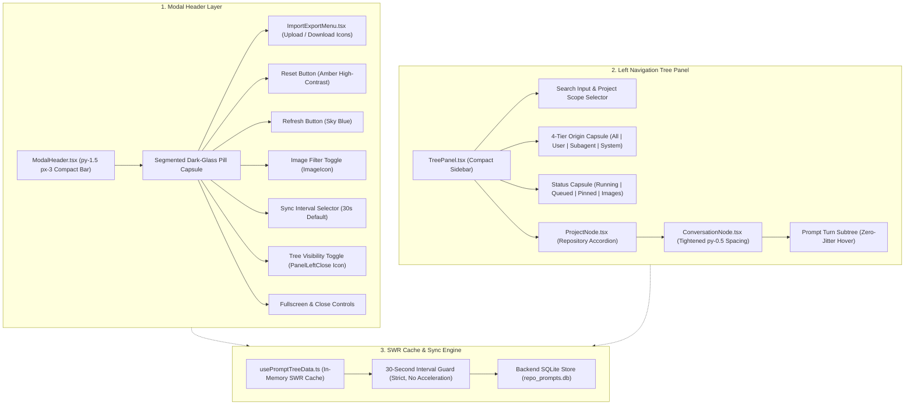

# 01-architecture-spec: Prompt Tree View Header Minimization, Tree Spacing, Icon Actions, and Segmented Capsules

- **Spec ID:** `02-spec/21-app/225-prompt-tree-view-issues/01-architecture-spec.md`
- **Parent Audit Ledger:** `02-spec/21-app/225-prompt-tree-view-issues/00-master-audit-ledger.md`
- **Master Plan:** `.ai-memory/plans/pending/225-prompt-tree-view-issues.md`
- **Subtask Plan:** `.ai-memory/plans/subtasks/225-prompt-tree-view-issues/01-header-and-tree-compactness.md`
- **Task ID:** `225`
- **Status:** `APPROVED`
- **Lead Architect:** Spec Author 01 (Frontend Tree & Header Specialist)
- **Target Subsystem:** `src/components/instances/PromptTreeView/`

---

## 1. Executive Summary & Problem Classification

The Prompt Tree View modal (`PromptTreeViewModal.tsx`) serves as the central orchestration dashboard for monitoring prompt transcripts, running subagents, queued prompts, and inspection details across Antigravity instances. User operational audits revealed critical visual ergonomics and interaction defects:

1. **Header Real Estate Bloat:** The top modal header and tree toolbar occupy excessive vertical height (`p-4` and `py-3` paddings), crowding the tree view and detail panes on standard resolution laptops (1080p).
2. **Cluttered Action Controls:** Heavy text labels on secondary utility actions ("Import / Export", "Hide tree") consume horizontal space, forcing essential action buttons (Reset, Refresh, Sync dropdown) into overflow or awkward wrapping.
3. **Contrast Deficiencies on Yellow Action Button:** The action button adjacent to Refresh previously suffered from poor contrast (white text on amber background or low-contrast text) and lacked standard tactile feedback. The button must be explicitly labeled "Reset" with high-contrast dark text on an amber background.
4. **Tree Node Spacing & Hover Jitter:** Conversation and turn nodes feature overly loose vertical padding (`py-1.5` to `py-2`), causing unnecessary scrolling. Furthermore, hovering over a conversation item previously triggered a border change that shifted adjacent content, disrupting layout stability.
5. **Polled Data Storms & Hover Invalidation:** An unthrottled timer accelerated refresh rates to 2 seconds when any prompt was active, while hover triggers invalidated cache states. Caching must be strictly preserved, with background synchronization restricted to the user-configured interval (default 30 seconds) or explicit manual button presses.
6. **Toolbar Capsule Fragmentation:** Action buttons were rendered as disjointed, standalone elements violating the segmented pill capsule design system mandated in `AGENTS.md`.

This specification defines the architectural overhaul for header minimization, compact tree spacing, Lucide icon conversion, high-contrast Reset button ergonomics, contiguous segmented dark-glass pill capsules, and strict 30-second synchronization caching.

---

## 2. Subsystem Architecture Overview

The Prompt Tree View is structured into three primary visual and functional layers:



---

## 3. Detailed Architectural Requirements

### 3.1 Header Layer Compaction (`ModalHeader.tsx`)

- **Padding Reduction:** The top header container padding is reduced from `p-4` / `py-3` to `py-1.5 px-3` (`bg-slate-50/80 dark:bg-[#0c0817]/95 backdrop-blur-xl border-b border-slate-200/80 dark:border-purple-900/40`).
- **Brand & Metadata Cluster:**
  - Compact icon container (`h-6 w-6 rounded-[5px]`).
  - Font size standardized to `text-xs font-bold` for title and `text-[10px] font-mono` for version (`vX.Y.Z`) and instance index badges (`#1`).
  - Instance name truncated cleanly at `max-w-[140px]` with native tooltip hover.
- **Header Control Capsule:** All header actions are grouped into a single contiguous segmented dark-glass pill capsule adhering to `AGENTS.md`.

### 3.2 Action Controls & Icon Button Conversions

| Control | Previous Representation | New Representation | Tooltip Text | Styling Specification |
| :--- | :--- | :--- | :--- | :--- |
| **Import / Export** | Text button "Import / Export" or oversized dropdown | Dual Lucide Icons: `Download` (Export) and `Upload` (Import) or consolidated `Database` icon button | `Import / Export tree transcripts` | Segmented capsule cell, `w-7 h-7 flex items-center justify-center text-slate-700 dark:text-slate-200 hover:bg-slate-200/80 dark:hover:bg-[#40285e]/90` |
| **Hide Tree View** | Text button "Hide tree view" / toggle button with trailing text | Lucide Icon: `PanelLeftClose` (when expanded) / `PanelLeftOpen` (when collapsed) | `Hide tree panel (Alt+B)` / `Show tree panel (Alt+B)` | Segmented capsule cell, `w-7 h-7 flex items-center justify-center text-slate-500 dark:text-slate-400 hover:text-slate-700 dark:hover:text-slate-200` |
| **Reset Action** | Ambiguous icon or mismatched label | Explicit Text + Icon: `<RotateCcw /> Reset` | `Reset tree from disk transcripts (wipes SQLite cache and rescans)` | `text-zinc-950 bg-amber-400 hover:bg-amber-300 font-semibold shadow-sm active:translate-y-px h-7 px-2.5 text-[11px]` |
| **Refresh Action** | Icon or overlapping button | Explicit Text + Icon: `<RefreshCw /> Refresh` | `Refresh the tree now (respects 30s cache otherwise)` | `text-white bg-sky-600 hover:bg-sky-500 font-semibold shadow-sm active:translate-y-px h-7 px-2.5 text-[11px]` |
| **Image Filter** | Loose toggle button | Lucide Icon: `ImageIcon` | `Filter by Images: Show only conversations with attached images` | Segmented capsule cell, active: `bg-sky-500/25 text-sky-400`, inactive: `text-slate-500 hover:text-sky-400` |
| **Sync Interval** | Plain text or native select | Segmented pill cell with inline indicator and dark-glass popover | `Auto-sync interval (Click to change)` | `h-7 px-2.5 text-[11px] font-semibold text-slate-700 dark:text-slate-200` |

### 3.3 High-Contrast 3D Tactile Styling (Reset & Action Buttons)

Per user guidelines and `AGENTS.md`:
- **Yellow / Amber Contrast Rule:** Background `bg-amber-400 hover:bg-amber-300` MUST strictly pair with high-contrast dark text `text-zinc-950 font-semibold`. White text on yellow/amber is strictly forbidden due to WCAG AA failure.
- **3D Tactile Elevation:**
  - Static state: `shadow-sm` or subtle bottom border bevel (`shadow-[0_2px_0_0_#b45309]`).
  - Active pressed state: `active:translate-y-px active:shadow-none`.
  - Icon animation: `isResetting` triggers `animate-spin` on `RotateCcw`.

### 3.4 Contiguous Segmented Pill Capsules

Toolbar button groups must never render as loose, disconnected circular buttons or disjointed rounded rectangles. They must be rendered as contiguous segmented capsules:
```tsx
<div className="inline-flex items-center rounded-full bg-slate-100/90 dark:bg-zinc-900/90 backdrop-blur-md border border-slate-200/80 dark:border-zinc-700/60 p-0.5 divide-x divide-slate-200/70 dark:divide-zinc-700/60 shadow-xs">
    {/* Segment 1: Import / Export */}
    {/* Segment 2: Reset */}
    {/* Segment 3: Refresh */}
    {/* Segment 4: Image Filter */}
    {/* Segment 5: Sync Interval Selector */}
    {/* Segment 6: Hide Tree View Toggle */}
    {/* Segment 7: Fullscreen */}
    {/* Segment 8: Close */}
</div>
```

Any dropdown `<select>` mounted inside a segmented pill capsule MUST use transparent borderless styling (`bg-transparent border-0 focus:ring-0 focus:outline-none`) to eliminate nested white pill-in-pill defects.

### 3.5 Tree Node Spacing & Zero-Jitter Hover Invariants

1. **Tight Vertical Metrics:**
   - Conversation row padding: reduced to `py-0.5 px-1.5` (from `py-1.5` / `py-2`).
   - Line height: clamped to `leading-snug`.
   - Sequential badges (`formatSeqBadge`): rendered as ultra-compact micro-pills (`text-[9px] font-mono px-1 py-0.2 rounded-xs`).
   - Prompt turn subtree padding: reduced to `py-0.5 px-1.5` with tight `space-y-0.5`.
2. **Zero-Jitter Hover Protection:**
   - Conversation rows must NEVER add or change borders upon hover (`border-t`, `border-b`, or `border-emerald-500` on hover are forbidden).
   - Base state: `border border-transparent`.
   - Hover state: subtle background tint only (`hover:bg-slate-100/80 dark:hover:bg-[#181126]/70`), preserving exact pixel dimensions and layout coordinates.
3. **4-Tier Origin Hierarchy Visuals:**
   - `USER_PROMPT`: Sky badge, User icon (`text-sky-500`).
   - `SUBAGENT_INSTRUCTION`: Purple badge, Bot icon (`text-purple-500`), nested hierarchically with branch glyph (`└── ↳`).
   - `SYSTEM_MESSAGE`: Zinc badge, Terminal icon (`text-zinc-500`).
   - `TOOL_OUTPUT`: Amber badge, Wrench icon (`text-amber-500`).

### 3.6 Strict 30-Second Caching Guard (`usePromptTreeData.ts`)

- **Polling Rate Invariant:** Polling is strictly bounded by the user-selected `syncInterval` (defaults to 30s; options: `off`, `15s`, `30s`, `1m`, `2m`).
- **No Dynamic Polling Acceleration:** Legacy logic that accelerated polling to 2 seconds when any prompt was detected as running is removed. Active prompts stream events or update on the 30-second tick; background threads must not saturate the SQLite database or disk transcripts.
- **Zero Hover Refetches:** Hovering over tree nodes or projects must NEVER trigger network requests, IPC calls (`invoke('get_project_conversation_tree')`), or cache invalidations.

---

## 4. Architectural Data Contracts

### 4.1 ModalHeader Component Interface
```typescript
export interface ModalHeaderProps {
    instanceName: string;
    appVersion?: string;
    sequenceNumber?: number;
    executablePath?: string;
    isFullscreen: boolean;
    setIsFullscreen: (v: boolean | ((prev: boolean) => boolean)) => void;
    isLoading: boolean;
    syncInterval: SyncInterval;
    setSyncInterval: (v: SyncInterval) => void;
    restoreFileInputRef: React.RefObject<HTMLInputElement | null>;
    onClose: () => void;
    onBackup: () => void;
    onRestore: () => void;
    onExportSqlite: () => void;
    onImportSqlite: () => void;
    onCopyAllTreePrompts: () => Promise<void> | void;
    onFileRestore: (e: React.ChangeEvent<HTMLInputElement>) => void;
    onRefreshAll: () => void;
    onResetTree: () => void;
    isTreeCollapsed?: boolean;
    onToggleTree?: () => void;
    isAutoSyncing?: boolean;
    isRefreshing?: boolean;
    isResetting?: boolean;
}
```

### 4.2 ConversationNode Component Interface
```typescript
export interface ConversationNodeProps {
    conv: AgmConversationNode;
    project: AgmProjectTreeNode;
    isSelected: boolean;
    isLastConv?: boolean;
    onSelect: (conv: AgmConversationNode, project: AgmProjectTreeNode) => void;
    onOpenInspector: (conv: AgmConversationNode, repoPath: string) => void;
    onRenameConversation?: (conversationId: string, newTitle: string, targetInst?: string) => Promise<void> | void;
    onResendPrompts?: (count: number | 'all') => void;
    onEnqueue?: () => void;
    onRerunConversation?: (convoId: string, nudgeType: string) => void;
    onOpenContextMenu?: (props: any) => void;
}
```

---

## 5. Verification & Quality Gates

1. **Visual Regression Gate:**
   - Header container height measured at `< 42px`.
   - Segmented capsule rendered with zero border collisions or white pill-in-pill artifacts.
   - Conversation row height measured at `< 26px` with zero vertical shifting on hover.
2. **Contrast Audit Gate:**
   - Reset button text (`text-zinc-950`) evaluated against amber background (`bg-amber-400` / `bg-amber-300`) achieves contrast ratio `> 10:1` (exceeding WCAG AAA standard `7:1`).
   - Refresh button text (`text-white`) evaluated against sky blue (`bg-sky-600`) achieves contrast ratio `> 4.5:1`.
3. **Telemetry & Polling Gate:**
   - Network / IPC logs confirm `get_project_conversation_tree` executes at exactly 30-second intervals when idle or running.
   - Mouse hover over 10 consecutive conversation nodes triggers 0 IPC calls.
