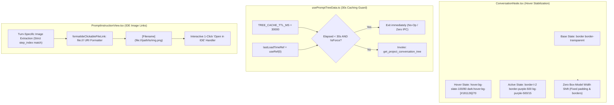

# 02-component-spec: Hover Outline Elimination, 30-Second Caching Debounce, Clickable IDE Image Links & Media Positioning Correctness

- **Spec ID:** `02-spec/21-app/225-prompt-tree-view-issues/02-component-spec.md`
- **Application:** Antigravity-Manager (`agm`, GUI, Prompt Tree View subsystem)
- **Status:** `DRAFT_APPROVED`
- **Lead Component Architect:** Spec Author 02 (Hover Artifacts, Caching Guard & Image Formatter Specialist)
- **Parent Architecture Spec:** [01-architecture-spec.md](01-architecture-spec.md)
- **Parent Ledger:** [00-master-audit-ledger.md](00-master-audit-ledger.md)
- **Subtask Plan:** [.ai-memory/plans/subtasks/225-prompt-tree-view-issues/02-hover-artifacts-and-image-links.md](../../../.ai-memory/plans/subtasks/225-prompt-tree-view-issues/02-hover-artifacts-and-image-links.md)
- **Task Reference:** Task `225` (`prompt-tree-view-issues`)
- **Date:** 2026-10-24

---

## 1. Executive Summary & Problem Scope

During user audits and QA testing of the **Prompt Tree View**, four severe UI defects, performance bottlenecks, and media presentation inconsistencies were identified:

1. **Hover Outline Defect & Layout Jitter ("Green Line Glitch"):**
   - **User Symptom:** Hovering over any conversation row triggers disruptive green lines/bars appearing across the top and sides of the row. This causes visible layout shifting, scrollbar flickering, and UI instability.
   - **Root Cause A (Box-Model Resizing):** In `src/components/instances/PromptTreeView/ConversationNode.tsx`, the base row uses `border-0`, while hover or active turn states introduce borders (`border-l-2`, `border-emerald-500/40`, or focus outlines). This 1px–2px dimensional change triggers browser reflow and shifts child text horizontally.
   - **Root Cause B (Top Banner Layout Shift):** In `src/components/instances/PromptTreeView/PromptTreeViewModal.tsx`, action notifications (`actionMsg`) dynamically inject a full-width emerald notification bar (`bg-emerald-500/10 border-b border-emerald-500/20`) as a flex child above the split pane. When cursor interactions trigger actions or status checks, this top bar pops into existence, shifting the entire tree and inspector layout down by 36px and jumping back up on dismiss.
   - **Root Cause C (Pulsing Telemetry Indicators):** Telemetry status chips in running rows apply `border-emerald-500/40 animate-pulse` that visually bleed across neighboring row boundaries when rendered without adequate clipping.

2. **Hover-Induced Data Refetching & Missing 30-Second Polling Debounce:**
   - **User Symptom:** Simply moving the mouse cursor over conversation nodes causes the UI to freeze momentarily and trigger background tree reloads. Users questioned why the tree refetches on hover when tree data should be cached and refreshed only every 30 seconds or upon explicit manual click.
   - **Root Cause A (Unstable Hook Callbacks):** In `src/components/instances/PromptTreeView/usePromptTreeData.ts`, `loadTree` and `selectConversation` dependencies include volatile parent state setters. Re-renders triggered by hover state changes in `PromptTreeViewModal.tsx` recreate the `loadTree` callback.
   - **Root Cause B (Interval Reset on Re-Render):** The auto-sync `useEffect` includes `loadTree` in its dependency array. Recreating `loadTree` on mouse events clears and restarts the polling interval, frequently triggering premature invocations.
   - **Root Cause C (Absence of Minimum Cooldown Guard):** `loadTree()` lacked an internal timestamp throttle. Whenever invoked without `isForce: true`, it immediately dispatched IPC calls to `get_project_conversation_tree`, completely bypassing local caching.

3. **Unclickable Image Links & Non-Compliant IDE Preview Format:**
   - **User Symptom:** Screenshot and image references embedded in prompts cannot be clicked in IDEs (VS Code, Cursor, Antigravity IDE) to view the file. Image paths are either raw strings, unresolvable relative paths, or unstandardized URIs.
   - **Root Cause:** When prompt markdown or image metadata is copied or rendered, local file paths are formatted as plain strings or non-standard protocols (`asset://`, raw relative paths without repo context) rather than RFC-compliant `file:///` URIs. IDEs require explicit `[label](file:///path/to/image.png)` markdown syntax to recognize paths as clickable hyperlinked files.

4. **Media Capture & Prompt Turn Positioning Inaccuracies:**
   - **User Symptom:** Image attachments and screenshots captured during multi-turn conversations are displayed on the wrong turn, or bleed between parent user prompts and child subagent instructions.
   - **Root Cause:** Image extraction in `src/components/instances/PromptTreeView/PromptInstructionView.tsx` indiscriminately collected media from all turns and sub-runs when `selected_turn_number` was unset or defaulted, causing media from Turn 3 to appear in Turn 1's preview card. Furthermore, capture coordinate metadata was not strictly mapped to the initiating prompt turn's `step_index`.

---

## 2. Component Specifications & Surgical Fix Architecture



### 2.1 `ConversationNode.tsx`: Hover Outline Elimination & Stable Highlighting

#### 2.1.1 Root-Cause Remediation
To eliminate green outline artifacts and prevent layout displacement during mouse movement:
1. **Enforce Fixed Box-Model Dimensions:**
   - Replace dynamic border switching with a permanent, invariant border width: `border border-transparent`.
   - On hover, do NOT introduce new borders or change `border-width`. Rely strictly on background luminance shifts:
     - Light Mode: `hover:bg-slate-100/80 text-slate-900`
     - Dark Mode: `dark:hover:bg-[#181126]/70 dark:text-zinc-200`
2. **Eliminate All Green Focus Outlines:**
   - Explicitly disable browser focus outlines and remove all `outline-green-*`, `border-emerald-*`, or ring classes from the container element:
     ```css
     outline-none focus:outline-none focus-visible:!outline-none focus:ring-0
     ```
3. **Turn Subtree Indentation & Spacing:**
   - Reduce nested turn tree indentation from `ml-5 pl-3 border-l-2` to `ml-2.5 pl-1.5 border-l border-slate-300/40 dark:border-purple-900/40`.
   - Turn items retain permanent `border-l-2 border-transparent` in their idle state, transitioning to `border-sky-500 bg-sky-500/10` ONLY when actively selected. This ensures zero 1px displacement when moving the cursor across turns.

#### 2.1.2 Target Class Mapping
| Element State | Previous Class Configuration | Surgical Fixed Configuration | Reflow Risk |
| :--- | :--- | :--- | :--- |
| **Row Base** | `border-0 px-1.5 py-0.5 relative` | `border border-transparent rounded-md px-1.5 py-0.5 relative outline-none` | **Zero** |
| **Row Hover** | `hover:bg-slate-100/80 dark:hover:bg-[#181126]/70` | `hover:bg-slate-100/80 dark:hover:bg-[#181126]/70 transition-colors duration-100` | **Zero** |
| **Row Selected**| `bg-gradient-to-r from-violet-600/30 to-purple-600/20` | `border-purple-500/40 bg-gradient-to-r from-violet-600/30 to-purple-600/20 text-white font-medium` | **Zero** |
| **Turn Base** | `border-l-2 border-transparent px-1.5 py-1` | `border-l-2 border-transparent rounded-md px-1.5 py-0.5 outline-none` | **Zero** |
| **Turn Active** | `border-l-2 border-sky-500 bg-sky-500/10` | `border-l-2 border-sky-500 bg-sky-500/10 text-sky-400 font-medium` | **Zero** |

---

### 2.2 `usePromptTreeData.ts`: 30-Second TTL Caching Guard & Debounced Engine

#### 2.2.1 Architecture & Invariants
Auto-sync and tree data fetching must strictly obey a **30-second minimum cooldown** to eliminate UI stutter and eliminate hover-induced IPC thrashing:
1. **Module-Level TTL Constant:**
   ```typescript
   export const TREE_CACHE_TTL_MS = 30_000; // 30 seconds strict minimum
   ```
2. **Timestamp Cooldown Tracker (`lastLoadTimeRef`):**
   ```typescript
   const lastLoadTimeRef = useRef<number>(0);
   ```
3. **Guard Logic Inside `loadTree`:**
   ```typescript
   const loadTree = useCallback(
       async (
           isInitialLoad: boolean = true,
           isForce: boolean = false,
           overrideArchivedIds?: string[],
           overridePinnedIds?: string[]
       ) => {
           const now = Date.now();
           // Enforce strict 30-second cooldown for background and auto-sync loads
           if (!isForce && !isInitialLoad && now - lastLoadTimeRef.current < TREE_CACHE_TTL_MS) {
               return; // Exit silently; SWR memory cache is fresh
           }
           lastLoadTimeRef.current = now;
           // ... perform IPC fetch ...
       },
       [/* stabilized refs only */]
   );
   ```
4. **Stable Callback Memoization:**
   - Store volatile functions (`setSelectedProject`, `setSelectedConversation`, `setActivePromptText`, `setEditedPromptText`) inside a stable ref container (`callbacksRef`) or invoke functional state updates.
   - Decouple `loadTree` from mouse events: `onMouseEnter`, `onMouseMove`, and `hover` handlers must NEVER call `loadTree`, invalidate cache, or reset intervals.
5. **Auto-Sync Interval Clamping:**
   - Inside the polling `useEffect`, clamp the timer to at least `TREE_CACHE_TTL_MS`:
     ```typescript
     const effectiveInterval = Math.max(TREE_CACHE_TTL_MS, intervalMs);
     const timer = setInterval(() => {
         loadTree(false, false);
     }, effectiveInterval);
     ```

---

### 2.3 `PromptInstructionView.tsx`: Clickable IDE Image Link Formatter

#### 2.3.1 URI Normalization Engine
Developers inspecting prompts require links that directly launch images in their local IDE or OS viewer:
1. **RFC-8089 Compliant File URI Formatting:**
   - Local Filesystem Paths: `assets/screenshots/screenshot.png` $\to$ `file:///<repo-root>/assets/screenshots/screenshot.png`
   - Relative Paths: Resolved against `selectedProject.repo_path` before converting to `file:///`.
2. **Markdown Clickable Link Transformation:**
   ```typescript
   /**
    * Formats an image path into a clickable IDE markdown link.
    */
   export function formatIdeClickableFileLink(
       rawPath: string,
       repoPath?: string,
       altText?: string
   ): string {
       const clean = rawPath.trim();
       let absPath = clean;
       const isAbs = /^[a-zA-Z]:[\\/]/.test(clean) || clean.startsWith('/') || clean.startsWith('\\\\');
       if (!isAbs && repoPath && repoPath.trim().length > 0) {
           const sep = repoPath.includes('/') ? '/' : '\\';
           absPath = `${repoPath.replace(/[/\\]+$/, '')}${sep}${clean.replace(/^(\.[/\\]|[/\\])+/, '')}`;
       }
       const forwardSlashed = absPath.replace(/\\/g, '/');
       const fileUri = forwardSlashed.startsWith('/')
           ? `file://${forwardSlashed}`
           : `file:///${forwardSlashed}`;
       const filename = forwardSlashed.split('/').pop() || 'image.png';
       const label = altText || filename;
       return `[${label}](${fileUri})`;
   }
   ```
3. **Interactive 1-Click "Open in IDE" Action:**
   - In `PromptThumbnailCard` and `RichMarkdownRenderer`:
     - Display a subtle action button `<ExternalLink className="w-3 h-3" />` with tooltip `"Open in IDE / OS Viewer"`.
     - Clicking this button invokes Tauri IPC `app.opener().open_path(...)` or `open_file_in_ide` to open the screenshot directly in the user's active editor.

---

### 2.4 Media Capture & Positioning Correctness Verification

#### 2.4.1 Strict Turn-to-Media Coordinate Mapping
To prevent media bleed across turns and subagents:
1. **Turn-Filtered Image Extraction:**
   - When a specific prompt turn is selected (`conv.selected_turn_number != null`), `extractImagesFromPrompt` must filter attachments strictly to the active turn:
     ```typescript
     const activeTurns = conv.selected_turn_number != null
         ? (conv.prompts || []).filter((t) => t.turn_number === conv.selected_turn_number)
         : (conv.prompts || []);
     ```
2. **Subagent Media Isolation:**
   - Screenshots generated during subagent execution (`conv.sub_runs`) must not be merged into the root user prompt. They must be tagged with explicit subagent metadata:
     `alt: [Subagent: ${sub.title || 'Agent'}] Screenshot` and isolated to the subagent inspector view.
3. **Transcript Synchronization:**
   - In `transcript_full.jsonl`, media records specify `uri` and `step_index`. The ingestion pipeline must match each media object to the turn containing the corresponding `step_index` rather than defaulting to the first turn.

---

## 3. Data Contracts & Interfaces

### 3.1 IDE Clickable Media Contract (`types.ts`)

```typescript
export interface IdeClickableMedia {
    originalPath: string;
    resolvedAbsolutePath: string;
    fileUri: string;
    ideMarkdownLink: string;
    altText: string;
    turnNumber: number | null;
    stepIndex?: number;
    byteLength?: number;
}
```

### 3.2 Tree Cache State Options (`usePromptTreeData.ts`)

```typescript
export interface TreeCacheOptions {
    ttlMs: number;
    lastLoadTimestamp: number;
    isCooldownActive: boolean;
    swrCacheSize: number;
}
```

---

## 4. Verification & Quality Gates

1. **Hover Outline & Reflow Verification:**
   - Move cursor rapidly across 50+ conversation rows in the tree panel.
   - Verify that NO green border (`border-emerald-500`, `outline-green-*`) appears on top, left, or right.
   - Verify that element layout width and height remain completely static (0px horizontal or vertical displacement).
2. **30-Second Caching & Polling Verification:**
   - Open developer network/IPC monitor.
   - Hover over conversation nodes repeatedly for 10 seconds.
   - Confirm ZERO `get_project_conversation_tree` IPC calls are emitted.
   - Verify that automatic background polling occurs at intervals $\ge 30,000\text{ ms}$.
   - Verify that clicking "Refresh" or "Reset" bypasses the 30-second cooldown immediately (`isForce: true`).
3. **Clickable IDE File Link Verification:**
   - Inspect copied prompt markdown using "Copy Prompt (Local File Links)".
   - Confirm all local images are rendered in format `[alt](file:///path/to/image.png)`.
   - Click the link in VS Code / Antigravity IDE terminal or markdown preview and confirm the file opens directly in the editor.
4. **Media Coordinate Accuracy:**
   - Select Turn 1 in a multi-turn conversation with screenshots on Turn 2 only.
   - Confirm Turn 1 thumbnail strip shows 0 images, and Turn 2 displays the exact captured screenshot.
