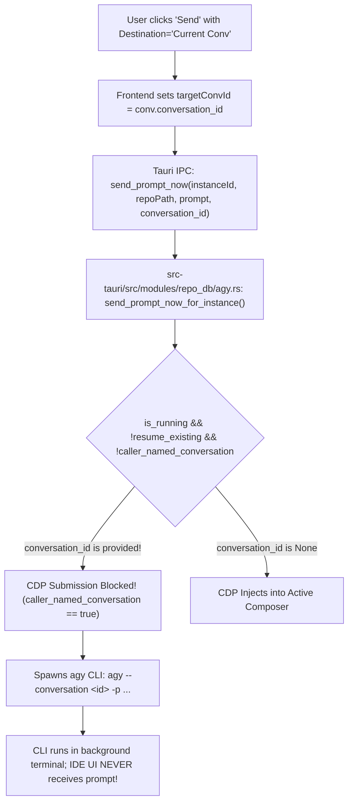

# Specification & Root Cause Analysis: Combined Dispatch Dropdown, Conversation Misrouting & Prompt Title Extraction

- **Specification File:** `02-spec/21-app/225-prompt-tree-view-issues/03-dropdown-and-conversation-spec.md`
- **Parent Audit Ledger:** `02-spec/21-app/225-prompt-tree-view-issues/00-master-audit-ledger.md`
- **Master Plan:** `.ai-memory/plans/pending/225-prompt-tree-view-issues.md`
- **Subtask Plan:** `.ai-memory/plans/subtasks/225-prompt-tree-view-issues/03-send-enqueue-rerun-dropdown-and-conversation-target.md`
- **Task ID:** `225`
- **Slug:** `prompt-tree-view-issues`
- **Status:** `DRAFT`
- **Date:** 2026-10-24

---

## 1. Context & Architectural Overview

The Antigravity Manager (AGM) prompt management subsystem acts as the command center for multi-instance prompt orchestration, queuing, and replay across local Antigravity IDE workspaces. 

Task 225 reports three interrelated functional defects in prompt dispatch and representation:
1. **Dropdown Fragmentation**: The combined `[Send | Enqueue | Rerun]` split-button was disassembled, obscuring the primary dispatch modes.
2. **Conversation Misrouting**: Selecting "Current Conversation" sends prompts to a new conversation instead of appending/dispatching to the selected conversation.
3. **Conversation Title & Content Distortion**: Transcript parsing distorts conversation names by allowing trailing subagent instructions or short responses to overwrite root conversation titles.

This specification details the root causes and defines the unified fix architecture.

---

## 2. Root Cause Analysis (RCA): Current vs. New Conversation Misrouting

### 2.1. Symptom & Failure Manifestation
When a user selects a conversation in Prompt Tree View, verifies that the destination dropdown is set to **"Current Conversation"**, and clicks **"Send"**, the prompt does not appear in the currently active conversation in Antigravity IDE. Instead, it either:
- Appears in an entirely new conversation tab, OR
- Executes headlessly via the CLI without appearing in the IDE UI at all, leaving the developer confused.

Conversely, when **"New Conversation"** is selected, the prompt is often typed directly into the active conversation without creating a new session.

---

### 2.2. 4-Part Root Cause Analysis



#### Part 1: Mechanism 1 — Live CDP Bypass on Named Conversations
In `src-tauri/src/modules/repo_db/agy.rs`:
```rust
let resume_existing = resumes_existing_conversation(active_prompt.session_id.as_deref());
let caller_named_conversation = conversation_id
    .map(str::trim)
    .is_some_and(|value| !value.is_empty());
if is_running && !resume_existing && !caller_named_conversation {
    // Submit prompt directly into running Antigravity IDE's conversation composer via CDP
    submit_prompt_via_cdp_for_instance(&canonical_inst, fallback_prompt, true)
} else {
    // Fallback: Dispatch via agy CLI execution
    spawn_or_replace_prompt_via_agy(&active_prompt, true)
}
```
- **The Flaw**: When the user specifies "Current Conversation", `conversation_id` is passed as `Some("conv-...")`.
- Consequently, `caller_named_conversation` evaluates to **`true`**.
- This makes `!caller_named_conversation` **`false`**, causing the system to **completely bypass live DevTools CDP submission**!
- The dispatch falls through to `spawn_or_replace_prompt_via_agy`, executing `agy` as a headless background CLI process instead of injecting text into the IDE composer.

#### Part 2: Mechanism 2 — Headless CLI vs. GUI Disconnect
The `agy` CLI binary (`spawn_or_replace_prompt_via_agy`) is a headless agent runner. When spawned with `-p "..."`, it executes in its own terminal environment. It does **not** communicate with the Electron/VS Code window DOM of the running Antigravity IDE. Therefore, a user watching their IDE sees nothing happen in their current chat, and a new unlinked conversation transcript is created under `.system_generated/logs/`.

#### Part 3: Mechanism 3 — Synthetic Prefix Stripping in `agy_conversation_id`
Historically (until commit `3ed326a59`), `agy_conversation_id` contained:
```rust
if trimmed.starts_with("conv-") {
    return None;
}
```
Because Antigravity conversations are keyed with `conv-...`, any attempt to resume an existing conversation had its ID discarded, forcing the background CLI to initialize a brand-new conversation session.

#### Part 4: Mechanism 4 — Inversion of "New Conversation" in CDP
In `src-tauri/src/modules/instance/cdp_onboarding.rs`, `submit_prompt_on_ws`:
```javascript
// Focus message input and insert text
const selectorLadder = ['[aria-label="Message input"]', ...];
```
- When CDP was executed, it did not inspect whether the user requested a **New Conversation**.
- It immediately found whatever message input was open in the active tab and typed into it.
- There was no action to trigger the IDE's "New Chat" button (`button[aria-label="New Chat"]` or `button.codicon-plus`).
- As a result, "New Conversation" appended to the current chat, while "Current Conversation" bypassed CDP and spawned a headless CLI process. The behaviors were completely inverted!

---

### 2.3. Unified Remediation Architecture

#### 2.3.1. Clear Semantic Definitions
1. **Target Mode: `current`**:
   - The user intends to dispatch the prompt to the conversation currently open in the IDE.
   - If the IDE is running, dispatch **MUST** use live DevTools CDP (`submit_prompt_via_cdp_for_instance`).
   - If `cancel_running_first: true` (Send / Preempt), it cancels any active generating turn before typing.
   - If `cancel_running_first: false` (Enqueue), it appends or stages the prompt.
2. **Target Mode: `new`**:
   - The user intends to start a fresh conversation session.
   - If the IDE is running, CDP **MUST** first trigger the "New Chat" command in the IDE (`button[aria-label="New Chat"]` or `button.codicon-plus` or `workbench.action.chat.newChat`), wait 200ms for DOM settlement, and then insert the prompt into the newly opened composer.
   - If a `newConversationTitle` is provided, AGM writes/updates the conversation summary once the session ID is initialized.

#### 2.3.2. Corrected Backend Dispatch Logic (`src-tauri/src/modules/repo_db/agy.rs`)

```rust
// Corrected Dispatch Hierarchy:
// 1. If instance process is alive and active CDP port exists:
//    - If target_mode is 'new', CDP clicks New Chat first, then types and sends.
//    - If target_mode is 'current', CDP types directly into the active composer.
// 2. Fall back to agy CLI ONLY if IDE is not running or CDP fails.

pub fn send_prompt_now_for_instance(
    instance_id: &str,
    repo_path: &str,
    prompt_content: &str,
    conversation_id: Option<&str>,
) -> Result<ActivePrompt, String> {
    // ... preemption and instance liveness checks ...

    let target_is_new = conversation_id.map(str::trim) == Some("new");
    let (is_running, _, pids) = crate::modules::instance::is_instance_process_running_smart(&canonical_inst);

    let mut dispatched_via_cdp = false;
    if is_running {
        crate::modules::instance::focus_running_instance(&pids, Some(repo_path));
        let max_cdp_attempts = if was_cold_started { 3 } else { 1 };
        for attempt in 1..=max_cdp_attempts {
            if crate::modules::instance::cdp_onboarding::submit_prompt_via_cdp_for_instance_with_mode(
                &canonical_inst,
                fallback_prompt,
                true, // cancel_running_first
                target_is_new, // open_new_chat_first
            ).is_ok() {
                dispatched_via_cdp = true;
                break;
            }
            if attempt < max_cdp_attempts {
                std::thread::sleep(std::time::Duration::from_millis(500));
            }
        }
    }

    if !dispatched_via_cdp {
        // Fallback to agy CLI with conversation flag preserved
        spawn_or_replace_prompt_via_agy(&active_prompt, true)?;
    }

    Ok(active_prompt)
}
```

---

## 3. Combined [Send, Enqueue, Rerun] Dropdown Restoration

### 3.1. Requirements & UX Structure
The top-right action area of `DetailHeader.tsx` must unify Send, Enqueue, and Rerun into a cohesive split-button capsule.

```text
+-------------------------------------------------------------------------------+
| [ ⚡ Send (Preempt)  v ]                                                      |
+-------------------------------------------------------------------------------+
      | (Click chevron opens popover)
      v
+-------------------------------------------------------------------------------+
| DISPATCH ACTION                                                               |
|   (•) ⚡ Send Now (Preempt)   - Interrupt running task & execute immediately  |
|   ( ) 📥 Enqueue FIFO         - Add to background queue behind active task    |
|   ( ) 🔁 Rerun Turn           - Re-execute turn with count & verification     |
+-------------------------------------------------------------------------------+
| DESTINATION CONVERSATION                                                      |
|   Target: [ Current Conversation (Active)  |  New Conversation ]              |
|   ↳ [ If New: Input conversation title or objective... ]                     |
+-------------------------------------------------------------------------------+
| VERIFICATION & SUFFIX                                                         |
|   Template: [ None | Is It Done? | Edge Cases & Tests | Security Audit ]      |
+-------------------------------------------------------------------------------+
| [ Execute Action Button ]                                                     |
+-------------------------------------------------------------------------------+
```

### 3.2. Segmented Pill Styling Rules
Following `<RULE[d:\work\Antigravity-Manager\AGENTS.md]>`:
- Contiguous segmented pill capsule: `rounded-full`, shared border, subtle divider lines, dark-glass styling.
- Borderless inline selects: `bg-transparent border-0 focus:ring-0 focus:outline-none`.
- Accessible tooltips and hotkeys: `N` for Send, `Q` for Enqueue, `R` for Rerun.

---

## 4. Conversation Names & Prompts Extraction Correctness

### 4.1. The Root Cause of Title & Prompt Distortion

#### Flaw 1: Prioritization of Trailing Turns Over Root Prompt
In `src-tauri/src/modules/repo_db/tree_collect.rs`:
```rust
let mut effective_prompt = inspection
    .latest_prompt
    .filter(|s| !s.trim().is_empty())
    .or_else(|| prompt_turns.last().map(|t| t.prompt_text.clone()))
    .or_else(|| prompt_turns.first().map(|t| t.prompt_text.clone()))
```
- When a conversation has multiple turns (e.g. Turn 1: "Implement auth token refresh", Turn 2: "looks good", Turn 3: "ok"), `latest_prompt` extracts "ok".
- `tree_node_conv.rs` then passes `effective_prompt` ("ok") into `conversation_display_title(&item.title, &item.prompt)`.
- As a result, the conversation title in the tree is replaced with "ok" or trailing subagent chatter!

#### Flaw 2: Over-Aggressive Heading Stripping
In `src-tauri/src/modules/repo_db/text_utils.rs`:
```rust
// Check if line is a markdown header (# Title), horizontal rule (---, ***), or blockquote (> ...)
if trimmed.starts_with('#')
    || trimmed.starts_with('>')
    || trimmed.starts_with("---")
```
- Prompts that start with a markdown header (e.g. `# Prompt Tree View Issues: high priority instruction`) have their entire title line **skipped**.
- The summary extractor then picks up subsequent boilerplate lines or code blocks, resulting in meaningless titles.

### 4.2. Corrected Title Extraction Algorithm

```rust
pub fn extract_conversation_root_title(
    db_title: &str,
    first_turn_prompt: Option<&str>,
    latest_prompt: Option<&str>,
) -> String {
    let clean_db_title = db_title.trim();
    if !is_placeholder_title(clean_db_title) {
        return clean_db_title.to_string();
    }

    // Prominence to FIRST user prompt (root human intent)
    if let Some(first_prompt) = first_turn_prompt {
        let summary = extract_smart_prompt_summary(first_prompt, 80);
        if !summary.trim().is_empty() {
            return summary;
        }
    }

    if let Some(latest) = latest_prompt {
        let summary = extract_smart_prompt_summary(latest, 80);
        if !summary.trim().is_empty() {
            return summary;
        }
    }

    "Untitled Conversation".to_string()
}
```

In `extract_smart_prompt_summary`:
- Strip heading markers (`#`, `##`) from the line rather than dropping the entire line:
  ```rust
  let content = trimmed.trim_start_matches('#').trim();
  if !content.is_empty() && !is_generic_preamble(content) {
      substantive_lines.push(content);
  }
  ```

---

## 5. Invariants & Observability Standards

1. **Strictly Relative Git Paths**: All file links and specs use repository-relative paths (`02-spec/...`, `src/...`, `src-tauri/...`).
2. **FIFO Queue Preservation**: Any enqueue query in SQLite must enforce `ORDER BY created_at ASC, id ASC`.
3. **No Silent Errors**:
   - Rust: Use `AppError` and `record_ignored(result, "justification comment")`.
   - TypeScript: Use `useErrorStore.getState().captureError(...)` for dispatch failures.

---

## 6. Acceptance Criteria Matrix

| Criteria ID | Requirement | Verification Method |
| :--- | :--- | :--- |
| **AC-DISPATCH-01** | Unified split-button in `DetailHeader.tsx` allows 1-click execution of armed mode. | UI click test on Send, Enqueue, Rerun. |
| **AC-DISPATCH-02** | Destination selector toggles between "Current Conversation" and "New Conversation". | State inspection & dispatch payload audit. |
| **AC-DISPATCH-03** | When "Current Conversation" is selected, prompt is injected into active IDE chat via CDP. | Live IDE DevTools interaction test. |
| **AC-DISPATCH-04** | When "New Conversation" is selected, CDP triggers "New Chat" before prompt injection. | Live IDE verification: new chat opens. |
| **AC-DISPATCH-05** | Conversation titles in tree reflect root human intent, not trailing follow-up turns. | Tree rendering audit on multi-turn conversations. |
| **AC-DISPATCH-06** | Markdown `# Header` lines in prompts are formatted as titles instead of being stripped. | Unit test for `extract_smart_prompt_summary`. |
