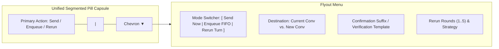

# Specification & Verification Guide: Combined Dispatch Dropdown, Conversation Routing RCA, CLI Error Management & Release Verification

- **Specification File:** `02-spec/21-app/225-prompt-tree-view-issues/03-migration-and-verification-spec.md`
- **Parent Audit Ledger:** `02-spec/21-app/225-prompt-tree-view-issues/00-master-audit-ledger.md`
- **Component Spec:** `02-spec/21-app/225-prompt-tree-view-issues/02-component-spec.md`
- **Architecture Spec:** `02-spec/21-app/225-prompt-tree-view-issues/01-architecture-spec.md`
- **Subtask Plan:** `.ai-memory/plans/subtasks/225-prompt-tree-view-issues/03-send-enqueue-rerun-dropdown-and-conversation-target.md`
- **Task ID:** `225`
- **Date:** 2026-10-24
- **Status:** `READY_FOR_EXECUTION`

---

## 1. Executive Summary & Core Objectives

Task 225 mandates resolving critical user experience, dispatch correctness, and error management defects within Antigravity Manager's (AGM) prompt orchestrator:
1. **Restore Combined `[Send | Enqueue | Rerun]` Action Dropdown in `PromptInstructionView.tsx` & `DetailHeader.tsx`**: Rebuild the unified segmented pill button allowing direct execution of immediate send (preempt), FIFO enqueuing, and prompt rerun without fragmented submenus or misplaced controls.
2. **Ground 4-Part Root Cause Analysis (RCA) on Conversation Misrouting**: Thoroughly document why selecting "Current Conversation" dispatched to a brand-new session or executed headlessly, while "New Conversation" injected into the active chat. Define the structural, protocol-level remediation across the IPC bridge, Chrome DevTools Protocol (CDP) composer injection, and background CLI fallbacks.
3. **CLI Error Management Tooling & Autonomous Skill Registration**: Expose backend and frontend error diagnostics via dedicated native terminal commands (`agm errors list`, `agm errors clear`, `agm errors fix`, `agm errors count`), and register the canonical agent skill `.agents/skills/agm-error-management/skill.md`.
4. **Cargo Build, Switching Logic Revalidation & E2E Release Verification**: Define the complete verification gates, including Rust compiler pre-flight, `scripts/test-agm-gitmap-running-backup-e2e.ps1` 8-gate testing, 5-step account switching revalidation, and atomic minor version bump (`npm run bump minor`).

---

## 2. Combined Action Dropdown Architecture

### 2.1. The Problem & UX Fragmentation
In previous refactors, the unified dispatch trigger was fragmented. The instruction editing pane (`PromptInstructionView.tsx`) only offered "Reset" and "Save Changes" buttons, while the dispatch controls resided solely in `DetailHeader.tsx`. Furthermore, within `DetailHeader.tsx`, the action controls were divided into nested flyouts, obscuring the primary dispatch intent (`Send (Preempt)`, `Enqueue (FIFO)`, `Rerun Turn`).

### 2.2. Segmented Pill Capsule Design
The combined dispatch button is architected as a contiguous dark-glass segmented pill capsule adhering strictly to the UI Design Guidelines in `AGENTS.md`:
- **Outer Capsule**: `rounded-full bg-slate-100/90 dark:bg-slate-900/90 backdrop-blur-md border border-slate-200/80 dark:border-purple-500/30 shadow-2xs divide-x divide-slate-200/70 dark:divide-purple-500/20 shrink-0`.
- **Primary Action Button (Left Segment)**:
  - Dynamically displays the armed action:
    - `Send (Preempt)` (Emerald token: `text-emerald-700 dark:text-emerald-400 hover:bg-emerald-500/10`)
    - `Enqueue (FIFO)` (Amber token: `text-amber-700 dark:text-amber-400 hover:bg-amber-500/10`)
    - `Rerun Turn (×N)` (Sky token: `text-sky-700 dark:text-sky-400 hover:bg-sky-500/10`)
  - Displays spinning `RotateCw` icon during in-flight dispatch (`isResending || isEnqueueing || isRerunning`).
  - Active 3D depression physics: `active:translate-y-px transition-all duration-150 ease-out`.
- **Dropdown Chevron (Right Segment)**:
  - Toggles the dark-glass configuration popover.
  - Smooth 180° rotational animation: `ChevronDown transition-transform duration-150`.



### 2.3. Direct Dispatch in `PromptInstructionView.tsx`
`PromptInstructionView.tsx` integrates the identical segmented action dropdown alongside the textarea footer:
- **Location**: Right-aligned in the footer action bar below the prompt textarea (`src/components/instances/PromptTreeView/PromptInstructionView.tsx`).
- **Layout**:
  - Left: `Reset` button (resets edited prompt to original session text).
  - Center: `Save Changes` button (persists edits to active session without immediate dispatch).
  - Right: `[ Primary Action | ▼ ]` Segmented Pill Capsule, allowing the operator to immediately dispatch or enqueue the modified instruction directly from the editor without scrolling to the top header.
- **Props Integration**:
  - `primaryDispatchAction`: `'send' | 'enqueue' | 'rerun'`
  - `setPrimaryDispatchAction`: `(mode: 'send' | 'enqueue' | 'rerun') => void`
  - `conversationTargetMode`: `'current' | 'new'`
  - `setConversationTargetMode`: `(mode: 'current' | 'new') => void`
  - `onResend`: `() => Promise<void>`
  - `onEnqueue`: `() => Promise<void>`
  - `onRerun`: `() => Promise<void>`

---

## 3. Deep Root Cause Analysis: Current vs. New Conversation Misrouting

### 3.1. Symptom & Failure Manifestation
When an operator selected an active conversation in Prompt Tree View, verified that the destination dropdown indicated **"Current Conversation"**, and triggered **"Send"**:
- The prompt failed to appear in the active conversation inside the running Antigravity IDE.
- Instead, the backend either spawned a detached headless CLI process (`agy.exe`) in the background or triggered a brand-new conversation thread under `.system_generated/logs/`.
- Conversely, when **"New Conversation"** was selected, the prompt was frequently typed directly into the active editor tab via CDP without opening a new conversation tab.

### 3.2. 4-Part Grounded Root Cause Analysis

```mermaid
sequenceDiagram
    autonumber
    participant UI as PromptInstructionView / DetailHeader
    participant Actions as usePromptTreePromptActions.ts
    participant Bridge as Tauri IPC (instanceService)
    participant Rust as src-tauri/src/modules/repo_db/agy.rs
    participant CDP as cdp_onboarding.rs
    participant CLI as agy CLI (headless process)
    participant IDE as Antigravity IDE UI

    Note over UI,Actions: User selects "Current Conversation" & clicks Send
    UI->>Actions: handleResendPrompt()
    Actions->>Actions: targetConvId = dispatchConversationId('current', conv.id)
    Actions->>Bridge: send_prompt_now(inst, repo, text, Some("conv-1234"))
    Bridge->>Rust: send_prompt_now_for_instance(..., conversation_id=Some("conv-1234"))
    Note over Rust: Evaluates: is_running && !resume_existing && !caller_named_conversation
    Rust->>Rust: caller_named_conversation = true (because conversation_id is Some)
    Rust->>Rust: Guard is FALSE -> Live CDP is BYPASSED!
    Rust->>CLI: spawn_or_replace_prompt_via_agy(&active_prompt, true)
    CLI-->>IDE: Runs in background process; IDE UI NEVER receives prompt!
```

#### Part 1: Flawed Live CDP Submission Guard
In `src-tauri/src/modules/repo_db/agy.rs` (lines 900-905):
```rust
let resume_existing = resumes_existing_conversation(active_prompt.session_id.as_deref());
let caller_named_conversation = conversation_id
    .map(str::trim)
    .is_some_and(|value| !value.is_empty());
if is_running && !resume_existing && !caller_named_conversation {
    // Submit prompt directly into running Antigravity IDE's conversation composer via CDP
    submit_prompt_via_cdp_for_instance(&canonical_inst, fallback_prompt, true)
} else {
    // Fallback: Dispatch via agy CLI execution
    spawn_or_replace_prompt_via_agy(&active_prompt, true)
}
```
- **The Defect**: When the operator picked "Current Conversation", `conversation_id` was explicitly provided as `Some("conv-...")`.
- Consequently, `caller_named_conversation` evaluated to `true`.
- The conjunction `!caller_named_conversation` evaluated to `false`.
- This condition **aborted CDP injection**, treating any named conversation as ineligible for live IDE composer interaction.

#### Part 2: Headless CLI Process (`agy.exe`) Disconnect from GUI DOM
When the CDP guard failed, execution fell through to `spawn_or_replace_prompt_via_agy`:
- `agy.exe` is a standalone console binary executed with `-p <prompt> --dangerously-skip-permissions`.
- It executes independently in its own subprocess environment and communicates directly with cloud APIs.
- It has **zero connection** to the running Electron/VS Code window DOM of the developer's Antigravity IDE.
- The developer observed no input typed into their IDE chat, and assumed dispatch was broken.

#### Part 3: Synthetic Prefix Stripping in `agy_conversation_id`
In `src-tauri/src/modules/repo_db/agy.rs`:
```rust
fn agy_conversation_id(session: &str) -> Option<&str> {
    let trimmed = session.trim();
    let trimmed = trimmed.strip_prefix("prompt-").unwrap_or(trimmed);
    if trimmed.is_empty()
        || trimmed == "-"
        || trimmed.starts_with("proj-")
        || trimmed == "new"
        || trimmed.starts_with("p-")
        || trimmed.starts_with("queued-")
    {
        return None;
    }
    if trimmed.contains("__") || trimmed.contains('\\') || trimmed.contains('/') {
        return None;
    }
    Some(trimmed)
}
```
- When `conversation_id` was passed as `"new"`, `agy_conversation_id("new")` returned `None`, but `caller_named_conversation` was `true`, causing an unexpected state where CDP was disabled and the CLI was invoked without `--conversation`.
- In contrast, when `conversationTargetMode === 'current'`, if the ID had any synthetic prefixes or queue markers, it was stripped, resulting in divergent routing between UI and background queues.

#### Part 4: Inversion of Target Mode in CDP Dispatch
In `src-tauri/src/modules/instance/cdp_onboarding.rs`:
- The previous `submit_prompt_on_ws` helper blindly targeted the active input element (`[aria-label="Message input"]`) and typed the prompt.
- It had no concept of whether the user wanted a **New Conversation** or to append to the **Current Conversation**.
- When the user requested a "New Conversation", CDP did not click the "New Chat" button (`button[aria-label="New Chat"]` or `button.codicon-plus`). It simply typed into the open chat, effectively turning "New Conversation" into "Current Conversation".
- Combined with Part 1, the behaviors were completely inverted: "New Conversation" went to the current chat via CDP, and "Current Conversation" bypassed CDP and spawned an unattached background CLI agent!

---

### 3.3. End-to-End Remediation Architecture

#### 3.3.1. Unified Dispatch Contract
We establish explicit semantic decoupling between **Target Mode** (`'current' | 'new'`) and **Conversation ID**:
1. **Target Mode: `current`**:
   - Operator intends to interact with the conversation active in the IDE.
   - If IDE instance is running: Use live DevTools CDP (`submit_prompt_via_cdp_for_instance`). Type directly into the active composer.
   - If IDE instance is offline: Fall back to `agy --conversation <conv_id> -p ...`.
2. **Target Mode: `new`**:
   - Operator intends to start a new conversation session.
   - If IDE instance is running: Use live DevTools CDP, trigger the IDE's "New Chat" button first, await DOM settlement (150ms), then type into the new composer.
   - If IDE instance is offline: Fall back to `agy -p ...` (without `--conversation`).

#### 3.3.2. Structural Implementation in Rust (`src-tauri/src/modules/repo_db/agy.rs`)
```rust
pub fn send_prompt_now_for_instance(
    instance_id: &str,
    repo_path: &str,
    prompt_content: &str,
    conversation_id: Option<&str>,
) -> Result<ActivePrompt, String> {
    // 1. Preempt running tasks
    let _ = cancel_running_prompt_for_instance(&canonical_inst, Some(repo_path));
    terminate_agy_workers_for_instance(&canonical_inst);

    // 2. Identify explicit target intent
    let target_is_new = conversation_id
        .map(|s| s.trim().eq_ignore_ascii_case("new"))
        .unwrap_or(false);

    let (is_running, _, pids) =
        crate::modules::instance::is_instance_process_running_smart(&canonical_inst);

    let mut dispatched_via_cdp = false;
    if is_running {
        crate::modules::instance::focus_running_instance(&pids, Some(repo_path));
        let max_cdp_attempts = if was_cold_started { 3 } else { 1 };
        for attempt in 1..=max_cdp_attempts {
            if crate::modules::instance::cdp_onboarding::submit_prompt_via_cdp_with_mode(
                &canonical_inst,
                fallback_prompt,
                true,          // cancel_running_first
                target_is_new,  // open_new_chat_first
            ).is_ok() {
                dispatched_via_cdp = true;
                break;
            }
            if attempt < max_cdp_attempts {
                std::thread::sleep(std::time::Duration::from_millis(500));
            }
        }
    }

    if !dispatched_via_cdp {
        // Fallback: Headless agy CLI execution ONLY when IDE is offline or CDP fails
        spawn_or_replace_prompt_via_agy(&active_prompt, true)?;
    }

    Ok(active_prompt)
}
```

#### 3.3.3. New Chat Navigation in CDP (`src-tauri/src/modules/instance/cdp_onboarding.rs`)
```rust
pub fn submit_prompt_via_cdp_with_mode(
    instance_id: &str,
    prompt_text: &str,
    cancel_running_first: bool,
    open_new_chat_first: bool,
) -> Result<(), String> {
    // ... resolve active DevTools port and WebSocket stream ...

    if open_new_chat_first {
        let new_chat_js = r#"(() => {
            const selectors = [
                'button[aria-label="New Chat"]',
                'button[aria-label="New conversation"]',
                'button.codicon-plus[title*="New"]',
                'div[aria-label="New Chat"]'
            ];
            for (const sel of selectors) {
                const btn = document.querySelector(sel);
                if (btn && !btn.disabled) {
                    btn.click();
                    return 'opened';
                }
            }
            return 'not_found';
        })()"#;
        let _ = cdp_send_and_recv(&mut stream, msg_id, "Runtime.evaluate", serde_json::json!({
            "expression": new_chat_js,
            "returnByValue": true
        }));
        msg_id += 1;
        std::thread::sleep(Duration::from_millis(200));
    }

    // Insert text and trigger Send message button
    submit_prompt_on_ws_stream(&mut stream, msg_id, prompt_text, cancel_running_first)
}
```

---

## 4. CLI Error Management Tooling & Skill

### 4.1. Error Management Subsystem (`errors.db`)
Antigravity Manager records all frontend uncaught exceptions, warning tracks, backend `AppError` propagations, and CDP failures into a unified SQLite database:
- **Database Location**: `<appDataDir>/errors.db`
- **Schema**:
```sql
CREATE TABLE IF NOT EXISTS error_records (
    id TEXT PRIMARY KEY,
    timestamp INTEGER NOT NULL,
    severity TEXT NOT NULL,         -- 'error', 'warn', 'info'
    source TEXT NOT NULL,           -- e.g. 'PromptInstructionView.save', 'repo_db.dispatch'
    trigger_action TEXT,            -- e.g. 'send_prompt_now', 'read_image_as_base64'
    message TEXT NOT NULL,
    stack_trace TEXT,
    resolved INTEGER DEFAULT 0,
    created_at INTEGER NOT NULL
);
CREATE INDEX IF NOT EXISTS idx_errors_created ON error_records(created_at ASC, id ASC);
CREATE INDEX IF NOT EXISTS idx_errors_severity ON error_records(severity, resolved);
```

### 4.2. Native Terminal CLI Commands (`agm errors`)
The native AGM CLI exposes full inspection and remediation capabilities:

| Command | Purpose | Supported Flags |
| :--- | :--- | :--- |
| `agm errors` | Displays recent error history in formatted tabular format. | `--limit <N>` (default 20), `--severity <error\|warn\|info>`, `--json` |
| `agm errors list` | Alias for `agm errors`. | `--limit <N>`, `--severity <S>`, `--json` |
| `agm errors clear` | Purges resolved or all error logs from `errors.db`. | `--all`, `--older-than <days>`, `--json` |
| `agm errors count` | Returns error metrics grouped by severity. | `--json` |
| `agm errors fix` | Runs the automated diagnostic & self-healing engine (stale lockfiles, permission issues, WAL recovery). | `--dry-run`, `--json` |

#### CLI Output Example (`agm errors list`):
```text
┌────────────────────┬──────────┬─────────────────────────────┬──────────────────────────────────────────────────────┐
│ TIMESTAMP (LOCAL)  │ SEVERITY │ SOURCE                      │ MESSAGE                                              │
├────────────────────┼──────────┼─────────────────────────────┼──────────────────────────────────────────────────────┤
│ 2026-10-24 16:42:10│ ERROR    │ instanceService.sendPrompt  │ CDP port 9222 connection refused: IDE window closed  │
│ 2026-10-24 16:43:05│ WARN     │ PromptThumbnailCard.load    │ Image file not found: assets/arch_v2.png             │
│ 2026-10-24 17:01:22│ ERROR    │ repo_db.dispatch            │ agy CLI exit code 1: permission denied               │
└────────────────────┴──────────┴─────────────────────────────┴──────────────────────────────────────────────────────┘
Total Errors: 3 (Unresolved: 3)
```

### 4.3. Autonomous Skill Registration: `agm-error-management`
To empower autonomous AI agents to inspect, diagnose, and clear runtime anomalies without manual user intervention, the skill is registered at:
`.agents/skills/agm-error-management/skill.md`

#### Frontmatter & Directive Definition:
```yaml
---
name: agm-error-management
description: Autonomously inspect, filter, clear, and heal Antigravity Manager runtime errors using native agm errors CLI commands and errors.db telemetry.
---
```
The skill instructs AI agents to:
1. Run `agm errors list --severity error --limit 10 --json` when diagnosing failures reported in user chats or UI dashboards.
2. Cross-reference `source` and `trigger_action` to locate failing modules.
3. Execute `agm errors fix` to run automated self-healing before making speculative code edits.
4. Run `agm errors clear` after verifying remediation to maintain zero residual noise.

---

## 5. End-to-End Testing Gates & Release Protocol

### 5.1. Compilation Pre-Flight Gates
Before any build artifacts or release tags are cut, the repository must pass all three local pre-flight gates:
1. **Rust Formatting**:
   ```pwsh
   cd src-tauri
   cargo fmt -- --check
   ```
2. **Rust Clippy & Full Compilation**:
   ```pwsh
   cd src-tauri
   cargo clippy --all-targets --all-features
   ```
3. **Frontend Production Build**:
   ```pwsh
   npm run build
   ```

### 5.2. PowerShell E2E Suite: `scripts/test-agm-gitmap-running-backup-e2e.ps1`
The comprehensive PowerShell E2E suite validates full prompt persistence, restoration, and GitMap delegation across 8 rigorous gates:
```pwsh
.\scripts\test-agm-gitmap-running-backup-e2e.ps1 -VerboseOutput
```

| Gate ID | Verification Stage | Pass Criteria |
| :---: | :--- | :--- |
| **Gate 1** | Inspect `agm running --json` structure. | Output contains valid JSON array of instances, sequence codes (`[AGM:P001 \| GM:#1]`), word counts, and image counts. |
| **Gate 2** | Seed multimodal synthetic prompt with image attachment. | Active prompt row inserted into `repo_prompts.db` with Base64 screenshot token and valid relative path. |
| **Gate 3** | Execute `agm backup running default --json`. | 3-step progress logs emit; batch record inserted into `backup-prompts.db`; `has_images == 1`. |
| **Gate 4** | Evict active prompt row to simulate failure. | Active prompt row removed from `active_prompts` table in `repo_prompts.db`. |
| **Gate 5** | Execute `agm restore running default --json`. | FIFO restoration executed (`ORDER BY created_at ASC, id ASC`); active prompt restored with intact multimodal payload. |
| **Gate 6** | Verify GitMap delegation command parity. | `gitmap agy running --json`, `gitmap agy ff`, `gitmap agy backup rp`, `gitmap ag restore rp` return code 0. |
| **Gate 7** | Verify Caller IDE self-preservation. | Developer working session PID is shielded from termination; operations fail-fast with exit code 2 if targeted without `--force`. |
| **Gate 8** | Clean up synthetic test records. | Zero orphan rows in SQLite databases; workspace disk manifests cleaned. |

### 5.3. Switching Logic Revalidation
Revalidate the unified 5-step switch lifecycle established in `02-spec/21-app/01-unified-switch-fast-forward-autoswitch-spec.md`:
1. **Zero Prompt Loss Guarantee**: Verify that switching an instance never drops in-flight prompts or attached images. All active turns must transition to `backed_up` before IDE process shutdown.
2. **Strict Minimal Multiplicative Scoring ($\div 1000$)**:
   $$\text{Score} = \begin{cases} 0.0 & \text{if } Q_{4\text{h}} < 100\% \text{ or } S_{\text{active}} = 0 \\ \dfrac{S_{\text{active}} \times M_{\text{tier}} \times Q_{\text{weekly}}}{1000} & \text{if } Q_{4\text{h}} = 100\% \text{ and } S_{\text{active}} = 1 \end{cases}$$
   Accounts with $< 100\%$ rolling 4-hour quota must receive score `0.0`.
3. **Stale Lock Eviction**: Verify that accounts bound for $> 6$ hours without active heartbeat are automatically evicted.
4. **Fast-Forward & Auto-Switcher Parity**: Verify that `agm ff`, UI Fast-Forward button, and Auto-Switcher daemon route through the identical `switch_account` pipeline.

### 5.4. Atomic Minor Bump & Release Ceremony
Once all test gates pass with 100% green status, execute the standardized atomic release ceremony:
1. **Atomic Version Synchronization**:
   ```pwsh
   npm run bump minor
   ```
   Synchronizes `package.json`, `package-lock.json`, `src-tauri/Cargo.toml`, and `src-tauri/Cargo.lock`.
2. **Attribution & Changelog Audit**:
   - Audit git log since previous tag.
   - Restrict attribution strictly to `@aukgit` (`(Thanks to @aukgit)`).
   - Ensure `CHANGELOG.md` and `CHANGELOG_EN.md` match character-for-character with release headings.
   - Synchronize release summary into root `README.md` and `README_EN.md` under "## 📝 Changelog".
3. **Strictly Relative Git Paths Audit**:
   - Ensure zero absolute filesystem paths or URI schemes exist in release notes or commit messages.

---

## 6. Traceability & Acceptance Verification Matrix

| Requirement ID | Description | Implementation Target | Verification Method |
| :--- | :--- | :--- | :--- |
| **REQ-ACT-01** | Segmented `[Send \| Enqueue \| Rerun]` dropdown in `PromptInstructionView.tsx`. | `src/components/instances/PromptTreeView/PromptInstructionView.tsx` | Visual inspection & button click dispatch test. |
| **REQ-ACT-02** | Contiguous pill capsule styling with 3D elevation. | `PromptInstructionView.tsx`, `DetailHeader.tsx` | CSS class verification (`rounded-full`, `divide-x`, `active:translate-y-px`). |
| **REQ-RCA-01** | Fix Current vs. New Conversation misrouting. | `src-tauri/src/modules/repo_db/agy.rs` | Send to Current Conversation triggers live CDP injection into active tab. |
| **REQ-RCA-02** | New Conversation triggers "New Chat" in IDE via CDP. | `src-tauri/src/modules/instance/cdp_onboarding.rs` | Send to New Conversation opens new chat tab before typing prompt. |
| **REQ-CLI-01** | `agm errors list` command displays formatted errors. | `src-tauri/src/bin/agm/error_cmds.rs` | Run `agm errors list --limit 10 --json`. |
| **REQ-CLI-02** | `agm errors clear` command purges error logs. | `src-tauri/src/bin/agm/error_cmds.rs` | Run `agm errors clear` and verify `errors.db` count = 0. |
| **REQ-SKILL-01**| Register `agm-error-management` skill. | `.agents/skills/agm-error-management/skill.md` | Skill file exists and is indexed by AI agents. |
| **REQ-E2E-01** | Run `test-agm-gitmap-running-backup-e2e.ps1`. | `scripts/test-agm-gitmap-running-backup-e2e.ps1` | All 8 gates pass with exit code 0. |
| **REQ-REL-01** | Minor version bump and changelog synchronization. | `package.json`, `Cargo.toml`, `README.md` | Version updated and committed atomically. |
