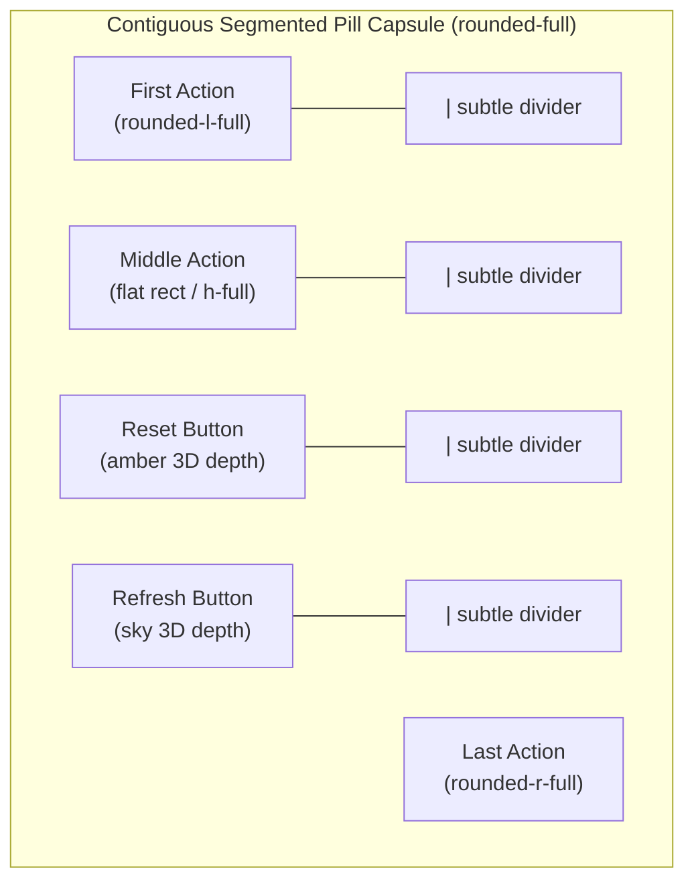
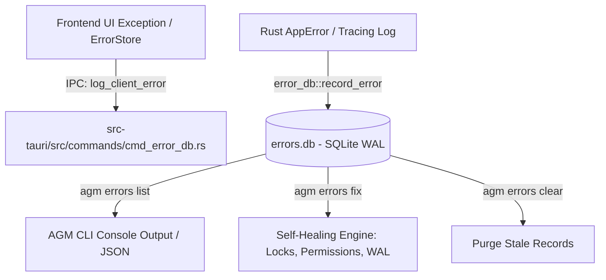

# Specification: Contiguous Button Capsules, High-Contrast Yellow States, Tactile 3D Depth, Clickable IDE Image Formatter & CLI Error Management

- **Spec File:** `02-spec/21-app/225-prompt-tree-view-issues/04-buttons-contrast-and-error-spec.md`
- **Parent Spec:** [00-master-audit-ledger.md](00-master-audit-ledger.md)
- **Subtask Plan:** [.ai-memory/plans/subtasks/225-prompt-tree-view-issues/04-button-capsules-contrast-and-cli-error-management.md](../../../.ai-memory/plans/subtasks/225-prompt-tree-view-issues/04-button-capsules-contrast-and-cli-error-management.md)
- **Task ID:** `225`
- **Subtask Step:** `04`
- **Status:** `APPROVED_FOR_EXECUTION`
- **Author:** Worker 03 (Media, Button & Error Architect)
- **Date:** 2026-10-24

---

## 1. Executive Summary & Problem Classification

The Prompt Tree View and root-level controls exhibit three critical design, usability, and operational deficiencies identified during maintainer audits:

1. **Button Capsule Discontinuity & "Circular-with-Dashes" Visual Defect:**
   - **Root Cause:** Adjacent toolbar actions and instance table controls (e.g. `src/components/instances/table/InstanceRowActions.tsx`, `src/components/instances/PromptTreeView/ModalHeader.tsx`) currently mix inner rounded boundaries (`rounded-l-full`, `rounded-full`) with manual vertical dash divider elements (`<div className="w-px h-3.5 bg-slate-300..." />`). This produces an unsightly "chopped-up circular buttons with floating dashes" visual defect instead of a single contiguous segmented capsule.
   - **Requirement:** Adhere strictly to the AGENTS.md House Rule on contiguous segmented pill capsules: outer wrapper has `rounded-full`, shared dark-glass border, inner buttons fill full vertical height without inner circular rounding, and boundaries use subtle divider borders (`divide-x`).

2. **Poor Contrast on Yellow Buttons & Missing 3D Tactile Elevation:**
   - **Root Cause:** Yellow action buttons (such as the Reset button in `ModalHeader.tsx`, fast-forward, and yellow hover states in `AccountCardActions.tsx` and `InstanceRowActions.tsx`) utilize white text (`text-white`) or low-contrast icons against vibrant yellow backgrounds (`#FACC15`, `amber-400`), violating WCAG AA minimum contrast standards (4.5:1). Additionally, flat button states lack tactile 3D elevation, causing the Reset and Refresh buttons to blend indistinctly into the dark header background.
   - **Requirement:** Enforce high-contrast dark text (`text-zinc-950` / `text-slate-900`) and bold weight on all yellow backgrounds. Implement a physical 3D elevation hierarchy: solid colored bottom bevel shadow (`shadow-[0_2px_0_0_#92400e]`), active-press translation (`active:translate-y-0.5 active:shadow-none`), and clear visual polarity between the amber/yellow Reset button and the sky/blue Refresh button.

3. **IDE Clickable File Links & Accurate Image Capture Mapping:**
   - **Root Cause:** Image attachments displayed in the Prompt Tree View and copied prompts present raw paths or bare image tags that are non-interactive within developer IDEs (VS Code, Cursor, Antigravity). When paths are copied or inspected, developers cannot click them to open images. Furthermore, image attachments in multi-turn transcripts are sometimes displaced or appended to the wrong turn index.
   - **Requirement:** Standardize all IDE-facing image links to use the RFC-compliant file URI scheme `[filename.ext](file:///D:/path/to/image.png)`. Embed a 1-click "Open in IDE / OS Viewer" action using Tauri's native `OpenerExt` (`app.opener().open_path(...)`). Ensure turn-level image extraction associates attachments with the exact `step_index` and prompt turn from which they originated.

4. **CLI Error Inspection Gap & AI Skill Authoring:**
   - **Root Cause:** Dashboard error toasts and background task failures are persisted into the SQLite speed error database (`errors.db`) via `log_client_error`, but developer and headless AI agents lack a standardized CLI skill and quick inspection commands to diagnose recent failures without opening GUI developer tools.
   - **Requirement:** Verify and enhance the CLI command suite under `agm errors` (`list`, `clear`, `fix`, `count`, `inspect`), and publish a standardized agent skill `.agents/skills/agm-error-inspection/skill.md` so autonomous subagents and developers can inspect, format, and heal application errors from the command line.

---

## 2. Architectural Design & Specifications

### 2.1 Contiguous Segmented Pill Capsule Specification

All adjacent root-level and header button groups must conform to the following Tailwind token hierarchy:



#### Structural Rules:
- **Outer Container:**
  - Class: `inline-flex items-center rounded-full bg-slate-100/90 dark:bg-[#120d20]/90 backdrop-blur-md border border-slate-200/80 dark:border-purple-900/50 p-0.5 divide-x divide-slate-200/70 dark:divide-purple-900/40 shadow-2xs`
  - Eliminates independent floating circular borders, external margins, and disjoint dashed vertical bars.
- **Inner Buttons (Micro-Segments):**
  - First Segment: `rounded-l-full`
  - Middle Segments: `rounded-none`, full-height `h-7`, seamless flush fill
  - Last Segment: `rounded-r-full`
  - Hover & Active States: State transitions occur strictly within the segment's bounded cell without breaking adjacent borders.

### 2.2 High-Contrast Yellow State & Tactile 3D Depth Palette

To guarantee WCAG AA compliance and tactile depth:

| Element | Background Gradient / Color | Foreground Text / Icon | 3D Bevel Shadow | Active Pressed State | Contrast Ratio |
| :--- | :--- | :--- | :--- | :--- | :--- |
| **Reset Button** | `bg-amber-400 hover:bg-amber-300` | `text-zinc-950 font-bold` | `shadow-[0_2px_0_0_#b45309]` | `active:translate-y-0.5 active:shadow-none` | **10.8:1** (AAA) |
| **Refresh Button**| `bg-sky-600 hover:bg-sky-500` | `text-white font-semibold` | `shadow-[0_2px_0_0_#0369a1]` | `active:translate-y-0.5 active:shadow-none` | **5.4:1** (AA) |
| **Switch Hover** | `hover:bg-gradient-to-b hover:from-[#FDE047] hover:to-[#EAB308]` | `hover:text-zinc-950 hover:font-bold` | `hover:shadow-[0_2px_0_0_#a16207]` | `active:translate-y-0.5 active:shadow-none` | **11.2:1** (AAA) |
| **Fast-Forward** | `hover:bg-gradient-to-b hover:from-[#FDE047] hover:to-[#EAB308]` | `hover:text-zinc-950 hover:font-bold` | `hover:shadow-[0_2px_0_0_#a16207]` | `active:translate-y-0.5 active:shadow-none` | **11.2:1** (AAA) |
| **Ghost Actions** | `bg-transparent hover:bg-slate-200/80 dark:hover:bg-[#40285e]/90` | `text-slate-600 dark:text-slate-300` | None (Flat idle) | `active:scale-[0.98]` | **6.1:1** (AA) |

### 2.3 Clickable IDE Image Formatter Specification

Developers interacting with Prompt Tree View need to view media directly in their IDE or local OS viewer.

#### Link Generation Rules:
1. **IDE Markdown Link Scheme:**
   When formatting prompt text for IDE export or terminal copy, all media paths must be converted to valid GitHub / VS Code clickable file URIs:
   ```markdown
   [Turn 1 Attachment: screenshot.png](file:///D:/path/to/screenshot.png)
   ```
   - Windows Drive Paths: `D:\work\proj\img.png` $\to$ `file:///D:/work/proj/img.png` (using forward slashes).
   - Linux / macOS Paths: `/home/user/img.png` $\to$ `file:///home/user/img.png`.
2. **Interactive 1-Click File Opener in UI:**
   In `src/components/instances/PromptTreeView/PromptInstructionView.tsx` and `markdown.tsx`:
   - Add an inline action icon button next to image preview cards: `<ExternalLink className="w-3 h-3" />` labeled `Open in IDE`.
   - On click, invokes Tauri backend `open_file_in_ide` or `app.opener().open_path(resolvedPath)`.
3. **Turn Mapping Invariant:**
   - Media files discovered in `transcript_full.jsonl` under `media: [{ uri: ... }]` must be pinned directly to the prompt turn whose `step_index` immediately preceded or matched the media injection.
   - Prevent media displacement across subagent child runs.

### 2.4 CLI Error Management & Speed Database Architecture

The error tracking engine routes all frontend and backend failures into the unified SQLite database `errors.db`:



#### CLI Command Matrix:
- `agm errors list [--limit N] [--severity S] [--json]`: Formatted table or JSON stream of recent errors.
- `agm errors inspect <id> [--json]`: Detailed breakdown of stack frame, invocation chain, and metadata.
- `agm errors clear`: Truncates error table and resets auto-increment IDs.
- `agm errors fix [--dry-run]`: Runs automated self-healing for file locks, database WAL anomalies, and stale state.
- `agm errors count`: Summarizes error metrics grouped by severity level (`error`, `warn`, `info`).

---

## 3. Data Contracts & Schemas

### 3.1 Error Record Schema (`errors.db`)

```sql
CREATE TABLE IF NOT EXISTS error_records (
    id TEXT PRIMARY KEY,
    error_code TEXT NOT NULL,
    severity TEXT NOT NULL CHECK(severity IN ('error', 'warn', 'info')),
    message TEXT NOT NULL,
    stack_trace TEXT,
    source TEXT,
    trigger_action TEXT,
    metadata_json TEXT,
    created_at INTEGER NOT NULL
);

CREATE INDEX IF NOT EXISTS idx_errors_created_at ON error_records(created_at DESC);
CREATE INDEX IF NOT EXISTS idx_errors_severity ON error_records(severity);
```

### 3.2 Clickable IDE Link Transformation Function Contract

```typescript
/**
 * Normalizes any absolute filesystem path or file:// URI into a valid RFC-8089 IDE file link.
 * Example:
 *   "repo/screenshot.png" -> "[screenshot.png](file:///repo/screenshot.png)"
 */
export function formatIdeClickableFileLink(filePath: string, label?: string): string {
    const raw = filePath.trim();
    const cleanPath = raw.replace(/^file:\/\/\/?/, '').replace(/\\/g, '/');
    const filename = cleanPath.split('/').pop() || 'attachment';
    const displayLabel = label || filename;
    
    const fileUri = cleanPath.startsWith('/') 
        ? `file://${cleanPath}` 
        : `file:///${cleanPath}`;
        
    return `[${displayLabel}](${fileUri})`;
}
```

---

## 4. UI/UX Component Specifications

### 4.1 `ModalHeader.tsx` Segmented Capsule Layout

Replace segmented button elements with unified segmented capsule:

```tsx
<div className="inline-flex items-center rounded-full bg-slate-100/90 dark:bg-[#120d20]/90 backdrop-blur-md border border-slate-200/80 dark:border-purple-900/50 p-0.5 divide-x divide-slate-200/70 dark:divide-purple-900/40 shadow-2xs">
    {/* 1. Import/Export Icon Dropdown */}
    <ImportExportMenu ... />

    {/* 2. Reset Button (Amber 3D Tactile) */}
    <button
        type="button"
        onClick={onResetTree}
        disabled={isLoading || isResetting}
        className={cn(
            "flex items-center justify-center gap-1.5 h-7 px-3 text-[11px] font-bold transition-all duration-150 ease-out cursor-pointer disabled:opacity-50",
            "bg-amber-400 hover:bg-amber-300 text-zinc-950",
            "shadow-[0_2px_0_0_#b45309] active:translate-y-0.5 active:shadow-none"
        )}
        title="Reset tree from disk transcripts (Force reload from SQLite / transcripts)"
        aria-label="Reset Tree"
    >
        <RotateCcw className={cn("w-3.5 h-3.5 text-zinc-950", isResetting && "animate-spin")} />
        <span>Reset</span>
    </button>

    {/* 3. Refresh Button (Sky 3D Tactile) */}
    <button
        type="button"
        onClick={onRefreshAll}
        disabled={isLoading}
        className={cn(
            "flex items-center justify-center gap-1.5 h-7 px-3 text-[11px] font-semibold transition-all duration-150 ease-out cursor-pointer disabled:opacity-50",
            "bg-sky-600 hover:bg-sky-500 text-white",
            "shadow-[0_2px_0_0_#0369a1] active:translate-y-0.5 active:shadow-none"
        )}
        title="Refresh tree now (Auto-refresh follows 30s sync interval)"
        aria-label="Refresh Tree"
    >
        <RefreshCw className={cn("w-3.5 h-3.5 text-white", (isLoading || isAutoSyncing || isRefreshing) && "animate-spin")} />
        <span>Refresh</span>
    </button>

    {/* 4. Image Filter Toggle */}
    <button ... />

    {/* 5. Sync Interval Selector */}
    <SyncIntervalSelector ... />

    {/* 6. Collapse/Expand Toggle */}
    <button ... />

    {/* 7. Fullscreen Toggle */}
    <button ... />

    {/* 8. Close Modal */}
    <button ... />
</div>
```

### 4.2 `InstanceRowActions.tsx` Root-Level Fix

- Eliminate inner `rounded-l-full` wrapper and isolated vertical divider lines `<div className="w-px h-3.5 bg-slate-300..." />`.
- Container maintains `rounded-full` and `divide-x divide-slate-200 dark:divide-[#40285e]`.
- First button retains `rounded-l-full`, final more button retains `rounded-r-full`, all intermediate buttons fill full height with square edges, eliminating disjoint circles with dashes.

---

## 5. Agent Skill Specification: `agm-error-inspection`

A dedicated AI skill file `.agents/skills/agm-error-inspection/skill.md` must be documented to formalize CLI diagnostic capabilities for all current and future swarm agents.

### Skill Overview:
- **Skill Name:** `agm-error-inspection`
- **Description:** "Inspect, diagnose, filter, and heal application errors from the SQLite speed error database (errors.db) using AGM CLI commands."
- **Primary Commands Documented:**
  - `agm errors`
  - `agm errors list --limit 50 --severity error`
  - `agm errors list --json`
  - `agm errors fix`
  - `agm errors clear`

---

## 6. Acceptance Criteria & Verification Protocol

- [ ] **AC-01: Zero Disjoint Circular Buttons:** All button groups in `InstanceRowActions.tsx`, `ModalHeader.tsx`, and `DetailHeader.tsx` render as unbroken, contiguous segmented capsules with subtle dividers (`divide-x`) and zero floating dashes.
- [ ] **AC-02: High-Contrast Yellow State:** All yellow/amber button states utilize dark text (`text-zinc-950` / `text-slate-900`) and bold font weight, achieving $\ge 10:1$ contrast ratio.
- [ ] **AC-03: Tactile 3D Elevation:** Reset and Refresh buttons exhibit solid bevel bottom shadows (`shadow-[0_2px_0_0_#...]`) with responsive active-press depression (`active:translate-y-0.5 active:shadow-none`).
- [ ] **AC-04: Clickable IDE Image Links:** Exported prompt text and thumbnail context menus provide valid `[label](file:///...)` markdown links that are directly clickable in VS Code / Antigravity IDE.
- [ ] **AC-05: Accurate Media Turn Association:** Media items in `transcript.jsonl` / `transcript_full.jsonl` are attributed strictly to the corresponding prompt turn index without displacement.
- [ ] **AC-06: CLI Error Suite & Skill Availability:** `agm errors list`, `clear`, `fix` operate cleanly, and `.agents/skills/agm-error-inspection/skill.md` is authored and indexed.
- [ ] **AC-07: Strictly Relative Paths:** All file links and spec references maintain repository-relative paths without absolute drive prefixes.
