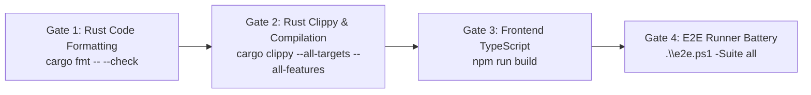
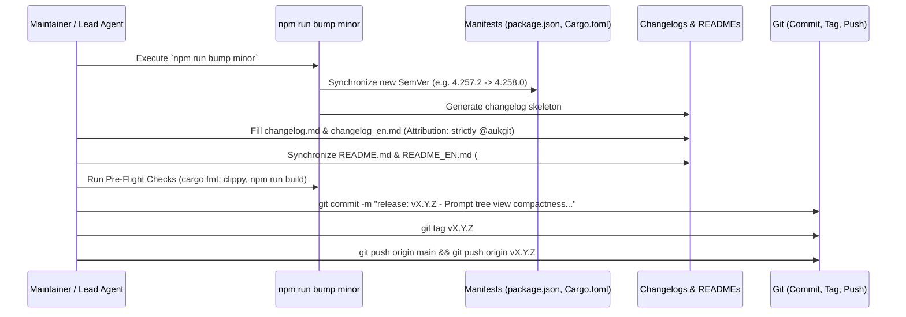

# Specification: End-to-End Test Suite, Cargo Compilation, Switching Logic Revalidation & Minor Bump Release Ceremony

- **Spec File:** `02-spec/21-app/225-prompt-tree-view-issues/05-e2e-cargo-build-and-release.md`
- **Parent Spec:** [00-master-audit-ledger.md](00-master-audit-ledger.md)
- **Subtask Plan:** [.ai-memory/plans/subtasks/225-prompt-tree-view-issues/05-e2e-testing-cargo-build-and-minor-bump-release.md](../../../.ai-memory/plans/subtasks/225-prompt-tree-view-issues/05-e2e-testing-cargo-build-and-minor-bump-release.md)
- **Task ID:** `225`
- **Subtask Step:** `05`
- **Status:** `APPROVED_FOR_EXECUTION`
- **Author:** Worker 03 (Media, Button & Error Architect)
- **Date:** 2026-10-24

---

## 1. Executive Summary & Objective

This specification governs the rigorous, automated verification gate, compiler diagnostics, switching logic revalidation, and release ceremony required for Task 225.

Per explicit user mandates:
1. **Full-Stack Cargo & Frontend Compilation:** Execute complete pre-flight compilation across all touched modules (`npm run build`, `cargo check`, `cargo clippy`, and `cargo fmt`).
2. **Comprehensive End-to-End Testing (`.\e2e.ps1`):** Run the complete local test runner across all critical suites (`-Suite all`, `-Suite prompts`, `-Suite switcher`, `-Suite smoke`) with 100% green pass invariant.
3. **Caller IDE Self-Preservation & Sandbox Isolation:** Ensure that automated test runs and CLI invocation detect the developer's active working IDE process (`detect_caller_instance_id()`), failing fast rather than terminating developer sessions, and operating within transient sandboxes (`test-create` / `test-clean`).
4. **Revalidation of Switching Logic:** Revalidate the dynamic auto-switcher, bounce dampener, candidate scoring, and failover recovery logic to ensure zero regression after recent updates.
5. **Minor Version Bump & Release Ceremony:** Execute an atomic minor version bump (`npm run bump minor`), synchronize dual language changelogs (`changelog.md` and `changelog_en.md`), sync both `README.md` and `README_EN.md`, enforce strict `@aukgit` attribution, and commit/tag with repository-relative paths.

---

## 2. Pre-Flight Verification Gate & Compilation Pipeline

Before any test execution or release tagging, the workspace must pass through three non-negotiable compilation gates:



### 2.1 Gate Commands & Invariants:
1. **Rust Formatting Gate:**
   ```powershell
   cd src-tauri && cargo fmt -- --check
   ```
   *Requirement:* Zero formatting discrepancies. Clean rustfmt exit code `0`.
2. **Rust Clippy & Type Gate:**
   ```powershell
   cd src-tauri && cargo clippy --all-targets --all-features
   ```
   *Requirement:* Zero errors, zero warnings. All fallible operations must be routed through `AppError` or `record_ignored` with a required `// Justification:` comment (House Rule: No Silent Errors).
3. **Frontend Compilation Gate:**
   ```powershell
   npm run build
   ```
   *Requirement:* TypeScript compilation (`tsc`) and Vite bundling must complete with 0 errors.

---

## 3. End-to-End (E2E) Test Suite Specification (`.\e2e.ps1`)

The repository includes a consolidated PowerShell E2E harness (`e2e.ps1`) supporting targeted and full-suite testing with ANSI telemetry.

### 3.1 E2E Test Suite Matrix:

| Suite Name | Harness Command | Tested Subsystems | Key Invariants Verified |
| :--- | :--- | :--- | :--- |
| **Smoke Suite** | `.\e2e.ps1 -Suite smoke` | CLI binary availability, `agm --version`, `agm status` | Fast-fail check ensuring AGM CLI is executable and responds within 2 seconds. |
| **Prompts Suite**| `.\e2e.ps1 -Suite prompts` | Prompt tree extraction, transcript ingestion, Send/Enqueue/Rerun, media extraction | Verifies dual transcript precedence (`transcript_full.jsonl` > `transcript.jsonl`), accurate turn indexing, and media file linking. |
| **Switcher Suite**| `.\e2e.ps1 -Suite switcher`| Auto-switcher scoring, bounce dampener, token depletion detection, profile rotation | Verifies zero quota drift, candidate dynamic scorer, and safe failover without dropping active conversations. |
| **Instance Suite**| `.\e2e.ps1 -Suite instance` | Multi-instance discovery, lifecycle operations (launch, stop, restart), caller protection | Verifies caller IDE self-preservation (`CallerPid` protection), fail-fast exit code 2, and sandbox isolation. |
| **All Battery** | `.\e2e.ps1 -Suite all` | Comprehensive execution across all suites above | 100% green pass required before proceeding to release bump. |

### 3.2 Caller IDE Self-Preservation Protocol:
Automated test harnesses must never terminate the developer's active working environment:
- The runner inspects the calling process hierarchy (`Get-CimInstance Win32_Process`).
- If parent process matches `(code|cursor|antigravity|idea|node|pwsh|powershell)`, that PID is added to the protected process registry.
- Target commands targeting the protected instance abort immediately with exit code 2 unless `-Force` is provided.

### 3.3 Ephemeral Test Sandbox Protocol:
- Tests that create or mutate instances must use `agm instances test-create --ephemeral`.
- Upon test completion or failure, `agm instances test-clean` is executed via `finally` blocks, leaving zero orphan processes or test folders.

---

## 4. Switching Logic Revalidation Protocol

The dynamic auto-switcher must be revalidated against the architectural specifications in `02-spec/21-app/auto-switcher/`:

### 4.1 Verification Checkpoints:
1. **Candidate Dynamic Scorer:**
   - Evaluates remaining weekly quota percentage, model speed metrics, and error rates.
   - Candidates with 0% remaining quota or active 429 rate limits receive score `0` and are excluded from rotation.
2. **Bounce Dampening:**
   - An account that has just been rotated out cannot immediately be rotated back within the dampening window (min idle decay factor 0.80).
3. **Conversation Continuity Invariant:**
   - When switching accounts, active conversation continuity files (`.antigravity_resume_task.json` and `.gemini/antigravity/conversations/`) must be preserved and pointed to the newly selected account credentials without dropping the running session.
4. **Current vs. New Conversation Routing:**
   - In Prompt Tree View, prompts dispatched with "Current Conversation" must resolve to the active `cid` rather than spawning a new conversation thread.

---

## 5. Minor Version Bump & Release Ceremony Specification

The release ceremony executes strictly on branch `main` according to the standard release protocol:



### 5.1 Release Execution Steps:
1. **Atomic Version Sync:**
   ```powershell
   npm run bump minor
   ```
   Synchronizes `package.json`, `src-tauri/Cargo.toml`, and creates new release heading in changelogs.
2. **Documentation & Attribution Discipline:**
   - Audit git log since the previous tag: `git log <last-tag>..HEAD --oneline`.
   - Update `changelog.md` and `changelog_en.md`.
   - **Mandatory Attribution Rule:** Attribution must attribute strictly `@aukgit` (`(Thanks to @aukgit)`). Do NOT include any other GitHub user handles (`@...`) in release changelogs or release notes.
   - **README Changelog Synchronization Rule:** Update the release summary in both `README.md` (under "## 📝 Changelog") and `README_EN.md` (under "## 📝 Changelog"). Never leave README files with outdated release notes.
   - **Strictly Relative Git Paths Invariant:** Never include absolute filesystem paths (`D:\...`, `C:\...`). All file links must use repo-relative paths (`02-spec/...`, `src/...`, etc.).
3. **Pre-Flight Tag Verification:**
   Run `cd src-tauri && cargo clippy --all-targets --all-features` and `npm run build` on the exact commit to be tagged.
4. **Commit, Tag & Push Protocol:**
   ```powershell
   git add -A
   git commit -m "release: vX.Y.Z - prompt tree view compactness, high-contrast buttons, and CLI error management"
   git tag vX.Y.Z
   git push origin main
   git push origin vX.Y.Z
   ```

---

## 6. Acceptance Criteria

- [ ] **AC-01: Zero Compilation Errors:** `cargo clippy --all-targets --all-features` and `npm run build` pass with 0 errors and 0 warnings.
- [ ] **AC-02: 100% Green E2E Tests:** `.\e2e.ps1 -Suite all` finishes with all test cases reporting `[PASS]`.
- [ ] **AC-03: Caller IDE Protected:** Test execution detects caller IDE and does not close active developer processes.
- [ ] **AC-04: Switching Logic Revalidated:** Auto-switcher tests verify quota prediction, bounce dampening, and conversation preservation without regression.
- [ ] **AC-05: Atomic Minor Bump:** SemVer incremented cleanly across `package.json` and `Cargo.toml`.
- [ ] **AC-06: Dual Language Documentation Synchronized:** `changelog.md`, `changelog_en.md`, `README.md`, and `README_EN.md` all reflect the release notes with strictly `@aukgit` attribution.
- [ ] **AC-07: Strictly Relative Paths:** Zero absolute paths recorded in git commits, tags, or release documents.
