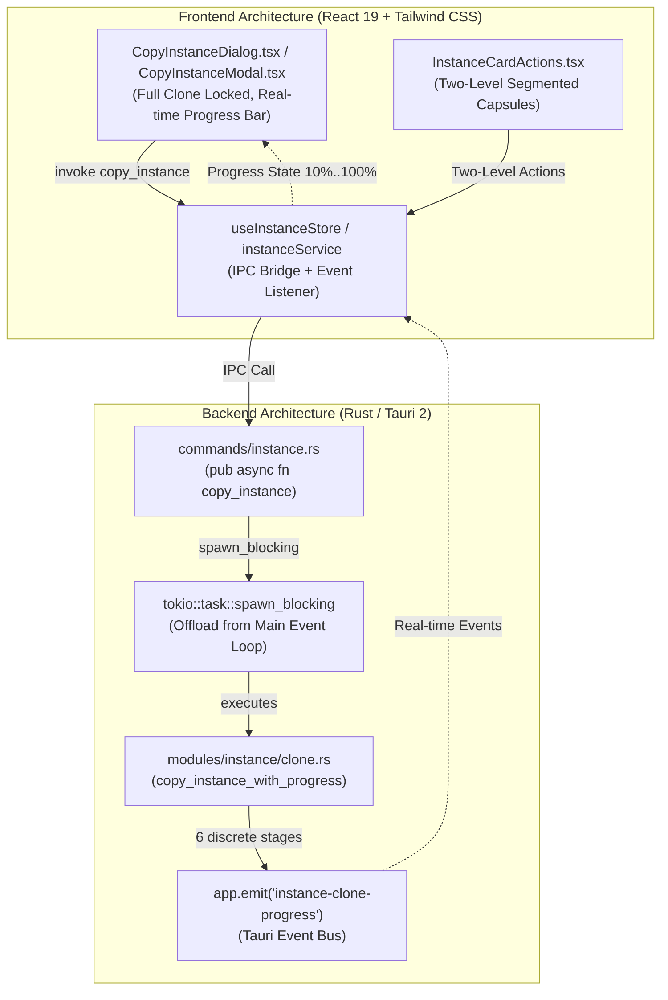
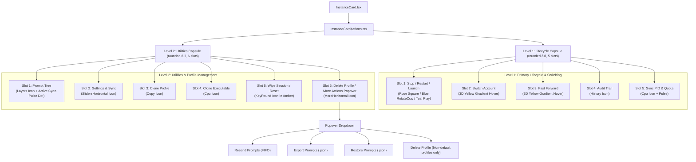

# Specification 226: Non-Blocking Async Instance Clone, Modal Simplification, and Two-Level Instance Card Actions Reversion

**Specification Identifier:** `226-antigravity-manager-clone-and-ui-enhancements`  
**Document:** `01-architecture-spec.md`  
**Version:** `1.0.0`  
**Status:** Approved  
**AI Confidence:** Production-Ready  
**Traceability:** Implements Task-02, Task-03, and Task-04 from `.ai-memory/plans/pending/226-antigravity-manager-clone-and-ui-enhancements.md`  

---

## 1. Problem Classification & Scope

### 1.1 UI Freeze During Profile / Instance Cloning
In previous versions, invoking `copy_instance` directly triggered heavy disk I/O synchronously on the Tauri main thread. Copying multi-gigabyte instance data directories (`copy_dir_recursive`), SQLite database backups (`state.vscdb`), and complex workspace trees (`workspaceStorage`) stalled the Win32 message loop (`WM_PAINT`, `WM_TIMER`) for upwards of 5 to 30 seconds. This caused the operating system to flag the Antigravity Manager window as `(Not Responding)` (ghost window artifact).

### 1.2 Over-Complicated Cloning Modal
The instance duplication dialogs (`CopyInstanceDialog.tsx` and `CopyInstanceModal.tsx`) presented users with an unnecessary radio choice between:
- `IDE Copy (Full Environment & Sessions)`
- `Profile Copy (Preferences & Snippets)`
Additionally, an optional checkbox allowed users to uncheck `Copy Workspace Projects & Folders`. Selecting "Profile Copy" or unchecking workspace replication frequently caused cloned profiles to miss critical extension state, active sessions, and recent workspaces, requiring manual repair. The user requirement strictly dictates removing the "Profile Copy" option and locking the process to a full clone with workspace copying permanently enabled and clearly communicated via an informative badge.

### 1.3 Cramped Instance Card Action Buttons
In a recent update, the instance card action toolbar was compressed into a single 10-slot pill capsule. On standard and compact card widths, buttons were heavily squeezed, reducing hit targets and obscuring visual feedback. The requirement dictates reverting `InstanceCardActions.tsx` back to a two-level segmented layout:
- **Level 1 (5 buttons)**: Lifecycle and high-frequency switching operations.
- **Level 2 (6 buttons)**: Deep configuration, management tools, and administrative actions.

---

## 2. Technical Architecture Overview



### 2.1 Asynchronous Non-Blocking Clone Engine
To guarantee zero UI freezing:
1. `copy_instance` in `src-tauri/src/commands/instance.rs` is converted to `pub async fn copy_instance(app: tauri::AppHandle, ...)`.
2. Heavy filesystem traversal and SQLite backups are moved off the async runtime thread into dedicated OS worker threads via `tokio::task::spawn_blocking`.
3. The clone engine reports progress through 6 discrete stages over the Tauri event channel `instance-clone-progress`:
   - **Stage 1 (10%) — Initializing**: Resolve source instance UUID, allocate target paths, create initial configuration stub in registry.
   - **Stage 2 (30%) — User Settings**: Replicate `settings.json`, `keybindings.json`, snippets, `security_presets.json`, and policy configurations.
   - **Stage 3 (50%) — SQLite Databases**: Safe read-only transactional clone of `state.vscdb`, `storage.json`, and machine identifiers via `safe_clone_sqlite_db`.
   - **Stage 4 (75%) — Workspace Storage**: Replicate `User/workspaceStorage/` trees, sync open projects and recent folder states via `copy_instance_projects`.
   - **Stage 5 (95%) — Telemetry & Parity**: Reseed synthetic device UUIDs, scrub hardware telemetry salts (`scrub_storage_json_telemetry`), and enforce IDE parity.
   - **Stage 6 (100%) — Complete**: Commit instance registry changes, write audit log records, and return finalized `InstanceConfig`.

### 2.2 Cloning Modal Simplification
1. Remove all radio inputs, tabs, or switch controls for `cloneMode`. `cloneMode` is hardcoded to `'full'`.
2. Remove checkbox toggle for `copyProjects`. `copyProjects` is hardcoded to `true`.
3. Render a unified informative status capsule in `src/pages/instances/CopyInstanceDialog.tsx` and `src/components/navbar/instanceSelector/CopyInstanceModal.tsx`:
   - Primary badge: `IDE Copy (Full Environment & Sessions)` with cyan/blue gradient styling.
   - Verification badge: `Locked: Full Environment + Workspaces Enabled` with an emerald checkmark.
   - Informative note: "Clones the complete isolated runtime environment, extensions, user settings, active sessions, and workspace storage."
4. Integrate real-time progress bar responding to `instance-clone-progress` events when `isCloning` is active.

### 2.3 Two-Level Instance Card Actions Reversion
`src/pages/instances/InstanceCardActions.tsx` is structured into two stacked segmented pill capsules (`rounded-full`, shared dark-glass border, subtle dividers, and full-width alignment):

#### Level 1: Primary Lifecycle & Switching (5 buttons)
1. **Slot 1: Lifecycle State Action**
   - When running: Dual button sub-capsule with `Stop` (`Square` icon in rose, stops instance PID) and `Restart` (`RotateCcw` icon in sky blue with hover shadow `hover:shadow-[0_2px_0_0_#0369a1]`).
   - When stopped: Launch button (`Play` icon in teal, starts instance).
2. **Slot 2: Switch Account**
   - Icon: `ArrowRightLeft`.
   - Interactive 3D yellow gradient styling on hover:
     `hover:bg-gradient-to-b hover:from-[#FDE047] hover:via-[#FACC15] hover:to-[#EAB308] hover:!text-black hover:[&_svg]:!text-black hover:font-bold hover:shadow-[0_2px_0_0_#A16207,0_3px_5px_rgba(0,0,0,0.25)] active:translate-y-0.5 active:shadow-[0_0_0_0_#A16207]`
   - Action: Opens account selection modal for target instance (`setSwitchTargetInstance(inst)`).
3. **Slot 3: Fast Forward**
   - Icon: `FastForward`.
   - Styling: Matches 3D yellow gradient hover conventions for unified action ergonomics.
   - Action: Immediately switches instance to highest-scoring eligible account (`handleFastForward(inst.config.id)`).
4. **Slot 4: Audit Trail**
   - Icon: `History`.
   - Action: Opens instance audit log drawer / modal (`openAuditDialog(inst.config.id, inst.config.name)`).
5. **Slot 5: Sync PID & Quota**
   - Icon: `Cpu`.
   - Visual: Pulses when sync is active (`animate-pulse` during background query).
   - Action: Reconciles active process trees and syncs account quota metrics (`handleSync(inst.config.id)`).

#### Level 2: Tools, Utilities & Profile Management (6 buttons)
1. **Slot 1: Prompts Tree**
   - Icon: `Layers`.
   - Visual: Active task indicator: when `hasActiveTask` is true, applies cyan highlight (`bg-cyan-50 dark:bg-cyan-950/40 text-cyan-600 dark:text-cyan-300`) with an animated top-right cyan dot (`bg-cyan-500 animate-pulse`).
   - Action: Opens prompt tree inspector targeting this instance (`openPromptTree(inst.config.id)`).
2. **Slot 2: Settings & Sync**
   - Icon: `SlidersHorizontal`.
   - Action: Opens instance settings dialog (`openSettingsDialog(inst.config.id)`).
3. **Slot 3: Clone Profile**
   - Icon: `Copy`.
   - Action: Opens simplified duplication dialog (`openCopyDialog(inst.config.id, inst.config.name)`).
4. **Slot 4: Clone Executable**
   - Icon: `Cpu` (or binary clone icon).
   - Action: Copies standalone base executable into instance directory (`handleCloneExecutable(inst.config.id)`).
5. **Slot 5: Wipe Session / Credentials**
   - Icon: `KeyRound` in amber.
   - State: Disabled when instance is running (`disabled={inst.is_running || isBusy}`).
   - Action: Clears active tokens and session markers (`handleWipeSession(inst.config.id)`).
6. **Slot 6: Delete Profile / More Actions Popover**
   - Icon: `MoreHorizontal`.
   - Dropdown Popover contents:
     - `Resend Prompts (FIFO)` (`RotateCcw` in cyan).
     - `Export Prompts (.json)` (`FileDown` in purple).
     - `Restore Prompts (.json)` (`FileUp` in emerald).
     - Divider line.
     - `Delete Profile` (`Trash2` in rose, visible for non-default instances).

---

## 3. Data Contracts & Interfaces

### 3.1 Rust IPC Structures (`src-tauri/src/modules/instance/clone.rs`)

```rust
use serde::{Deserialize, Serialize};

/// Real-time progress update emitted during deep instance cloning.
#[derive(Debug, Clone, Serialize, Deserialize)]
pub struct CloneProgressPayload {
    /// Source instance identifier being cloned.
    pub source_id: String,
    /// Destination instance display name.
    pub target_name: String,
    /// Discrete stage identifier: "initializing" | "user_settings" | "sqlite_databases" | "workspace_storage" | "telemetry_sync" | "complete"
    pub stage: String,
    /// Numeric completion percentage (10, 30, 50, 75, 95, 100).
    pub percentage: u8,
    /// Human-readable description of current operation.
    pub message: String,
    /// Unix timestamp in milliseconds when stage began.
    pub timestamp_ms: u64,
}
```

### 3.2 Rust Command Signature (`src-tauri/src/commands/instance.rs`)

```rust
#[tauri::command]
pub async fn copy_instance(
    app: tauri::AppHandle,
    source_id: String,
    target_name: String,
    clone_mode: Option<String>,
    copy_projects: Option<bool>,
) -> Result<InstanceConfig, String> {
    let resolved_src = instance::resolve_instance_id(&source_id).unwrap_or(source_id);
    let should_copy_projs = copy_projects.unwrap_or(true);
    let effective_mode = clone_mode.unwrap_or_else(|| "full".to_string());
    let app_handle = app.clone();

    tokio::task::spawn_blocking(move || {
        let emit_progress = |stage: &str, percentage: u8, msg: &str| {
            let payload = instance::CloneProgressPayload {
                source_id: resolved_src.clone(),
                target_name: target_name.clone(),
                stage: stage.to_string(),
                percentage,
                message: msg.to_string(),
                timestamp_ms: std::time::SystemTime::now()
                    .duration_since(std::time::UNIX_EPOCH)
                    .unwrap_or_default()
                    .as_millis() as u64,
            };
            if let Err(err) = app_handle.emit("instance-clone-progress", payload) {
                tracing::warn!("[Instance Clone] Failed to emit clone progress: {}", err);
            }
        };

        instance::copy_instance_with_progress(
            &resolved_src,
            target_name,
            Some(&effective_mode),
            should_copy_projs,
            emit_progress,
        )
    })
    .await
    .map_err(|e| format!("Clone task join error: {}", e))?
}
```

### 3.3 TypeScript Contract (`src/services/instanceService/types.ts`)

```typescript
export interface CloneProgressPayload {
    source_id: string;
    target_name: string;
    stage: 'initializing' | 'user_settings' | 'sqlite_databases' | 'workspace_storage' | 'telemetry_sync' | 'complete';
    percentage: number;
    message: string;
    timestamp_ms: number;
}
```

---

## 4. Component Hierarchy & Flowcharts

### 4.1 Sequence Diagram: Asynchronous Clone Execution

```mermaid
sequenceDiagram
    autonumber
    actor User as User (UI)
    participant Modal as CopyInstanceDialog
    participant Store as useInstanceStore
    participant IPC as Tauri IPC Command
    participant Worker as tokio::task::spawn_blocking
    participant Engine as clone::copy_instance_with_progress
    participant EventBus as Tauri Event Bus

    User->>Modal: Enters name & clicks "Duplicate"
    Modal->>Store: copyInstance(sourceId, targetName, "full", true)
    Store->>IPC: invoke("copy_instance", { source_id, target_name, clone_mode: "full", copy_projects: true })
    IPC->>Worker: spawn_blocking(move || ...)
    Note over IPC,Worker: Main Tauri thread remains free; Win32 window message loop continues running

    Worker->>Engine: Begin execution
    Engine->>EventBus: emit("instance-clone-progress", { stage: "initializing", percentage: 10 })
    EventBus-->>Modal: Update UI: "Initializing clone environment (10%)..."

    Engine->>EventBus: emit("instance-clone-progress", { stage: "user_settings", percentage: 30 })
    EventBus-->>Modal: Update UI: "Copying user settings & policies (30%)..."

    Engine->>EventBus: emit("instance-clone-progress", { stage: "sqlite_databases", percentage: 50 })
    EventBus-->>Modal: Update UI: "Cloning SQLite databases (50%)..."

    Engine->>EventBus: emit("instance-clone-progress", { stage: "workspace_storage", percentage: 75 })
    EventBus-->>Modal: Update UI: "Replicating workspace storage (75%)..."

    Engine->>EventBus: emit("instance-clone-progress", { stage: "telemetry_sync", percentage: 95 })
    EventBus-->>Modal: Update UI: "Scrubbing telemetry & syncing parity (95%)..."

    Engine->>EventBus: emit("instance-clone-progress", { stage: "complete", percentage: 100 })
    EventBus-->>Modal: Update UI: "Clone finalized successfully (100%)"

    Engine-->>Worker: Ok(InstanceConfig)
    Worker-->>IPC: Ok(InstanceConfig)
    IPC-->>Store: Return InstanceConfig
    Store-->>Modal: Resolve promise
    Modal-->>User: Close modal, trigger success toast, refresh list
```

### 4.2 Hierarchy Diagram: Two-Level Segmented Card Actions



---

## 5. UI Design & Styling Specifications

### 5.1 Simplified Clone Dialogs
1. **Scope Selection Removal**:
   - Delete the 2-column radio card grid containing `IDE Copy` vs `Profile Copy`.
   - In its place, mount a single sleek informative card:
   ```tsx
   <div className="p-3.5 rounded-xl border border-cyan-500/40 bg-cyan-50/70 dark:bg-[#171025] ring-1 ring-cyan-500/20 shadow-xs mb-3.5">
       <div className="flex items-center justify-between gap-2 mb-1">
           <div className="flex items-center gap-1.5 font-bold text-xs text-gray-900 dark:text-white">
               <Layers className="w-3.5 h-3.5 text-cyan-600 dark:text-cyan-400" />
               <span>IDE Copy (Full Environment & Sessions)</span>
           </div>
           <span className="px-2 py-0.5 rounded-full text-[9px] font-bold uppercase tracking-wider bg-emerald-100 dark:bg-emerald-950/80 text-emerald-800 dark:text-emerald-300 border border-emerald-300/50 dark:border-emerald-500/30 flex items-center gap-1">
               <Check className="w-2.5 h-2.5 stroke-[3]" />
               Locked: Full Clone
           </span>
       </div>
       <p className="text-[11px] text-gray-600 dark:text-slate-300 leading-relaxed">
           Clones the complete isolated runtime environment, extensions, user settings, active sessions, and workspace storage into the new profile.
       </p>
   </div>
   ```
2. **Workspace Project Duplication Locking**:
   - Replace the interactive checkbox with a locked confirmation pill:
   ```tsx
   <div className="p-2.5 rounded-xl border border-gray-200 dark:border-[#171025] bg-gray-50/60 dark:bg-[#051320] flex items-center justify-between gap-2 mb-4 text-[11px] font-medium text-gray-700 dark:text-slate-300">
       <div className="flex items-center gap-2">
           <FolderSync className="w-3.5 h-3.5 text-emerald-500 dark:text-emerald-400 shrink-0" />
           <span>Workspace projects, recent paths, and states included</span>
       </div>
       <span className="text-[10px] font-bold text-emerald-600 dark:text-emerald-400">Always Included</span>
   </div>
   ```
3. **Cloning Progress Bar**:
   - When duplication is executing (`isCloning === true`), display an animated linear progress bar with the stage message and percentage.

### 5.2 Two-Level Capsule Structure in `InstanceCardActions.tsx`
The component wrapper contains two contiguous segmented pill containers separated by vertical margin (`mb-1.5`):

```tsx
<div className="pt-2.5 border-t border-gray-100 dark:border-[#40285e]/80 mt-2 space-y-1.5">
    {/* Level 1: Primary Lifecycle & Switching (5 items) */}
    <div className="relative flex w-full items-stretch overflow-hidden rounded-full border border-slate-200/80 bg-slate-100 shadow-2xs divide-x divide-slate-200 dark:border-[#40285e] dark:bg-[#090611] dark:divide-[#40285e]">
        {/* Slot 1: Stop/Restart/Launch */}
        {/* Slot 2: Switch Account (3D yellow hover) */}
        {/* Slot 3: Fast Forward (3D yellow hover) */}
        {/* Slot 4: Audit Trail */}
        {/* Slot 5: Sync PID & Quota */}
    </div>

    {/* Level 2: Utilities & Profile Management (6 items) */}
    <div className="relative flex w-full items-stretch overflow-hidden rounded-full border border-slate-200/80 bg-slate-100 shadow-2xs divide-x divide-slate-200 dark:border-[#40285e] dark:bg-[#090611] dark:divide-[#40285e]">
        {/* Slot 1: Prompt Tree (Cyan pulse dot) */}
        {/* Slot 2: Settings & Sync */}
        {/* Slot 3: Clone Profile */}
        {/* Slot 4: Clone Executable */}
        {/* Slot 5: Wipe Session / Reset */}
        {/* Slot 6: Delete Profile / More Actions Popover */}
    </div>
</div>
```

---

## 6. Error Handling & Invariant Enforcement

1. **No UI Freezing Invariant**:
   Under no circumstances may filesystem traversal, recursive directory copying, or SQLite file backups execute directly on an async event loop thread or the Tauri main thread. All operations must run inside `tokio::task::spawn_blocking`.
2. **No Silent Errors Compliance**:
   All fallible operations in `clone.rs` must either propagate errors using `?` or log them explicitly via `crate::error::record_ignored` accompanied by a mandatory `// Justification:` comment.
3. **Graceful Progress Emission Fallback**:
   If the frontend disconnects or event emission fails (`app.emit(...)` returns `Err`), the clone process must continue executing to completion without panicking.
4. **Target Idempotency**:
   If target instance directory creation or registry insertion fails, any transiently created files must be cleaned up to prevent orphaned data directories.
5. **Caller IDE Self-Preservation**:
   Process termination or session wipe actions must never kill the active caller IDE running this development session.

---

## 7. Acceptance Criteria

| Criteria ID | Verification Method | Binary Pass Condition |
| :--- | :--- | :--- |
| **AC-01** | Async Non-blocking Clone | `copy_instance` command is declared `pub async fn` and delegates all heavy disk I/O to `tokio::task::spawn_blocking`. Window never enters `(Not Responding)` during multi-GB profile clones. |
| **AC-02** | Real-time Clone Progress | Tauri emits `instance-clone-progress` across 6 discrete stages (`10%`, `30%`, `50%`, `75%`, `95%`, `100%`) with correct payload schema. |
| **AC-03** | Modal Simplification | Both `CopyInstanceDialog.tsx` and `CopyInstanceModal.tsx` have zero references to `Profile Copy` or radio selection. Full IDE copy is locked and visibly badged. Workspace projects are always included. |
| **AC-04** | Level 1 Capsule Layout | `InstanceCardActions.tsx` renders top capsule with exactly 5 slots: Stop/Restart/Launch, Switch Account (3D yellow hover), Fast Forward, Audit Trail, Sync PID & Quota. |
| **AC-05** | Level 2 Capsule Layout | `InstanceCardActions.tsx` renders bottom capsule with exactly 6 slots: Prompt Tree (cyan pulse dot), Settings & Sync, Clone Profile, Clone Executable, Wipe Session, Delete / More Popover. |
| **AC-06** | Relative Paths Invariant | Zero absolute paths (`C:\`, `D:\`, `/home/`) present in specifications, plans, and touched code. |
| **AC-07** | Zero Builds / Tests | No `cargo build`, `npm run build`, `npm test`, or `cargo test` run during specification authoring. |
