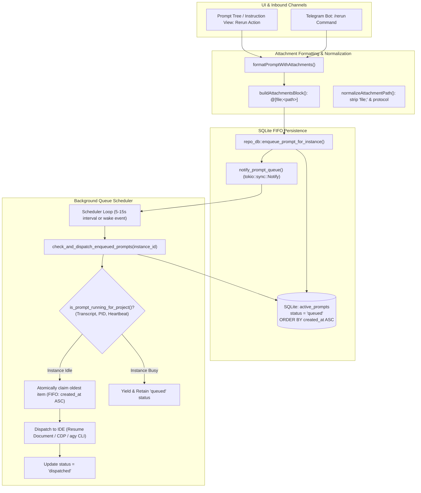

# Specification: Rerun and Attachment Format Correction — Architecture Spec

**Slug**: `rerun-and-attachment-format-correction`  
**Sequence**: `227`  
**Document**: `01-architecture-spec.md`  
**Status**: APPROVED  
**Target Branch**: `main`  
**Author**: Spec Author 01  
**Attribution**: strictly `@aukgit`  

---

## 1. Executive Summary & Strategic Intent

Antigravity Manager orchestrates AI agent interactions, prompts, transcripts, and instance runtimes across polyglot environments. Two critical defects in prompt rerun execution and multimodal attachment formatting have been identified:

1. **Rerun Enqueue Invariant Violation (Premature Injection / Send)**:
   - *Problem*: Certain rerun actions directly invoke immediate prompt injection or dispatch (`execute_prompt_injection`, `sendPromptNow`, or immediate Chrome DevTools Protocol / process spawning). Bypassing the database queue causes race conditions with active conversation turns, risks concurrent write conflicts in the IDE transcript, leads to prompt collisions and loss, and breaks the core First-In-First-Out (FIFO) queue guarantees.
   - *Strategic Solution*: Enforce an unconditional **FIFO Prompt Enqueue Invariant**. All rerun requests—whether initiated from the frontend Prompt Tree View, keyboard shortcuts, or Telegram inbound handlers—must strictly enqueue into the SQLite `active_prompts` table with `status: 'queued'`. Reruns must never execute immediate injection. Dispatching is delegated exclusively to the background queue scheduler (`check_and_dispatch_enqueued_prompts`), which verifies instance idle status before dispatching prompts chronologically.

2. **Attachment Formatting Discrepancy (Third Bracket Syntax)**:
   - *Problem*: Multimodal prompt attachments were formatted as bare bracketed paths `@[<path>]` (e.g. `@[assets/screenshots/image.png]`), omitting the required `file;` prefix.
   - *Strategic Solution*: Standardize all prompt attachment formatting to the canonical **Third Bracket Syntax**: `@[file;<file_path>]` (e.g. `1. @[file;assets/screenshots/image.png]`). Update all parser, extractor, and serializer touchpoints across frontend TypeScript (`promptAttachment.ts`, `clipboard.ts`, `PromptInstructionView.tsx`) and backend Rust (`detection.rs`) to generate canonical `@[file;<path>]` syntax while maintaining seamless backward compatibility for legacy `@[<path>]`.

---

## 2. Systems Architecture & Pipeline Workflow

The diagram below illustrates the end-to-end lifecycle of a prompt rerun and attachment handling across Antigravity Manager:



---

## 3. Canonical Attachment Syntax Specification

### 3.1 Terminology & Third Bracket Convention
In Indian and South Asian technical English conventions, bracket hierarchies are defined as:
- **First Brackets**: Round parentheses `(...)`
- **Second Brackets**: Curly braces `{...}`
- **Third Brackets**: Square brackets `[...]`

The requirement mandates that inside the third brackets (square brackets), the attachment token must begin with the keyword `file`, followed by a semicolon `;`, and then the target file path.

### 3.2 Canonical Grammar & Structure
The canonical attachment token format is:
```text
@[file;<file_path>]
```

When multiple attachments are appended to a prompt, they are grouped in an `Attachments:` block at the end of the user request:

```text
Attachments:
1. @[file;assets/screenshots/dashboard.png]
2. @[file;assets/screenshots/error-modal.png]
```

If the prompt contains an explicit `</USER_REQUEST>` closing tag, the `Attachments:` block is placed immediately before the closing tag, ensuring prompt parsers in downstream language models recognize the attachments as belonging to the user turn.

### 3.3 Grammar Rules
1. **Prefix**: Must start with `@[` followed immediately by `file;`.
2. **Path**: The path follows the semicolon `;`. Leading and trailing whitespace surrounding the semicolon or path must be tolerated and stripped during parsing: `@[file; <file_path>]` -> `<file_path>`.
3. **Closing**: Must close with `]`.
4. **Path Sanitization**:
   - File protocol prefixes (`file:///`, `file://`, `agm-asset://`, `http://asset.localhost/`) are stripped.
   - Slashes are normalized according to repository/platform conventions.
   - Redundant relative prefixes (`./`) are collapsed.

### 3.4 Backward Compatibility Matrix
All parsers and extractors must accept both canonical and legacy formats without throwing errors or dropping files:

| Source Token | Extractor Output (Clean Path) | Formatter Output (Canonical) |
|---|---|---|
| `@[file;assets/shot.png]` | `assets/shot.png` | `1. @[file;assets/shot.png]` |
| `@[file; assets/shot.png]` | `assets/shot.png` | `1. @[file;assets/shot.png]` |
| `@[assets/shot.png]` (Legacy) | `assets/shot.png` | `1. @[file;assets/shot.png]` |
| `` (Markdown) | `assets/shot.png` | `1. @[file;assets/shot.png]` |
| `@[file;file:///repo/shot.png]` | `repo/shot.png` | `1. @[file;repo/shot.png]` |

---

## 4. FIFO Prompt Enqueue Invariant

### 4.1 Invariant Definition
> **FIFO Prompt Enqueue Invariant**:
> Any operation intended to rerun, retry, replay, or re-execute a prompt must NEVER invoke immediate dispatch or injection (`execute_prompt_injection`, `sendPromptNow`, or direct CDP submission). All rerun operations must strictly route through `repo_db::enqueue_prompt_for_instance` (backend) or `enqueuePrompt` (frontend) with initial `status: 'queued'`.

### 4.2 Why Immediate Send is Prohibited
1. **Active Turn Corruption**: If an IDE instance is currently generating a response or executing a subagent tool call, injecting a prompt immediately clobbers the active transcript state, resulting in interleaved messages, lost context, or corrupted JSONL records.
2. **Queue Starvation & Reordering**: Immediate dispatch bypasses prompts that have already been queued and are awaiting execution. This violates First-In-First-Out ordering and causes non-deterministic execution sequences.
3. **Process Crash & Volatility**: Prompts sent directly without database persistence are lost permanently if the IDE process crashes or restarts before processing completes.
4. **Tenant Isolation**: Direct injection often relies on active window focus or ambient process state rather than the canonical `instance_id`. Database enqueuing guarantees strict instance scoping.

### 4.3 Comparison Matrix: Immediate Send vs. FIFO Enqueue

| Dimension | Immediate Send (`sendPromptNow` / `execute_prompt_injection`) | FIFO Enqueue (`enqueuePrompt` / `enqueue_prompt_for_instance`) |
|---|---|---|
| **Initial Status** | Directly attempts `'dispatched'` or running state | Persisted as `status = 'queued'` |
| **Concurrency Safety** | Dangerous: clobbers active turns if instance is busy | Safe: gates dispatch behind instance idle detection |
| **Ordering Guarantee** | Non-deterministic (LIFO / race condition prone) | Strict FIFO (`ORDER BY created_at ASC, id ASC`) |
| **Crash Recovery** | Unrecoverable if process dies mid-send | Fully recoverable from SQLite on restart |
| **Multimodal Handling** | May drop media paths during IPC transmission | Serializes attachments and data URIs atomically |

---

## 5. Background Queue Scheduling Architecture

### 5.1 The `check_and_dispatch_enqueued_prompts` Engine
The background scheduling engine is centered in `src-tauri/src/modules/repo_db/queue.rs` via `check_and_dispatch_enqueued_prompts(target_instance: Option<&str>) -> Result<usize, String>`.

#### Operational Stages:
1. **Instance Scoping**:
   - If `target_instance` is `Some(id)`, the scheduler queries only prompts assigned to that specific `instance_id`.
   - If `target_instance` is `None`, the scheduler iterates over all active instances registered in the instance manager.

2. **Strict Chronological FIFO Query**:
   Prompts are selected using strict chronological ordering:
   ```sql
   SELECT id, project_id, instance_id, repo_path, prompt_content, model, session_id, image_payload, created_at
   FROM active_prompts
   WHERE instance_id = ? AND status = 'queued'
   ORDER BY created_at ASC, id ASC
   LIMIT 1;
   ```
   *Rule*: Inverted LIFO queries (`ORDER BY updated_at DESC`) are strictly forbidden in queue dispatch logic.

3. **Instance Idle Gating (`is_prompt_running_for_project`)**:
   Before dispatching the oldest queued prompt, the engine checks whether the target project/instance is currently busy:
   - Evaluates `transcript_full.jsonl` (and `transcript.jsonl`) for incomplete `USER_INPUT` turns without matching terminal assistant completion or tool outputs.
   - Evaluates heartbeat files and PID process liveness.
   - If the instance is running or busy, the scheduler yields, leaving the prompt in `status: 'queued'` to be checked on the next tick.

4. **Atomic Claim & Dispatch Execution**:
   - When the instance is confirmed idle, the scheduler creates the resume task document (`resume_task_document`) or triggers the IDE dispatch mechanism.
   - Upon confirmed successful handoff, the status transitions from `'queued'` to `'dispatched'`.
   - If dispatch fails, the prompt remains `'queued'` with a backoff timestamp to prevent busy-loop thrashing.

### 5.2 Dynamic Wakeup via `notify_prompt_queue()`
To prevent unacceptable latency when enqueuing prompts while an instance is idle, the enqueue handler calls `crate::modules::scheduler::notify_prompt_queue()`. This signals a `tokio::sync::Notify` barrier, immediately waking the scheduler loop without waiting for the next periodic polling tick.

---

## 6. Cross-Subsystem Component Contracts

### 6.1 Frontend TypeScript Subsystem
- **`src/utils/promptAttachment.ts`**:
  - `buildAttachmentsBlock(paths: string[])`: Formats lines as `${idx + 1}. @[file;${p}]`.
  - `collectPromptAttachmentRawTargets(prompt: string)`: Matches `/@\[(?:file;\s*)?([^\]]+)\]/g`, strips `file;`, and returns clean path tokens.
  - `extractRawTarget(input: PromptAttachmentInput)`: Strips `file;` prefix from string inputs.
  - `stripAttachmentsFromPrompt(prompt: string)`: Cleans both legacy `@[...]` and canonical `@[file;...]` attachment blocks.
  - `formatPromptWithAttachments(...)`: Orchestrates extraction, normalization, deduplication, and insertion of canonical `@[file;...]` blocks.
- **`src/components/instances/PromptTreeView/clipboard.ts`**:
  - `extractAssets(text: string)`: Updated regex to parse `@[file;...]` and strip `file;`.
  - `extractLocalPathFromUri(uri: string)`: Defensively strips `file;` prefix before path resolution.
- **`src/components/instances/PromptTreeView/PromptInstructionView.tsx`**:
  - `executeDirectRerun()`: Calls `enqueuePrompt` (never `sendPromptNow`). Uses `formatPromptWithAttachments` to ensure attachments carry `@[file;...]`.
- **`src/components/instances/PromptTreeView/usePromptTreePromptActions.ts`**:
  - `dispatchRerunMessages()`: Confirmed to use `enqueuePrompt`.
  - `dispatchMultiPromptResend()`: Replaces any legacy direct send calls with `enqueuePrompt`.

### 6.2 Backend Rust Subsystem
- **`src-tauri/src/modules/repo_db/detection.rs`**:
  - `extract_image_uris_or_paths(content: &str)`: When parsing bracketed tokens from prompts, strips `file;` prefix before verifying image extensions and resolving local file paths.
- **`src-tauri/src/modules/telegram_inbound/prompt_history.rs`**:
  - `rerun_prompt_by_id()`: Replaces `execute_prompt_injection(&args)` with `crate::modules::repo_db::enqueue_prompt_for_instance`, sets status to `'queued'`, and notifies scheduler.
- **`src-tauri/src/modules/telegram_inbound/send_flow.rs`**:
  - `dispatch_turn_rerun_execution()`: Replaces direct injection with `enqueue_prompt_for_instance`.

---

## 7. Invariants, Security & Error Discipline

1. **Invariant 1: Strictly Relative Git Paths**:
   All paths in specifications, code comments, commit messages, and documentation must be repository-relative (e.g. `02-spec/...`, `src/...`, `src-tauri/...`). Never output absolute paths (`C:\...`, `D:\...`).
2. **Invariant 2: No Silent Errors**:
   All fallible operations in Rust must propagate errors via `AppError` and log via `tracing`. All TypeScript failures must route to `useErrorStore.getState().captureException` or `trackWarning`. Bare `catch {}` blocks or ignored results are forbidden.
3. **Invariant 3: Strict FIFO Queue Ordering**:
   All prompt retrieval queries across SQLite tables (`active_prompts`, `prompt_backups`) must enforce `ORDER BY created_at ASC, id ASC`.
4. **Invariant 4: Worker Search Primacy**:
   Codebase inspection must be conducted exclusively via GitMap (`gitmap aum search`, `gitmap find`, `gitmap cat`). Standard `rg`, `grep`, or `Select-String` are banned.
5. **Invariant 5: Attribution Integrity**:
   Attribution must strictly attribute `@aukgit` (`(Thanks to @aukgit)`). No other user handles may appear.
