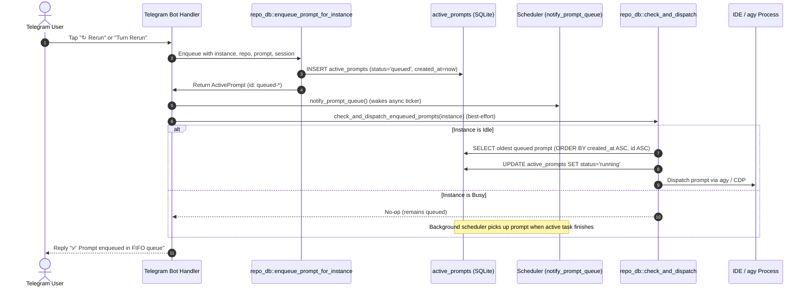

# Component Specification: Backend Telegram Rerun Enqueue & Queue Transition Engine

- **Specification Slug:** `227-rerun-and-attachment-format-correction`
- **Specification Path:** `02-spec/21-app/227-rerun-and-attachment-format-correction/02-component-spec.md`
- **Subtask Plan Path:** `.ai-memory/plans/subtasks/227-rerun-and-attachment-format-correction/02-backend-rerun-enqueue.md`
- **Master Plan Path:** `.ai-memory/plans/pending/227-rerun-and-attachment-format-correction.md`
- **Author:** Spec Author 02 (Backend & Queue Pipeline Working Group)
- **Primary Attribution:** `@aukgit` (`(Thanks to @aukgit)`)
- **Status:** APPROVED & MANDATED
- **Target Release:** `v4.227.0`
- **Component Scope:**
  - `src-tauri/src/modules/telegram_inbound/prompt_history.rs` (`rerun_prompt_by_id`, image payload preservation, FIFO queueing)
  - `src-tauri/src/modules/telegram_inbound/send_flow.rs` (`dispatch_turn_rerun_execution`, removal of direct injection and synchronous CDP submit)
  - `src-tauri/src/modules/repo_db/agy.rs` (`enqueue_prompt_for_instance` integration)
  - `src-tauri/src/modules/scheduler.rs` (`notify_prompt_queue` wakeup)

---

## 1. Technical Directive & Architectural Invariants

### 1.1 Problem Statement & Anti-Pattern Analysis
In earlier revisions of the Telegram inbound dispatch subsystem:
1. **Immediate Injection Bypass**: When a user tapped a rerun action in `/history` or issued `/rerun <id8>`, `prompt_history.rs:rerun_prompt_by_id` constructed an execution command and called `super::injection::execute_prompt_injection(&args).await`. Similarly, when a user clicked a turn rerun or turn verification inline button in `send_flow.rs`, `dispatch_turn_rerun_execution` called `execute_prompt_injection(&args).await` and immediately followed it with `crate::modules::instance::cdp_onboarding::submit_prompt_via_cdp_for_instance(instance_id, &injected_text, true)`.
2. **Queue Invariant Violation**: By invoking direct injection and CDP DOM submission, the system completely bypassed the centralized SQLite queue in `active_prompts`. If the target IDE instance was already executing a long-running prompt, the rerun either:
   - Collided with the active session, corrupting the prompt injection pipeline.
   - Forcibly terminated or aborted running jobs without user consent (`cancel_running_first = true`).
   - Failed silently without an audit trail in `active_prompts` with `status = 'queued'`.
3. **Loss of Attached Media**: In `prompt_history.rs`, lines 187–193 explicitly dropped media payloads:
   ```rust
   // ANTI-PATTERN: Dropping original images on rerun
   let image_note = prompt
       .image_payload
       .as_deref()
       .map(str::trim)
       .filter(|payload| !payload.is_empty())
       .map(|_| "\n• <b>Image:</b> <i>original had an image attachment — text re-sent only</i>")
       .unwrap_or("");
   ```
   Rerunning a prompt that originally had screenshot tokens or image attachments failed to re-attach or forward those images to the IDE.

### 1.2 Mandatory Architectural Invariants
All prompt rerun operations, whether initiated via `/history` one-tap rerun, `/rerun <id8>`, conversation turn rerun (`send:tr:<cid8>:<turn>`), or verification rerun (`send:tv:<cid8>:<turn>`), MUST comply with the following invariants:
1. **FIFO Enqueue Mandate**: Reruns MUST NOT execute immediate prompt injection (`execute_prompt_injection`) or direct CDP submission (`submit_prompt_via_cdp_for_instance(..., true)`). Reruns MUST route through `crate::modules::repo_db::enqueue_prompt_for_instance` with initial database state `status = 'queued'`.
2. **Preservation of Media Payloads**: If the source prompt record (`ActivePrompt`) contains an `image_payload` (e.g. joined file paths, screenshot tokens, or image URIs), this payload MUST be preserved and stored in the newly enqueued `ActivePrompt` row and its associated `.antigravity_resume_task.json` snapshot.
3. **Reactive Scheduler Wakeup**: Immediately after enqueuing, handlers MUST trigger `crate::modules::scheduler::notify_prompt_queue()` to awaken the background FIFO scheduler ticker without waiting for the default polling interval.
4. **Best-Effort Idle Dispatch Check**: Handlers MUST trigger an immediate non-blocking idle check via `crate::modules::repo_db::check_and_dispatch_enqueued_prompts(Some(instance_id))` wrapped in `crate::error::record_ignored` with an explicit justification comment. If the IDE instance is idle, the prompt is dispatched within sub-second latency; if the IDE is busy, it remains safely in `queued` state until the executing task terminates.
5. **No Silent Errors (House Rule 2026-10-10)**: All database and enqueue operations must return structured errors (`Result<..., String>` or `AppError`). Best-effort notifications must be tracked via `crate::error::record_ignored` accompanied by mandatory justification comments.

---

## 2. Component Specification: `prompt_history.rs`

### 2.1 File & Function Identity
- **Target File:** `src-tauri/src/modules/telegram_inbound/prompt_history.rs`
- **Target Function:** `pub async fn rerun_prompt_by_id(id8: &str) -> (String, Option<Value>)`

### 2.2 Parameter Mappings & Resolution
When `rerun_prompt_by_id(id8)` matches a source prompt `prompt: ActivePrompt` from `crate::modules::repo_db::list_all_prompts()`:
1. `conversation`: Resolved via `rerun_conversation(&prompt)`.
2. `instance`: Derived from `prompt.instance_id.trim()`, falling back to `"default"` if empty.
3. `repo_path`: Extracted directly from `prompt.repo_path.as_str()`.
4. `prompt_content`: Extracted directly from `prompt.prompt_content.as_str()`.
5. `image_payload`: Extracted from `prompt.image_payload.as_deref()`.

### 2.3 Refactoring Blueprint: Replacing Direct Injection with Queue Enqueue
#### Existing Anti-Pattern (Before)
```rust
// BEFORE: Bypassing queue via direct injection
let args = format!(
    "{conversation} --instance {instance} {}",
    prompt.prompt_content
);
let injected = super::injection::execute_prompt_injection(&args).await;
```

#### Canonical Enqueue Flow (After)
```rust
// AFTER: Strict FIFO Queue Enqueue
let mut enqueued = match crate::modules::repo_db::enqueue_prompt_for_instance(
    instance,
    &prompt.repo_path,
    &prompt.prompt_content,
    Some(&conversation),
) {
    Ok(p) => p,
    Err(err) => {
        return (
            format!(
                "⚠️ <b>Failed to enqueue rerun:</b> <code>{}</code>",
                clean_for_telegram_html(&err, 200)
            ),
            None,
        );
    }
};

// Preserve original image payload if present
if let Some(ref img) = prompt.image_payload {
    let clean_img = img.trim();
    if !clean_img.is_empty() {
        enqueued.image_payload = Some(clean_img.to_string());
        // Justification: Persisting preserved image payload to SQLite queue is best-effort cache sync
        crate::error::record_ignored(
            crate::modules::repo_db::save_or_requeue_prompt(&enqueued),
            "persist preserved image payload for rerun prompt",
        );
    }
}

// Wake background scheduler immediately
crate::modules::scheduler::notify_prompt_queue();

// Immediate dispatch check if the instance is currently idle
// Justification: Idle dispatch check is best-effort; background scheduler picks up prompt if busy
crate::error::record_ignored(
    crate::modules::repo_db::check_and_dispatch_enqueued_prompts(Some(instance)),
    "check and dispatch enqueued rerun prompt immediately if idle",
);
```

### 2.4 User-Facing Telegram Response Updates
1. **Immediate Telegram Ack**: Update acknowledgement text from `"✅ Prompt dispatched to IDE!"` to `"✅ Prompt enqueued for execution (FIFO queue)!"`.
2. **Image Status Note**: Replace the derogatory "text re-sent only" message with a positive confirmation of preserved media:
   ```rust
   let image_note = enqueued
       .image_payload
       .as_deref()
       .map(str::trim)
       .filter(|payload| !payload.is_empty())
       .map(|_| "\n• <b>Image:</b> <i>original image attachment preserved and queued</i>")
       .unwrap_or("");
   ```
3. **Card Header**: Update response header to clearly identify queue status:
   ```rust
   let reply = format!(
       "🔁 <b>Prompt Re-Run Enqueued</b>\n\
       • <b>Queue ID:</b> <code>{queue_id}</code>\n\
       • <b>Status:</b> <code>queued</code> (FIFO Order)\n\
       • <b>Machine:</b> <code>{machine}</code>\n\
       • <b>Instance:</b> <code>{instance}</code>\n\
       • <b>Conversation:</b> <code>{conversation}</code>\n\
       • <b>Source prompt:</b> <code>{source}</code> <i>{sent_at}</i>{image_note}\n\n\
       <b>Enqueued Prompt Preview:</b>\n\
       <pre>{preview}</pre>\n\n\
       {proof}",
       queue_id = clean_for_telegram_html(&enqueued.id, 24),
       machine = clean_for_telegram_html(&local_machine_label(), META_CHARS),
       instance = clean_for_telegram_html(instance, META_CHARS),
       conversation = clean_for_telegram_html(&conversation, META_CHARS),
       source = clean_for_telegram_html(&id_prefix(&prompt.id), 16),
       sent_at = format_sent_at(prompt.created_at),
       preview = clean_for_telegram_html(&prompt_preview(&enqueued, summary_words), 1000),
       proof = proof,
   );
   ```

---

## 3. Component Specification: `send_flow.rs`

### 3.1 File & Function Identity
- **Target File:** `src-tauri/src/modules/telegram_inbound/send_flow.rs`
- **Target Function:**
  ```rust
  async fn dispatch_turn_rerun_execution(
      cid8: &str,
      full_cid: &str,
      instance_id: &str,
      repo_path: &str,
      seq_code: &str,
      gitmap_seq_code: &str,
      turn_num: usize,
      is_verify: bool,
      prompt_content_opt: Option<String>,
  ) -> (String, Option<Value>)
  ```

### 3.2 Removal of Direct Injection and Direct CDP Submission
#### Existing Anti-Pattern (Before)
Lines 1177–1186:
```rust
// BEFORE: Direct injection and synchronous CDP bypass
let args = format!("{} --instance {} {}", full_cid, instance_id, injected_text);
let injected = execute_prompt_injection(&args).await;

// Trigger direct CDP submission for instance
let _cdp_ok = crate::modules::instance::cdp_onboarding::submit_prompt_via_cdp_for_instance(
    instance_id,
    &injected_text,
    true,
)
.is_ok();
```
#### Defects Eliminated
- `execute_prompt_injection(&args)` bypassed `active_prompts`.
- `submit_prompt_via_cdp_for_instance(instance_id, &injected_text, true)` passed `cancel_running_first = true`, abruptly cancelling active developer turns in the IDE.
- Zero persistence in `active_prompts` with status `queued`.

### 3.3 Canonical Enqueue Flow (After)
```rust
// AFTER: Strict FIFO Queue Enqueue
let mut enqueued = match crate::modules::repo_db::enqueue_prompt_for_instance(
    instance_id,
    repo_path,
    &injected_text,
    Some(full_cid),
) {
    Ok(p) => p,
    Err(err) => {
        return (
            format!(
                "⚠️ <b>Failed to enqueue {action}:</b> <code>{}</code>",
                clean_for_telegram_html(&err, 200)
            ),
            None,
        );
    }
};

// Preserve or update image payload if media detected
let (_, detected_images) =
    crate::modules::repo_db::extract_image_payload_or_path(&injected_text);
if !detected_images.is_empty() {
    enqueued.image_payload = Some(detected_images.join(";"));
    // Justification: Persisting detected media paths to SQLite queue is best-effort cache sync
    crate::error::record_ignored(
        crate::modules::repo_db::save_or_requeue_prompt(&enqueued),
        "persist media paths for turn rerun prompt",
    );
}

// Wake background scheduler immediately
crate::modules::scheduler::notify_prompt_queue();

// Immediate dispatch check if the instance is currently idle
// Justification: Idle dispatch check is best-effort; background scheduler picks up prompt if busy
crate::error::record_ignored(
    crate::modules::repo_db::check_and_dispatch_enqueued_prompts(Some(instance_id)),
    "check and dispatch enqueued turn rerun prompt immediately if idle",
);
```

### 3.4 Telegram Confirmation & Response Metadata
- **Status Reporting**: Set status explicitly to `queued (FIFO Queue)`.
- **Action Header**: Display `🔁 Prompt Turn Rerun Enqueued` or `🛡️ Prompt Verification Enqueued`.
- **Delivery Proof**: Retain asynchronous background proof shot (`capture_and_send_proof_shot`) without blocking the response.

---

## 4. Lifecycle & Status Transition Model



### 4.1 State Machine Transitions
1. **Initial Enqueue**:
   - `status`: `'queued'`
   - `id`: `format!("queued-{}", uuid)`
   - `created_at`: `Utc::now().timestamp()`
   - `image_payload`: Persisted from original prompt or extracted from attachment markdown.
2. **Scheduler Pickup**:
   - Query: `SELECT ... FROM active_prompts WHERE status IN ('backed_up', 'queued', 'pending') ORDER BY created_at ASC, id ASC LIMIT 1`.
   - Invariant: Strict FIFO ordering is preserved across all SQLite queries.
3. **Dispatch & Execution**:
   - `status`: Transitions from `'queued'` -> `'running'` (or `'in_flight'`).
   - On completion: Transitions to `'completed'` or archived.

---

## 5. Verification Contracts & Quality Gates

### 5.1 Verification Checklist
| Component | Function | Expected Behavior | Verification Target |
|---|---|---|---|
| `prompt_history.rs` | `rerun_prompt_by_id` | Inserts `status = 'queued'`, preserves `image_payload`, signals scheduler | `active_prompts` row starts with `queued-`, status `queued` |
| `send_flow.rs` | `dispatch_turn_rerun_execution` | Removes direct injection, enqueues via `enqueue_prompt_for_instance` | No direct CDP abort; prompt saved to SQLite |
| `scheduler.rs` | `notify_prompt_queue` | Signals `PROMPT_QUEUE_NOTIFY` to interrupt 30s backoff sleep | Wakes ticker immediately |
| Rust Quality Gate | Compilation & Linter | Clean compilation without warnings | `cargo fmt -- --check`, `cargo clippy --lib --bin agm` |

### 5.2 Relative Path Invariant & House Rules
- Never use or log absolute filesystem paths.
- All errors must be propagated or recorded via `crate::error::record_ignored` with a `// Justification:` comment.
