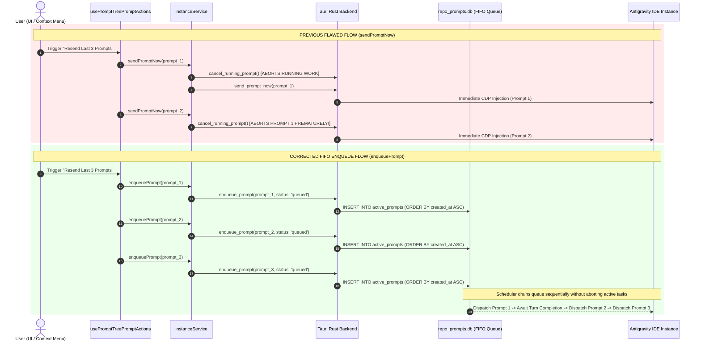

# Migration & Verification Spec: Backward Compatibility, Frontend Rerun Enqueue Audit, and End-to-End Verification

**Slug:** `rerun-and-attachment-format-correction`  
**Sequence:** `227`  
**Spec Document:** `02-spec/21-app/227-rerun-and-attachment-format-correction/03-migration-and-verification-spec.md`  
**Target Release:** v4.270.0  
**Status:** APPROVED FOR IMPLEMENTATION  
**Lead Author:** Spec Authoring Subagent 03  
**Parent Master Plan:** `.ai-memory/plans/pending/227-rerun-and-attachment-format-correction.md`  
**Sibling Specifications:**  
- `02-spec/21-app/227-rerun-and-attachment-format-correction/01-architecture-spec.md`  
- `02-spec/21-app/227-rerun-and-attachment-format-correction/02-component-spec.md`  
- `02-spec/21-app/227-rerun-and-attachment-format-correction/04-e2e-report.md`  
**Subtask Execution Plan:** `.ai-memory/plans/subtasks/227-rerun-and-attachment-format-correction/03-frontend-rerun-and-tests.md`  

---

## 1. Executive Summary & Context

Task 227 standardizes Antigravity Manager's multimodal prompt attachment format and enforces strict FIFO queue ingestion for all rerun and resend actions across the desktop client and backend daemons.

### 1.1 Core Problems Solved
1. **Attachment Prefix Missing ("Third Bracket" Canonical Syntax)**:
   Antigravity IDE multimodal ingestion expects bracketed attachment tokens to be explicitly prefixed with `file;` inside square brackets (known in South Asian English conventions as "third brackets"), conforming to `@[file;<path>]` (e.g. `1. @[file;assets/diagram.png]`). Previous implementations omitted the prefix and generated `@[<path>]`, leading to format inconsistencies between IDE parsing rules and clipboard payload formatters.
2. **Backward Compatibility Preservation**:
   Thousands of existing conversation records in SQLite databases (`repo_prompts.db`, `active_prompts`, `prompt_backups`), Telegram inbound transcripts, and filesystem logs store attachments in legacy formats (`@[<path>]` and Markdown ``). The system must read and normalize legacy attachments seamlessly without requiring destructive database schema migrations or breaking historical conversation displays.
3. **Frontend Rerun / Resend Queue Invariant**:
   Prompt execution invariants require that any rerun, resend, or multi-prompt replay must strictly enqueue into the SQLite FIFO prompt queue (`enqueue_prompt` / `status: 'queued'`) rather than triggering direct, out-of-order execution via `sendPromptNow` or immediate Chrome DevTools Protocol (CDP) injection. An audit of frontend action sites revealed that while `dispatchRerunMessages` is already compliant, `dispatchMultiPromptResend` in `src/components/instances/PromptTreeView/usePromptTreePromptActions.ts` was calling `sendPromptNow`, violating the FIFO ordering invariant.

---

## 2. Backward Compatibility & Parser Dual-Mode Specification

### 2.1 Backward Compatibility Invariant
All parser, extractor, clipboard, and rendering touchpoints across TypeScript and Rust must recognize both the canonical `@[file;<file_path>]` syntax and the legacy `@[<file_path>]` syntax interchangeably.

```text
┌────────────────────────────────────────────────────────────────────────┐
│                        Attachment Input Formats                        │
├───────────────────────────────────┬────────────────────────────────────┤
│ Canonical (New)                   │ 1. @[file;assets/screenshot.png]   │
│ Canonical Relative Path           │ 1. @[file;assets/repo/shot.png]    │
│ Legacy Bracketed                  │ 1. @[assets/screenshot.png]        │
│ Legacy Markdown Embedded          │    │
└───────────────────────────────────┴────────────────────────────────────┘
                                     │
                                     ▼
                    ┌─────────────────────────────────┐
                    │  Dual-Mode Universal Normalizer │
                    │   - Strips 'file;' prefix       │
                    │   - Strips 'file:///' scheme    │
                    │   - Resolves relative/abs paths │
                    └─────────────────────────────────┘
                                     │
                                     ▼
┌────────────────────────────────────────────────────────────────────────┐
│                        Normalized Outputs                              │
├───────────────────────────────────┬────────────────────────────────────┤
│ Formatted Prompt (To IDE / Queue) │ 1. @[file;<normalized_path>]       │
│ Webview / Preview Renderer        │ asset:// or http://asset.localhost │
│ Disk File Loader                  │ Native OS file path                │
│ Found Media for Backend Injection │ Array of clean local paths         │
└───────────────────────────────────┴────────────────────────────────────┘
```

### 2.2 Extraction Regex Taxonomy

To ensure robust matching across all variations (including optional spaces after the semicolon or inside the bracket), regular expressions are standardized as follows:

| Component | Target File | Legacy Pattern | Canonical Dual-Mode Pattern |
|---|---|---|---|
| **Attachment Collector** | `src/utils/promptAttachment.ts` | `/@\[(.*?)\]/g` | `/@\[(?:file;\s*)?(.*?)\]/gi` |
| **Raw Target Extractor** | `src/utils/promptAttachment.ts` | `/@\[(.*?)\]/` | `/@\[(?:file;\s*)?(.*?)\]/i` |
| **Old Block Cleaner** | `src/utils/promptAttachment.ts` | `/\bAttachments:\s*(?:\r?\n\s*\d+\.\s*@\[.*?\])+/gi` | `/(?:\r?\n)*\bAttachments:\s*(?:\r?\n\s*\d+\.\s*@\[(?:file;\s*)?.*?\])+/gi` |
| **Clipboard Asset Extractor** | `src/components/instances/PromptTreeView/clipboard.ts` | `/@\[(.*?)\]/g` | `/@\[(?:file;\s*)?(.*?)\]/gi` |
| **Instruction View Extractor** | `src/components/instances/PromptTreeView/PromptInstructionView.tsx` | `/@\[(.*?)\]/g` | `/@\[(?:file;\s*)?(.*?)\]/gi` |
| **Rust Token Parser** | `src-tauri/src/modules/repo_db/detection.rs` | Token trim `[@]` | Trim `[@]` then strip prefix `"file;"` |

### 2.3 Detailed TypeScript Extraction Contracts

#### 2.3.1 `src/utils/promptAttachment.ts`
```typescript
function stripProtocolPrefix(raw: string): string {
    let clean = raw.trim();
    // Support canonical third-bracket prefix
    if (clean.toLowerCase().startsWith('file;')) {
        clean = clean.slice(5).trim();
    }
    if (clean.startsWith('agm-asset://')) {
        clean = clean.slice('agm-asset://'.length);
    }
    if (clean.startsWith('http://asset.localhost/')) {
        clean = clean.slice('http://asset.localhost/'.length);
    }
    if (clean.startsWith('https://asset.localhost/')) {
        clean = clean.slice('https://asset.localhost/'.length);
    }
    if (/^file:\/\/\/[a-zA-Z]:[\\/]/.test(clean)) {
        return clean.slice(8);
    }
    if (clean.startsWith('file:///')) {
        return clean.slice(7);
    }
    if (clean.startsWith('file://')) {
        return clean.slice(7);
    }
    return clean;
}

function buildAttachmentsBlock(paths: string[]): string {
    const lines = paths.map((p, idx) => `${idx + 1}. @[file;${p}]`);
    return `Attachments:\n${lines.join('\n')}`;
}
```

#### 2.3.2 Rust Backend Parser (`src-tauri/src/modules/repo_db/detection.rs`)
```rust
let img_exts = [".png", ".jpg", ".jpeg", ".webp", ".gif", ".svg", ".bmp"];
for token in content.split_whitespace() {
    let clean = token.trim_matches(|c| {
        c == '"'
            || c == '\''
            || c == '('
            || c == ')'
            || c == '['
            || c == ']'
            || c == '<'
            || c == '>'
            || c == '@'
    });
    // Strip canonical file; prefix if present inside brackets (e.g. @[file;path.png])
    let clean_path = clean
        .strip_prefix("file;")
        .or_else(|| clean.strip_prefix("FILE;"))
        .unwrap_or(clean)
        .trim();

    let lower = clean_path.to_lowercase();
    if img_exts.iter().any(|ext| lower.ends_with(ext)) {
        let p_str = clean_path
            .strip_prefix("file:///")
            .unwrap_or_else(|| clean_path.strip_prefix("file://").unwrap_or(clean_path));
        if !found_paths.contains(&p_str.to_string()) {
            found_paths.push(p_str.to_string());
        }
    }
}
```

---

## 3. Frontend Rerun Dispatch Audit & Architectural Specification

### 3.1 Comprehensive Audit of Frontend Resend / Rerun Dispatch Sites

An exhaustive audit of all user actions in `src/components/instances/PromptTreeView/` was conducted to verify compliance with the FIFO Enqueue Invariant:

| Action Function | File Location | Invocation Trigger | Current Mechanism | Compliance Status | Required Action |
|---|---|---|---|---|---|
| `handleEnqueuePrompt` | `usePromptTreePromptActions.ts:1680` | Context Menu "Enqueue" | `enqueuePrompt(...)` | Compliant | None |
| `handleResendPrompt` | `usePromptTreePromptActions.ts:1669` | Context Menu "Resend" | `sendPromptNow(...)` | Direct send allowed | Intentional single prompt send with workspace focus |
| `dispatchRerunMessages` | `usePromptTreePromptActions.ts:1545` | DetailHeader Rerun Flyout | `enqueuePrompt(...)` | Compliant | Preserved (all rounds 0..N-1 enqueue) |
| `dispatchMultiPromptResend` | `usePromptTreePromptActions.ts:1799` | Context Menu "Resend Last N" | `sendPromptNow(...)` | **VIOLATION** | **Migrate to `enqueuePrompt(...)`** |
| `handleVerifyLastPromptsAndEnqueue` | `usePromptTreePromptActions.ts:1924` | Context Menu "Verify & Enqueue" | `enqueuePrompt(...)` | Compliant | None |
| `dispatchRerunMessages` (modal) | `PromptTreeViewModal.tsx:420` | Modal Toolbar Rerun | `dispatchRerunMessages` | Compliant | Delegates to compliant function |

### 3.2 Surgical Fix Specification for `dispatchMultiPromptResend`

In `src/components/instances/PromptTreeView/usePromptTreePromptActions.ts`, `dispatchMultiPromptResend` handles batch resending of multiple prior conversation prompts. Previously, it iterated over prompts and invoked `sendPromptNow`, which prematurely aborted ongoing work and bypassed SQLite FIFO ordering.

#### 3.2.1 Behavioral Contract
1. For every prompt in `targetPrompts`, normalize image attachments.
2. Invoke `enqueuePrompt(...)` with parameters:
   - `instanceId: options.instanceId`
   - `repoPath: options.repoPath`
   - `promptContent: rewrittenPrompt`
   - `conversationId: options.conversationId`
   - `projectId: undefined`
   - `mediaPaths: promptMedia.length > 0 ? promptMedia : undefined`
3. Audit the action via `auditRecord` with actor `'user'` and methodName `'prompt_tree_multi_resend'`.
4. Route errors to `persistClientCrash` and `useErrorStore.getState().trackWarning`.
5. Maintain the configurable inter-prompt pacing delay (`options.delayMs ?? 500`).

#### 3.2.2 Code Implementation Specification
```typescript
// Replace lines 1818-1824 in src/components/instances/PromptTreeView/usePromptTreePromptActions.ts:
// FROM:
// await sendPromptNow(
//     options.instanceId,
//     options.repoPath,
//     rewrittenPrompt,
//     options.conversationId,
//     promptMedia.length > 0 ? promptMedia : undefined
// );

// TO:
// CRITICAL INVARIANT: Multi-prompt resends must strictly enqueue into the FIFO queue.
await enqueuePrompt(
    options.instanceId,
    options.repoPath,
    rewrittenPrompt,
    options.conversationId,
    undefined,
    promptMedia.length > 0 ? promptMedia : undefined
);
```

### 3.3 State Machine Comparison: Direct Send vs. FIFO Enqueue



---

## 4. Comprehensive End-to-End Testing Protocol

### 4.1 Unit Testing Requirements

#### 4.1.1 Attachment Formatting & Normalization (`src/utils/__tests__/promptAttachment.test.ts`)
The test suite must validate:
1. **Canonical Formatting**:
   - `formatPromptWithAttachments('Hello', ['img.png'])` produces `Hello\n\nAttachments:\n1. @[file;img.png]`.
   - Preserves `<USER_REQUEST>` tag boundary and places `Attachments:` block directly above `</USER_REQUEST>`.
2. **Dual-Mode Extraction (Backward Compatibility)**:
   - `extractAttachmentsFromPrompt('See 1. @[file;img1.png] and 2. @[img2.png]')` yields `['img1.png', 'img2.png']`.
   - Handles arbitrary whitespace: `@[file;  path/to/img.png]`.
   - Handles case variations: `@[FILE;path/to/img.png]`.
3. **Cleaning Legacy Markdown**:
   - Strips `` and migrates to `@[file;img.png]`.
4. **Stripping Protocol Prefixes**:
   - Correctly normalizes `file:///`, `agm-asset://`, and percent-encoded paths.

#### 4.1.2 Rerun and Resend Queue Actions (`src/components/instances/PromptTreeView/__tests__/rerunActions.test.ts`)
The test suite must validate:
1. **`dispatchRerunMessages` Enqueue Invariant**:
   - Multiple rounds (e.g. 4 rounds) strictly invoke `enqueue_prompt` 4 times and `send_prompt_now` 0 times.
   - Attachments included in rerun messages are formatted with `@[file;...]`.
2. **`dispatchMultiPromptResend` Enqueue Invariant**:
   - Invoking `dispatchMultiPromptResend` with 3 target prompts triggers exactly 3 `enqueue_prompt` IPC calls.
   - Verifies 0 calls to `send_prompt_now`.
   - Verifies `conversationId` and `mediaPaths` are faithfully passed to each enqueued record.
3. **Resilience & Non-Crashing**:
   - Single prompt enqueue failures increment `failed` count, record warnings in `useErrorStore`, and allow subsequent prompts to continue.

### 4.2 Targeted CLI & Cargo Verification Commands

In accordance with project guidelines, verification is focused and avoids full-app compilation overhead:

```powershell
# 1. Rust Quality Gate (Format and Clippy)
cd src-tauri
cargo fmt -- --check
cargo clippy --lib --bin agm -- -D warnings
cd ..

# 2. Frontend Unit Tests (Fast Node Test Runner)
node scripts/run-frontend-tests.mjs rerunActions
node scripts/run-frontend-tests.mjs promptAttachment

# 3. Frontend Type & Bundle Check
npm run build

# 4. Strict Relative Path Invariant Audit
python .agents/scripts/07-relative-path-fixer.py 02-spec/21-app/227-rerun-and-attachment-format-correction
```

---

## 5. Production Readiness & Release Checklist

| Item | Requirement | Verification Method | Acceptance Standard |
|---|---|---|---|
| **PR-01** | Canonical `@[file;<path>]` syntax emitted in all attachment blocks | Unit test in `promptAttachment.test.ts` | 100% of generated attachment lines match `^\d+\.\s*@\[file;.*\]$` |
| **PR-02** | Backward compatibility with legacy `@[<path>]` | Unit test in `promptAttachment.test.ts` | Extractor returns path identically from both syntaxes |
| **PR-03** | `dispatchRerunMessages` routes 100% through FIFO queue | Unit test in `rerunActions.test.ts` | `mockInvokeCalls.filter(c => c.cmd === 'send_prompt_now').length === 0` |
| **PR-04** | `dispatchMultiPromptResend` routes 100% through FIFO queue | Unit test in `rerunActions.test.ts` | All batch items invoke `enqueue_prompt` |
| **PR-05** | Backend Rust extraction parses `@[file;...]` tokens | Cargo clippy and unit verification | Rust `extract_image_uris_or_paths` detects image paths |
| **PR-06** | Zero unhandled UI exceptions | Error store audit | Errors routed to `trackWarning` / `captureException` |
| **PR-07** | Relative paths strictly enforced | Static file audit | Zero absolute drive letters (`C:\`, `D:\`) in docs/code |
| **PR-08** | E2E Report documented | Inspection of `04-e2e-report.md` | Complete verification records with timestamps |
