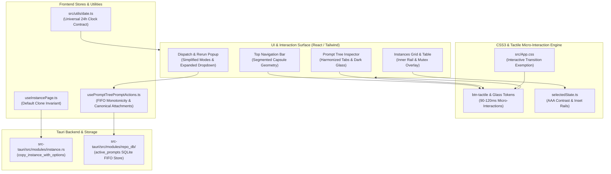
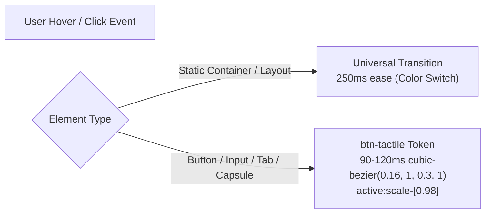
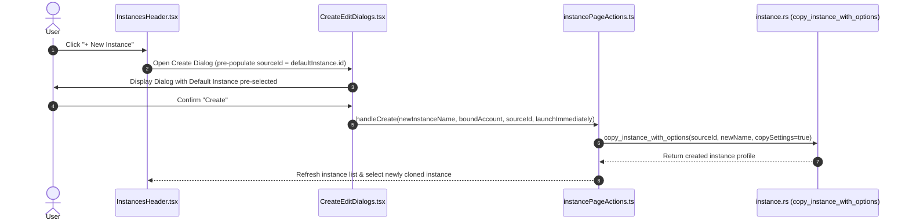

# Specification 228: UI & Feature Enhancement Instructions — System Architecture & Contracts

## 1. System Architecture Overview

Antigravity Manager (AGM) operates as an intelligent orchestration gateway and desktop management console for autonomous agentic coding environments. It bridges multi-instance IDE lifecycles, SQLite-backed prompt queues, and protocol-level communication between upstream AI models and the Antigravity desktop IDE.



This specification establishes the architectural contracts, design tokens, interaction models, and invariant guarantees for Plan `228-ui-and-feature-enhancement-instructions`. The overarching objective is to eliminate visual friction, eradicate UI transition slowness, enforce seamless capsule geometry, pre-select default profiles on instance creation, standardize universal 24-hour time formatting, and enforce strict First-In-First-Out (FIFO) queue guarantees during prompt rerun and multi-account dispatch.

---

## 2. Design Tokens, CSS3 Tactile Micro-Interactions & Transition Lag Elimination

### 2.1 Root Cause of Interactive Slowness
In `src/App.css`, a universal transition rule was applied across all elements:

```css
*,
*::before,
*::after {
  transition-property: color, background-color, border-color, text-decoration-color, fill, stroke, box-shadow;
  transition-timing-function: cubic-bezier(0.4, 0, 0.2, 1);
  transition-duration: 250ms;
}
```

While intended to deliver smooth background color transitions during global dark/light theme toggles, this blanket duration of `250ms` introduces unacceptable input lag and visual sluggishness to high-frequency interactive controls:
1. Buttons hover and click feedback feels delayed and unresponsive.
2. Segmented tab selection appears to drag rather than snap instantaneously.
3. Dropdowns, inputs, and toggle switches exhibit sluggish boundary shifts.

### 2.2 Transition Lag Elimination Strategy
Interactive elements must be explicitly exempted from the universal `250ms` delay. The transition architecture decomposes transitions into two distinct layers:
- **Global Theme Layer (Slow)**: Page-level containers, layout backdrops, and static text retain graceful `200ms–250ms` transitions during theme switching.
- **Tactile Interaction Layer (Fast & Snappy)**: Buttons, clickable pills, dropdown triggers, and tab segments use instantaneous or rapid `90ms–120ms` micro-interaction tokens with zero initial lag.



### 2.3 Tactile Token Architecture (`btn-tactile`)
In `src/App.css`, define tactile utility classes and apply explicit exemptions:

```css
/* Interactive element transition override to eliminate UI slowness */
button,
input,
select,
textarea,
[role="button"],
.btn-tactile {
  transition-duration: 100ms !important;
  transition-timing-function: cubic-bezier(0.16, 1, 0.3, 1) !important;
  transition-property: color, background-color, border-color, box-shadow, transform, opacity !important;
}

/* Tactile micro-interaction token */
.btn-tactile:active {
  transform: scale(0.98);
}
```

---

## 3. Active Instance Indicator & Card Geometry Invariants

### 3.1 Defect Analysis: Outer Border-Left Rail vs Corner Radius
In `src/components/common/selectedState.ts`:
```typescript
export const SELECTED_CARD_CLASSES =
  "bg-slate-100 dark:bg-slate-900 text-slate-900 dark:text-white border border-amber-400/35 border-l-[6px] border-l-amber-400 font-semibold shadow-xs";
```
When `border-l-[6px]` is applied directly to an element that also possesses `rounded-[5px]` (as in `src/pages/instances/InstanceCard.tsx`), standard CSS box-model calculation creates a severe geometric artifact:
- The `6px` left border does not curve smoothly with the `1px` top and bottom borders.
- The top-left and bottom-left corners clip irregularly, forming an unsightly rectangular notch or distorted triangular wedge.
- The inner card content is shifted horizontally by 5px compared to adjacent unselected cards, creating layout jitter during active instance selection.

### 3.2 Inset Rail Architecture Invariant
To preserve the 6px amber indicator rail while strictly maintaining symmetrical `rounded-[5px]` corner curvature and zero content shift, the active rail must be decoupled from the outer border box:
1. Outer border remains uniform `1px` on all four sides (`border border-amber-400/35`).
2. The active rail is rendered as an internal absolute indicator element:
   ```tsx
   {isActive && (
       <span
           className="absolute left-0 top-0 bottom-0 w-1.5 bg-amber-400 rounded-l-[4px] pointer-events-none z-10"
           aria-hidden="true"
       />
   )}
   ```
3. Alternatively, `selectedState.ts` maintains uniform border box geometry, ensuring `box-sizing: border-box` remains completely undistorted.

### 3.3 Capsule Nesting Invariant (Elimination of Nested Pills)
In `src/pages/instances/InstanceCard.tsx`:
- Adjacent controls (`Active`, `Rename`, `Copy`) are housed inside a segmented pill capsule:
  `rounded-full border border-slate-200 dark:border-[#40285e] divide-x`.
- When active, the component rendered:
  `<span className={cn(ACTIVE_PILL_CLASSES, 'text-[9px] px-1.5 py-0.2 tracking-wider')}>Active</span>`.
- Because `ACTIVE_PILL_CLASSES` defines `rounded-full border border-amber-300 dark:border-amber-400/50`, it rendered a rounded pill with its own outer border *inside* a divided pill segment, creating a double-border "pill-in-pill" defect.

**The Capsule Nesting Invariant**:
- A segmented capsule item MUST NEVER render its own disjointed rounded pill or internal border.
- The active segment must fill the capsule section flush, using:
  `px-2 py-0.5 text-[9px] font-bold tracking-wider bg-amber-400/15 text-amber-900 dark:text-amber-300 select-none`.
- Only standalone badges (outside segmented capsules) may utilize `ACTIVE_PILL_CLASSES`.

---

## 4. Prompt Inspector Tab Alignment & Translucent Active Background Architecture

### 4.1 Structural Defect Analysis
In `src/components/instances/PromptTreeView/DetailTabs.tsx`:
1. View Mode capsule houses Preview (`<Eye>`), Raw (`<Code>`), Edit (`<Edit3>`), and Details (`<Activity> Details <PulseDot>`).
2. Height and baseline mismatch:
   - Preview, Raw, Edit used icon-only buttons with `p-1.5 px-2`.
   - Details used `p-1.5 px-2.5 flex items-center gap-1.5 text-[11px] font-semibold`.
   - When Details is mounted, the capsule experiences subtle height jitter and vertical baseline misalignment between icon centers and text baselines.
3. Stark Background Color:
   - The active tab used `bg-blue-600 text-white shadow-2xs`.
   - On dark-glass surfaces, this stark solid blue block creates a jarring visual contrast, breaking the muted dark-slate theme.

### 4.2 Harmonized Geometry & Dark-Glass Active Styling
1. **Vertical Alignment Contract**:
   - Capsule container enforces fixed height: `h-7 min-h-[28px]`.
   - All inner buttons use `h-full inline-flex items-center justify-center text-xs font-medium`.
   - Details button text and pulse indicator align vertically with icon centers (`leading-none flex items-center gap-1.5`).
2. **Translucent Dark-Glass Active Styling**:
   - Replace opaque `bg-blue-600 text-white` with a theme-adaptive translucent glass treatment:
     - Light mode: `bg-sky-500/15 text-sky-700 shadow-2xs font-semibold`
     - Dark mode: `dark:bg-sky-500/20 dark:text-sky-300 dark:border-sky-500/30 shadow-2xs font-semibold`
   - Active icon inherits the vibrant accent color (`text-sky-600 dark:text-sky-400`), while inactive tabs rest quietly in `text-slate-600 dark:text-slate-400 hover:text-slate-900 dark:hover:text-slate-200 hover:bg-slate-200/50 dark:hover:bg-slate-800/60`.

---

## 5. Top-Level Menu Capsule Geometry & Rectangular Hover Elimination

### 5.1 Root Cause of Rectangular Hover Anomaly
In `src/components/navbar/NavMenu.tsx`:
```tsx
<div className="flex items-center rounded-full bg-gray-100 dark:bg-slate-900/90 border border-gray-200/60 dark:border-slate-800 p-0.5 shadow-xs divide-x divide-gray-200/70 dark:divide-slate-800/80">
    <div className="relative group">
        <Link
            to="/accounts"
            className="flex items-center justify-center px-2.5 py-1 ... rounded-full hover:bg-gray-200/80 dark:hover:bg-slate-800/60"
        >
            ...
        </Link>
    </div>
    ...
</div>
```
1. Outer container defines `rounded-full p-0.5 divide-x`.
2. Each item is wrapped in an intermediate `<div className="relative group">` which has zero border radius.
3. The inner `<Link>` has `rounded-full`.
4. When hovering over items, the hover highlight creates an internal pill that conflicts with the outer capsule border and adjacent divider lines.
5. In dropdown menus or sub-buttons, rectangular hover backgrounds (`rounded-md` or `rounded-none`) bleed outside the outer rounded boundary, creating ugly rectangular corners clipping over the rounded capsule.

### 5.2 Capsule Geometry Invariant
All contiguous segmented pill capsules must obey the following geometric rules:
1. **Outer Boundary**: `rounded-full border border-gray-200/60 dark:border-slate-800 p-0.5 overflow-hidden`.
2. **Segment Radius Mapping**:
   - First segment: `rounded-l-full`
   - Middle segments: `rounded-none`
   - Last segment: `rounded-r-full`
   - Standalone single segment: `rounded-full`
3. **Hover & Active Highlights**:
   Hover states must stretch smoothly to the vertical borders and divider lines without awkward gaps, using dark-glass tints (`hover:bg-slate-200/60 dark:hover:bg-slate-800/60`).

---

## 6. Default Instance Cloning Architecture for "+ New Instance"

### 6.1 Defect Analysis: Empty Sandboxes vs Developer Continuity
When an operator creates a new profile in `src/pages/instances/InstancesHeader.tsx`:
- The modal initializes `newInstanceFromInstance` to `''` (Blank profile).
- Creating a blank instance yields an empty folder without user extensions, theme customizations, security policies, or workspaceStorage history.
- The user must manually configure settings, re-install extensions, and re-bind policies.

### 6.2 Default Instance Clone Invariant
When the operator clicks "+ New Instance":
1. The creation dialog MUST pre-populate `newInstanceFromInstance` with the identifier of the current Default instance (`inst.config.is_default ? inst.config.id : 'default'`).
2. If no default is designated, it resolves to the active instance ID (`activeInstanceId`).
3. The clone option dropdown clearly labels the selection: `Default Profile (Clones extensions, settings & policies)`.
4. If an operator explicitly desires an empty sandbox, they can choose `Blank profile (clean isolated sandbox)`.



---

## 7. Universal 24-Hour Clock Formatting Contract

### 7.1 Motivation & System Invariant
Timestamps across Antigravity Manager were inconsistently formatted:
- `formatDateTime()` in `src/utils/date.ts` produced `DD-MMM-YYYY HH:mm`.
- Several views invoked `new Date().toLocaleTimeString()`, which fluctuates based on the host OS locale (producing `1:30:15 PM` on US English systems, `13:30:15` on European systems, causing layout width jitter).
- Terminal logs, transcript files (`transcript.jsonl`), and prompt audit events always use 24-hour UTC or 24-hour local timestamps (`HH:mm:ss`).

### 7.2 Canonical Helper Specification in `src/utils/date.ts`
Implement `formatTime24` as the single authoritative time-only formatting function:

```typescript
export interface FormatTime24Options {
    withSeconds?: boolean;
    fallback?: string;
}

/**
 * Formats timestamp into universal 24-hour time: HH:mm or HH:mm:ss.
 * Guarantees zero AM/PM jitter, strict 2-digit zero-padding, and cross-platform consistency.
 *
 * Examples:
 * - formatTime24(1729864200000) => "14:30"
 * - formatTime24(1729864200000, { withSeconds: true }) => "14:30:00"
 */
export function formatTime24(
    value?: number | string | Date | null,
    options?: FormatTime24Options
): string {
    const ms = parseToMs(value);
    if (ms === null) return options?.fallback ?? '-';

    const d = new Date(ms);
    const hours = String(d.getHours()).padStart(2, '0');
    const minutes = String(d.getMinutes()).padStart(2, '0');

    if (options?.withSeconds) {
        const seconds = String(d.getSeconds()).padStart(2, '0');
        return `${hours}:${minutes}:${seconds}`;
    }

    return `${hours}:${minutes}`;
}
```

### 7.3 Usage Contract Across Frontend Surfaces
- Prohibit all direct calls to `toLocaleTimeString()` across `src/`.
- Replace ad-hoc time displays with `formatTime24(ts)` or `formatDateTime(ts, DateFormatModeType.TwentyFourHour)`.

---

## 8. FIFO Queue Invariant on Prompt Rerun & Multi-Account Dispatch Contract

### 8.1 FIFO Ordering Invariant
Per project house rules:
> All prompt restore, dispatch, and queue processing queries across SQLite databases (`active_prompts`, `prompt_backups`, `repo_prompts.db`) MUST enforce strict First-In-First-Out ordering using `ORDER BY created_at ASC, id ASC`. Inverted LIFO queries (`ORDER BY updated_at DESC`) are strictly forbidden in dispatch logic.

### 8.2 Rerun Dispatch Execution Contract
In `src/components/instances/PromptTreeView/usePromptTreePromptActions.ts`:
- When an operator triggers `Rerun Turn` with count $N$ ($1 \le N \le 10$):
  1. Every single turn (from round 1 to round $N$) MUST route through `enqueuePrompt`.
  2. Rerun MUST NEVER trigger direct preemptive execution (`sendPrompt`).
  3. Sequential artificial timestamp increments (`created_at = Date.now() + i`) must be applied if enqueued in rapid succession to ensure strictly monotonic `created_at ASC` sorting in SQLite.
  4. Each turn's payload must support bracketed attachments formatted using the canonical semicolon syntax:
     `@[file;<relative-or-absolute-path>]`.

### 8.3 Dispatch Modal UI Refinement
In `src/components/instances/PromptTreeView/DetailHeader.tsx`:
1. **Simplified Mode Labels**:
   - Button 1: **"Send"** (Tooltip: *"Cancel & Send / Send (Preempt): Cancels any running task to execute immediately (Hotkey: N)"*)
   - Button 2: **"Enqueue"** (Tooltip: *"Enqueue (FIFO): Queues prompt behind active task in IDE (Hotkey: Q)"*)
   - Button 3: **"Rerun"** (Tooltip: *"Rerun Turn: Enqueues turn N times into FIFO queue (Hotkey: R)"*)
2. **Dropdown Expansion**:
   - The message template and verification dropdowns must have expanded widths (minimum `min-w-[280px]` or `w-full`) to prevent text truncation and eliminate ellipsis overflow.
3. **Pre-Deployment & E2E Verification Presets**:
   - Include the mandatory pre-deployment verification template:
     `"Have you tested these below instructions with end-to-end testing and released it?"`
   - Accessible via the verification suffix dropdown for immediate prompt hardening.

---

## 9. Architectural Verification & Compliance Matrix

| Architecture Requirement | Target Module / File | Verification Gate |
| :--- | :--- | :--- |
| **Transition Lag Elimination** | `src/App.css` | Buttons respond in $\le 100\text{ms}$; no 250ms delay on interactive state. |
| **Active Card Rail Invariant** | `src/pages/instances/InstanceCard.tsx`, `src/components/common/selectedState.ts` | Corner radius `rounded-[5px]` remains unclipped; amber rail rendered cleanly without geometric distortion. |
| **Capsule Nesting Invariant** | `src/pages/instances/InstanceCard.tsx` | Zero pill-in-pill nesting inside segmented capsules; active item blends seamlessly into segment. |
| **Prompt Tab Alignment** | `src/components/instances/PromptTreeView/DetailTabs.tsx` | Baseline and height standardized to 28px/32px; translucent dark-glass active background. |
| **Top-Level Menu Geometry** | `src/components/navbar/NavMenu.tsx`, `src/components/navbar/InstanceSelector.tsx` | Zero rectangular hover bleeds outside rounded-full capsule. |
| **Default Instance Cloning** | `src/pages/instances/CreateEditDialogs.tsx`, `src/pages/instances/InstancesHeader.tsx` | "+ New Instance" selects default instance profile by default; copies settings & extensions. |
| **Universal 24h Clock** | `src/utils/date.ts`, entire `src/` codebase | 100% elimination of `toLocaleTimeString()`; zero AM/PM jitter. |
| **Rerun FIFO Invariant** | `src/components/instances/PromptTreeView/usePromptTreePromptActions.ts` | All $N$ rerun turns queued via `enqueuePrompt` with monotonic timestamps (`ORDER BY created_at ASC, id ASC`). |
