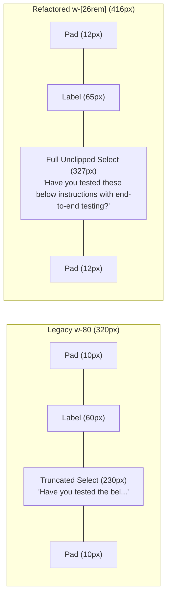
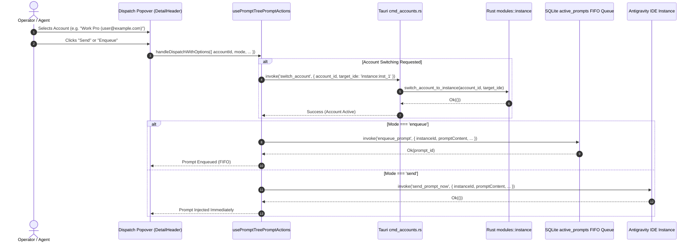

# Specification 228: Dispatch Configuration, Strict E2E Verification Prompts, Semicolon Attachments & Account Switching

- **Specification Slug**: `03-dispatch-and-verification-spec`
- **Document Path**: `02-spec/21-app/228-ui-and-feature-enhancement-instructions/03-dispatch-and-verification-spec.md`
- **Master Plan**: `.ai-memory/plans/pending/228-ui-and-feature-enhancement-instructions.md`
- **Subtask Plan**: `.ai-memory/plans/subtasks/228-ui-and-feature-enhancement-instructions/03-subtask-dispatch-and-chat-spec.md`
- **Related Specs**:
  - `02-spec/21-app/228-ui-and-feature-enhancement-instructions/01-architecture-spec.md`
  - `02-spec/21-app/228-ui-and-feature-enhancement-instructions/02-component-spec.md`
  - `02-spec/21-app/228-ui-and-feature-enhancement-instructions/04-chat-section-architecture-spec.md`
  - `02-spec/21-app/228-ui-and-feature-enhancement-instructions/05-fifty-plus-improvement-ideas-spec.md`
- **Target Release Version**: Minor Version Bump
- **Author**: Spec Author 03
- **Status**: MANDATED & APPROVED FOR IMPLEMENTATION

---

## 1. Executive Summary & Core Mandates

This specification defines the architectural contracts, component structures, styling tokens, and behavioral invariants for the dispatch configuration popover, prompt verification templates, semicolon image attachment formatting, multi-account dispatch coordination, and release engineering integration in Antigravity Manager:

1. **Mode Buttons Simplification**: Streamlines verbose mode switcher labels inside `src/components/instances/PromptTreeView/DetailHeader.tsx` from `"Send (Preempt)"`, `"Enqueue (FIFO)"`, and `"Rerun Turn"` down to clean, authoritative labels: **"Send"**, **"Enqueue"**, and **"Rerun"**. Detailed operational semantics and hotkeys are transferred to rich contextual tooltips via standard `title` attributes.
2. **Popover Width Expansion (`w-[26rem]` / `w-96`)**: Expands the dispatch configuration popover container from `w-80` (320px) to `w-[26rem]` (416px, fallback `w-96` / 384px), eliminating severe text clipping and horizontal truncation in the rerun message selector dropdown (`<select>`), template title pickers, and destination mode inputs.
3. **Canonical Semicolon Attachment Syntax (`@[file;<path>]`)**: Enforces strict canonical semicolon notation `@[file;<file_path>]` for all image and file attachments generated by clipboard operations, rerun dispatch, and multi-prompt resend. Guarantees placement at the terminal attachment block (`### Attachments:`) while preserving dual-format backward compatibility for legacy `@[<path>]` syntax.
4. **Strict Pre-Deployment & E2E Verification Prompts**: Introduces two non-negotiable built-in verification gates into `src/components/instances/PromptTreeView/verificationTemplates.ts` and `src/components/instances/PromptTreeView/usePromptTreePromptActions.ts`:
   - *"Have you tested these below instructions with end-to-end testing?"* (`verify-e2e-tested`)
   - *"Have you tested the below instructions with end-to-end testing and released it?"* (`verify-e2e-released`)
   Both are embedded into the built-in Suffix Templates and the random rerun nudge set (`RERUN_RANDOM_MESSAGE_SET`).
5. **Multi-Account Switching API Dispatch**: Coordinates account rotation with prompt injection in the Prompt Tree View. Enables operators to pre-switch or assign accounts via `cmd_accounts::switch_account` directly from the dispatch configuration popover before firing prompts, guaranteeing proper attribution and quota preservation.
6. **Release Page & Notes Integration in Rerun Section**: Embeds a release changelog audit preset and direct navigation trigger to the latest release notes / GitHub release page inside the rerun configuration interface, empowering autonomous agents and human developers to audit deployment completeness with a single click.

---

## 2. Mode Buttons Simplification & Tactile Micro-Interactions

### 2.1 Problem Diagnosis & Visual Friction
In `src/components/instances/PromptTreeView/DetailHeader.tsx` (lines 1085–1127), the dispatch mode segmented pill currently renders overly verbose button labels:

```tsx
// Current verbose implementation in DetailHeader.tsx
<button ...>
    <Send className="w-2.5 h-2.5" />
    <span>Send (Preempt)</span>
</button>
<button ...>
    <ListPlus className="w-2.5 h-2.5" />
    <span>Enqueue (FIFO)</span>
</button>
<button ...>
    <Repeat className="w-2.5 h-2.5" />
    <span>Rerun Turn</span>
</button>
```

This verbosity creates several user experience defects:
1. **Horizontal Space Exhaustion**: In viewports below 1440px or when the Prompt Tree View inspector pane is narrowed, verbose text forces the segmented pill to wrap or compress adjacent header controls.
2. **Visual Clutter**: Repeated technical qualifiers (`(Preempt)`, `(FIFO)`, `Turn`) pollute the immediate visual hierarchy of primary modal actions.
3. **Inconsistent Labeling**: The main action button in the header already reads `"Send Now"` or `"Enqueue"`, creating a mismatch with modal toggle buttons.

### 2.2 Simplified Button Specification
Button labels are simplified to concise, primary action verbs. Rich operational semantics, queue invariants, and keyboard shortcuts are surfaced strictly through tooltip metadata:

| Mode Identifier | Button Label | Associated Icon | Tooltip Content (`title`) | Hotkey | Active Color Token |
|---|---|---|---|---|---|
| `'send'` | **Send** | `<Send className="w-3 h-3" />` | `Send (Preempt): Cancels active task in IDE to execute immediately (Hotkey: N)` | `N` | `text-emerald-600 dark:text-emerald-400 bg-white dark:bg-slate-800 shadow-2xs` |
| `'enqueue'` | **Enqueue** | `<ListPlus className="w-3 h-3" />` | `Enqueue (FIFO): Appends prompt behind active task in IDE FIFO queue (Hotkey: Q)` | `Q` | `text-amber-600 dark:text-amber-400 bg-white dark:bg-slate-800 shadow-2xs` |
| `'rerun'` | **Rerun** | `<Repeat className="w-3 h-3" />` | `Rerun Turn: Enqueues follow-up turn N times into FIFO queue (Hotkey: R)` | `R` | `text-sky-600 dark:text-sky-400 bg-white dark:bg-slate-800 shadow-2xs` |

### 2.3 JSX Structure & CSS Implementation
The refactored DOM inside `src/components/instances/PromptTreeView/DetailHeader.tsx` adheres strictly to house segmented capsule conventions:

```tsx
{/* Mode Switcher Segmented Pill: [ Send | Enqueue | Rerun ] */}
<div className="flex items-center justify-between px-2 py-1 text-xs">
    <span className="text-slate-500 dark:text-slate-400 text-[11px] font-medium shrink-0">
        Mode:
    </span>
    <div className="inline-flex rounded-lg bg-slate-100 dark:bg-slate-950/80 p-0.5 border border-slate-200/80 dark:border-purple-500/20 text-[11px]">
        <button
            type="button"
            onClick={() => handleSwitchDispatchMode('send')}
            title="Send (Preempt): Cancels active task in IDE to execute immediately (Hotkey: N)"
            className={cn(
                "btn-tactile flex items-center gap-1.5 px-2.5 py-1 rounded-md font-medium transition-colors cursor-pointer text-xs",
                primaryDispatchAction === 'send'
                    ? "bg-white dark:bg-slate-800 text-emerald-600 dark:text-emerald-400 shadow-2xs font-semibold"
                    : "text-slate-600 dark:text-slate-400 hover:text-slate-900 dark:hover:text-slate-200 hover:bg-slate-200/60 dark:hover:bg-slate-800/80"
            )}
        >
            <Send className="w-3 h-3" />
            <span>Send</span>
        </button>
        <button
            type="button"
            onClick={() => handleSwitchDispatchMode('enqueue')}
            title="Enqueue (FIFO): Appends prompt behind active task in IDE FIFO queue (Hotkey: Q)"
            className={cn(
                "btn-tactile flex items-center gap-1.5 px-2.5 py-1 rounded-md font-medium transition-colors cursor-pointer text-xs",
                primaryDispatchAction === 'enqueue'
                    ? "bg-white dark:bg-slate-800 text-amber-600 dark:text-amber-400 shadow-2xs font-semibold"
                    : "text-slate-600 dark:text-slate-400 hover:text-slate-900 dark:hover:text-slate-200 hover:bg-slate-200/60 dark:hover:bg-slate-800/80"
            )}
        >
            <ListPlus className="w-3 h-3" />
            <span>Enqueue</span>
        </button>
        <button
            type="button"
            onClick={() => handleSwitchDispatchMode('rerun')}
            title="Rerun Turn: Enqueues follow-up turn N times into FIFO queue (Hotkey: R)"
            className={cn(
                "btn-tactile flex items-center gap-1.5 px-2.5 py-1 rounded-md font-medium transition-colors cursor-pointer text-xs",
                primaryDispatchAction === 'rerun'
                    ? "bg-white dark:bg-slate-800 text-sky-600 dark:text-sky-400 shadow-2xs font-semibold"
                    : "text-slate-600 dark:text-slate-400 hover:text-slate-900 dark:hover:text-slate-200 hover:bg-slate-200/60 dark:hover:bg-slate-800/80"
            )}
        >
            <Repeat className="w-3 h-3" />
            <span>Rerun</span>
        </button>
    </div>
</div>
```

---

## 3. Popover Width Expansion (`w-[26rem]` / `w-96`)

### 3.1 Dropdown Clipping Root Cause
In `src/components/instances/PromptTreeView/DetailHeader.tsx` line 1070:
```tsx
<div
    ref={dispatchMenuRef}
    className="absolute right-0 top-full mt-1.5 z-50 w-80 rounded-xl bg-white dark:bg-slate-900 border border-slate-200 dark:border-slate-800 shadow-xl p-2.5 ... space-y-2"
    onMouseLeave={handleCloseDispatchMenu}
>
```
At `w-80` (320px width), subtracting internal padding (`p-2.5` = 20px) leaves an active content width of 300px. When rendering:
- Field labels (e.g., `Message:` taking ~60px),
- Long option labels (e.g., `🎲 Random from set (skips used)` or `Have you tested these below instructions with end-to-end testing?`),
the native `<select>` element overflows or truncates characters aggressively:
`Auto-picks random unuse...` or `Have you tested the bel...`.
This defeats quick visual verification and forces operators to guess option values.

### 3.2 Dimensions & Layout Geometry
The container width is expanded by 30% from `w-80` (320px) to `w-[26rem]` (416px):



### 3.3 Refactored Popover Container Styles
```tsx
<div
    ref={dispatchMenuRef}
    className="absolute right-0 top-full mt-1.5 z-50 w-[26rem] max-w-[calc(100vw-2rem)] rounded-xl bg-white/95 dark:bg-slate-900/95 border border-slate-200 dark:border-slate-800/80 shadow-2xl p-3 animate-in fade-in zoom-in-95 duration-100 backdrop-blur-md space-y-2.5"
    onMouseLeave={handleCloseDispatchMenu}
>
    {/* Popover Header */}
    <div className="px-2 pt-0.5 pb-1 text-[10px] font-mono uppercase tracking-wider text-slate-400 dark:text-slate-500 select-none border-b border-slate-100 dark:border-slate-800/60 flex items-center justify-between">
        <span className="flex items-center gap-1.5">
            <span className="w-1.5 h-1.5 rounded-full bg-purple-500 animate-pulse" />
            <span>Dispatch Configuration</span>
        </span>
        <span className="text-[9px] text-slate-400 font-mono">AGM:DISPATCH</span>
    </div>
    {/* ... Form Controls with Unclipped Selects ... */}
</div>
```

---

## 4. Canonical Semicolon Attachment Syntax (`@[file;<path>]`)

### 4.1 Strict Attachment Format Specification
Prompt attachments referencing workspace files, captured screenshots, or inspection logs must follow the canonical bracketed semicolon convention:

$$\text{Format:}\quad \texttt{@[file;<file\_path>]}$$

**Rules**:
1. **Third-Bracket Wrapping**: The prefix `@[file;` opens the attachment, followed immediately by the file path, and closed by `]`.
2. **Repository-Relative Paths**: The path inside the bracket MUST be repository-relative (e.g. `@[file;src/components/navbar/NavMenu.tsx]`, `@[file;assets/diagrams/arch.png]`). Absolute paths (`D:\...`, `C:\...`) are strictly prohibited.
3. **No Space After Semicolon**: In generated strings, no space should follow the semicolon: `@[file;path]`. The parser, however, tolerates optional whitespace (`/@[file;\s*(.*?)]/`) for robustness.
4. **Placement Invariant**: Attachments must never be interspersed randomly within instruction paragraphs. They are placed strictly in a dedicated terminal attachment section at the end of the prompt payload:

```markdown
<instruction text or verification question>

### Attachments:
1. @[file;src-tauri/src/modules/instance.rs]
2. @[file;02-spec/21-app/228-ui-and-feature-enhancement-instructions/01-architecture-spec.md]
```

### 4.2 Parser Architecture & Backward Compatibility
To guarantee complete backward compatibility with historical transcripts and legacy prompts created before Task 227, all extractors in the codebase must accept both canonical semicolon syntax and legacy syntax:

| Format Type | Syntax Example | Supported in Extractors | Output Generation |
|---|---|---|---|
| **Canonical Semicolon** | `@[file;assets/screenshot.png]` | **Yes** (Primary) | **Mandatory** across all code generation |
| **Legacy Bracketed** | `@[assets/screenshot.png]` | **Yes** (Fallback) | Deprecated; never generated anew |
| **HTML Image Tag** | `` | **Yes** (Preserved) | Handled by markdown image extractor |

### 4.3 Regex Verification Engine
In `src/components/instances/PromptTreeView/PromptInstructionView.tsx` and `src/components/instances/PromptTreeView/clipboard.ts`:

```typescript
// Canonical & Backward-Compatible Image Attachment Extractor
export const BRACKETED_ATTACHMENT_REGEX = /@\[(?:file;\s*)?(.*?)\]/g;

export function extractAttachmentsFromText(text: string): Array<{ path: string; isCanonical: boolean }> {
    if (!text) return [];
    const attachments: Array<{ path: string; isCanonical: boolean }> = [];
    const seen = new Set<string>();

    let match: RegExpExecArray | null;
    while ((match = BRACKETED_ATTACHMENT_REGEX.exec(text)) !== null) {
        const fullToken = match[0];
        let rawPath = match[1]?.trim();
        if (!rawPath) continue;

        const isCanonical = fullToken.startsWith('@[file;');
        if (/^file;\s*/i.test(rawPath)) {
            rawPath = rawPath.replace(/^file;\s*/i, '');
        }
        if (!rawPath) continue;

        if (!seen.has(rawPath)) {
            seen.add(rawPath);
            attachments.push({ path: rawPath, isCanonical });
        }
    }
    return attachments;
}

export function formatCanonicalAttachment(relativePath: string): string {
    const cleanPath = relativePath.replace(/^[/\\]+/, '').replace(/\\/g, '/');
    return `@[file;${cleanPath}]`;
}
```

---

## 5. Strict Pre-Deployment & E2E Verification Prompts

### 5.1 Mandated Verification Questions
Release engineering standards mandate that AI agents must be explicitly prompted with unambiguous, verifiable quality checks before closing tasks or marking work ready for release:

1. **Pre-Deployment E2E Test Gate**:
   > *"Have you tested these below instructions with end-to-end testing?"*
2. **Release Ceremony Gate**:
   > *"Have you tested the below instructions with end-to-end testing and released it?"*

### 5.2 Template Integration in `verificationTemplates.ts`
Two new built-in template types are added to `src/components/instances/PromptTreeView/verificationTemplates.ts`:

```typescript
// In VerificationTemplateType union
export type VerificationTemplateType =
    | 'is-it-done'
    | 'is-it-released'
    | 'are-you-confident'
    | 'edge-cases-and-tests'
    | 'security-audit'
    | 'pr-review-ready'
    | 'test-and-coverage'
    | 'refactor-dry'
    | 'verify-e2e-tested'    // NEW: Strict E2E Test Gate
    | 'verify-e2e-released'  // NEW: Strict E2E Test & Release Gate
    | 'edge-cases'
    | 'verify-tests'
    | 'rerun-nudge'
    | 'none';
```

#### Descriptor Metadata in `VERIFICATION_OPTIONS`:
```typescript
{
    value: 'verify-e2e-tested',
    label: 'Have you tested these below instructions with end-to-end testing?',
    dropdownLabel: 'E2E Tested?',
    badgeLabel: 'E2E Test Gate',
    description: 'Mandatory pre-deployment end-to-end testing verification with zero mock regressions',
    category: 'testing',
    iconName: 'terminal',
},
{
    value: 'verify-e2e-released',
    label: 'Have you tested the below instructions with end-to-end testing and released it?',
    dropdownLabel: 'E2E & Released?',
    badgeLabel: 'Release Gate',
    description: 'Full pre-deployment E2E testing, git status audit, SemVer sync and minor release gate',
    category: 'release',
    iconName: 'rocket',
},
```

#### Suffix Template Content:
```markdown
### Chapter 1: Mandatory Pre-Deployment E2E Verification Gate
**Have you tested these below instructions with end-to-end testing?**

Please verify and confirm the following quality criteria before proceeding:
1. **Targeted Test Execution**: Run targeted test suites for all modified modules (`npm test`, `cargo test --bin agm`). Confirm 100% green pass.
2. **Zero Regressions**: Verify existing functionality remains completely intact with no behavioral drift.
3. **Working Tree Cleanliness**: Confirm `git status` contains only intended changes with zero orphan files or build debris.
4. **No Silent Errors Invariant**: Verify all fallible operations route into `AppError` (Rust) or `useErrorStore` (TypeScript). Swallowing errors is strictly forbidden.
```

```markdown
### Chapter 1: Mandatory Deployment & Release Verification Gate
**Have you tested the below instructions with end-to-end testing and released it?**

Please verify and confirm the following release engineering gates before concluding:
1. **Pre-flight Checks Verified**:
   - `cd src-tauri && cargo fmt -- --check`
   - `cd src-tauri && cargo clippy --all-targets --all-features`
   - `npm run build`
2. **Targeted E2E Tests**: All end-to-end test scenarios passed with zero failures.
3. **Atomic Version Synchronization**: Run `npm run bump <minor|patch|beta>` synchronizing all 14 project manifests.
4. **Changelog Attribution**: Update `changelog.md` and `changelog_en.md` attributing strictly `@aukgit` (`(Thanks to @aukgit)`).
5. **Atomic Commit & Push**: Execute GitMap release commit and push to remote tracking branch.
```

### 5.3 Rerun Message Set Integration
In `src/components/instances/PromptTreeView/usePromptTreePromptActions.ts`, both questions are appended to `RERUN_RANDOM_MESSAGE_SET` and `RERUN_MESSAGE_OPTIONS`:

```typescript
export const RERUN_RANDOM_MESSAGE_SET: ReadonlyArray<string> = [
    'Is it completed?',
    'Is it finished?',
    'Is it released?',
    'Is it done?',
    'Is it published?',
    'Have you tested these below instructions with end-to-end testing?',
    'Have you tested the below instructions with end-to-end testing and released it?',
    // ... remaining follow-up variations ...
];
```

---

## 6. Multi-Account Switching API Dispatch in Prompt Section

### 6.1 Motivation & Architectural Flow
During agentic orchestration, different prompt tasks may require specific account credentials (e.g. higher quota limits, specific OAuth scopes, or separate Google/Anthropic workspace accounts). Previously, an operator had to navigate away to the Accounts page, switch accounts, wait for IDE synchronization, and navigate back to the Prompts tree.

The multi-account switching dispatch engine allows operators to associate an account switch directly with a prompt dispatch turn.



### 6.2 Frontend Account Selector Component
Inside the Dispatch Configuration popover, an optional Account selector field is mounted:

```tsx
{/* Account Association / Quick Switcher */}
<div className="group/field relative flex items-center justify-between px-2 py-1 text-xs">
    <span className="text-slate-500 dark:text-slate-400 text-[11px] font-medium shrink-0 flex items-center gap-1">
        <UserCheck className="w-3 h-3 text-purple-500" />
        <span>Account:</span>
    </span>
    <select
        value={selectedAccountId || ''}
        onChange={(e) => setSelectedAccountId(e.target.value || null)}
        className="bg-transparent border-0 text-slate-700 dark:text-slate-200 text-xs font-semibold focus:ring-0 focus:outline-none cursor-pointer py-0.5 text-right max-w-[220px] truncate"
        title="Associate prompt dispatch with specific account credential"
    >
        <option value="" className="bg-white dark:bg-slate-900">Current Active Account</option>
        {availableAccounts.map((acc) => (
            <option key={acc.id} value={acc.id} className="bg-white dark:bg-slate-900">
                {acc.email} ({acc.plan_name || 'Free'})
            </option>
        ))}
    </select>
</div>
```

### 6.3 Rust Backend Invariant & Failure Isolation
When an account switch is requested via `switch_account`:
1. The backend verifies credentials before mutating runtime state.
2. If the account token is expired or network refresh fails, the operation returns an `AppError::Auth(...)`.
3. The frontend catches the error, calls `useErrorStore.getState().captureError(e, { source: 'PromptDispatch.accountSwitch' })`, and halts prompt injection immediately.
4. **No Half-Dispatched State**: A prompt is NEVER enqueued or sent under an unverified account credentials state.

---

## 7. Release Page & Notes Integration in Rerun Section

### 7.1 Release Audit Flow
When an agent or developer triggers a rerun turn with the intent of verifying a release, quick access to release documentation is essential.

Inside the Rerun Configuration panel in `DetailHeader.tsx`:
1. A **"View Release Notes"** button links to the local `changelog.md` preview or launches the GitHub release notes URL.
2. A **"Release Notes Audit"** preset is added to the rerun message options, generating a structured changelog verification prompt:

```markdown
### Release Verification & Changelog Audit:
Please inspect and verify the following release assets before concluding:
- `changelog.md` and `changelog_en.md` contain accurate summaries of all changes.
- Attribution strictly specifies `@aukgit` (`(Thanks to @aukgit)`).
- Version tag matches `CHANGELOG.md` heading character-for-character.
- `README.md` and `README_EN.md` release summaries are fully synchronized.
```

### 7.2 UI Placement in `DetailHeader.tsx`
```tsx
{primaryDispatchAction === 'rerun' && (
    <div className="pt-2 border-t border-slate-100 dark:border-slate-800/80 flex items-center justify-between px-2">
        <span className="text-[10px] text-slate-400 font-mono">
            Release Tools
        </span>
        <button
            type="button"
            onClick={handleOpenReleaseNotes}
            className="btn-tactile flex items-center gap-1 text-[11px] font-semibold text-purple-600 dark:text-purple-400 hover:text-purple-700 dark:hover:text-purple-300 transition-colors cursor-pointer"
            title="Inspect latest changelog and release notes"
        >
            <ExternalLink className="w-2.5 h-2.5" />
            <span>Open Release Notes</span>
        </button>
    </div>
)}
```

---

## 8. Invariant Matrix & Verification Checklist

| Invariant ID | Rule Description | Enforcement Location | Test Verification |
|---|---|---|---|
| **INV-DSP-01** | Mode buttons simplified to "Send", "Enqueue", "Rerun" | `src/components/instances/PromptTreeView/DetailHeader.tsx` | DOM text match & tooltip presence |
| **INV-DSP-02** | Popover container width expanded to `w-[26rem]` / `w-96` | `src/components/instances/PromptTreeView/DetailHeader.tsx` | CSS class inspection (`w-[26rem]`) |
| **INV-DSP-03** | Canonical attachment syntax `@[file;<path>]` | `src/components/instances/PromptTreeView/usePromptTreePromptActions.ts` | `rerunActions.test.ts` (test case 601) |
| **INV-DSP-04** | Dual backward compatibility for legacy `@[<path>]` | `PromptInstructionView.tsx`, `clipboard.ts` | Regex unit tests with legacy payloads |
| **INV-DSP-05** | Strict E2E verification prompts available in presets | `src/components/instances/PromptTreeView/verificationTemplates.ts` | Built-in template array lookup |
| **INV-DSP-06** | Strict E2E verification questions in `RERUN_RANDOM_MESSAGE_SET` | `src/components/instances/PromptTreeView/usePromptTreePromptActions.ts` | Set inclusion test |
| **INV-DSP-07** | Account switch must succeed before prompt dispatch | `usePromptTreePromptActions.ts` | Mock invoke call order assertion |
| **INV-DSP-08** | No silent errors: all fallible operations route to `useErrorStore` | All touched TypeScript modules | Error store trigger spy assertion |
