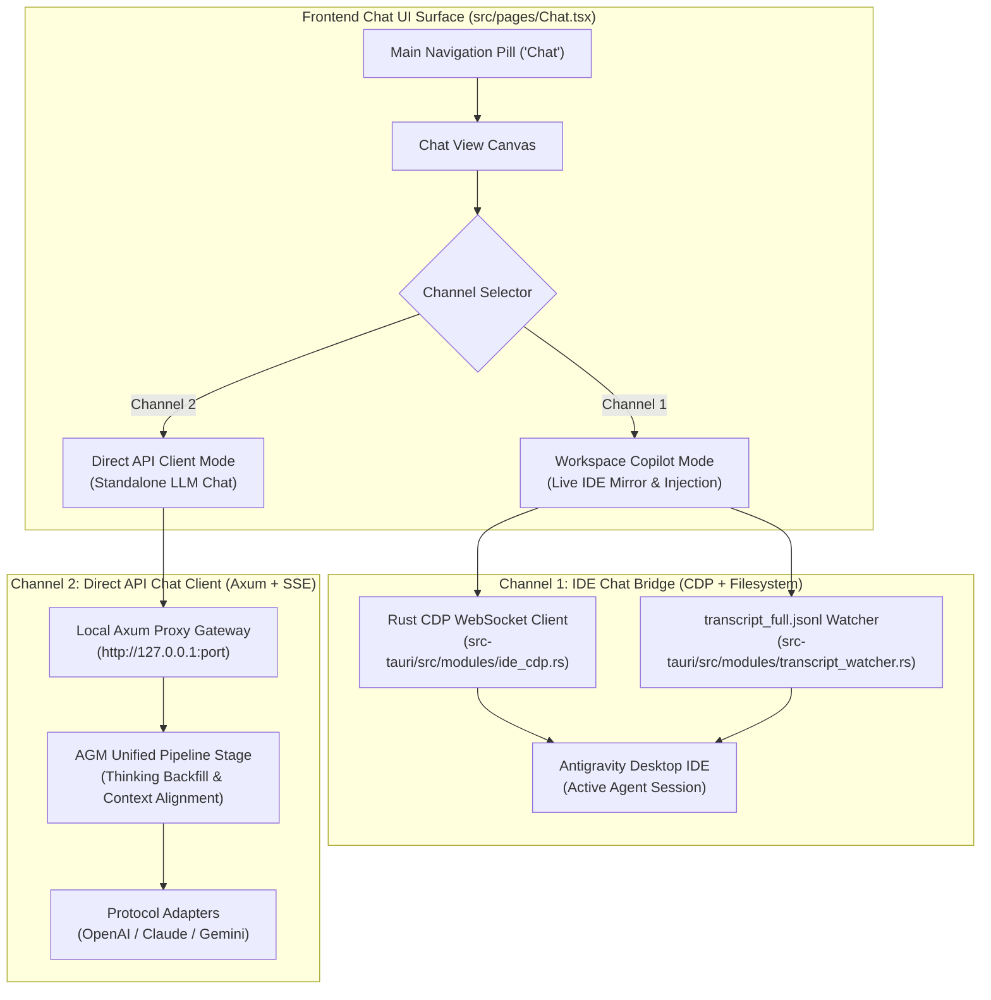
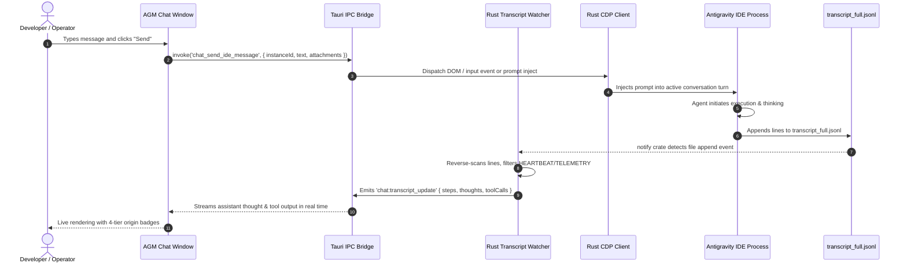
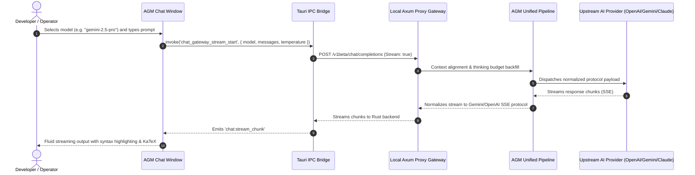

# Specification 228: Future Chat Section Architecture — Dual-Channel Workspace Copilot & Direct Gateway Client

- **Specification Slug**: `04-chat-section-architecture-spec`
- **Document Path**: `02-spec/21-app/228-ui-and-feature-enhancement-instructions/04-chat-section-architecture-spec.md`
- **Master Plan**: `.ai-memory/plans/pending/228-ui-and-feature-enhancement-instructions.md`
- **Subtask Plan**: `.ai-memory/plans/subtasks/228-ui-and-feature-enhancement-instructions/03-subtask-dispatch-and-chat-spec.md`
- **Related Specs**:
  - `02-spec/21-app/228-ui-and-feature-enhancement-instructions/01-architecture-spec.md`
  - `02-spec/21-app/228-ui-and-feature-enhancement-instructions/02-component-spec.md`
  - `02-spec/21-app/228-ui-and-feature-enhancement-instructions/03-dispatch-and-verification-spec.md`
  - `02-spec/21-app/228-ui-and-feature-enhancement-instructions/05-fifty-plus-improvement-ideas-spec.md`
- **Target Release Version**: Architectural Blueprint (Future Integration)
- **Author**: Spec Author 03
- **Status**: ARCHITECTURAL SPECIFICATION & RFC

---

## 1. Executive Summary & Vision

Antigravity Manager (AGM) has evolved into a comprehensive orchestrator managing multi-instance IDE lifecycles, SQLite-backed prompt queues, and protocol-level AI gateway routing. While the **Prompt Tree View** excels at structured turn inspection, historical audit trails, and batch rerun dispatching, developers and operators frequently require a fluid, conversational interface directly inside the AGM desktop console.

This specification establishes the architectural blueprint for a dedicated **Chat** section in the main navigation menu (`src/components/navbar/NavMenu.tsx`). The system is architected around a novel **Dual-Channel Engine**:



### Core Design Principles
1. **Zero IDE Interference (Caller Self-Preservation)**: The chat system must actively detect the developer's working IDE instance (`detect_caller_instance_id()`) and never terminate, restart, or mutate its state.
2. **Dual-Channel Flexibility**: Operators can interact directly with an ongoing IDE agent session (Channel 1) or engage with upstream models directly via the proxy without touching the IDE (Channel 2).
3. **4-Tier Origin Hierarchy**: Message rendering strictly enforces house tier classification: `USER_PROMPT` (Sky), `SUBAGENT_INSTRUCTION` (Purple, nested with `↳`), `SYSTEM_MESSAGE` (Zinc), and `TOOL_OUTPUT` (Amber).
4. **Interactive Context Omission**: Never display raw `<truncated N bytes>` plain text; render interactive dark-glass omission banners (`⚡ [Omitted N bytes/lines of context - Click to inspect/expand]`).
5. **No Silent Errors Invariant**: Every fallible network, IPC, or parsing operation must route through `AppError` and the error store (`useErrorStore`).

---

## 2. Dual-Channel Architecture

### 2.1 Channel 1: IDE Chat Bridge (Workspace Copilot Mode)

Channel 1 operates as a live, bidirectional bridge into a running Antigravity IDE instance. It allows the user to converse with the agent currently operating in the IDE, inspect its thinking in real time, and inject instructions without having to bring the IDE window to the foreground.



#### Technical Contracts for Channel 1:
- **CDP Discovery**: Discovers the target IDE instance's remote debugging port (defaulting to 9222 or dynamically scanned via instance PID).
- **Transcript Source Precedence**: Must monitor `<appDataDir>\brain\<conversation-id>\.system_generated\logs\transcript_full.jsonl` (un-truncated source of truth) as primary, falling back to `transcript.jsonl` only if the full log is unavailable.
- **Deep Reverse-Scan Filter**: Reverse-scans across at least 10 lines from EOF, strictly bypassing trailing `TOKEN_USAGE`, `HEARTBEAT`, and `TELEMETRY` records to reliably extract assistant `thinking` and `tool_calls`.
- **Attachment Formatting**: Attachments passed into the IDE session must format strictly as `@[file;<file_path>]`.

---

### 2.2 Channel 2: Direct API Chat Client (Standalone Headless / Gateway Mode)

Channel 2 functions as an independent, high-performance chat client that communicates directly with Antigravity Manager's internal Axum proxy gateway. It bypasses the IDE entirely and functions even when no IDE is running (e.g. on headless servers, during remote CI runs, or for rapid ad-hoc prompt testing).



#### Technical Contracts for Channel 2:
- **Gateway Binding**: Connects via local loopback (`http://127.0.0.1:<proxy_port>`), authenticated via AGM's internal runtime token.
- **Protocol Decoupling**: Frontend sends standard OpenAI or Gemini chat completion payloads. The AGM pipeline uniformly handles thinking block backfilling, thinking budget filtering, and sanitization of risky prompts.
- **Session Persistence**: Chat history for Channel 2 is persisted locally in AGM's SQLite speed database (`chat_sessions` and `chat_messages` tables), completely separated from IDE repo transcripts.

---

## 3. Tauri IPC Interface & Event Bus Contracts

### 3.1 IPC Commands Registry

```rust
// In src-tauri/src/commands/cmd_chat.rs

#[derive(Debug, Clone, Serialize, Deserialize)]
#[serde(rename_all = "snake_case")]
pub enum ChatChannel {
    IdeBridge { instance_id: String, conversation_id: Option<String> },
    DirectGateway { session_id: String, model: String },
}

#[derive(Debug, Clone, Serialize, Deserialize)]
pub struct ChatMessagePayload {
    pub role: String,
    pub content: String,
    pub attachments: Vec<String>, // Canonical format: @[file;<path>]
    pub parent_turn_id: Option<String>,
}

#[derive(Debug, Clone, Serialize, Deserialize)]
pub struct ChatSessionSummary {
    pub session_id: String,
    pub title: String,
    pub channel_type: String,
    pub model: Option<String>,
    pub instance_id: Option<String>,
    pub message_count: u32,
    pub updated_at: String,
}

#[tauri::command]
pub async fn chat_list_sessions(
    app: tauri::AppHandle,
    channel_filter: Option<String>,
) -> Result<Vec<ChatSessionSummary>, AppError>;

#[tauri::command]
pub async fn chat_send_message(
    app: tauri::AppHandle,
    channel: ChatChannel,
    payload: ChatMessagePayload,
) -> Result<String, AppError>;

#[tauri::command]
pub async fn chat_cancel_stream(
    app: tauri::AppHandle,
    session_id: String,
) -> Result<(), AppError>;

#[tauri::command]
pub async fn chat_get_transcript(
    app: tauri::AppHandle,
    instance_id: String,
    conversation_id: String,
    line_offset: Option<usize>,
) -> Result<TranscriptPage, AppError>;
```

### 3.2 Frontend Event Stream Contracts

```typescript
// In src/types/chat.ts

export interface ChatChunkEvent {
    sessionId: string;
    delta: string;
    kind: 'content' | 'thought';
}

export interface ChatToolCallEvent {
    sessionId: string;
    toolCallId: string;
    toolName: string;
    arguments: Record<string, unknown>;
}

export interface ChatToolResultEvent {
    sessionId: string;
    toolCallId: string;
    output: string;
    isError: boolean;
}

export interface ChatDoneEvent {
    sessionId: string;
    finishReason: 'stop' | 'length' | 'tool_calls' | 'cancelled';
    tokenUsage?: {
        promptTokens: number;
        completionTokens: number;
        totalTokens: number;
    };
}
```

---

## 4. UI Layout, Component Hierarchy & Design Tokens

### 4.1 Master Layout Canvas (3-Pane Responsive Layout)

```text
+--------------------------------------------------------------------------------------------------------+
| Navigation Bar: [ Instances | Accounts | Prompts | Chat* | Settings ]                    [Window Controls] |
+--------------------------------------------------------------------------------------------------------+
| Sessions Sidebar (280px)   | Main Chat Pane (Flex-1)                                                   |
| +-------------------------+ +-------------------------------------------------------------------------+ |
| | [+ New Chat]            | | Header: [ Channel 1: IDE Bridge | inst-1 (PID: 8412) ]  ● Connected    | |
| |                         | | Model: [ gemini-2.5-pro v ] | Token Usage: 12.4k | [Clear] [Export]         | |
| | Search sessions...      | +-------------------------------------------------------------------------+ |
| |                         | | Message Stream (Scroll Area)                                            | |
| | Channel 1: IDE Sessions | |                                                                         | |
| | > Fix Auth Refresh (Now)| | [USER] 14:22                                                            | |
| |   Refactor Storage      | | Please investigate the token refresh loop in auth.rs                    | |
| |                         | | Attachments: @[file;src/auth.rs]                                        | |
| | Channel 2: Gateway Chats| |                                                                         | |
| | > Prompt Tuning Draft   | | [ASSISTANT] 14:23 (Thinking: 4.2s) v                                    | |
| |   Architecture RFC      | | > Thinking process disclosure: inspecting JWT expiry logic...           | |
| |                         | |                                                                         | |
| |                         | | [TOOL_OUTPUT] (Wrench) - read_file(src/auth.rs)                         | |
| |                         | | ⚡ [Omitted 1,420 lines of context - Click to inspect/expand]            | |
| |                         | |                                                                         | |
| |                         | | The issue occurs because line 42 does not update the refresh timestamp. | |
| +-------------------------+ +-------------------------------------------------------------------------+ |
|                           | Input Box:                                                                | |
|                           | +-----------------------------------------------------------------------+ | |
|                           | | Ask a question or type instructions...                                | | |
|                           | |                                                                       | | |
|                           | | +-------------------------------------------------------------------+ | | |
|                           | | [Mode: Send v]  [@ Attach File] [Token Est: 140]         [Send (N)] | | |
|                           | +-----------------------------------------------------------------------+ | |
+---------------------------+-----------------------------------------------------------------------------+
```

### 4.2 4-Tier Origin Badge Specifications

Rendering of conversation turns strictly distinguishes between the 4 architectural origins:

| Origin Tier | Badge Color | Icon | Visual Indentation | Meaning |
|---|---|---|---|---|
| `USER_PROMPT` | `bg-sky-500/15 text-sky-700 dark:text-sky-300 border-sky-500/30` | `<User className="w-3 h-3 text-sky-500" />` | Level 0 (`ml-0`) | Direct operator or user prompt |
| `SUBAGENT_INSTRUCTION` | `bg-purple-500/15 text-purple-700 dark:text-purple-300 border-purple-500/30` | `<Bot className="w-3 h-3 text-purple-500" />` | Level 1 (`ml-6 border-l-2 border-purple-500/30 pl-3`) | Autonomous subagent child task, prefixed with branch glyphs (`↳`, `└──`) |
| `SYSTEM_MESSAGE` | `bg-zinc-500/15 text-zinc-700 dark:text-zinc-300 border-zinc-500/30` | `<Terminal className="w-3 h-3 text-zinc-500" />` | Level 0 (`ml-0`) | System instruction, context primer, or agent harness directive |
| `TOOL_OUTPUT` | `bg-amber-500/15 text-amber-700 dark:text-amber-300 border-amber-500/30` | `<Wrench className="w-3 h-3 text-amber-500" />` | Level 1 (`ml-4 bg-amber-500/5 p-2 rounded-lg`) | Output from tool executions (`run_command`, `read_file`, etc.) |

### 4.3 Interactive Truncation Callouts

When transcripts or tool outputs exceed display thresholds (e.g., > 800 lines or > 46,080 bytes), the text MUST NOT be rendered as unstyled plain text (`<truncated 1420 lines>`). It must render as an interactive, dark-glass callout banner:

```tsx
<div className="my-2 p-2.5 rounded-xl bg-slate-100/90 dark:bg-slate-900/90 border border-amber-500/30 dark:border-amber-500/20 shadow-sm backdrop-blur-md flex items-center justify-between">
    <div className="flex items-center gap-2">
        <span className="flex h-2 w-2 relative">
            <span className="animate-ping absolute inline-flex h-full w-full rounded-full bg-amber-400 opacity-75"></span>
            <span className="relative inline-flex rounded-full h-2 w-2 bg-amber-500"></span>
        </span>
        <span className="text-xs font-mono font-medium text-amber-800 dark:text-amber-300">
            ⚡ [Omitted {omittedLines} lines ({omittedBytes} bytes) of context]
        </span>
    </div>
    <button
        type="button"
        onClick={() => handleExpandOmission(calloutId)}
        className="btn-tactile px-2.5 py-1 text-[11px] font-semibold rounded-md bg-amber-500/20 hover:bg-amber-500/30 text-amber-900 dark:text-amber-200 transition-colors cursor-pointer"
    >
        Inspect Full Context
    </button>
</div>
```

---

## 5. File Context Attachments & Canonical Syntax

All file attachments in the chat input bar leverage the canonical semicolon format:

$$\texttt{@[file;<relative\_workspace\_path>]}$$

### User Interaction Workflow:
1. **Drag-and-Drop**: The developer drags files from the OS file manager or AGM instance explorer directly into the chat input area.
2. **Autocomplete Trigger (`@`)**: Typing `@` in the textarea invokes an inline workspace fuzzy file picker searching across repository files via GitMap indexing.
3. **Pill Preview Bar**: Attached files appear in a horizontal pill carousel immediately above the text input, displaying file name, size, type icon, and a remove button.
4. **Token Estimation**: AGM calculates estimated token overhead for attached files in real time and displays it alongside the Send button.

---

## 6. Error Boundaries & Graceful Degradation

To ensure that unstable network streams, large transcripts, or upstream API errors never crash Antigravity Manager, the Chat view is encapsulated in a dedicated error boundary:

```tsx
// In src/pages/Chat/ChatErrorBoundary.tsx
export class ChatErrorBoundary extends React.Component<ChatErrorBoundaryProps, ChatErrorBoundaryState> {
    state: ChatErrorBoundaryState = { hasError: false, error: null };

    static getDerivedStateFromError(error: Error): ChatErrorBoundaryState {
        return { hasError: true, error };
    }

    componentDidCatch(error: Error, errorInfo: React.ErrorInfo) {
        useErrorStore.getState().captureException(error, {
            source: 'ChatView.ErrorBoundary',
            componentStack: errorInfo.componentStack || undefined,
        });
    }

    handleReset = () => {
        this.setState({ hasError: false, error: null });
    };

    render() {
        if (this.state.hasError) {
            return (
                <div className="flex-1 flex flex-col items-center justify-center p-8 text-center space-y-4">
                    <div className="w-12 h-12 rounded-full bg-rose-500/10 text-rose-500 flex items-center justify-center">
                        <AlertTriangle className="w-6 h-6" />
                    </div>
                    <h3 className="text-sm font-semibold text-slate-800 dark:text-slate-200">
                        Chat Stream Encountered an Error
                    </h3>
                    <p className="text-xs text-slate-500 max-w-md">
                        The chat session crashed safely without affecting your active instances or proxy gateway.
                    </p>
                    <button onClick={this.handleReset} className="btn-tactile px-3 py-1.5 rounded-lg bg-purple-600 text-white text-xs">
                        Reload Chat Canvas
                    </button>
                </div>
            );
        }
        return this.props.children;
    }
}
```

---

## 7. Caller IDE Self-Preservation & Safety Invariants

### 7.1 Caller PID Detection Invariant
To satisfy the House Rule on **Caller IDE Self-Preservation & Transient Test Sandboxing**:
- Whenever Channel 1 attaches to an IDE instance, it calls `detect_caller_instance_id()` to identify whether the target instance is the developer's active working environment.
- Any destructive operation (e.g. killing the IDE process, force-restarting the instance, or wiping its SQLite prompt queue) initiated from the Chat UI is intercepted and blocked:
  `Error: Cannot terminate or disrupt the active caller IDE instance. Use --force via CLI if intentional.`

### 7.2 Safety Invariant Matrix

| Invariant ID | Rule Description | Enforcement Layer | Failure Mode Action |
|---|---|---|---|
| **INV-CHT-01** | Caller IDE Self-Preservation | Rust `cmd_chat.rs` & `detect_caller_instance_id()` | Fails fast with exit code 2 unless overridden |
| **INV-CHT-02** | Prioritize `transcript_full.jsonl` | Rust `transcript_watcher.rs` | Auto-falls back to `transcript.jsonl` with warning |
| **INV-CHT-03** | 4-Tier Origin Badge Hierarchy | React `ChatMessageItem.tsx` | Strict type guard; defaults to `SYSTEM_MESSAGE` |
| **INV-CHT-04** | Interactive Truncation Callouts | React `TruncatedContextCallout.tsx` | Plain text truncation forbidden in DOM |
| **INV-CHT-05** | Canonical Attachment Syntax `@[file;<path>]` | Input Parser & IPC Serializer | Legacy syntax parsed; output strictly canonical |
| **INV-CHT-06** | No Silent Errors | All TS/Rust Chat Modules | Routed to `useErrorStore` / `AppError` |
