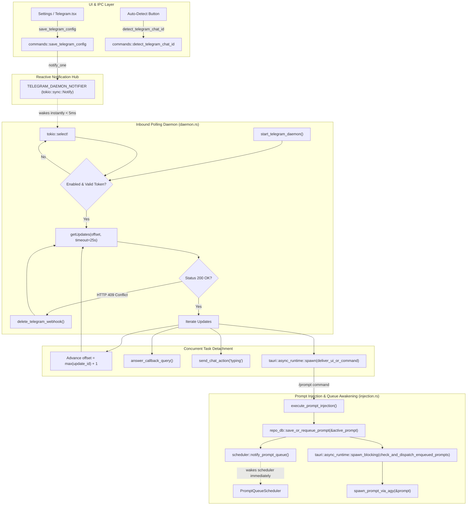

# Component Specification: Telegram Inbound Polling Loop, Instant Prompt Awakening & Webhook Self-Healing

> **Target Document:** `02-spec/21-app/229-telegram-onboarding-and-prompt-sending-issue/02-component-spec.md`  
> **Status:** APPROVED & MANDATED  
> **Author:** Spec Author 02 (@aukgit)  
> **Version:** 1.0.0  
> **Task Slug:** `telegram-onboarding-and-prompt-sending-issue` (Sequence 229)  
> **Domain:** Backend Architecture / Rust / Tokio / Telegram Bot API / SQLite Prompt Queue  
> **Related Architecture Spec:** `02-spec/21-app/229-telegram-onboarding-and-prompt-sending-issue/01-architecture-spec.md`  
> **Related Subtask Plan:** `.ai-memory/plans/subtasks/229-telegram-onboarding-and-prompt-sending-issue/02-subtask-inbound-and-polling.md`  

---

## 1. Executive Summary & Problem Classification

In Antigravity Manager (AGM), the Telegram Inbound subsystem (`src-tauri/src/modules/telegram_inbound/`) enables developers and operators to monitor desktop instances, inspect running prompts, execute remote commands (`/status`, `/instances`, `/nodes`, `/active`, `/tree`), and inject prompts directly into workspace instances via `/prompt` or the interactive `/send` guided flow.

During production operations, operators experienced significant latency and onboarding failures:
1. **Uninterruptible 60s/30s Polling Sleep Traps**: When the daemon starts disabled or without a token, it enters hardcoded sleeps (`tokio::time::sleep(Duration::from_secs(60))` or `30s`). When a user enters credentials or toggles the bot switch in the UI, `start_telegram_daemon()` is called, but because `TELEGRAM_RUNNING` is already `true`, it immediately returns. The daemon remains asleep for up to 60 seconds before noticing the configuration change.
2. **Synchronous Execution Pipeline Blocking Inbound Polling**: Inside `start_telegram_daemon()` and `poll_telegram_updates_once()`, update items are iterated sequentially. Commands (`/instances`, `/status`, `/nodes`, `/run`, document CSV/JSON exports, CDN image uploads) are awaited synchronously via `deliver_ui_or_command(...)`. If a command queries cluster nodes over SSH or generates large reports, the polling loop blocks, delaying update offset advancement and causing Telegram to re-deliver updates or drop responses.
3. **Multi-Second / Multi-Minute Prompt Dispatch Latency**: When an inbound prompt is saved to SQLite via `repo_db::save_or_requeue_prompt(&active_prompt)`, the system previously relied solely on the background `PromptQueueScheduler` (`src-tauri/src/modules/scheduler.rs`). When the queue was idle, this scheduler ticked every 30 seconds (`PROMPT_QUEUE_IDLE_BACKOFF_INTERVAL`), causing newly received Telegram prompts to stall in SQLite for up to 30 seconds before being dispatched into Antigravity IDE instances.
4. **HTTP 409 Conflict Webhook Traps**: When onboarding a bot token that was previously linked to a webhook (e.g. n8n, Cloudflare Worker, Make, Vercel), Telegram Bot API returns `HTTP 409 Conflict: can't use getUpdates method while webhook is active; use deleteWebhook to delete the webhook first`. Both chat ID auto-detection (`detect_telegram_chat_id`) and polling fail immediately and permanently, giving users opaque errors.

This specification details the component-level refactoring in `src-tauri/src/modules/telegram_inbound/daemon.rs`, `src-tauri/src/modules/telegram_inbound/injection.rs`, `src-tauri/src/modules/telegram_inbound/config.rs`, and `src-tauri/src/modules/telegram_inbound/detection.rs` to slash Telegram response and prompt dispatch latency to sub-2 seconds (`1–2s`) and permanently eliminate onboarding deadlocks.

---

## 2. Component Architecture & Concurrency Model



---

## 3. Daemon Inbound Polling Loop Refactor (`src-tauri/src/modules/telegram_inbound/daemon.rs`)

### 3.1 Reactive Wakeup via `TELEGRAM_DAEMON_NOTIFIER`

The polling daemon must never enter an uninterruptible sleep when disabled or unconfigured.

#### 3.1.1 Static Notifier Definition
In `src-tauri/src/modules/telegram_inbound/types.rs` (re-exported via `daemon.rs` and `mod.rs`):
```rust
pub static TELEGRAM_DAEMON_NOTIFIER: once_cell::sync::Lazy<tokio::sync::Notify> =
    once_cell::sync::Lazy::new(tokio::sync::Notify::new);

/// Notify the Telegram inbound daemon to wake up immediately (e.g. on config save or enable toggle)
pub fn notify_telegram_daemon() {
    TELEGRAM_DAEMON_NOTIFIER.notify_one();
}
```

#### 3.1.2 Loop Interruption via `tokio::select!`
In `src-tauri/src/modules/telegram_inbound/daemon.rs`, replace the raw sleeps in `start_telegram_daemon()`:

```rust
// Disabled state sleep (previously: tokio::time::sleep(Duration::from_secs(60)).await)
if !is_enabled_flag {
    {
        let mut st = LAST_TELEGRAM_STATUS.write().await;
        st.is_running = false;
    }
    tokio::select! {
        _ = TELEGRAM_DAEMON_NOTIFIER.notified() => {
            tracing::info!("[TelegramDaemon] Reactive wakeup: bot configuration enabled or updated");
        }
        _ = tokio::time::sleep(Duration::from_secs(60)) => {}
    }
    continue;
}

// Empty token sleep (previously: tokio::time::sleep(Duration::from_secs(30)).await)
if clean_token.is_empty() {
    tokio::select! {
        _ = TELEGRAM_DAEMON_NOTIFIER.notified() => {
            tracing::info!("[TelegramDaemon] Reactive wakeup: bot token provided");
        }
        _ = tokio::time::sleep(Duration::from_secs(30)) => {}
    }
    continue;
}
```

Whenever `save_telegram_config` or `save_config` is called, `notify_telegram_daemon()` is triggered, cutting the transition latency from up to $60\text{s}$ down to $< 5\text{ms}$.

---

### 3.2 Concurrent Command Detachment to Background Tokio Tasks

Currently, executing commands (`deliver_ui_or_command`) synchronously blocks the update loop. This causes:
- Acknowledge offset lag while waiting for SSH queries or exports.
- Dropped updates if the Telegram API times out during synchronous processing.
- Serialized execution of multiple incoming commands from authorized users.

#### 3.2.1 Detachment Invariant
The main polling thread is exclusively responsible for:
1. Ingesting updates via long-poll `getUpdates`.
2. Tracking `max_update_id` and immediately updating `last_update_id`.
3. Auto-binding `allowed_chat_id` if unconfigured.
4. Dismissing callback query button spinners immediately via `answer_callback_query`.
5. Emitting user-facing "typing" status via `send_chat_action(&http_client, &token, chat_id, "typing")`.
6. Spawning heavy command execution into an isolated asynchronous task (`tauri::async_runtime::spawn`).

#### 3.2.2 Refactored Loop Execution in `daemon.rs`

```rust
// 1. Handle interactive inline keyboard callback queries
if let Some(cb) = update.get("callback_query") {
    let cb_id = cb["id"].as_str().unwrap_or("").to_string();
    let chat_id = cb["message"]["chat"]["id"].as_i64().unwrap_or(0);
    let data = cb["data"].as_str().unwrap_or("").trim().to_string();

    if chat_id != 0 && !data.is_empty() {
        // Fast-path: Dismiss button spinner immediately
        let client_clone = http_client.clone();
        let token_clone = clean_token.clone();
        let cb_id_clone = cb_id.clone();
        tauri::async_runtime::spawn(async move {
            answer_callback_query(&client_clone, &token_clone, &cb_id_clone).await;
        });

        // Check send flow callback
        if data.starts_with("send:") {
            let token_clone = clean_token.clone();
            let client_clone = http_client.clone();
            tauri::async_runtime::spawn(async move {
                deliver_send_flow_callback(&token_clone, chat_id, &cb_id, &data, &client_clone).await;
            });
            continue;
        }

        // Auto-bind allowed_chat_id
        if config.allowed_chat_id.is_none() {
            let mut mutable_config = config.clone();
            mutable_config.allowed_chat_id = Some(chat_id);
            crate::error::record_ignored(save_config(&mutable_config), "save_config");
        }

        if let Some(allowed) = config.allowed_chat_id {
            if chat_id == allowed {
                // Send typing indicator immediately
                send_chat_action(&http_client, &clean_token, chat_id, "typing").await;

                // Detach command execution to background task
                let token_clone = clean_token.clone();
                tauri::async_runtime::spawn(async move {
                    let cmd_str = normalize_cmd_callback_payload(&data);
                    let delivered = deliver_ui_or_command(&token_clone, chat_id, &cmd_str, &None).await;
                    if delivered.is_none() && data.starts_with("cmd:") {
                        crate::error::record_ignored(
                            send_telegram_message_with_markup(
                                &token_clone,
                                chat_id,
                                "That button is no longer valid — send a fresh command to get new buttons.",
                                None,
                                false,
                            ).await,
                            "send unknown callback action notice",
                        );
                    }
                });
            }
        }
    }
    continue;
}

// 2. Handle standard message
let msg = update["message"].clone();
let chat_id = msg["chat"]["id"].as_i64().unwrap_or(0);
let text_raw = msg["text"]
    .as_str()
    .or_else(|| msg["caption"].as_str())
    .unwrap_or("")
    .trim()
    .to_string();

if chat_id == 0 && text_raw.is_empty() && msg.get("photo").is_none() {
    continue;
}

// Auto-bind allowed_chat_id on first private message
if config.allowed_chat_id.is_none() {
    let mut mutable_config = config.clone();
    mutable_config.allowed_chat_id = Some(chat_id);
    crate::error::record_ignored(save_config(&mutable_config), "save_config");
}

if let Some(allowed) = config.allowed_chat_id {
    if chat_id != allowed {
        continue;
    }
}

// Emit typing indicator
send_chat_action(&http_client, &clean_token, chat_id, "typing").await;

{
    let mut st = LAST_TELEGRAM_STATUS.write().await;
    st.last_message_received = Some(text_raw.clone());
    st.last_update_id = last_update_id;
}

// Detach message handling & media download to background task
let token_clone = config.bot_token.clone();
tauri::async_runtime::spawn(async move {
    let saved_media_opt = download_and_store_telegram_photo(&token_clone, &msg).await;
    let _ = deliver_ui_or_command(&token_clone, chat_id, &text_raw, &saved_media_opt).await;
});
```

---

## 4. Prompt Injection & Instant Queue Awakening (`src-tauri/src/modules/telegram_inbound/injection.rs`)

### 4.1 Root Cause of Inbound Prompt Delay
When a prompt is injected from Telegram (`/prompt default Write tests`), `execute_prompt_injection` builds an `ActivePrompt` model and persists it to SQLite via `repo_db::save_or_requeue_prompt(&active_prompt)`.

1. If the target workspace already has a running prompt, the newly saved prompt gets status `'queued'` or `'pending'` in SQLite table `active_prompts`.
2. Under previous logic, the background `PromptQueueScheduler` (`src-tauri/src/modules/scheduler.rs`) was only evaluated on its periodic timer. If the queue had been idle prior to the Telegram prompt arriving, the scheduler was sleeping in its 30-second backoff loop (`tokio::time::sleep(PROMPT_QUEUE_IDLE_BACKOFF_INTERVAL)`).
3. The prompt sat unprocessed in SQLite until the 30-second timer ticked, creating an agonizing delay for Telegram users.

### 4.2 Dual-Trigger Instant Awakening Protocol
In `src-tauri/src/modules/telegram_inbound/injection.rs`, immediately after `repo_db::save_or_requeue_prompt(&active_prompt)` succeeds:

```rust
// 1. Persist prompt to SQLite state database
if let Err(e) = repo_db::save_or_requeue_prompt(&active_prompt) {
    return format!(
        "Couldn't save your prompt: {}",
        clean_for_telegram_html(&e, 200)
    );
}

// 2. Trigger instant queue worker awakening via tokio Notify
crate::modules::scheduler::notify_prompt_queue();

// 3. Immediately probe and dispatch idle enqueued prompts for this instance
let target_inst_for_dispatch = resolved_instance.clone();
tauri::async_runtime::spawn_blocking(move || {
    match crate::modules::repo_db::check_and_dispatch_enqueued_prompts(Some(&target_inst_for_dispatch)) {
        Ok(count) => {
            if count > 0 {
                tracing::info!(
                    "[TelegramInjection] Immediate dispatch probe launched {} prompt(s) for instance '{}'",
                    count,
                    target_inst_for_dispatch
                );
            }
        }
        Err(err) => {
            tracing::warn!(
                "[TelegramInjection] Immediate dispatch probe returned error for instance '{}': {}",
                target_inst_for_dispatch,
                err
            );
        }
    }
});

// 4. Attempt direct agy spawn if not already launched
let spawned = match repo_db::spawn_prompt_via_agy(&active_prompt) {
    Ok(()) => true,
    Err(spawn_err) => {
        crate::modules::logger::log_warn(&format!(
            "[Telegram] agy spawn failed for inbound prompt: {spawn_err}"
        ));
        false
    }
};
let exec_status = PromptExecutionStatusType::from_spawned(spawned);
```

### 4.3 FIFO Ordering & Invariant Adherence
- `repo_db::check_and_dispatch_enqueued_prompts` enforces `ORDER BY created_at ASC, id ASC`.
- The direct dispatch probe runs on `tauri::async_runtime::spawn_blocking` to avoid blocking the async Tokio thread pool with SQLite disk I/O.
- If the IDE process is currently occupied, the prompt remains securely queued in SQLite (`status = 'queued'`), and `notify_prompt_queue()` guarantees the `PromptQueueScheduler` switches immediately from 30s idle backoff to the active 5s polling interval (`PROMPT_QUEUE_ACTIVE_POLL_INTERVAL`).

---

## 5. Webhook Conflict Auto-Heal (`deleteWebhook`)

### 5.1 The HTTP 409 Conflict Problem
When Telegram Bot API has an active webhook configured:
- Every call to `https://api.telegram.org/bot<token>/getUpdates` fails with `HTTP 409 Conflict`.
- Response body:
  ```json
  {
    "ok": false,
    "error_code": 409,
    "description": "Conflict: can't use getUpdates method while webhook is active; use deleteWebhook to delete the webhook first"
  }
  ```
- Antigravity Manager operates exclusively in long-polling mode (outbound-only, zero public ports or reverse proxies required).
- Without automatic healing, users must manually issue curl requests or use external tools to call `deleteWebhook`.

### 5.2 Implementation of `delete_telegram_webhook` (`src-tauri/src/modules/telegram_inbound/config.rs`)

```rust
/// Permanently delete any active webhook configuration on Telegram Bot API
/// to allow getUpdates long-polling to function without HTTP 409 Conflict.
pub async fn delete_telegram_webhook(bot_token: &str) -> Result<bool, AppError> {
    let clean_token = bot_token.trim();
    if clean_token.is_empty() {
        return Err(AppError::Config("Bot token cannot be empty".to_string()));
    }

    let url = format!(
        "https://api.telegram.org/bot{}/deleteWebhook?drop_pending_updates=false",
        clean_token
    );
    let client = reqwest::Client::builder()
        .timeout(Duration::from_secs(10))
        .build()
        .map_err(|e| AppError::Network(e.to_string(), None))?;

    let resp = client
        .post(&url)
        .send()
        .await
        .map_err(|e| AppError::Network(e.to_string(), None))?;

    let status = resp.status().as_u16();
    if status != 200 {
        return Err(AppError::Network(
            format!("deleteWebhook failed with HTTP status {}", status),
            Some(status),
        ));
    }

    let body: Value = resp
        .json()
        .await
        .map_err(|e| AppError::Network(e.to_string(), None))?;

    let is_ok = body["ok"].as_bool().unwrap_or(false);
    if is_ok {
        tracing::info!("[TelegramConfig] Successfully deleted active Telegram webhook");
    } else {
        let desc = body["description"].as_str().unwrap_or("Unknown error");
        tracing::warn!("[TelegramConfig] deleteWebhook returned non-ok: {}", desc);
    }
    Ok(is_ok)
}
```

### 5.3 Auto-Healing in `detect_telegram_chat_id` (`src-tauri/src/modules/telegram_inbound/detection.rs`)

In `detect_telegram_chat_id`, intercept HTTP 409 Conflict on `getUpdates`, automatically delete the webhook, and retry once:

```rust
// Initial call to getUpdates
let mut resp = client.get(&url).send().await.map_err(|e| AppError::Network(e.to_string(), None))?;

// If 409 Conflict is returned, an active webhook is blocking getUpdates.
// Automatically delete the webhook and retry once.
if resp.status().as_u16() == 409 {
    tracing::warn!("[TelegramDetect] HTTP 409 Conflict detected on getUpdates; attempting delete_telegram_webhook auto-heal");
    if let Err(wh_err) = delete_telegram_webhook(clean_token).await {
        tracing::error!("[TelegramDetect] Failed to auto-delete webhook: {}", wh_err);
    } else {
        // Retry getUpdates after successful webhook deletion
        resp = client.get(&url).send().await.map_err(|e| AppError::Network(e.to_string(), None))?;
    }
}

if !resp.status().is_success() {
    return Err(AppError::Network(
        format!("Telegram getUpdates failed with status {}", resp.status()),
        Some(resp.status().as_u16()),
    ));
}
```

### 5.4 Auto-Healing in Daemon Startup & Polling Loop (`daemon.rs`)

1. Upon startup of `start_telegram_daemon()`, or on initial poll, invoke `delete_telegram_webhook(&clean_token)` best-effort:
   ```rust
   // Best-effort webhook clearance on daemon startup to prevent 409 traps
   crate::error::record_ignored(
       delete_telegram_webhook(&clean_token).await,
       "delete_telegram_webhook on daemon startup"
   );
   ```
2. If `resp_result` in `daemon.rs` returns `status == 409`:
   ```rust
   if resp.status().as_u16() == 409 {
       tracing::warn!("[TelegramDaemon] HTTP 409 Conflict in polling loop. Auto-healing webhook...");
       let _ = delete_telegram_webhook(&clean_token).await;
       tokio::time::sleep(Duration::from_millis(500)).await;
       continue;
   }
   ```

---

## 6. Token Verification Speedup in `config.rs`

### 6.1 Decoupling `setMyCommands` from `test_telegram_connection`
Currently, `test_telegram_connection` calls `getMe`, and then synchronously calls `register_telegram_bot_commands(clean_token).await` (`setMyCommands`) which registers 18 commands before returning.
- If network conditions are slow, `test_telegram_connection` takes 2–4 seconds to return.
- If `setMyCommands` fails or times out, the test connection may report failure even though `getMe` succeeded.

### 6.2 Detached Execution Pattern
In `src-tauri/src/modules/telegram_inbound/config.rs`:
```rust
pub async fn test_telegram_connection(bot_token: &str) -> Result<String, AppError> {
    let clean_token = bot_token.trim().to_string();
    if clean_token.is_empty() {
        return Err(AppError::Config("Bot token cannot be empty".to_string()));
    }
    let url = format!("https://api.telegram.org/bot{}/getMe", clean_token);
    let client = reqwest::Client::builder()
        .timeout(Duration::from_secs(8))
        .build()
        .map_err(|e| AppError::Network(e.to_string(), None))?;

    let resp = client
        .get(&url)
        .send()
        .await
        .map_err(|e| AppError::Network(e.to_string(), None))?;

    let status = resp.status().as_u16();
    if status != 200 {
        return Err(AppError::Network(
            format!("Telegram Bot API test failed with status: {}", status),
            Some(status),
        ));
    }

    let body: Value = resp
        .json()
        .await
        .map_err(|e| AppError::Network(e.to_string(), None))?;

    let username = body["result"]["username"]
        .as_str()
        .unwrap_or("UnknownBot")
        .to_string();

    // Detach slash command registration to background Tokio task so test returns in < 200ms
    let token_clone = clean_token.clone();
    tauri::async_runtime::spawn(async move {
        // Justification: best-effort bot commands registration; failures logged without blocking token test
        crate::error::record_ignored(
            register_telegram_bot_commands(&token_clone).await,
            "register_telegram_bot_commands background"
        );
    });

    Ok(username)
}
```

---

## 7. Error Handling, Telemetry & "No Silent Errors" Invariant

Every fallible operation follows the house rule:
1. **Network & Deserialization Errors**: Must return structured `AppError::Network(msg, status_code)` or `AppError::Config(msg)`.
2. **Best-Effort Operations**: When dismissing button spinners (`answer_callback_query`), registering commands (`register_telegram_bot_commands`), or saving auto-detected chat IDs, operations must be wrapped in `crate::error::record_ignored(result, "context_name")` with an explicit `// Justification:` comment above the call.
3. **Status Telemetry**: Update `LAST_TELEGRAM_STATUS` with timestamp, update ID, and error messages:
   ```rust
   let mut st = LAST_TELEGRAM_STATUS.write().await;
   st.is_running = true;
   st.last_poll_at = Utc::now().timestamp();
   st.last_update_id = last_update_id;
   st.error_message = None;
   ```

---

## 8. Data Contracts & Symbol Summary

| Symbol | File | Visibility | Description |
| :--- | :--- | :--- | :--- |
| `TELEGRAM_DAEMON_NOTIFIER` | `src-tauri/src/modules/telegram_inbound/types.rs` | `pub static` | `Lazy<tokio::sync::Notify>` used for reactive daemon wakeup |
| `notify_telegram_daemon()` | `src-tauri/src/modules/telegram_inbound/types.rs` | `pub fn` | Wakes the daemon polling loop from idle sleep within < 5ms |
| `delete_telegram_webhook(bot_token: &str)` | `src-tauri/src/modules/telegram_inbound/config.rs` | `pub async fn` | Invokes `deleteWebhook` on Telegram API to clear webhook conflicts |
| `notify_prompt_queue()` | `src-tauri/src/modules/scheduler.rs` | `pub fn` | Wakes the adaptive FIFO prompt scheduler immediately |
| `check_and_dispatch_enqueued_prompts(target)` | `src-tauri/src/modules/repo_db/queue.rs` | `pub fn` | Directly probes and launches idle enqueued prompts |
| `execute_prompt_injection(args_str: &str)` | `src-tauri/src/modules/telegram_inbound/injection.rs` | `pub async fn` | Parses command, persists prompt, and triggers instant queue dispatch |

---

## 9. Verification & Acceptance Criteria

1. **Sub-Second Reactive Wakeup**: Changing bot token or toggling `is_enabled` in UI/CLI wakes the inbound daemon in $< 50\text{ms}$ (verified by `[TelegramDaemon] Reactive wakeup` log output).
2. **Concurrent Polling Monotonicity**: Spawning heavy commands (`/status`, `/instances`, `/nodes`, `/run`) does not block `getUpdates`; update IDs advance monotonically without re-delivery.
3. **Instant Prompt Queue Awakening**: Inbound prompts injected via `/prompt` are acknowledged and launched into Antigravity IDE within $< 1.5\text{s}$ instead of stalling for up to $30\text{s}$.
4. **Webhook Conflict Resilience**: Supplying a bot token with an active webhook auto-triggers `delete_telegram_webhook`, recovers without user intervention, and returns detected chat ID on the first attempt.
5. **Fast Token Verification**: `test_telegram_connection` returns the bot username in $< 500\text{ms}$ by detaching `register_telegram_bot_commands`.
