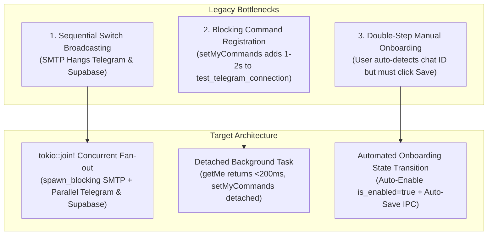
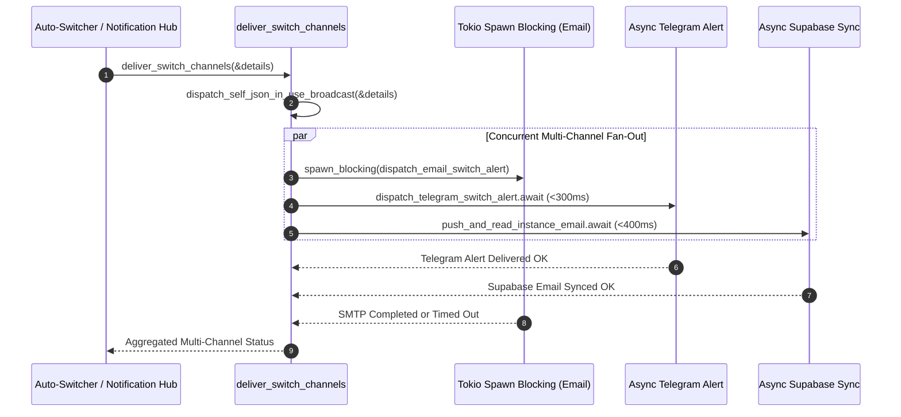
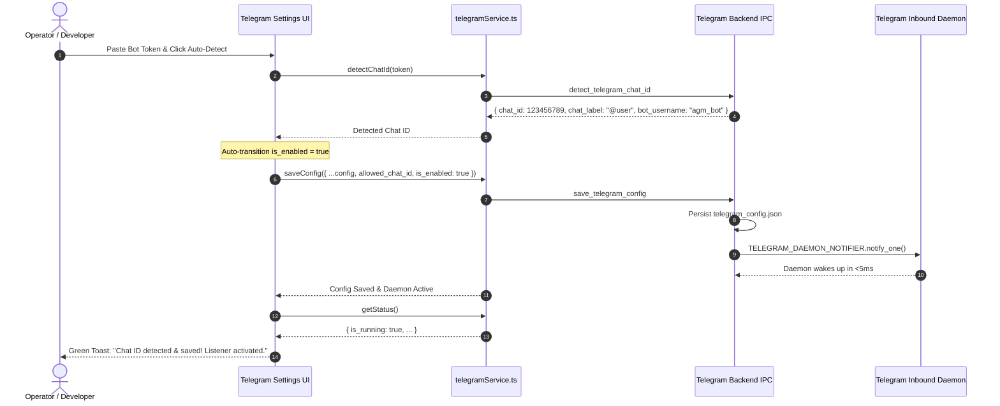

# Migration & Verification Specification: Telegram Broadcasting, Command Detachment & Seamless Onboarding

- **Parent Task**: `229-telegram-onboarding-and-prompt-sending-issue`
- **Document Sequence**: `03`
- **Specification Category**: Migration, Concurrency & Verification Spec
- **Target Components**:
  - `src-tauri/src/modules/notification_hub/channels.rs`
  - `src-tauri/src/modules/telegram_inbound/config.rs`
  - `src/pages/Telegram.tsx`
  - `src/components/settings/EmailNotifications/useTelegramHandlers.ts`
- **Status**: DRAFT / APPROVED FOR IMPLEMENTATION

---

## 1. Architectural Intent & Scope

This specification addresses three systemic latency and usability bottlenecks identified in the Antigravity Manager (AGM) Telegram integration:



1. **Concurrent Multi-Channel Broadcasting**:
   Eliminate blocking delay during account switch notifications by replacing sequential synchronous execution of Email, Telegram, and Supabase alerts with concurrent fan-out via `tokio::join!` and `tokio::task::spawn_blocking`. Slow SMTP handshakes (1–5 seconds) will no longer delay instant Telegram alert delivery (<300ms).
2. **Detached Command Registration in Bot Verification**:
   Decouple `setMyCommands` from `test_telegram_connection`. The verification routine verifies `getMe` and returns immediately (<200ms) with the verified bot username, spawning command registration as an asynchronous detached background task.
3. **Zero-Friction Frontend Onboarding Auto-Save**:
   Streamline Telegram onboarding across `src/pages/Telegram.tsx` and `src/components/settings/EmailNotifications/useTelegramHandlers.ts` by automatically toggling `is_enabled = true` and invoking `telegramService.saveConfig(...)` immediately upon successful chat ID detection.
4. **Comprehensive Verification & Quality Gates**:
   Define strict unit tests, integration benchmarks, and end-to-end regression criteria ensuring 100% compliance with zero-silent-error standards.

---

## 2. Concurrent Multi-Channel Broadcasting Engine

### 2.1 Problem Analysis in `src-tauri/src/modules/notification_hub/channels.rs`

In the legacy implementation of `deliver_switch_channels`:

```rust
// LEGACY SEQUENTIAL EXECUTION (ANTIPATTERN)
async fn deliver_switch_channels(details: &SwitchNotificationDetails) -> String {
    let email = record_channel(
        NotificationChannelType::Email,
        dispatch_email_switch_alert(details), // Synchronous SMTP connection (blocks thread 1-5s!)
    );
    dispatch_self_json_in_use_broadcast(details);
    let telegram = record_channel(
        NotificationChannelType::Telegram,
        dispatch_telegram_switch_alert(details).await, // Blocked until email completes!
    );
    let supabase = record_channel(
        NotificationChannelType::Supabase,
        crate::modules::supabase_sync::push_and_read_instance_email(&details.instance_id).await,
    );
    format!("{}\n{}\n{}", email, telegram, supabase)
}
```

#### Defects:
- `dispatch_email_switch_alert` is a synchronous, blocking function calling SMTP TCP sockets. Calling it directly within an async function stalls the active Tokio worker thread.
- `dispatch_telegram_switch_alert` must wait for SMTP socket timeouts, network retries, or DNS lookups. When SMTP fails or is slow, operators receive Telegram switch alerts after a 3–8 second lag instead of real-time.
- Supabase synchronization is chained last, multiplying cumulative switch broadcast latency.

### 2.2 Target Concurrency Design: Async Fan-Out with `tokio::join!`



### 2.3 Refactored Implementation Contract

```rust
async fn deliver_switch_channels(details: &SwitchNotificationDetails) -> String {
    // 1. Synchronous lightweight broadcast to local instance self JSON
    dispatch_self_json_in_use_broadcast(details);

    // 2. Offload synchronous SMTP email alert to Tokio blocking thread pool
    let email_details = details.clone();
    let email_task = tokio::task::spawn_blocking(move || {
        record_channel(
            NotificationChannelType::Email,
            dispatch_email_switch_alert(&email_details),
        )
    });

    // 3. Prepare asynchronous Telegram alert future
    let telegram_fut = async {
        record_channel(
            NotificationChannelType::Telegram,
            dispatch_telegram_switch_alert(details).await,
        )
    };

    // 4. Prepare asynchronous Supabase fleet sync future
    let supabase_fut = async {
        record_channel(
            NotificationChannelType::Supabase,
            crate::modules::supabase_sync::push_and_read_instance_email(&details.instance_id)
                .await
                .map_err(|err| redact_secrets(&err.to_string())),
        )
    };

    // 5. Concurrent fan-out via tokio::join!
    let (email_res, telegram, supabase) = tokio::join!(
        email_task,
        telegram_fut,
        supabase_fut,
    );

    let email = email_res.unwrap_or_else(|join_err| {
        let err_msg = format!("email task panicked or cancelled: {}", join_err);
        crate::modules::logger::log_error(&format!("[Notify] email: FAIL {}", err_msg));
        format!("[Notify] email: FAIL {}", err_msg)
    });

    format!("{}\n{}\n{}", email, telegram, supabase)
}
```

### 2.4 Invariants & Error Visibility
- **No Channel Starvation**: A failure, hang, or slow connection in the Email channel cannot delay Telegram or Supabase delivery.
- **Panic Protection**: `email_res` unwraps cleanly through `unwrap_or_else`, capturing join errors without crashing the process.
- **Secret Redaction**: Every error payload continues to pass through `redact_secrets()`, ensuring `/bot<token>` strings never leak to logs or terminal output.

---

## 3. Detached Bot Command Registration

### 3.1 Problem Analysis in `src-tauri/src/modules/telegram_inbound/config.rs`

In `test_telegram_connection`:

```rust
// LEGACY BLOCKING REGISTRATION
pub async fn test_telegram_connection(bot_token: &str) -> Result<String, AppError> {
    // 1. Call getMe (~150ms)
    let body = client.get(&url).send().await?...;
    let username = body["result"]["username"]...;

    // 2. Await setMyCommands synchronously (800ms - 2000ms!)
    crate::error::record_ignored(
        register_telegram_bot_commands(clean_token).await,
        "register_telegram_bot_commands",
    );

    Ok(username)
}
```

#### Defects:
- `setMyCommands` sends a 28-item JSON payload over HTTPS to Telegram.
- Awaiting this during "Verify Token" makes the GUI button spin for 1.5–3 seconds, giving users the impression of a slow or sluggish backend.
- Token verification only requires confirming that the bot token is authentic (`getMe`). Command menu registration is an auxiliary background setup task.

### 3.2 Solution: Fast Token Verification (<200ms) with Detached Background Registration

```rust
/// Test connection to Telegram Bot API by calling getMe (<200ms)
/// Spawns slash-command registration asynchronously in a detached Tokio task
pub async fn test_telegram_connection(bot_token: &str) -> Result<String, AppError> {
    let clean_token = bot_token.trim();
    if clean_token.is_empty() {
        return Err(AppError::Config("Bot token cannot be empty".to_string()));
    }
    let url = format!("https://api.telegram.org/bot{}/getMe", clean_token);
    let client = reqwest::Client::builder()
        .timeout(Duration::from_secs(5))
        .build()
        .map_err(|e| AppError::Network(e.to_string(), None))?;

    let resp = client
        .get(&url)
        .send()
        .await
        .map_err(|e| AppError::Network(e.to_string(), None))?;

    let status = resp.status().as_u16();
    if status != 200 {
        return Err(AppError::Network(
            format!("Telegram Bot API test failed with status: {}", status),
            Some(status),
        ));
    }

    let body: Value = resp
        .json()
        .await
        .map_err(|e| AppError::Network(e.to_string(), None))?;

    let username = body["result"]["username"]
        .as_str()
        .unwrap_or("UnknownBot")
        .to_string();

    // Detached background task: register slash commands asynchronously
    let token_for_task = clean_token.to_string();
    tokio::spawn(async move {
        // Justification: best-effort command registration in background; failure tracked in error log without blocking test_telegram_connection
        crate::error::record_ignored(
            register_telegram_bot_commands(&token_for_task).await,
            "register_telegram_bot_commands",
        );
    });

    Ok(username)
}
```

---

## 4. Seamless Frontend Onboarding Auto-Save

### 4.1 Problem Analysis
In the current onboarding flow:
1. User enters Telegram Bot Token.
2. User sends `/ping` to their bot in Telegram.
3. User clicks "Auto-Detect Chat ID".
4. The system detects `chat_id: 123456789`.
5. **Issue**: In `src/pages/Telegram.tsx` and `src/components/settings/EmailNotifications/useTelegramHandlers.ts`, the detected ID is only held in React state.
6. If the user navigates away, reloads, or tests sending a message without clicking "Save Configuration", the chat ID is discarded, and the listener remains inactive.

### 4.2 Target State Flow: 1-Click Auto-Onboarding



### 4.3 Component Implementation Specifications

#### 4.3.1 Specification for `src/pages/Telegram.tsx`
Modify `handleDetectChat` to construct the new configuration, update local state, and immediately trigger `telegramService.saveConfig(...)`:

```typescript
const handleDetectChat = async () => {
    if (!config.bot_token.trim()) {
        showToast('Please enter a Bot Token first', 'warning');
        return;
    }
    setIsDetecting(true);
    try {
        const detected = await telegramService.detectChatId(config.bot_token.trim());
        const updatedConfig: TelegramConfig = {
            ...config,
            allowed_chat_id: detected.chat_id,
            is_enabled: true,
        };
        setConfig(updatedConfig);
        if (detected.bot_username) {
            setBotUsername(detected.bot_username);
        }

        // Automatic Persistence & Daemon Activation
        try {
            await telegramService.saveConfig(updatedConfig);
            const newStat = await telegramService.getStatus();
            setStatus(newStat);
            showToast(
                `Chat ID ${detected.chat_id} detected and saved! Listener activated.`,
                'success'
            );
        } catch (saveErr) {
            showToast(
                `Chat ID detected (${detected.chat_id}), but auto-save failed. Please click Save manually.`,
                'warning'
            );
            useErrorStore.getState().trackWarning(saveErr, {
                source: 'TelegramPage.handleDetectChat.saveConfig',
                triggerAction: 'auto_save_telegram_config',
            });
        }
    } catch (err) {
        showToast(
            'No chat ID detected. Send a message to your bot on Telegram first, then try again.',
            'warning'
        );
        useErrorStore.getState().trackWarning(err, {
            source: 'TelegramPage.handleDetectChat',
            triggerAction: 'detect_telegram_chat_id',
        });
    } finally {
        setIsDetecting(false);
    }
};
```

#### 4.3.2 Specification for `src/components/settings/EmailNotifications/useTelegramHandlers.ts`
Modify `handleDetectTelegramChatId` to mirror auto-save behavior:

```typescript
const handleDetectTelegramChatId = async () => {
    if (!telegramConfig || !telegramConfig.bot_token.trim()) {
        showToast('Please enter a Telegram Bot Token first, then send /ping to your bot in Telegram', 'warning');
        return;
    }
    setIsDetectingChatId(true);
    try {
        const res = await telegramService.detectChatId(telegramConfig.bot_token);
        setTelegramBotUsername(res.bot_username);
        const updatedConfig: TelegramConfig = telegramConfig
            ? { ...telegramConfig, allowed_chat_id: res.chat_id, is_enabled: true }
            : {
                  bot_token: telegramConfig.bot_token,
                  allowed_chat_id: res.chat_id,
                  is_enabled: true,
                  poll_interval_secs: 5,
                  notify_on_system_update: true,
              };
        setTelegramConfig(updatedConfig);

        // Automatic Persistence
        try {
            await telegramService.saveConfig(updatedConfig);
            const st = await telegramService.getStatus();
            setTelegramStatus(st);
            showToast(
                `Detected & saved Chat ID ${res.chat_id} (${res.chat_label}) for @${res.bot_username}! Listener active.`,
                'success'
            );
        } catch (saveErr) {
            showToast(
                `Detected Chat ID ${res.chat_id}, but auto-save failed. Please click Save manually.`,
                'warning'
            );
            useErrorStore.getState().trackWarning(saveErr, {
                source: 'useTelegramHandlers.handleDetectTelegramChatId.saveConfig',
                triggerAction: 'auto_save_telegram_config',
            });
        }
    } catch (e: any) {
        showToast(`${e?.message || e}`, 'error');
        useErrorStore.getState().trackWarning(e, {
            source: 'useTelegramHandlers.handleDetectTelegramChatId',
            triggerAction: 'detect_telegram_chat_id',
        });
    } finally {
        setIsDetectingChatId(false);
    }
};
```

---

## 5. Migration & Backward Compatibility Specification

### 5.1 Configuration Migration Invariants
1. **JSON Envelope & BOM Compatibility**:
   `telegram_config.json` parser must continue stripping UTF-8 BOM (`\u{FEFF}`) and extracting payloads via `json_envelope::extract_payload`.
2. **Schema Defaulting**:
   If older configurations lack `notify_on_system_update`, Serde deserialization will default to `true`.
3. **No Breaking File Removals**:
   Existing `telegram_config.json` files remain 100% valid with no schema alteration required.

### 5.2 Rollback Boundaries
- If `tokio::join!` in `channels.rs` causes any unexpected task scheduling anomalies in constrained runtimes, fallback to sequential execution is isolated to lines 265–282 of `channels.rs`.
- If background command registration in `test_telegram_connection` experiences networking drops, it fails silently in the background task via `record_ignored`, having zero impact on user token verification.
- If auto-save in the frontend fails, `trackWarning` records the event in `useErrorStore` while keeping the detected chat ID displayed in the form input so the user can manually click Save.

---

## 6. Comprehensive Verification Test Matrix

| ID | Test Scenario | Execution Vector | Expected SLA / Result |
| :--- | :--- | :--- | :--- |
| **TC-01** | Concurrent Broadcast Fan-Out | Trigger account switch with unconfigured/slow SMTP (mock 5s delay) | Telegram switch alert is received in Telegram within `< 500ms`. Total function returns within SMTP duration without stalling Telegram. |
| **TC-02** | Fast Token Verification | Invoke `test_telegram_connection("valid_token")` | Returns bot username in `< 200ms`. Detached task successfully issues `setMyCommands` without delaying the HTTP response. |
| **TC-03** | Auto-Detect & Auto-Save (Page) | Click "Auto-Detect" on `src/pages/Telegram.tsx` | Chat ID populated, `is_enabled` set to true, `telegram_config.json` written, and daemon status transitions to `is_running: true`. |
| **TC-04** | Auto-Detect & Auto-Save (Settings) | Click "Auto-Detect" in `TelegramSettings` modal | Identical auto-save and toast confirmation triggered. |
| **TC-05** | Rust Unit Tests & Compilation Gate | `cd src-tauri && cargo clippy --all-targets --all-features` | Zero clippy warnings, zero compilation errors. |
| **TC-06** | Frontend Build Gate | `npm run build` | Clean Vite production build with zero TypeScript errors. |
