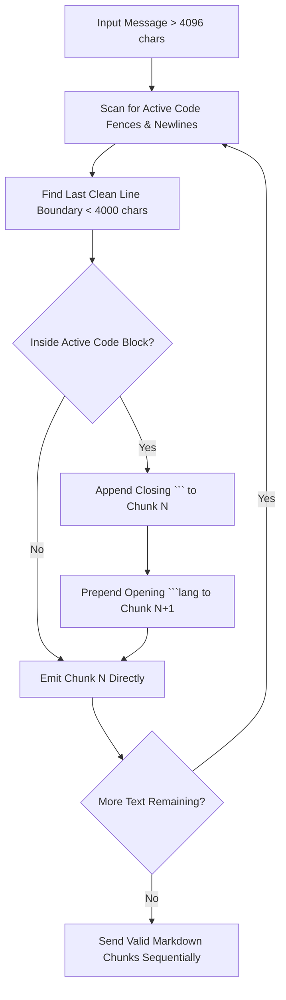
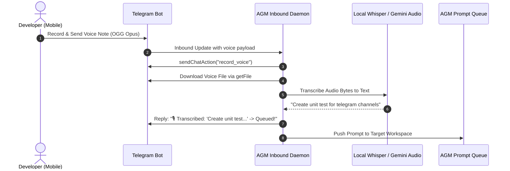

# Specification: Telegram Improvements, Future Enhancements & Architectural Suggestions

- **Parent Task**: `229-telegram-onboarding-and-prompt-sending-issue`
- **Document Sequence**: `04`
- **Specification Category**: Improvements & Suggestions Catalog (15+ Actionable Architectural Innovations)
- **Target Subsystem**: `telegram_inbound`, `notification_hub`, and Telegram Remote UI
- **Status**: PROPOSED FOR FUTURE MILESTONES

---

## 1. Executive Vision & Enhancement Taxonomy

The Telegram integration in Antigravity Manager (AGM) provides developers and system operators with a bi-directional command and control bridge. Moving beyond basic polling and text notifications, this specification catalogs **18 production-grade architectural enhancements**.

Each enhancement is categorized into one of five operational domains:
1. **Interactive Controls & Ergonimics** (Inline buttons, keyboards, deep links)
2. **Context Streaming & Visual Delivery** (Chat actions, progress bars, AST markdown chunking, albums)
3. **Resilience, Rate Limiting & High Availability** (Token bucket, flood wait, SQLite outbox, webhooks)
4. **Security, Governance & Multi-Tenancy** (Role-based ACLs, 2FA confirmations, secret sanitization)
5. **Multi-Modal & Avant-Garde Interfaces** (Voice prompt transcription, Telegram Mini Apps, forum topics)

---

## 2. Comprehensive Catalog of 18 Actionable Telegram Enhancements

### 2.1 Enhancement 01: Inline Keyboards for Instant Prompt Reruns & Fast Action

#### Concept & Objective
When an agent prompt finishes execution or fails (e.g. CI error, compile failure, or quota exhausted), the notification message should include an `InlineKeyboardMarkup`. Users can rerun the prompt, inspect logs, or dismiss alerts with a single tap from their phone or smartwatch without typing commands.

#### Visual Layout & User Experience
```text
┌────────────────────────────────────────────────────────┐
│ ❌ [Worker-1] Prompt P042 Failed (Compilation Error)   │
│ Branch: feat/telegram-inbound | Duration: 14.2s        │
│ Exit: cargo check failed (exit code 101)               │
├────────────────────────────────────────────────────────┤
│ [ 🔄 Rerun Prompt ]       [ 📋 View Last 10 Logs ]    │
│ [ 🩺 Run Self-Heal ]      [ 🔕 Dismiss Alert ]        │
└────────────────────────────────────────────────────────┘
```

#### Technical Implementation
- Telegram API: `inline_keyboard` inside `reply_markup` parameter of `sendMessage`.
- Backend Callback Handler: Extend `src-tauri/src/modules/telegram_inbound/daemon.rs` to process `callback_query` updates.
- Payload Contract:
  ```json
  {
    "callback_data": "prompt_rerun:P042:default"
  }
  ```
- Execution Flow:
  1. Operator taps `[ 🔄 Rerun Prompt ]`.
  2. Telegram sends `callback_query` to AGM polling daemon.
  3. Daemon dispatches `answerCallbackQuery(text="Queued prompt P042 for re-execution")`.
  4. Prompt is pushed into SQLite prompt queue via `repo_db::restore_prompt_by_id`.

---

### 2.2 Enhancement 02: Dynamic Chat Action Indicators ("Typing...", "Uploading Document...")

#### Concept & Objective
When a prompt is sent via Telegram or when AGM is synthesizing a multi-file diff, the operator sees no activity until the full response is ready (which can take 15–45 seconds). Sending continuous `sendChatAction` indicators lets the operator know the AI agent is actively thinking or generating code.

#### Technical Implementation
- Telegram API: `POST https://api.telegram.org/bot<token>/sendChatAction` with `action: "typing"` or `action: "upload_document"`.
- Asynchronous Heartbeat:
  ```rust
  pub fn start_chat_action_heartbeat(chat_id: i64, token: &str, action: &'static str) -> tokio::sync::oneshot::Sender<()> {
      let (tx, mut rx) = tokio::sync::oneshot::channel();
      let token = token.to_string();
      tokio::spawn(async move {
          let mut interval = tokio::time::interval(std::time::Duration::from_secs(4));
          loop {
              tokio::select! {
                  _ = interval.tick() => {
                      let _ = send_chat_action(&token, chat_id, action).await;
                  }
                  _ = &mut rx => break,
              }
          }
      });
      tx
  }
  ```
- When prompt generation finishes, dropping or sending on `tx` cancels the background ticker.

---

### 2.3 Enhancement 03: Intelligent MarkdownV2 Chunking with Code Block & AST Preservation

#### Concept & Objective
Telegram imposes a strict **4096-character limit** per message. Standard naive string chunking (`&text[..4096]`) frequently cuts in the middle of Markdown code blocks (` ```rust ... ``` `) or backticks. This triggers Telegram API `400 Bad Request: can't parse entities`, causing the message to fail silently or be dropped.

#### Algorithm Specification


#### Code Block Boundary Invariants:
1. Track the opening fence language identifier (e.g. ```` ```rust ````).
2. If chunk $N$ cuts off inside this block, close chunk $N$ with ```` ``` ```` and start chunk $N+1$ with ```` ```rust ````.
3. Replace raw `<` and `>` or unescaped markdown characters outside code blocks with escaped counterparts (`\_`, `\*`, `\[`, `\]`, `\(`, `\)`).

---

### 2.4 Enhancement 04: Interactive `/instances` Inline Selection & Quota Switcher

#### Concept & Objective
Enable switching active AGM desktop instances or auto-switcher accounts directly from Telegram via an interactive visual picker.

#### Visual Layout
```text
┌────────────────────────────────────────────────────────┐
│ 🖥️ Registered AGM Instances & Quota Status            │
├────────────────────────────────────────────────────────┤
│ [ 🟢 Default (98% - gemini-2.5-pro) ]                 │
│ [ 🟡 Work-Mac (42% - gemini-2.5-flash) ]              │
│ [ 🔵 Cloud-VM (100% - claude-3-7-sonnet) ]            │
├────────────────────────────────────────────────────────┤
│ [ ⚡ Fast-Forward Switch ]   [ 🔄 Refresh All ]       │
└────────────────────────────────────────────────────────┘
```

#### Technical Implementation
- Inbound Command: `/instances`.
- Queries `instance::load_registry()` and `account::list_accounts()`.
- Renders an inline keyboard where each row is an instance with its active account quota percentage.
- Tapping an instance button fires a callback query `switch_inst:<id>`, invoking `instance::switch_active_instance(id)` and editing the Telegram message with the new status.

---

### 2.5 Enhancement 05: Token Bucket Rate Limiter & Flood Wait Self-Healing

#### Concept & Objective
Telegram enforces strict limits:
- No more than 30 messages/second across the entire bot.
- No more than 1 message/second to a single private chat.
Exceeding this yields HTTP `429 Too Many Requests` with `retry_after: N`.

#### Target Architecture
```rust
pub struct TelegramRateLimiter {
    per_chat_last_send: Arc<tokio::sync::Mutex<HashMap<i64, std::time::Instant>>>,
    global_bucket: Arc<tokio::sync::Semaphore>,
}
```
- Before issuing `sendMessage`, the sender awaits a token from the leaky bucket.
- If Telegram returns HTTP 429, the client parses `body["parameters"]["retry_after"]`, sleeps asynchronously for the specified duration plus a 500ms safety jitter, and automatically replays the message.

---

### 2.6 Enhancement 06: Media Album & Multi-Image Diff Grouping (`sendMediaGroup`)

#### Concept & Objective
When an AI agent generates multiple visual artifacts (e.g., UI layout previews, diagrams, or charts), sending them as individual photo messages floods the chat and plays multiple notification sounds.

#### Technical Implementation
- Telegram API: `POST https://api.telegram.org/bot<token>/sendMediaGroup`.
- Up to 10 photos or documents grouped into an atomic album.
- Only the first item carries a formatted caption, creating a clean photo gallery with single notification delivery.

---

### 2.7 Enhancement 07: Developer Quiet Hours & Priority Override Matrix

#### Concept & Objective
Prevent non-critical notifications (e.g., routine cache cleanups, standard git syncs) from alerting the developer during sleep or focus hours.

#### Configuration Schema (`telegram_config.json`):
```json
{
  "quiet_hours": {
    "is_enabled": true,
    "start_time": "23:00",
    "end_time": "08:00",
    "timezone": "local"
  }
}
```
#### Routing Rules:
- During quiet hours:
  - `AlertSeverity::Info` and `AlertSeverity::Warning`: Set `disable_notification: true` (silent push).
  - `AlertSeverity::Critical` (e.g. all accounts rate limited, fatal crash): Set `disable_notification: false` (audible alert override).

---

### 2.8 Enhancement 08: Error Notification Triage Badges & Quick Heal

#### Concept & Objective
Transform error alerts from passive walls of text into actionable remediation widgets.

#### Visual Layout
```text
┌────────────────────────────────────────────────────────┐
│ ⚠️ AGM Error Alert: [Database Locked]                  │
│ File: src-tauri/src/modules/repo_db.rs:182             │
│ Details: database table is locked (code 5)             │
├────────────────────────────────────────────────────────┤
│ [ 🩺 Run DB Self-Heal ]     [ 🔄 Restart AGM Daemon ]  │
│ [ 📋 Export Crash Report ]  [ 🔕 Mute for 1 Hour ]     │
└────────────────────────────────────────────────────────┘
```
- Tapping `[ 🩺 Run DB Self-Heal ]` triggers SQLite WAL checkpointing and clears stale file locks remotely.

---

### 2.9 Enhancement 09: Webhook Reverse-Proxy Adapter for Cloud Deployments

#### Concept & Objective
In server environments (e.g., Docker, Linux VPS, or Cloud VMs), continuous HTTP long-polling (`getUpdates`) consumes network bandwidth and keeps connections open. A pluggable webhook adapter allows Telegram to push updates instantly over HTTPS to an AGM endpoint.

#### Implementation Details:
- Pluggable Mode: `polling_mode: "long_polling" | "webhook"`.
- Built-in lightweight Axum/Tauri HTTP webhook endpoint on configurable port (e.g. `127.0.0.1:4049/api/telegram/webhook`).
- Secret token verification via `X-Telegram-Bot-Api-Secret-Token` header.

---

### 2.10 Enhancement 10: Two-Factor Confirmation for Destructive Actions

#### Concept & Objective
Commands that can terminate instances, delete files, or prune history (`/prune`, `/stop`, `/agm instances rm`) must require a 2-step inline confirmation to prevent accidental taps on mobile touchscreens.

#### Flow:
1. User types `/prune 10`.
2. Bot replies:
   ```text
   ⚠️ Confirm Action: Prune 10 older conversation sessions from disk?
   This cannot be undone.
   [ ✅ Yes, Prune Conversations ]   [ ❌ Cancel ]
   ```
3. Callback query expires after 60 seconds.

---

### 2.11 Enhancement 11: In-Place Live Progress Bar & Message Editing (`editMessageText`)

#### Concept & Objective
When running multi-step tasks (e.g., GitMap multi-node scanning, large repository cloning, or test suite execution), avoid sending 20 separate status messages. Instead, maintain and edit a single message in-place.

#### Visual Layout
```text
┌────────────────────────────────────────────────────────┐
│ 🚀 Executing Task: Build & Test Swarm (Wave 2)         │
│ Status: Running unit tests...                          │
│ Progress: [■■■■■■■■□□] 80% (4/5 steps complete)        │
│ Current Step: cargo test --lib                         │
│ Elapsed: 24.8s | Active Workers: 3                     │
└────────────────────────────────────────────────────────┘
```
- Updated every 1.5 seconds via `editMessageText` to stay well within Telegram's rate limits while providing smooth, real-time visual progress.

---

### 2.12 Enhancement 12: Telegram Bot Deep Linking & Parameterized Shortcuts

#### Concept & Objective
Allow users to create desktop or mobile shortcuts that open Telegram and immediately trigger a specific AGM action via URL query parameters.

#### Deep Link Format:
- `https://t.me/<BotUsername>?start=prompt_audit`
- `https://t.me/<BotUsername>?start=status_node2`
When the bot receives `/start prompt_audit`, it resolves the parameter and launches the corresponding task template automatically.

---

### 2.13 Enhancement 13: Multi-User Role-Based Access Control (RBAC ACL)

#### Concept & Objective
Currently, `allowed_chat_id: Option<i64>` restricts the bot to a single operator. In team or swarm environments, multiple developers need varying access levels.

#### Data Schema:
```json
{
  "access_control": [
    { "chat_id": 123456789, "alias": "lead_dev", "role": "admin" },
    { "chat_id": 987654321, "alias": "qa_tester", "role": "operator" },
    { "chat_id": 555666777, "alias": "project_manager", "role": "readonly_viewer" }
  ]
}
```
#### Permissions Matrix:
- `readonly_viewer`: Can view `/status`, `/tree`, `/observe`, `/queues`.
- `operator`: Can trigger `/prompt`, `/send`, `/ff`.
- `admin`: Can execute destructive commands (`/prune`, `/update`, `/ssh`, `/agm`).

---

### 2.14 Enhancement 14: Voice-to-Prompt Audio Transcription Pipeline

#### Concept & Objective
Allow developers to dictate prompt instructions on the move using Telegram voice notes (`voice` or `audio` messages).

#### Processing Flow:


---

### 2.15 Enhancement 15: Local SQLite Outbox Journaling for Offline Resilience

#### Concept & Objective
If the host workstation temporarily loses internet access, switch alerts and prompt completion messages must not be dropped.

#### Table Schema (`outbox.db`):
```sql
CREATE TABLE IF NOT EXISTS telegram_outbox (
    id TEXT PRIMARY KEY,
    chat_id INTEGER NOT NULL,
    payload_json TEXT NOT NULL,
    attempts INTEGER NOT NULL DEFAULT 0,
    created_at INTEGER NOT NULL,
    last_attempt_at INTEGER NOT NULL DEFAULT 0
);
```
- A background worker drains the outbox whenever network connectivity is verified.

---

### 2.16 Enhancement 16: Telegram Mini App (TWA) Web Dashboard

#### Concept & Objective
Telegram Mini Apps allow rendering a full responsive React web app directly within the Telegram mobile and desktop clients via Webview.

#### Architecture:
- AGM serves its web assets over an authorized local tunnel or LAN IP with TLS.
- In Telegram, a persistent menu button `[ 📱 Open AGM Dashboard ]` opens the web app with native Telegram theme matching.

---

### 2.17 Enhancement 17: Supergroup Forum Topic Threading (`message_thread_id`)

#### Concept & Objective
Telegram Supergroups support Forum Topics. Instead of mixing all instances, nodes, and alerts into one chat, each AGM instance or project is mapped to its own dedicated Topic thread.

#### Structure:
- Topic `#general-status`: System updates, daily quota summaries.
- Topic `#instance-default`: Prompts and switches for Default instance.
- Topic `#instance-worker1`: Remote cluster node telemetry.
- All outbound messages specify `message_thread_id: topic_id`.

---

### 2.18 Enhancement 18: Card Palettes & Adaptive Aesthetic Styling

#### Concept & Objective
Allow users to customize the visual formatting of Telegram alerts to match their personal theme preferences using Unicode badges and ANSI framing.

#### Themes:
- `RiseUp Gold`: ☀️ Amber & Gold badges (`⚡`, `🏆`, `🟡`).
- `Obsidian Cyber`: 🌌 Dark glass minimalism (`◼`, `◽`, `🔲`).
- `Indigo Aurora`: 🔮 Deep violet and sky tokens (`🟣`, `🔷`, `✨`).
- `Terminal Matrix`: 🟢 Monochromatic green CLI style (`> `, `[OK]`, `[FAIL]`).

---

## 3. Prioritized Implementation Roadmap

| Tier | Enhancements | Primary Value Proposition | Complexity |
| :--- | :--- | :--- | :--- |
| **Tier 1 (Immediate)** | E01 (Inline Rerun), E02 (Chat Action), E03 (AST Chunking) | Eradicates user perception of lag and parsing errors | Low - Medium |
| **Tier 2 (Ergonomics)** | E04 (Instance Picker), E05 (Rate Limiter), E11 (In-Place Progress) | Transforms CLI commands into rich interactive GUI | Medium |
| **Tier 3 (Enterprise)** | E07 (Quiet Hours), E13 (Multi-User ACL), E15 (SQLite Outbox) | Hardens multi-user reliability and offline resilience | Medium - High |
| **Tier 4 (Next-Gen)** | E09 (Webhooks), E14 (Voice Prompts), E16 (Mini Apps), E17 (Topics) | Establishes AGM as an avant-garde mobile command center | High |
