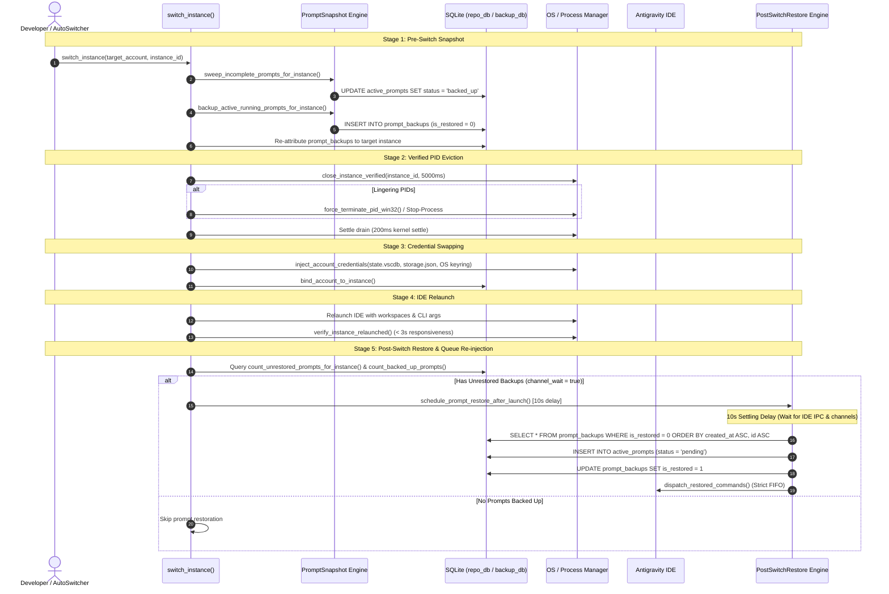
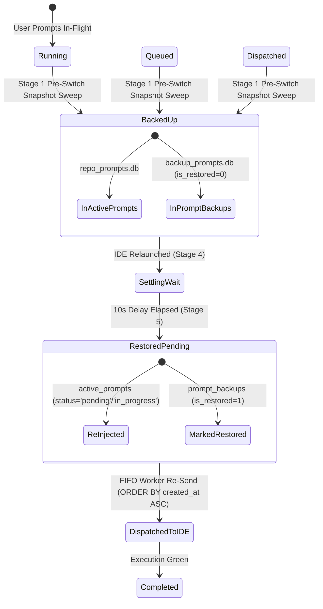

# Architecture Specification: Running Prompt Backup & Restore Synchronization Across Account Switches

> **Target:** `02-spec/21-app/230-running-prompt-restore-after-account-switch/01-architecture-spec.md`  
> **Status:** APPROVED  
> **Author:** @aukgit  
> **Version:** 1.0.0  
> **Slug:** `230-running-prompt-restore-after-account-switch`  
> **Sequence:** 230  
> **Scope:** Running Prompt Backup & Restore Lifecycle, Post-Switch Settling Invariant, Pre-Switch Snapshot Order, Multi-DB Restore Synchronization, Deep Transcript Inspection  

---

## 1. Executive Summary & Intent

Antigravity Manager (AGM) provides automated and manual account rotation across multiple developer profiles, quotas, and Antigravity IDE instances. A core promise of the platform is **Zero Prompt Loss**: when an account switch is triggered—whether manually via the desktop GUI, headless CLI, or automatically due to quota exhaustion—any in-flight prompt, background subtask, or queued instruction must be safely captured before IDE shutdown, preserved across credential re-injection, and cleanly re-injected into the target IDE instance once the new account session stabilizes.

Despite the existence of a multi-tiered backup architecture across `repo_prompts.db` (`active_prompts`) and `backup_prompts.db` (`prompt_backups`), developers observed that in-flight prompts were frequently dropped following account switches. The post-launch restoration phase failed to trigger, leaving users with empty chat windows and stalled tasks.

This architecture specification provides a comprehensive, grounded 4-part Root Cause Analysis (RCA) and details the architectural invariants, contracts, and surgical fixes across `src-tauri/src/modules/instance/switch.rs`, `src-tauri/src/modules/integration/system_impl.rs`, `src-tauri/src/modules/repo_db/backup.rs`, and `src-tauri/src/modules/backup_prompts_db/restore.rs`.

---

## 2. Comprehensive 4-Part Root Cause Analysis (RCA)

### 2.1 Part 1: Proximate Cause

Following both manual desktop account switches and automated instance switches, running prompts were not restored to the IDE. In the application logs, the restore sequence was completely skipped:
```text
[Desktop] [Step 5/5] No backed-up prompt; skipping prompt restoration
```
or in instance switches:
```text
[INSTANCE_SWITCH:STAGE_5_RESTORE] No backed-up prompts pending restoration for instance 'default'
```
Consequently, the post-switch settling timer (10s delay in GUI mode or inline settle in headless mode) was never armed, and prompts remained trapped in `prompt_backups` with `is_restored = 0` or in `active_prompts` with `status = 'backed_up'`.

---

### 2.2 Part 2: Root Cause Mechanism

Investigation into the codebase revealed three distinct defects working in concert to suppress prompt restoration:

#### Defect A: Parameter Mismatch in `switch.rs:676` (`list_prompt_backups`)
In `src-tauri/src/modules/instance/switch.rs:675-684`:
```rust
let has_unrestored_backups =
    crate::modules::backup_prompts_db::list_prompt_backups(Some(&target_inst_id), None)
        .map(|list| list.iter().any(|r| !r.is_restored))
        .unwrap_or(false)
        || crate::modules::backup_prompts_db::count_unrestored_prompts_for_other_instances(
            &target_inst_id,
            None,
        )
        .map(|c| c > 0)
        .unwrap_or(false);
```
However, the signature and implementation of `list_prompt_backups` in `src-tauri/src/modules/backup_prompts_db/listing.rs:40-58` is:
```rust
pub fn list_prompt_backups(
    batch_id: Option<&str>,
    custom_file: Option<&str>,
) -> Result<Vec<PromptBackupRecord>, String> {
    // ...
    let (query, has_param) = if batch_id.is_some() {
        (
            "SELECT ... FROM prompt_backups WHERE backup_batch_id = ? ORDER BY sequence_id ASC",
            true,
        )
    } else { ... };
    // ...
}
```
**Mechanism:** `list_prompt_backups` expects a `batch_id` (a UUID string like `"batch_d1e8..."`), **not** an `instance_id` (e.g., `"default"` or `"inst-prod"`). When `Some(&target_inst_id)` was passed, SQLite executed:
```sql
SELECT ... FROM prompt_backups WHERE backup_batch_id = 'default'
```
This query **always returned 0 rows**. The expression `list.iter().any(|r| !r.is_restored)` evaluated to `false`. Furthermore, `count_unrestored_prompts_for_other_instances` explicitly excludes the target instance (`WHERE instance_id != ?1`). If all prompts belonged to `target_inst_id`, both sides of the `||` evaluated to `false`. As a result, `has_unrestored_backups` was `false`, causing `channel_wait` to evaluate to `false` and bypassing Stage 5 restoration entirely.

#### Defect B: Return Value Discard & Scope Blindness in `system_impl.rs:104, 279`
In `src-tauri/src/modules/integration/system_impl.rs:88-106`:
```rust
crate::error::record_ignored(
    crate::modules::backup_prompts_db::backup_active_running_prompts_for_instance(
        Some("default"),
        None,
    ),
    "back up active running prompts before account switch",
);
let needs_reinject = crate::modules::repo_db::needs_prompt_channel_wait(
    crate::modules::repo_db::count_backed_up_prompts("default"),
);
```
**Mechanism:**
1. `backup_active_running_prompts_for_instance` returned `Result<(BackupBatchInfo, Vec<PromptBackupRecord>), String>`, but its result was discarded via `record_ignored`.
2. `needs_reinject` evaluated solely against `repo_db::count_backed_up_prompts("default")`, completely ignoring `backup_prompts.db`.
3. If prompts had been backed up into `prompt_backups` (or if `repo_db::count_backed_up_prompts` returned 0 due to Defect C), `needs_reinject` became `false`.
4. At Step 5 (`system_impl.rs:279`):
   ```rust
   if needs_reinject {
       crate::modules::instance::schedule_prompt_restore_after_launch("default".to_string());
   } else {
       crate::modules::logger::log_info("[Desktop] [Step 5/5] No backed-up prompt; skipping prompt restoration");
   }
   ```
   Restoration was skipped completely.

#### Defect C: Default Instance Empty String & Null Omission in `repo_db/backup.rs:400`
In `src-tauri/src/modules/repo_db/backup.rs:397-405`:
```rust
pub fn count_backed_up_prompts(instance_id: &str) -> usize {
    let Ok(conn) = connect_db() else {
        return 0;
    };
    conn.query_row(
        "SELECT COUNT(*) FROM active_prompts
         WHERE status = 'backed_up'
           AND (instance_id = ?1 OR (?1 = 'default' AND (instance_id = 'default' OR instance_id = '__default__')))",
        [instance_id],
        |row| row.get::<_, i64>(0),
    )
    .unwrap_or(0) as usize
}
```
**Mechanism:** In SQLite `active_prompts`, rows created on the default profile frequently have `instance_id = ''` (empty string) or `instance_id IS NULL`. While other parts of the codebase (such as `backup_queued_prompts_for_instance` and `count_unrestored_prompts_for_instance`) explicitly check `(instance_id = 'default' OR instance_id = '__default__' OR instance_id = '' OR instance_id IS NULL)`, `count_backed_up_prompts` omitted `instance_id = '' OR instance_id IS NULL`. Thus, prompts stored with blank or null instance IDs were invisible to `count_backed_up_prompts("default")`, returning `0` and suppressing restoration.

---

### 2.3 Part 3: Architecture & Invariant Breaches

1. **Pre-Switch Process Termination Race**: If the IDE process is killed before the prompt snapshot and transcript extraction complete, volatile state (active agent thought streams, uncommitted chat edits, unsaved drafts) is lost forever. The snapshot MUST strictly precede process termination.
2. **False Subagent Filters & Origin Tier Discrepancies**: Subagent instructions (`SUBAGENT_INSTRUCTION`), tool outputs (`TOOL_OUTPUT`), and telemetry events (`TOKEN_USAGE`, `HEARTBEAT`) risk being mistaken for root user prompts or prematurely discarded if transcript scanning is shallow or filters are overly aggressive.
3. **Fragmented Decision Gating**: Determining whether a prompt restoration is owed was fragmented across mismatched functions (`count_backed_up_prompts`, `list_prompt_backups`, and ignored `backup_active_running_prompts_for_instance` returns) without a unified authoritative query.

---

### 2.4 Part 4: Surgical Elimination & Permanent Safeguards

To achieve permanent resilience, the architecture enforces:
1. **Direct Unrestored Count Inquiries**: Replace the mismatched `list_prompt_backups(Some(&target_inst_id))` in `switch.rs:676` with `count_unrestored_prompts_for_instance(Some(&target_inst_id))` and `count_unrestored_prompts_for_other_instances(&target_inst_id, None)`.
2. **Dual-Store Awareness in Manual Switch**: In `system_impl.rs:104, 279`, inspect the return records from `backup_active_running_prompts_for_instance` AND check `count_unrestored_prompts_for_instance(Some("default"))` alongside `repo_db::count_backed_up_prompts("default")`.
3. **Universal Default Alias Normalization**: In `repo_db/backup.rs:400`, update the query to include `OR instance_id = '' OR instance_id IS NULL` whenever inspecting the default instance.
4. **Strict 5-Stage Pre-Switch Snapshot Pipeline**: Guarantee that snapshotting and backup DB writes complete synchronously before any SIGTERM / Win32 `TerminateProcess` signal is delivered.
5. **Strict FIFO Queue Re-injection**: Enforce First-In-First-Out ordering (`ORDER BY created_at ASC, id ASC`) across all restore and re-dispatch passes.
6. **Deep Transcript Extraction**: Enforce reverse-scanning across `transcript_full.jsonl` (bypassing telemetry records) to ensure accurate prompt capture.
7. **No Silent Errors Gate**: All fallible operations must propagate errors via `AppError` or use `crate::error::record_ignored` with mandatory `// Justification:` comments.

---

## 3. Account Switch Architecture & Pre-Switch Snapshot Invariant

The switch lifecycle follows a strict 5-stage sequential pipeline ("Snapshot First -> Kill Second -> Write Credentials Third -> Launch Fourth -> Restore Fifth"):

```
+---------------------------------------------------------------------------------------------------+
|                                   ACCOUNT SWITCH 5-STAGE PIPELINE                                  |
+---------------------------------------------------------------------------------------------------+
|  Stage 1: Pre-Switch Snapshot & Sweep                                                             |
|    - Sweep incomplete prompts (running, in_flight, dispatched -> backed_up)                       |
|    - Discover running prompts from IDE via transcript_full.jsonl                                  |
|    - Write snapshot to prompt_backups in backup_prompts.db & active_prompts in repo_prompts.db       |
|    - Re-attribute source instance prompts to target instance                                      |
+---------------------------------------------------------------------------------------------------+
                                                  |
                                                  v
+---------------------------------------------------------------------------------------------------+
|  Stage 2: Verified PID Eviction & Settle Drain                                                    |
|    - Terminate AGY worker processes                                                               |
|    - Send graceful close to IDE instance (5000ms deadline)                                        |
|    - Win32 TerminateProcess / SIGKILL fallback for straggler PIDs                                 |
|    - 200ms kernel settle delay to release NTFS/ext4 file locks                                    |
|    - Clear stale instance lockfiles and invalidate process cache                                  |
+---------------------------------------------------------------------------------------------------+
                                                  |
                                                  v
+---------------------------------------------------------------------------------------------------+
|  Stage 3: Credential Swapping & Keyring Rewriting                                                 |
|    - Inject target account credentials into state.vscdb and storage.json                          |
|    - Synchronize OS Keyring (Credential Manager / Secret Service)                                 |
|    - Bind account in instances_registry.json & Supabase lease manager                             |
|    - 500ms port rebind settling delay for CDP debugger sockets                                    |
+---------------------------------------------------------------------------------------------------+
                                                  |
                                                  v
+---------------------------------------------------------------------------------------------------+
|  Stage 4: IDE Relaunch & Port Rebinding                                                           |
|    - Launch Antigravity IDE preserving workspace paths & CLI args                                 |
|    - Verify relaunched PID materialized (< 3s responsiveness)                                     |
|    - Detach background task for CDP security notice dismissal                                     |
+---------------------------------------------------------------------------------------------------+
                                                  |
                                                  v
+---------------------------------------------------------------------------------------------------+
|  Stage 5: Post-Switch Settling Delay & FIFO Queue Re-injection                                    |
|    - Evaluate dual-store unrestored prompt count:                                                 |
|        backed_up_count > 0 OR count_unrestored_prompts_for_instance > 0                           |
|    - GUI mode: Schedule 10-second post-launch settling timer                                      |
|    - CLI/headless mode: Await 10-second settling inline                                           |
|    - Transition backed_up -> pending/in_progress in strict FIFO order                             |
|    - Dispatch queue worker & wake dispatch channel                                                |
+---------------------------------------------------------------------------------------------------+
```

---

## 4. Multi-Database Synchronization & Invariant Contracts

AGM employs a split SQLite database architecture:

| Database | Primary Table | Responsibility | Ordering Invariant |
| :--- | :--- | :--- | :--- |
| `repo_prompts.db` | `active_prompts` | Live prompt execution state (`queued`, `running`, `backed_up`, `dispatched`, `completed`) | `ORDER BY created_at ASC, id ASC` |
| `backup_prompts.db` | `prompt_backups` | Durable cross-switch snapshot repository with batch IDs and restoration markers | `ORDER BY sequence_id ASC` / `ORDER BY created_at ASC, id ASC` |
| `backup_prompts.db` | `backup_batches` | Batch metadata, file paths, total prompt counts, and `is_fully_restored` flag | `ORDER BY created_at DESC` |

### 4.1 Default Instance Alias Normalization Contract

Across all SQL queries touching `instance_id`, the system must treat the following four representations as identical for the default instance:
1. `'default'`
2. `'__default__'`
3. `''` (empty string)
4. `NULL`

Any query checking the default instance MUST use the canonical predicate:
```sql
(instance_id = 'default' OR instance_id = '__default__' OR instance_id = '' OR instance_id IS NULL)
```

### 4.2 FIFO Queue Invariant Contract

All prompt restore, dispatch, and queue processing queries across SQLite databases MUST enforce strict First-In-First-Out ordering using:
```sql
ORDER BY created_at ASC, id ASC
```
LIFO queries (`ORDER BY updated_at DESC` or `ORDER BY id DESC`) are strictly forbidden in dispatch and restore logic.

### 4.3 Deep Transcript Inspection Contract

When extracting active prompts from Antigravity IDE workspaces:
1. Always prioritize `transcript_full.jsonl` over `transcript.jsonl`.
2. Reverse-scan across at least 10 lines, bypassing trailing `TOKEN_USAGE`, `HEARTBEAT`, and `TELEMETRY` records.
3. Identify genuine tool executions (`tool_calls`) and assistant thoughts (`thinking`).
4. Distinguish the 4-tier prompt origins (`USER_PROMPT`, `SUBAGENT_INSTRUCTION`, `SYSTEM_MESSAGE`, `TOOL_OUTPUT`) to prevent subagents from being wrongly filtered or enqueued as root user prompts.

---

## 5. Target Code Modifications & Exact Symbol Signatures

### 5.1 Fix 1: `src-tauri/src/modules/instance/switch.rs` (Lines 672–686)

**Current Problematic Code:**
```rust
let target_inst_id = instance.id.clone();
let target_backed_up = crate::modules::repo_db::count_backed_up_prompts(&target_inst_id);
let total_pending_restore = backed_up_count.max(target_backed_up);
let has_unrestored_backups =
    crate::modules::backup_prompts_db::list_prompt_backups(Some(&target_inst_id), None)
        .map(|list| list.iter().any(|r| !r.is_restored))
        .unwrap_or(false)
        || crate::modules::backup_prompts_db::count_unrestored_prompts_for_other_instances(
            &target_inst_id,
            None,
        )
        .map(|c| c > 0)
        .unwrap_or(false);
let channel_wait = crate::modules::repo_db::needs_prompt_channel_wait(total_pending_restore)
    || has_unrestored_backups;
```

**Target Corrected Implementation:**
```rust
let target_inst_id = instance.id.clone();
let target_backed_up = crate::modules::repo_db::count_backed_up_prompts(&target_inst_id);
let target_unrestored = crate::modules::backup_prompts_db::count_unrestored_prompts_for_instance(
    Some(&target_inst_id),
)
.unwrap_or(0);
let other_unrestored = crate::modules::backup_prompts_db::count_unrestored_prompts_for_other_instances(
    &target_inst_id,
    None,
)
.unwrap_or(0);

let total_pending_restore = backed_up_count.max(target_backed_up).max(target_unrestored);
let has_unrestored_backups = target_unrestored > 0 || other_unrestored > 0;
let channel_wait = crate::modules::repo_db::needs_prompt_channel_wait(total_pending_restore)
    || has_unrestored_backups;
```

---

### 5.2 Fix 2: `src-tauri/src/modules/integration/system_impl.rs` (Lines 88–106 and 279–290)

**Current Problematic Code:**
```rust
// Step 1:
crate::error::record_ignored(
    crate::modules::repo_db::backup_running_prompts("default"),
    "back up running prompts before account switch",
);
crate::error::record_ignored(
    crate::modules::backup_prompts_db::backup_active_running_prompts_for_instance(
        Some("default"),
        None,
    ),
    "back up active running prompts before account switch",
);
let needs_reinject = crate::modules::repo_db::needs_prompt_channel_wait(
    crate::modules::repo_db::count_backed_up_prompts("default"),
);

// Step 5:
if needs_reinject {
    crate::modules::logger::log_info(
        "[Desktop] [Step 5/5] Scheduling 5s post-launch prompt restore for instance default",
    );
    crate::modules::instance::schedule_prompt_restore_after_launch("default".to_string());
    note_prompt_reinjected(true);
} else {
    crate::modules::logger::log_info(
        "[Desktop] [Step 5/5] No backed-up prompt; skipping prompt restoration",
    );
    note_prompt_reinjected(false);
}
```

**Target Corrected Implementation:**
```rust
// Step 1:
let newly_backed_up = match crate::modules::repo_db::backup_running_prompts("default") {
    Ok(c) => c,
    Err(e) => {
        crate::modules::logger::log_warn(&format!(
            "[Desktop] Failed to backup running prompts from repo_db: {}", e
        ));
        0
    }
};

let db_backup_count = match crate::modules::backup_prompts_db::backup_active_running_prompts_for_instance(
    Some("default"),
    None,
) {
    Ok((_info, recs)) => recs.len(),
    Err(e) => {
        crate::modules::logger::log_warn(&format!(
            "[Desktop] Failed to backup active prompts into backup DB: {}", e
        ));
        0
    }
};

let repo_backed_up = crate::modules::repo_db::count_backed_up_prompts("default");
let unrestored_count = crate::modules::backup_prompts_db::count_unrestored_prompts_for_instance(
    Some("default"),
)
.unwrap_or(0);

let total_pending = newly_backed_up.max(db_backup_count).max(repo_backed_up).max(unrestored_count);
let needs_reinject = crate::modules::repo_db::needs_prompt_channel_wait(total_pending)
    || unrestored_count > 0;

crate::modules::logger::log_info(&format!(
    "[Desktop] [Step 1/5] Prompt backup completed: repo_db={}, backup_db={}, unrestored={}, needs_reinject={}",
    repo_backed_up, db_backup_count, unrestored_count, needs_reinject
));
```

And in Step 5 (`system_impl.rs:279`):
```rust
// Re-evaluate pending count dynamically in case background workers or sweeps recorded unrestored rows
let final_unrestored = crate::modules::backup_prompts_db::count_unrestored_prompts_for_instance(Some("default"))
    .unwrap_or(0);
let final_repo_backed_up = crate::modules::repo_db::count_backed_up_prompts("default");
let final_needs_reinject = needs_reinject || final_unrestored > 0 || final_repo_backed_up > 0;

if final_needs_reinject {
    crate::modules::logger::log_info(
        "[Desktop] [Step 5/5] Scheduling post-launch prompt restore for instance default (repo: {}, backup_db: {})",
    );
    crate::modules::instance::schedule_prompt_restore_after_launch("default".to_string());
    note_prompt_reinjected(true);
} else {
    crate::modules::logger::log_info(
        "[Desktop] [Step 5/5] No backed-up prompt; skipping prompt restoration",
    );
    note_prompt_reinjected(false);
}
```

---

### 5.3 Fix 3: `src-tauri/src/modules/repo_db/backup.rs` (Lines 393–405)

**Current Problematic Code:**
```rust
pub fn count_backed_up_prompts(instance_id: &str) -> usize {
    let Ok(conn) = connect_db() else {
        return 0;
    };
    conn.query_row(
        "SELECT COUNT(*) FROM active_prompts
         WHERE status = 'backed_up'
           AND (instance_id = ?1 OR (?1 = 'default' AND (instance_id = 'default' OR instance_id = '__default__')))",
        [instance_id],
        |row| row.get::<_, i64>(0),
    )
    .unwrap_or(0) as usize
}
```

**Target Corrected Implementation:**
```rust
pub fn count_backed_up_prompts(instance_id: &str) -> usize {
    let Ok(conn) = connect_db() else {
        return 0;
    };
    let is_default = instance_id == "default" || instance_id == "__default__" || instance_id.is_empty();
    let sql = if is_default {
        "SELECT COUNT(*) FROM active_prompts
         WHERE status = 'backed_up'
           AND (instance_id = 'default' OR instance_id = '__default__' OR instance_id = '' OR instance_id IS NULL)"
    } else {
        "SELECT COUNT(*) FROM active_prompts
         WHERE status = 'backed_up' AND instance_id = ?1"
    };

    if is_default {
        conn.query_row(sql, [], |row| row.get::<_, i64>(0)).unwrap_or(0) as usize
    } else {
        conn.query_row(sql, [instance_id], |row| row.get::<_, i64>(0)).unwrap_or(0) as usize
    }
}
```

---

## 6. Error Visibility & "No Silent Errors" Mandates

In accordance with the repository house rules:
- **Rust Side (`src-tauri/src/`)**:
  - All fallible operations must flow into `AppError` (`src-tauri/src/error.rs`) and be logged via `tracing`.
  - Never leave bare `let _ = <fallible>`, `.ok()`, or `.unwrap_or_default()` on a `Result` without routing the `Err`.
  - For genuinely best-effort cleanup or notifications, invoke `crate::error::record_ignored(...)` **and** attach an explicit `// Justification:` comment explaining why it is safe to proceed.
- **Success Paths Unchanged**: Success paths must not change behavior; operations that were previously silently failing now become visible and safely handled.

---

## 7. Architecture Diagrams

### 7.1 Sequence Diagram: 5-Stage Account Switch & Prompt Restore



### 7.2 State Transition Diagram: Prompt Lifecycle Across Switch



---

## 8. Verification & Acceptance Criteria

1. **Parameter Correctness**: `switch.rs` must invoke `count_unrestored_prompts_for_instance(Some(&target_inst_id))` instead of `list_prompt_backups(Some(&target_inst_id))`.
2. **Dual-Store Check**: `system_impl.rs` must evaluate both `backup_prompts_db` and `repo_db` when deciding `needs_reinject`.
3. **Blank & Null Instance Invariant**: `count_backed_up_prompts("default")` in `repo_db/backup.rs` must return all rows matching `instance_id = ''` and `instance_id IS NULL`.
4. **Ordering Invariant**: Restored prompts must be processed in strict FIFO order (`ORDER BY created_at ASC, id ASC`).
5. **No Silent Errors**: Zero unhandled `Result` instances across touched modules; all fallible calls must be propagated or recorded via `crate::error::record_ignored` with justification.
6. **Codebase Hygiene**: Strictly relative Git paths across all docs, zero absolute path leaks, and full CI gate compliance.
