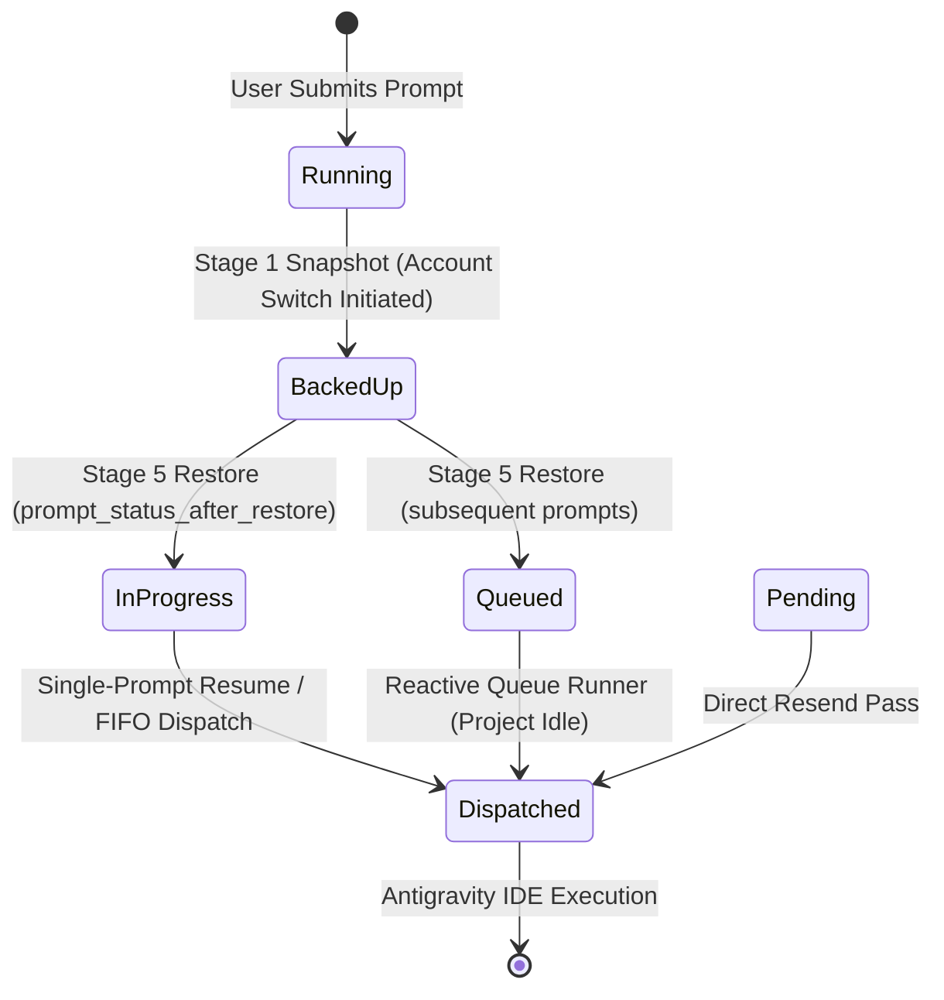
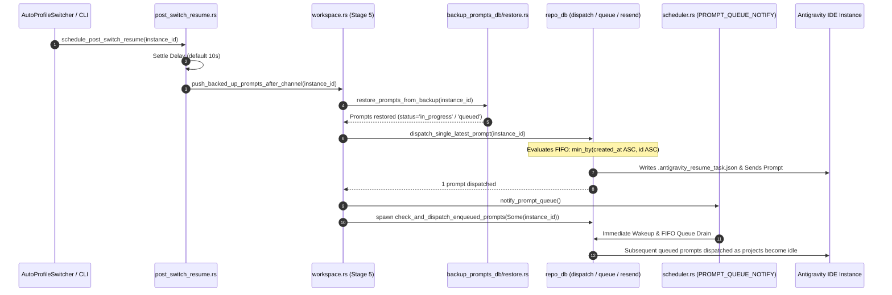

# Component Specification: Running Prompt Restore, Queue Alignment & FIFO Dispatch Engine

- **Specification Slug:** `230-running-prompt-restore-after-account-switch`
- **Specification Path:** `02-spec/21-app/230-running-prompt-restore-after-account-switch/02-component-spec.md`
- **Parent Architecture Spec:** `02-spec/21-app/230-running-prompt-restore-after-account-switch/01-architecture-spec.md`
- **Subtask Plan:** `.ai-memory/plans/subtasks/230-running-prompt-restore-after-account-switch/02-subtask-restore-status-and-queue.md`
- **Sequence ID:** `230`
- **Author:** Spec Author 02 (Prompt Restoration & Queue Subsystem)
- **Status:** APPROVED & MANDATED

---

## 1. Executive Summary & Problem Classification

During automated or manual account switching across Antigravity IDE instances, any active or in-flight prompts in the source instance must be snapshotted (`Stage 1: Backup`), transitioned into a staging state, and reinjected (`Stage 5: Restore`) onto the target profile once the IDE prompt communication channel settles.

An exhaustive audit of the prompt restore and dispatch pipeline identified four distinct architectural defects that lead to dropped prompts, dispatch latency stalls, queue ordering inversion (LIFO), and false-positive subagent prompt discards:

1. **Restored Status & Dispatch Query Divergence:**
   - In `src-tauri/src/modules/backup_prompts_db/restore.rs:504-510`, `prompt_status_after_restore` marks previously running or in-progress prompts as `"in_progress"`.
   - In `src-tauri/src/modules/repo_db/resend.rs:77`, the query filter strictly selects `WHERE status IN ('backed_up', 'queued', 'pending', 'running')`, omitting `'in_progress'`.
   - In `src-tauri/src/modules/repo_db/resend.rs:180`, the deduplication check bypass arm `match prompt.status.as_str()` lists `"backed_up" | "running" | "pending" | "queued" => false`, omitting `"in_progress"`. As a result, restored prompts that reach this check query the transient dispatch cache and get dropped as duplicates.
   - In `src-tauri/src/modules/repo_db/queue.rs:154`, `check_and_dispatch_enqueued_prompts` checks `status IN ('queued', 'pending')`, ignoring `"in_progress"` entirely.
2. **LIFO Inversion in Dispatch Selection:**
   - In `src-tauri/src/modules/repo_db/dispatch.rs:393-403`, `pick_latest_prompt` uses `max_by(|a, b| a.updated_at.cmp(&b.updated_at)...)`. When multiple backed-up prompts exist, the system selects the newest prompt instead of the oldest. This directly violates the strict First-In-First-Out (FIFO) queue invariant mandated in project guidelines.
   - In `src-tauri/src/modules/repo_db/tree_format.rs:116`, `list_running_prompts_for_instance` orders rows by `ORDER BY updated_at DESC`, displaying and traversing prompts in reverse chronological order.
3. **Passive vs. Reactive Post-Switch Scheduler Wakeup:**
   - In `src-tauri/src/modules/instance/workspace.rs:210` and `src-tauri/src/modules/instance/post_switch_resume.rs`, after single-prompt restore completes, the background prompt queue scheduler is not reactively notified. Any remaining or newly restored prompts languish in `active_prompts` until the scheduler's periodic polling interval ticks (up to 30 seconds during idle backoff).
4. **Transcript Discovery Subagent Filter & Schema Fallback Flaws:**
   - In `src-tauri/src/modules/repo_db/discovery.rs:81`, `is_subagent_or_system_content` checks `lower.starts_with("you are ")`. Valid user prompts (e.g., "You are an expert Rust programmer, refactor this module...") are incorrectly classified as subagent instructions and dropped.
   - In `src-tauri/src/modules/repo_db/discovery.rs:45-64`, the narrow schema fallback query initializes `status` to `String::new()`. At lines 243-250, the discovery filter checks `status.contains("RUNNING")`. Because `status` is empty, active conversations discovered under narrow schema tables are discarded.

---

## 2. Component Architecture & Data Flow

### 2.1 Prompt Status Transition Lifecycle

The following state diagram depicts the corrected prompt status transition lifecycle across backup, restore, and dispatch:



### 2.2 Account Switch, Restore & Reactive Dispatch Sequence



---

## 3. Detailed Technical Specifications

### 3.1 Restored Status & Query Alignment

#### 3.1.1 Restore Status Mapping (`src-tauri/src/modules/backup_prompts_db/restore.rs`)
In `prompt_status_after_restore`, prompts are classified based on their previous state prior to the account switch:
- Saved `"running"` or `"in_progress"`: Restored to `"in_progress"`.
- Saved `"queued"`: Restored to `"queued"`.
- All other states (interrupted, backed up): Restored to `"pending"`.

```rust
pub(crate) fn prompt_status_after_restore(saved: &str) -> &'static str {
    match saved {
        "running" | "in_progress" => "in_progress",
        "queued" => "queued",
        _ => "pending",
    }
}
```

#### 3.1.2 Resend Candidates Query (`src-tauri/src/modules/repo_db/resend.rs`)
At line 77, the prepared SQL statement for `resend_single_pass` must include `'in_progress'` in its query filter:

```sql
SELECT id, project_id, instance_id, repo_path, prompt_content, model, session_id, status, created_at, updated_at, image_payload 
FROM active_prompts 
WHERE status IN ('backed_up', 'queued', 'pending', 'running', 'in_progress')
ORDER BY created_at ASC, id ASC LIMIT ?
```

#### 3.1.3 Dispatch Deduplication Bypass (`src-tauri/src/modules/repo_db/resend.rs`)
At line 180, restored prompts with status `"in_progress"` must bypass the `dispatched_prompts_cache` check so they are never suppressed as duplicate dispatches:

```rust
let already_dispatched = match prompt.status.as_str() {
    "backed_up" | "running" | "pending" | "queued" | "in_progress" => false,
    _ => {
        let mut cache = match get_dispatched_prompts_cache().lock() {
            Ok(guard) => guard,
            Err(poisoned) => poisoned.into_inner(),
        };
        let seen = cache.contains(&prompt.id) || cache.contains(&sig);
        if !seen {
            cache.insert(prompt.id.clone());
            cache.insert(sig);
        }
        seen
    }
};
```

#### 3.1.4 Enqueued Prompts Dispatch Query (`src-tauri/src/modules/repo_db/queue.rs`)
At line 154, `check_and_dispatch_enqueued_prompts` must include `'in_progress'` alongside `'queued'` and `'pending'` to ensure restored in-progress prompts are immediately eligible for dispatch:

```sql
SELECT id, project_id, instance_id, repo_path, prompt_content, model, session_id, status, created_at, updated_at, image_payload
FROM active_prompts
WHERE (project_id = ?1 OR repo_path = ?2)
  AND (instance_id = ?3 OR (?3 = 'default' AND (instance_id = 'default' OR instance_id = '__default__')))
  AND status IN ('queued', 'pending', 'in_progress')
ORDER BY created_at ASC, id ASC
LIMIT 1
```

---

### 3.2 Strict FIFO Ordering Invariant Enforcement

#### 3.2.1 Refactoring `pick_latest_prompt` to `pick_first_queued_prompt` (`src-tauri/src/modules/repo_db/dispatch.rs`)
The function `pick_latest_prompt` at lines 393-403 previously selected candidates using `max_by` on `updated_at`, resulting in inverted LIFO behavior. It must be refactored to `pick_first_queued_prompt` using `min_by` on `created_at` with deterministic tie-breaking on `id`:

```rust
/// Pick the earliest enqueued prompt in strict FIFO order: smallest `created_at`,
/// ties broken deterministically by smallest `id`.
/// Candidates arrive sorted; this helper enforces the FIFO invariant in-memory.
fn pick_first_queued_prompt(prompts: &[ActivePrompt]) -> Option<ActivePrompt> {
    prompts
        .iter()
        .min_by(|a, b| {
            a.created_at
                .cmp(&b.created_at)
                .then_with(|| a.id.cmp(&b.id))
        })
        .cloned()
}
```

In `dispatch_single_latest_prompt`, call `pick_first_queued_prompt(&candidates)` to guarantee that the prompt created first is the prompt restored and dispatched first.

#### 3.2.2 FIFO Query Ordering in Running Prompts Listing (`src-tauri/src/modules/repo_db/tree_format.rs`)
At line 116, replace `ORDER BY updated_at DESC` with `ORDER BY created_at ASC, id ASC`:

```sql
SELECT id, project_id, instance_id, repo_path, prompt_content, model, session_id, status, created_at, updated_at, image_payload
FROM active_prompts
WHERE (instance_id = ?1 OR (instance_id = '__default__' AND ?1 = 'default'))
  AND status IN ('running', 'in_flight', 'dispatched')
ORDER BY created_at ASC, id ASC
```

---

### 3.3 Reactive Post-Switch Scheduler Wakeup

#### 3.3.1 Immediate Notification in Workspace Restore (`src-tauri/src/modules/instance/workspace.rs`)
In `push_backed_up_prompts_after_channel`, once `dispatch_single_latest_prompt` completes, the system must immediately wake the background prompt queue scheduler and spawn an asynchronous dispatch pass for the current instance:

```rust
// Wake up the background adaptive FIFO prompt queue ticker immediately
crate::modules::scheduler::notify_prompt_queue();

// Trigger an immediate asynchronous queue dispatch for the restored instance
let inst_for_dispatch = instance_id.to_string();
tauri::async_runtime::spawn(async move {
    if let Err(err) = crate::modules::repo_db::check_and_dispatch_enqueued_prompts(Some(&inst_for_dispatch)) {
        crate::modules::logger::log_warn(&format!(
            "[INSTANCE_SWITCH:STAGE_5_RESTORE] Post-restore dispatch trigger failed for '{inst_for_dispatch}': {err}"
        ));
    }
});
```

#### 3.3.2 Timer & Headless Wakeup Integration (`src-tauri/src/modules/instance/post_switch_resume.rs`)
In `run_post_switch_resume_after_delay`, `arm_resume_timer`, and `force_dispatch_resume`, ensure that after `run_resume_with_retry` executes, `crate::modules::scheduler::notify_prompt_queue()` is called so any remaining queued tasks are processed without waiting for ticker timeouts.

---

### 3.4 Subagent Prompt Filter Fix & Narrow Schema Hardening

#### 3.4.1 Subagent Detection Filter (`src-tauri/src/modules/repo_db/discovery.rs`)
In `is_subagent_or_system_content` at lines 67-82, remove the generic prefix check `lower.starts_with("you are ")`. Genuine subagent instructions and system messages are identified by explicit structural envelopes (`<SYSTEM_MESSAGE>`, `[Message] timestamp=`, `Task id `) and caller delegation headers (`invoked by a caller agent`, `You are Research`, `You are Worker`, `You are Spec Author`). Valid user prompts that begin with "you are" must be preserved:

```rust
fn is_subagent_or_system_content(content: &str) -> bool {
    let trimmed = content.trim();
    if trimmed.contains("<SYSTEM_MESSAGE>")
        || trimmed.contains("[Message] timestamp=")
        || trimmed.contains("You are Research")
        || trimmed.contains("You are Worker")
        || trimmed.contains("You are Spec Author")
        || trimmed.starts_with("Task id ")
    {
        return true;
    }
    let lower = trimmed.to_lowercase();
    lower.contains("subagent")
        || lower.contains("invoked by a caller agent")
}
```

#### 3.4.2 Narrow Schema Fallback Liveness (`src-tauri/src/modules/repo_db/discovery.rs`)
In `read_conversation_summary_rows` at lines 45-64, when the table schema does not include `status` and falls back to the narrow query, set `status: "RUNNING".to_string()`. Because `not_fully_idle` is set to `1`, defaulting `status` to `"RUNNING"` prevents `discovery.rs:243-250` from dropping active conversations:

```rust
let narrow = "SELECT conversation_id, preview, workspace_uris
     FROM conversation_summaries
     ORDER BY rowid DESC
     LIMIT 25";
let Ok(mut stmt) = conn.prepare(narrow) else {
    return Vec::new();
};
let Ok(rows) = stmt.query_map([], |row| {
    Ok(ConversationSummaryRow {
        cid: row.get(0)?,
        preview: row.get::<_, Option<String>>(1)?.unwrap_or_default(),
        status: "RUNNING".to_string(),
        not_fully_idle: 1,
        workspace_uris: row.get(2)?,
        last_modified_time: None,
    })
}) else {
    return Vec::new();
};
rows.flatten().collect()
```

Additionally, in lines 243-250, verify liveness using transcript turn inspection when status is empty:

```rust
let is_genuinely_running = (not_fully_idle != 0 && (status.contains("RUNNING") || status.is_empty()))
    || (status.is_empty() && !inspection.is_terminal_done && inspection.turns > 0);
let is_quota_or_error_interrupted = inspection.is_error_or_quota
    || status.contains("ERROR")
    || status.contains("FAILED");

if !is_genuinely_running && !is_quota_or_error_interrupted {
    continue;
}
```

---

## 4. Verification & Testing Strategy

### 4.1 Unit & Contract Tests
1. **FIFO Prompt Selection Test:**
   - Create a sequence of test prompts with differing `created_at` and `updated_at` timestamps (e.g., prompt A created at T0, updated at T2; prompt B created at T1, updated at T1).
   - Assert `pick_first_queued_prompt` returns prompt A (earliest `created_at`), verifying zero LIFO inversion.
2. **Restored Status Query Alignment Test:**
   - Insert prompts into `active_prompts` with statuses `'in_progress'`, `'queued'`, `'pending'`, and `'backed_up'`.
   - Execute `resend_single_pass` and `check_and_dispatch_enqueued_prompts`.
   - Assert all `'in_progress'` prompts are retrieved and marked eligible for dispatch.
3. **Subagent Filter Boundary Test:**
   - Feed user prompt: `"You are an expert AI software engineer. Please fix this bug."`
   - Assert `is_subagent_or_system_content` returns `false`.
   - Feed subagent prompt: `"[Message] timestamp=2026-10-26T19:00:00Z You are Worker 01..."`
   - Assert `is_subagent_or_system_content` returns `true`.
4. **Narrow Schema Fallback Liveness Test:**
   - Execute fallback row construction with empty summary status.
   - Assert the row is preserved and inspected rather than prematurely dropped at the running filter stage.

---

## 5. Architectural Invariants Checklist

- [x] Strict First-In-First-Out ordering enforced across all dispatch queries (`ORDER BY created_at ASC, id ASC`).
- [x] No LIFO queries (`ORDER BY updated_at DESC`) in prompt selection or queue processing.
- [x] Universal handling of `'in_progress'` status across restore, resend, deduplication bypass, and queue dispatch.
- [x] Reactive scheduler notification via `PROMPT_QUEUE_NOTIFY.notify_one()` on restore completion.
- [x] Zero silent errors: all fallible operations propagate or record via `crate::error::record_ignored` with explicit justifications.
- [x] Strictly repository-relative Git paths across all documentation and specifications.
