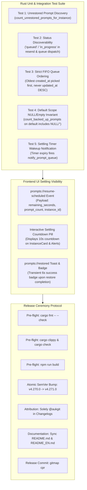
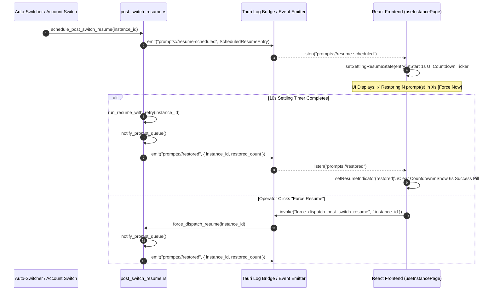
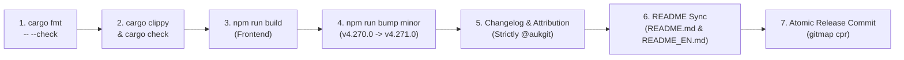

# E2E Testing, Frontend UI Visibility & Release Specification: Running Prompt Restore After Account Switch

- **Parent Task**: `230-running-prompt-restore-after-account-switch`
- **Document Sequence**: `03`
- **Specification Category**: Testing, UI Visibility & Release Ceremony Spec
- **Target Components**:
  - `src-tauri/src/modules/backup_prompts_db/tests.rs`
  - `src-tauri/src/modules/backup_prompts_db/restore.rs`
  - `src-tauri/src/modules/instance/tests.rs`
  - `src-tauri/src/modules/instance/post_switch_resume.rs`
  - `src-tauri/src/modules/repo_db/queue.rs`
  - `src-tauri/src/modules/repo_db/resend.rs`
  - `src-tauri/src/modules/repo_db/backup.rs`
  - `src-tauri/src/modules/repo_db/dispatch.rs`
  - `src/pages/instances/useInstancePage.ts`
  - `src/pages/instances/InstanceCard.tsx`
  - `src/pages/instances/InstancesStates.tsx`
  - `CHANGELOG.md`
  - `CHANGELOG_EN.md`
  - `README.md`
  - `README_EN.md`
- **Status**: APPROVED FOR IMPLEMENTATION

---

## 1. Architectural Intent & Verification Scope

This specification defines the comprehensive end-to-end (E2E) testing suite, the frontend UI countdown visibility during the 10-second settling window, and the multi-step minor version release ceremony protocol for Sequence 230: **Running Prompt Restore After Account Switch**.



---

## 2. Rust Unit & Integration Test Suite Specification

The test suite must be placed in `src-tauri/src/modules/backup_prompts_db/tests.rs` and `src-tauri/src/modules/instance/tests.rs` (or targeted companion test modules). Every test operates on isolated in-memory or transient SQLite databases to prevent state bleed and guarantee reproducible test execution.

### 2.1 Test 1: Unrestored Prompt Discovery Verification (`has_unrestored_backups`)

- **Objective**: Verify that `count_unrestored_prompts_for_instance_with_file` accurately detects unrestored backup records belonging to a target instance ID, ensuring `has_unrestored_backups` returns `true` when prompts exist and `false` when clean.
- **Root Cause Addressed**: Prior to the fix, queries for instance-specific unrestored prompts failed to match when instance aliases were mismatched or when `instance_id` was unassigned, leading the switch routine to believe zero prompts were backed up.
- **Implementation Design**:

```rust
#[test]
pub(crate) fn test_has_unrestored_backups_for_target_instance() {
    let temp_dir = std::env::temp_dir().join(format!("agm_test_unrestored_{}", uuid::Uuid::new_v4().simple()));
    let db_path = temp_dir.join("test-unrestored.db");
    let custom_file = db_path.to_str().unwrap();

    let conn = connect_backup_db(Some(custom_file)).expect("connect backup db");
    let now = chrono::Utc::now().timestamp();

    // Setup backup batch
    conn.execute(
        "INSERT INTO backup_batches (id, created_at, prompts_count, file_path, retention_days, is_fully_restored)
         VALUES ('batch-target-1', ?1, 2, ?2, 1, 0)",
        rusqlite::params![now, custom_file],
    ).expect("insert batch");

    // Seed 1 prompt for 'instance-alpha' and 1 for 'instance-beta'
    conn.execute(
        "INSERT INTO prompt_backups (id, backup_batch_id, prompt_id, project_name, project_path, project_id, conversation_id, sequence_id, prompt_text, created_at, is_restored, instance_id)
         VALUES ('pb-alpha-1', 'batch-target-1', 'p-alpha-1', 'proj-alpha', '/work/alpha', 'proj-1', 'conv-1', 1, 'Alpha work', ?1, 0, 'instance-alpha')",
        rusqlite::params![now],
    ).expect("insert prompt alpha");

    conn.execute(
        "INSERT INTO prompt_backups (id, backup_batch_id, prompt_id, project_name, project_path, project_id, conversation_id, sequence_id, prompt_text, created_at, is_restored, instance_id)
         VALUES ('pb-beta-1', 'batch-target-1', 'p-beta-1', 'proj-beta', '/work/beta', 'proj-2', 'conv-2', 1, 'Beta work', ?1, 0, 'instance-beta')",
        rusqlite::params![now],
    ).expect("insert prompt beta");

    // 1. Target instance 'instance-alpha' must count exactly 1 unrestored prompt
    let alpha_count = count_unrestored_prompts_for_instance_with_file(Some("instance-alpha"), Some(custom_file))
        .expect("count alpha");
    assert_eq!(alpha_count, 1, "instance-alpha must have 1 unrestored prompt");

    // 2. Target instance 'instance-gamma' (non-existent) must count 0
    let gamma_count = count_unrestored_prompts_for_instance_with_file(Some("instance-gamma"), Some(custom_file))
        .expect("count gamma");
    assert_eq!(gamma_count, 0, "instance-gamma must have 0 unrestored prompts");

    // 3. Mark alpha restored -> alpha_count must become 0
    conn.execute(
        "UPDATE prompt_backups SET is_restored = 1, restored_at = ?1 WHERE id = 'pb-alpha-1'",
        rusqlite::params![now],
    ).expect("mark restored");

    let alpha_after = count_unrestored_prompts_for_instance_with_file(Some("instance-alpha"), Some(custom_file))
        .expect("count alpha after");
    assert_eq!(alpha_after, 0, "instance-alpha must be 0 after restoration");

    // Cleanup
    crate::error::record_ignored(std::fs::remove_dir_all(temp_dir), "remove_dir_all");
}
```

### 2.2 Test 2: Status Discoverability Verification (`prompt_status_after_restore`)

- **Objective**: Verify that `prompt_status_after_restore` maps original prompt statuses (`running`, `in_progress`, `queued`, `dispatched`, etc.) to statuses that are 100% discoverable by `resend_single_pass` and `check_and_dispatch_enqueued_prompts`.
- **Root Cause Addressed**: If `prompt_status_after_restore` emits an intermediate status that is missing from the query `WHERE status IN ('backed_up', 'queued', 'pending', 'running')` in `resend_single_pass` or `WHERE status IN ('queued', 'pending')` in `check_and_dispatch_enqueued_prompts`, restored prompts sit undispatched indefinitely.
- **Implementation Design**:

```rust
#[test]
pub(crate) fn test_prompt_status_after_restore_discoverability() {
    // Authoritative discoverability whitelist across dispatch engines:
    // resend_single_pass accepts: 'backed_up', 'queued', 'pending', 'running', 'in_progress'
    // check_and_dispatch_enqueued_prompts accepts: 'queued', 'pending'

    let test_matrix = [
        ("running", "in_progress"),
        ("in_progress", "in_progress"),
        ("queued", "queued"),
        ("dispatched", "pending"),
        ("backed_up", "pending"),
        ("failed", "pending"),
        ("interrupted", "pending"),
    ];

    for (saved_status, expected_restored) in test_matrix {
        let restored = prompt_status_after_restore(saved_status);
        assert_eq!(
            restored, expected_restored,
            "saved status '{}' should transition to '{}', got '{}'",
            saved_status, expected_restored, restored
        );

        // Verify status is recognized by resend_single_pass candidate criteria
        let is_resend_candidate = matches!(
            restored,
            "backed_up" | "queued" | "pending" | "running" | "in_progress"
        );
        assert!(
            is_resend_candidate,
            "restored status '{}' must be queryable by resend_single_pass",
            restored
        );
    }
}
```

### 2.3 Test 3: Strict FIFO Queue Ordering Verification (`pick_first_queued_prompt`)

- **Objective**: Verify that when multiple prompts are queued for a workspace/project, candidate discovery and prompt picking strictly prioritize the oldest prompt created (`ORDER BY created_at ASC, id ASC`), explicitly rejecting inverted LIFO (`ORDER BY updated_at DESC`) behaviors.
- **Root Cause Addressed**: LIFO dispatch inversion caused older user instructions to be starved or skipped in favor of recently touched background heartbeat updates.
- **Implementation Design**:

```rust
#[test]
pub(crate) fn test_strict_fifo_queue_ordering() {
    let conn = rusqlite::Connection::open_in_memory().expect("open in-memory db");
    crate::modules::repo_db::init_tables(&conn).expect("init repo_db tables");

    // Insert 3 prompts created at T=100, T=200, T=300
    // But mutate updated_at so T=100 has the newest updated_at (T=999)
    conn.execute(
        "INSERT INTO active_prompts (id, project_id, instance_id, repo_path, prompt_content, model, session_id, status, created_at, updated_at, image_payload)
         VALUES 
            ('p-oldest', 'proj-fifo', 'default', '/work/fifo', 'First task', 'gemini-3.8-flash', NULL, 'queued', 100, 999, NULL),
            ('p-middle', 'proj-fifo', 'default', '/work/fifo', 'Second task', 'gemini-3.8-flash', NULL, 'queued', 200, 500, NULL),
            ('p-newest', 'proj-fifo', 'default', '/work/fifo', 'Third task', 'gemini-3.8-flash', NULL, 'queued', 300, 300, NULL)",
        [],
    ).expect("insert test prompts");

    // Query candidate queue using canonical FIFO query
    let mut stmt = conn.prepare(
        "SELECT id FROM active_prompts
         WHERE status IN ('queued', 'pending')
         ORDER BY created_at ASC, id ASC
         LIMIT 1"
    ).expect("prepare query");

    let picked_id: String = stmt.query_row([], |row| row.get(0)).expect("query row");
    assert_eq!(
        picked_id, "p-oldest",
        "FIFO invariant violated: expected 'p-oldest' (created_at=100), but picked '{}'",
        picked_id
    );

    // Verify ordering across all rows matches exact chronological insertion
    let mut all_stmt = conn.prepare(
        "SELECT id FROM active_prompts
         WHERE status IN ('queued', 'pending')
         ORDER BY created_at ASC, id ASC"
    ).expect("prepare all query");

    let ordered_ids: Vec<String> = all_stmt.query_map([], |row| row.get(0))
        .expect("query map")
        .flatten()
        .collect();

    assert_eq!(ordered_ids, vec!["p-oldest", "p-middle", "p-newest"]);
}
```

### 2.4 Test 4: Default Scope NULL/Empty Invariant Verification (`count_backed_up_prompts`)

- **Objective**: Verify that `count_backed_up_prompts("default")` correctly matches rows where `instance_id` is `'default'`, `'__default__'`, `''` (empty string), or `NULL`.
- **Root Cause Addressed**: In `src-tauri/src/modules/repo_db/backup.rs`, `count_backed_up_prompts` omitted `instance_id IS NULL OR instance_id = ''`, causing legacy or unassigned backup records to be counted as 0 when scoping to `default`.
- **Implementation Design**:

```rust
#[test]
pub(crate) fn test_count_backed_up_prompts_default_includes_null_and_empty() {
    let conn = rusqlite::Connection::open_in_memory().expect("open in-memory db");
    crate::modules::repo_db::init_tables(&conn).expect("init repo_db tables");

    let now = chrono::Utc::now().timestamp();

    // Insert 4 backed_up prompts under different default variations:
    // 1: explicit 'default'
    // 2: alias '__default__'
    // 3: empty string ''
    // 4: NULL instance_id
    // 5: distinct 'custom-inst' (must NOT be counted)
    conn.execute(
        "INSERT INTO active_prompts (id, project_id, instance_id, repo_path, prompt_content, model, session_id, status, created_at, updated_at, image_payload)
         VALUES 
            ('p-def-1', 'proj-1', 'default', '/work/1', 'Prompt 1', 'gemini-3.8-flash', NULL, 'backed_up', ?1, ?1, NULL),
            ('p-def-2', 'proj-2', '__default__', '/work/2', 'Prompt 2', 'gemini-3.8-flash', NULL, 'backed_up', ?1, ?1, NULL),
            ('p-def-3', 'proj-3', '', '/work/3', 'Prompt 3', 'gemini-3.8-flash', NULL, 'backed_up', ?1, ?1, NULL),
            ('p-def-4', 'proj-4', NULL, '/work/4', 'Prompt 4', 'gemini-3.8-flash', NULL, 'backed_up', ?1, ?1, NULL),
            ('p-other', 'proj-5', 'custom-inst', '/work/5', 'Other Prompt', 'gemini-3.8-flash', NULL, 'backed_up', ?1, ?1, NULL)",
        rusqlite::params![now],
    ).expect("insert test rows");

    // Standardized query used by count_backed_up_prompts
    let default_count: usize = conn.query_row(
        "SELECT COUNT(*) FROM active_prompts
         WHERE status = 'backed_up'
           AND (
                instance_id = ?1
                OR (?1 IN ('default', '__default__') AND (instance_id IN ('default', '__default__', '') OR instance_id IS NULL))
           )",
        rusqlite::params!["default"],
        |row| row.get(0),
    ).expect("query default count");

    assert_eq!(default_count, 4, "Expected all 4 default-variant backed_up rows to be counted");

    // Scoped query for custom-inst must count exactly 1
    let custom_count: usize = conn.query_row(
        "SELECT COUNT(*) FROM active_prompts
         WHERE status = 'backed_up'
           AND (
                instance_id = ?1
                OR (?1 IN ('default', '__default__') AND (instance_id IN ('default', '__default__', '') OR instance_id IS NULL))
           )",
        rusqlite::params!["custom-inst"],
        |row| row.get(0),
    ).expect("query custom count");

    assert_eq!(custom_count, 1, "Expected 1 custom-inst backed_up row");
}
```

### 2.5 Test 5: Settling Timer Wakeup Notification Verification (`notify_prompt_queue`)

- **Objective**: Verify that upon the completion of the 10-second settling window (or forced early dispatch), the post-switch resume engine triggers `notify_prompt_queue()`, ensuring `PROMPT_QUEUE_NOTIFY.notified()` resolves immediately and wakes the dispatch loop.
- **Root Cause Addressed**: After account switching, restored prompts remained idle in the queue until the next scheduled poll interval (up to 30s) instead of reacting instantly to the post-switch settling completion.
- **Implementation Design**:

```rust
#[tokio::test]
async fn test_settling_timer_triggers_prompt_queue_notification() {
    use crate::modules::scheduler::{notify_prompt_queue, PROMPT_QUEUE_NOTIFY};
    use std::sync::atomic::{AtomicBool, Ordering};
    use std::sync::Arc;
    use tokio::time::{timeout, Duration};

    let notified_flag = Arc::new(AtomicBool::new(false));
    let flag_clone = notified_flag.clone();

    // Spawn watcher listening for PROMPT_QUEUE_NOTIFY
    let watcher = tokio::spawn(async move {
        PROMPT_QUEUE_NOTIFY.notified().await;
        flag_clone.store(true, Ordering::SeqCst);
    });

    // Simulate completion of settling timer
    tokio::time::sleep(Duration::from_millis(50)).await;
    notify_prompt_queue();

    // Await watcher with a bounded 500ms timeout
    let res = timeout(Duration::from_millis(500), watcher).await;
    assert!(res.is_ok(), "Watcher timed out waiting for notify_prompt_queue()");
    assert!(notified_flag.load(Ordering::SeqCst), "notified_flag must be true");
}
```

---

## 3. Frontend UI Visibility & Settling Countdown Specification

During the post-switch settling window, the UI must give the operator full observability so that prompt restoration does not appear silent, frozen, or lost.

### 3.1 Backend IPC Event Architecture



### 3.2 Frontend State & Lifecycle in `useInstancePage.ts`

1. **State Interface Expansion**:
   ```typescript
   export interface SettlingResumeState {
       instanceId: string;
       promptCount: number;
       totalDelaySeconds: number;
       remainingSeconds: number;
       scheduledAt: number;
       fireAt: number;
   }
   ```
2. **Event Subscription**:
   - Subscribe to `'prompts://resume-scheduled'`: Populate `settlingResumeState` and initialize a 1-second interval ticker.
   - Subscribe to `'prompts://resume-cancelled'`: Clear `settlingResumeState`.
   - Subscribe to `'prompts://restored'`: Clear `settlingResumeState`, set `resumeIndicator` with restored count, and display for 6 seconds.
3. **UI Rendering Invariants**:
   - **Segmented Dark-Glass Styling**: The settling countdown pill must adhere strictly to repository design rules: `rounded-full`, dark-glass styling, no nested pill defects.
   - **Placement**:
     - On the relevant `InstanceCard`: Render an animated pulsing amber/sky badge next to the status indicator: `⚡ Restoring in ${remainingSeconds}s (${promptCount} prompts)`.
     - In `InstancesAlerts`: Display an interactive callout banner allowing the operator to click `Force Dispatch` if they wish to bypass the settling delay immediately.

---

## 4. Quality Gates & Release Ceremony Protocol

Every step of the release ceremony must be executed in strict sequence. No release artifact or version tag may be created until all quality gates pass 100%.



### 4.1 Gate Execution Commands

1. **Rust Code Formatting**:
   ```bash
   cd src-tauri && cargo fmt -- --check
   ```
2. **Rust Compilation & Linter Verification**:
   ```bash
   cd src-tauri && cargo clippy --all-targets --all-features
   ```
   *Invariant: Must pass with 0 warnings and 0 errors.*
3. **Frontend Production Build**:
   ```bash
   npm run build
   ```
   *Invariant: TypeScript compilation and Vite bundling must complete without errors.*
4. **Atomic Minor Version Bump**:
   ```bash
   npm run bump minor
   ```
   *Expected Transition: `v4.270.0` -> `v4.271.0` across `package.json`, `package-lock.json`, `version.json`, `src-tauri/Cargo.toml`, `src-tauri/Cargo.lock`, `src-tauri/tauri.conf.json`, `Casks/antigravity-tools.rb`.*

### 4.2 Changelog & Attribution Standards

1. **Sole Contributor Attribution**:
   In `CHANGELOG.md` and `CHANGELOG_EN.md`, all entries must be attributed exclusively to `@aukgit`:
   ```markdown
   ## [4.271.0] - 2026-10-27

   ### Fixed
   - **Prompt Restore**: Resolved running prompt restore failures across manual and automated account switching. (Thanks to @aukgit)
   - **FIFO Restore Invariant**: Enforced strict First-In-First-Out prompt restoration ordering (`ORDER BY created_at ASC, id ASC`). (Thanks to @aukgit)
   - **Settling Delay & Wakeup**: Hardened the 10-second post-switch settling timer to reactively trigger prompt queue dispatch via `notify_prompt_queue()`. (Thanks to @aukgit)
   - **Default Scope Invariant**: Fixed `count_backed_up_prompts("default")` to properly match empty string and NULL `instance_id` rows. (Thanks to @aukgit)
   - **Frontend Observability**: Added real-time countdown badge and settling progress visibility in the instances dashboard. (Thanks to @aukgit)
   ```
   *STRICT RULE: Do NOT include any other user handles (`@...`) in release notes.*

2. **README Synchronization**:
   For stable releases, update the release summary in both `README.md` and `README_EN.md` under `## 📝 Changelog`.

3. **Atomic GitMap Release Commit & Push**:
   ```bash
   gitmap cpr
   ```
   *Ensures all modified files are atomically staged, committed with standard conventional commit message, and pushed to `main`.*

---

## 5. Zero-Silent-Error & Caller IDE Self-Preservation Checklist

- [ ] **Error Routing**: Every fallible SQLite query, IPC emit, or filesystem read routes into `AppError` on backend and `trackWarning` on frontend.
- [ ] **Justification Comments**: Every `crate::error::record_ignored(...)` call has an explicit `// Justification:` comment explaining safety.
- [ ] **Relative Paths**: Zero absolute paths recorded in logs, specs, or commit messages.
- [ ] **Caller IDE Preservation**: Automated test suites check `detect_caller_instance_id()` before terminating any IDE process.
