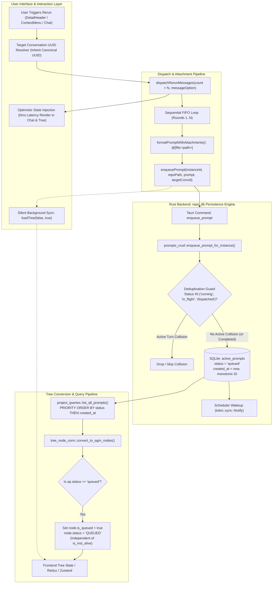
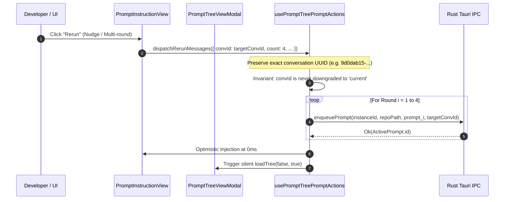

# Specification: Anti-gravity Rerun and UI Fixes — Architecture Spec

**Slug**: `anti-gravity-rerun-and-ui-fixes`  
**Sequence**: `231`  
**Document**: `01-architecture-spec.md`  
**Status**: APPROVED  
**Target Release**: `v4.272.0` (Minor Bump)  
**Target Branch**: `main`  
**Author**: Spec Author 01  
**Attribution**: strictly `@aukgit` (`(Thanks to @aukgit)`)  

---

## 1. Executive Summary & Strategic Intent

Antigravity Manager functions as a high-performance orchestration gateway and prompt management suite for AI agent workflows across IDE instances, managing prompt trees, transcripts, and instance runtimes.

During rigorous operational testing and multi-round rerun stress testing, five systemic architectural defects were identified in the rerun lifecycle, SQLite persistence layer, and tree visualization pipelines:

1. **Rerun Target Conversation UUID Loss & Degradation**:
   - *Problem*: In `PromptInstructionView.tsx` and `PromptTreeViewModal.tsx`, when rerun operations were triggered, the destination conversation UUID was occasionally lost or downgraded to the string literal `'current'`, or unassigned when `selectedProject` was null. This caused reruns to spawn disconnected detached conversations or orphan turns instead of appending chronologically to the user's targeted conversation thread.
   - *Strategic Solution*: Enforce an unconditional **Target Conversation UUID Inheritance Invariant**. All rerun dispatch paths (`dispatchRerunMessages`, `handleRerunConversation`, `DetailHeader`, `PromptInstructionView`) must explicitly resolve and pass the canonical UUID. The routing function `dispatchConversationId(mode, conversationId, isRunning)` must never degrade a valid UUID into `'current'` or drop it to `undefined`.

2. **Multi-Round Rerun Throttling & Artificial 30s Latency**:
   - *Problem*: Multi-round reruns (e.g. 4 consecutive rounds dispatched via `dispatchRerunMessages`) suffered from artificial 30-second backoff delays, blocking UI execution and preventing enqueued items from rendering immediately.
   - *Strategic Solution*: Implement **Immediate FIFO Queue Injection**. When a user requests $N$ rounds (e.g. 4 rounds), all $N$ items are enqueued sequentially into the SQLite `active_prompts` queue with strictly monotonic timestamps (`created_at ASC, id ASC`) without artificial backoffs. Concurrently, **Optimistic State Injection** injects synthetic queued turns into client-side state at 0ms latency, giving instantaneous visual confirmation in both the chat view and Prompt Tree View.

3. **Overzealous Deduplication Dropping in SQLite Layer (`prompts_crud.rs`)**:
   - *Problem*: In `src-tauri/src/modules/repo_db/prompts_crud.rs`, a live-status deduplication query (`SELECT status FROM active_prompts WHERE (repo_path = ?1 ...) AND prompt_content = ?4`) matched historical `completed` prompts with identical content. Incoming rerun requests (which naturally carry identical prompt text) with status `'queued'` were flagged as colliding with a `completed` prompt, causing the backend to log `Preserving live prompt ... skipping overwrite` and silently drop the rerun request.
   - *Strategic Solution*: Restrict the deduplication query to actively executing stages: `WHERE status IN ('running', 'in_flight', 'dispatched')`. Historical `completed`, `cancelled`, or `backed_up` records must never block a newly enqueued rerun prompt from entering the FIFO queue.

4. **Instance Liveness Coupling in Tree Node Conversion (`tree_node_conv.rs`)**:
   - *Problem*: In `src-tauri/src/modules/repo_db/tree_node_conv.rs`, queued status evaluation was tightly coupled to ephemeral process liveness (`let is_queued = is_alive_and_fresh && is_pending_stage;` and `let is_ap_queued = is_inst_alive && ...`). If an instance process was momentarily offline, transitioning, or idle, prompts legitimately queued in SQLite were demoted to `COMPLETED` or `IDLE`, causing queued turns to vanish from the tree view.
   - *Strategic Solution*: Decouple `is_queued` evaluation completely from `is_inst_alive`. An active prompt whose database status is `'queued'` or `'pending'` unconditionally evaluates `is_queued = true` and `status = 'QUEUED'`. Process liveness governs execution readiness, never database queue persistence.

5. **SQLite Query Saturation & Starvation under LIMIT 500 (`project_queries.rs`)**:
   - *Problem*: In `src-tauri/src/modules/repo_db/project_queries.rs`, `list_all_prompts()` queried `active_prompts ORDER BY created_at ASC, id ASC LIMIT 500`. Once a workspace accumulated 500 older completed prompts, newly enqueued and running prompts (having newer timestamps) were pushed beyond the 500-record window and completely excluded from backend state synchronization.
   - *Strategic Solution*: Implement **Priority-Weighted Queue Ordering**. The query must prioritize active and queued prompts ahead of completed ones using SQL priority ordering: `ORDER BY CASE WHEN status IN ('queued', 'running', 'dispatched', 'in_flight') THEN 0 ELSE 1 END, created_at ASC, id ASC LIMIT 500`.

---

## 2. End-to-End System Architecture

The following diagram details the end-to-end lifecycle of prompt rerun dispatching, FIFO SQLite persistence, queue priority sorting, decoupled node conversion, and optimistic UI rendering:



---

## 3. Rerun Target ID Routing Architecture

### 3.1 Problem Analysis: UUID Loss & String Literal Degradation
In previous iterations, conversation rerun handling had divergent implementations across multiple components:
- `PromptInstructionView.tsx`: If `selectedProject` was null or during tab switches, `repoPath` defaulted to `""`, and conversation ID fell back to `undefined` or string literal `'current'`.
- `PromptTreeViewModal.tsx`: The modal mounted sub-components without forwarding `onRerun` or `onEnqueue` callbacks, forcing inner components to rely on orphaned local state or fallback routines.
- `usePromptTreePromptActions.ts`: In certain conditional branches, `dispatchConversationId('current', conversationId, isRunning)` evaluated `mode === 'current'` without defensive UUID validation, allowing `'current'` to be dispatched to backend targets that required an explicit UUID.

### 3.2 Target UUID Inheritance Rules & Invariants
To guarantee that a rerun always appends to its origin conversation thread:

1. **Canonical UUID Preservation**:
   Every rerun dispatch context (`RerunDispatchContext`) must accept a `convId?: string`. When initiating a rerun from an existing conversation node `conv`:
   ```typescript
   const targetConvId = conv.conversation_id?.trim() || convoId?.trim() || undefined;
   ```
2. **Defensive UUID Validation**:
   The function `dispatchConversationId(mode, conversationId, _isRunning)` in `src/components/instances/PromptTreeView/usePromptTreePromptActions.ts` enforces:
   - If `mode === 'new'`, return `'new'`.
   - If `conversationId` is provided and non-empty, return `conversationId.trim()`.
   - Never return the literal string `'current'` to the backend dispatch layer; if no UUID exists, return `undefined` so that the backend can assign a fresh thread cleanly.
3. **Modal & View Prop Passthrough**:
   `PromptTreeViewModal.tsx` must wire all prompt action props to nested tree views:
   - `onRerunConversation={handleRerunConversation}`
   - `onRerun={handleStripRerun}`
   - `onEnqueue={handleEnqueuePrompt}`
   - `repoPath={selectedProject?.repoPath || activeRepoPath}`



---

## 4. Immediate FIFO Queue Injection & Optimistic State Pipeline

### 4.1 Elimination of 30s Delays in Multi-Round Reruns
Previous multi-round implementations imposed an artificial delay (up to 30 seconds) between successive prompt dispatches or required individual round confirmation before enqueuing the next.

Under the **Immediate FIFO Queue Injection** architecture:
- When $N$ rounds are requested (e.g. 4 rounds):
  1. `dispatchRerunMessages` iterates sequentially through all $N$ rounds in a tight loop.
  2. Each round is formatted with its unique nudge variation and canonical attachment block (`@[file;<path>]`).
  3. All $N$ rounds are dispatched to `enqueuePrompt` immediately.
  4. Each prompt is inserted into SQLite `active_prompts` with `status: 'queued'`.
  5. The backend scheduler (`check_and_dispatch_enqueued_prompts`) is notified once via `tokio::sync::Notify` and drains the queue strictly in FIFO order (`ORDER BY created_at ASC, id ASC`) as the target instance becomes idle.

### 4.2 0ms Optimistic State Injection
To ensure zero visual latency for developer feedback:
- Concurrently with IPC calls, synthetic turns are constructed and injected directly into the client-side conversation state:
  ```typescript
  const optimisticTurn: AgmPromptTurnNode = {
      turn_number: currentTurnCount + roundIndex,
      step_index: 0,
      prompt_text: formattedPrompt,
      preview_200w: extractPreview(formattedPrompt, 200),
      status: 'QUEUED',
      is_running: false,
      is_queued: true,
      timestamp: new Date().toISOString(),
      created_at: Date.now(),
      media_paths: rerunMedia,
      media_thumbnails: rerunMedia,
  };
  ```
- Both the chat conversation view and the Prompt Tree View render these turns immediately with the distinct `QUEUED` badge (Amber/Sky).

### 4.3 Enqueue Refresh Bar Suppression
- *Defect*: Triggering `loadTree(true, true)` upon enqueue activated `isInitialLoad = true`, displaying a prominent 2px blue horizontal indeterminate loading bar across the header and spinning the global sync icon.
- *Remediation*: All enqueue, resend, and rerun callbacks must invoke `loadTree(false, true)`:
  - `isInitialLoad = false`: Suppresses the intrusive top progress bar.
  - `isSilent = true`: Performs background data fetching without clearing existing node selections or causing layout flicker.

---

## 5. Backend Database & Conversion Engine Invariants

### 5.1 Deduplication Query Fix (`src-tauri/src/modules/repo_db/prompts_crud.rs`)

#### Root Cause Analysis
In `src-tauri/src/modules/repo_db/prompts_crud.rs`, the deduplication logic was designed to prevent duplicate prompt injection. However, its query was overzealous:

```rust
// DEFECTIVE IMPLEMENTATION:
tx.query_row(
    "SELECT status FROM active_prompts WHERE (repo_path = ?1 OR repo_path = ?2 OR repo_path = ?3) AND prompt_content = ?4 LIMIT 1",
    params![&prompt.repo_path, &norm_path_slash, &norm_path_bslash, &prompt.prompt_content],
    |r| r.get(0),
)
```

If a prompt with identical text was executed earlier and marked `status = 'completed'`, this query returned `Some("completed")`. The subsequent guard checked:

```rust
if matches!(live_status.as_deref(), Some("running") | Some("completed"))
    && prompt.status != "completed"
    && prompt.status != "running"
{
    // Skipped insertion!
    return Ok(());
}
```

Because an incoming rerun has `prompt.status = "queued"`, it matched this condition and was discarded without being inserted into SQLite!

#### Surgical Remediation
The deduplication query must strictly ignore completed, backed-up, or cancelled records. It must only guard against collisions with prompts that are actively executing in flight:

```rust
// CORRECT ARCHITECTURAL IMPLEMENTATION:
let live_status: Option<String> = tx
    .query_row(
        "SELECT status FROM active_prompts WHERE id = ?1",
        params![&prompt.id],
        |r| r.get(0),
    )
    .ok()
    .or_else(|| {
        let norm_path_slash = prompt.repo_path.trim().replace('\\', "/");
        let norm_path_bslash = prompt.repo_path.trim().replace('/', "\\");
        tx.query_row(
            "SELECT status FROM active_prompts 
             WHERE (repo_path = ?1 OR repo_path = ?2 OR repo_path = ?3) 
               AND prompt_content = ?4 
               AND status IN ('running', 'in_flight', 'dispatched') 
             LIMIT 1",
            params![&prompt.repo_path, &norm_path_slash, &norm_path_bslash, &prompt.prompt_content],
            |r| r.get(0),
        )
        .ok()
    });
```

This ensures:
- Newly enqueued rerun prompts with identical content to completed turns are immediately persisted.
- Truly active, in-flight prompts remain protected from duplicate clobbering.

---

### 5.2 Decoupling `is_queued` from Process Liveness (`src-tauri/src/modules/repo_db/tree_node_conv.rs`)

#### Root Cause Analysis
In `src-tauri/src/modules/repo_db/tree_node_conv.rs`, queued status was gated behind process liveness:

```rust
// DEFECTIVE IMPLEMENTATION:
let is_fresh = (now - ap.updated_at) <= 600;
let is_alive_and_fresh = is_inst_alive && is_fresh;
let is_queued = is_alive_and_fresh && is_pending_stage;
let is_ap_queued = is_inst_alive && (now - ap.updated_at <= 600) && ap.status.equals_any(QUEUED_STATUSES);
```

When `is_inst_alive` was false (e.g. IDE not yet running, process probe latency, or background worker switching accounts), `is_queued` became `false`. The turn node and conversation node then fell back to:

```rust
status: if is_run {
    "RUNNING".to_string()
} else if is_ap_queued {
    "QUEUED".to_string()
} else {
    "COMPLETED".to_string() // Defect: demoted to COMPLETED!
}
```

#### Surgical Remediation
Decouple `is_queued` entirely from process liveness. Queue state belongs to the SQLite persistence domain, not the ephemeral OS process domain:

```rust
// CORRECT ARCHITECTURAL IMPLEMENTATION:
let is_fresh = (now - ap.updated_at) <= 3600; // 1-hour queue validity window
let is_queued = is_pending_stage; // Decoupled: if in queue/pending stage, it is queued!
let is_ap_queued = ap.status.equals_any(QUEUED_STATUSES);

let ap_turn = AgmPromptTurnNode {
    turn_number: 1,
    step_index: 0,
    prompt_text: ap.prompt_content.clone(),
    preview_200w: preview_200w.clone(),
    status: if is_run {
        "RUNNING".to_string()
    } else if is_ap_queued {
        "QUEUED".to_string()
    } else {
        "COMPLETED".to_string()
    },
    is_running: is_run,
    is_queued: is_ap_queued, // Preserved unconditionally
    ...
};
```

This guarantees:
- Prompts awaiting execution remain visible in the queue even if the IDE is temporarily restarting or closed.
- Visual status stays consistently Amber/Sky `QUEUED`.

---

### 5.3 Priority Ordering under SQLite Saturation (`src-tauri/src/modules/repo_db/project_queries.rs`)

#### Root Cause Analysis
`list_all_prompts()` in `project_queries.rs` fetched records via:

```sql
-- DEFECTIVE QUERY:
SELECT id, project_id, instance_id, repo_path, prompt_content, model, session_id, status, created_at, updated_at, image_payload 
FROM active_prompts 
ORDER BY created_at ASC, id ASC 
LIMIT 500;
```

When the table accumulated 500 completed prompts over weeks of usage, the oldest 500 completed records completely saturated the query window. Any newly created queued or running prompts (which had newer timestamps) were truncated out of the returned 500 rows, rendering them invisible to the frontend.

#### Surgical Remediation
Introduce priority weighting in the `ORDER BY` clause so that active and queued prompts always take precedence over historical completed prompts:

```sql
-- CORRECT ARCHITECTURAL QUERY:
SELECT id, project_id, instance_id, repo_path, prompt_content, model, session_id, status, created_at, updated_at, image_payload 
FROM active_prompts 
ORDER BY 
    CASE 
        WHEN status IN ('queued', 'running', 'dispatched', 'in_flight') THEN 0 
        ELSE 1 
    END ASC, 
    created_at ASC, 
    id ASC 
LIMIT 500;
```

This ensures:
- All queued and running prompts are guaranteed to be returned within the 500-row limit.
- Completed prompts only fill remaining capacity.
- The core FIFO ordering (`created_at ASC, id ASC`) is strictly preserved within each priority tier.

---

## 6. Tree View Filter Row Compaction & UI Layout

### 6.1 Problem: Filter Row Clipping in Constrained Sidebars
In `src/components/instances/PromptTreeView/TreePanel.tsx`, Row 2 of the filter controls required 451px of horizontal space:
- Left filter capsule: Contained verbose text labels (`Running`, `Queued`, `Pinned`, `Has Images`).
- Right filter capsule: Contained verbose text buttons (`Hide Archived`, `Hide Audio`, `<select>` sort dropdown).

When the sidebar panel was sized to its standard 340px or minimum 280px width, the rightmost buttons were severely clipped and cut off from view.

### 6.2 Architectural Solution: Responsive Icon-First Compaction
1. **Left Filter Capsule**:
   - Replace verbose text with sleek, icon-first labels:
     - `Run` (Play icon)
     - `Queue` (Clock icon)
     - `Pin` (Pin icon)
     - Lucide `Image` icon (tooltipped: "Filter prompts with media attachments")
2. **Right Filter Capsule**:
   - Convert to sleek icon-only toggle buttons with rich tooltip text:
     - Lucide `EyeOff` / `Eye` icon for "Hide Auto / Unpinned"
     - Lucide `Archive` icon for "Hide Archived"
   - Preserve transparent borderless styling on the sort `<select>` dropdown (`bg-transparent border-0 focus:ring-0 focus:outline-none`).
3. **Space Savings**:
   - Total required width reduced from 451px down to ~190px.
   - Zero horizontal clipping across all supported sidebar dimensions (280px - 600px).

---

## 7. Cross-Platform & Headless Compatibility

1. **Strictly Relative Git Paths Invariant**:
   - In accordance with repository standards, all file path representations in specifications, plans, commit messages, and database metadata must use repository-relative paths (`src/...`, `src-tauri/...`, `02-spec/...`, `.ai-memory/...`).
   - Filesystem path separators must be normalized (`/` vs `\`) for cross-platform comparison using `normalize_path_for_compare`.

2. **No Silent Errors Invariant**:
   - All fallible Rust operations must map errors into `AppError` and emit structured `tracing` logs.
   - Best-effort operations must invoke `crate::error::record_ignored` accompanied by a clear justification comment.
   - Frontend TypeScript catches must route to `useErrorStore.getState().captureError` or `trackWarning`. Fake success responses are strictly forbidden.

3. **Caller IDE Self-Preservation**:
   - Automated tests and background daemons must detect caller IDE processes via `detect_caller_instance_id()` to prevent terminating active developer sessions.
   - Integration tests must generate transient sandboxes (`agm instances test-create`) and purge them on completion (`agm instances test-clean`).
