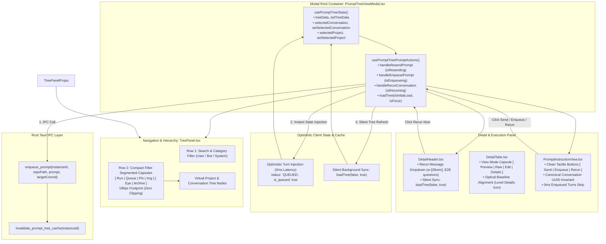

# Specification: Anti-gravity Rerun and UI Fixes — Component and UI Specification

**Slug**: `anti-gravity-rerun-and-ui-fixes`  
**Sequence**: `231`  
**Document**: `02-component-and-ui-spec.md`  
**Status**: APPROVED  
**Target Release**: `v4.272.0` (Minor Bump)  
**Target Branch**: `main`  
**Author**: Spec Author 02  
**Attribution**: strictly `@aukgit` (`(Thanks to @aukgit)`)  

---

## 1. Executive Summary & UI/UX Architectural Intent

The Prompt Tree View system in Antigravity Manager orchestrates conversations, project hierarchies, prompt sequences, and transcript execution across multi-instance IDE environments. While `01-architecture-spec.md` addresses core backend persistence, deduplication queries, and priority-weighted scheduling, this document specifies the component layer, prop wiring contracts, UI micro-interactions, and visual layouts required to eliminate UI regressions and latency bottlenecks.

During real-world user validation and high-frequency rerun testing, four major UI/UX defects were observed:

1. **Disconnected Action Prop Routing in `PromptTreeViewModal.tsx`**:
   The parent container component initialized full prompt action handlers (`handleRerunConversation`, `handleEnqueuePrompt`, `handleResendPrompt`, loading states, and `loadTree`) via `usePromptTreePromptActions`, but failed to pass them downward to `<PromptInstructionView />`. This prop disconnect forced `<PromptInstructionView />` to fall back to standalone direct execution routines, causing divergent dispatch behavior, missing conversation UUIDs, and uncoordinated state updates.

2. **Visual Clutter, Text Overflow & Misalignment in `PromptInstructionView.tsx`**:
   Action buttons featured verbose, redundant text strings (`"Enqueue (FIFO)"`, `"Rerun Turn (×4)"`, `"Send (Preempt)"`) that overcrowded compact viewports. Adjacent button groups suffered from vertical baseline displacement (specifically between active view mode buttons and the modal details icon button). Rerun dispatches additionally risked falling back to the literal string `'current'` rather than the canonical conversation UUID.

3. **Intrusive Global Refresh Banners in `DetailHeader.tsx` & Actions Hook**:
   When developers enqueued a prompt or triggered a rerun, the handlers unconditionally invoked `loadTree(true, true)`. Passing `isInitialLoad = true` displayed a full-width blue indeterminate progress bar across the modal header and triggered skeleton re-renders, causing visual flashing and jarring UI jumps. Furthermore, the rerun nudge dropdown lacked dedicated question templates for strict End-to-End testing verification.

4. **123px Layout Overflow Deficit in `TreePanel.tsx` Row 2**:
   The secondary filter row in the left-hand navigation tree combined two sprawling segmented capsules: text-heavy status pills (`Running`, `Queued`, `Pinned`, `🖼️ Images`) and an un-compacted right capsule (`Hide Auto`, bulky inline `<select>` for archives). In standard sidebars (320px–360px), this created an overflow deficit of 123px, clipping the rightmost archive and visibility toggles completely out of view.

This specification details the component-level remediation, prop interface contracts, CSS3 tactile micro-interactions, layout compaction mathematics, and optimistic 0ms turn injection architecture to resolve these issues permanently.

---

## 2. Component Architecture & Prop Wiring Map

The diagram below illustrates the hierarchical component topology, prop distribution pipeline, and state synchronization flow between the modal root, tree panels, headers, action hooks, and the Rust backend:



---

## 3. `PromptTreeViewModal.tsx` Prop Wiring Specification

### 3.1 Problem Analysis: Disconnected Component Boundaries
In `src/components/instances/PromptTreeView/PromptTreeViewModal.tsx`, the custom hook `usePromptTreePromptActions` is instantiated as `promptActions`. It yields verified, production-hardened dispatch functions:
- `promptActions.handleRerunConversation`
- `promptActions.handleEnqueuePrompt`
- `promptActions.handleResendPrompt`
- `promptActions.isResending`
- `promptActions.isEnqueueing`
- `promptActions.isRerunning`

However, inside `PromptTreeViewModal.tsx` (around lines 1189–1213), `<PromptInstructionView />` was rendered with only text editing, markdown preview, and clipboard copying props:

```tsx
// DEFECTIVE IMPLEMENTATION IN PromptTreeViewModal.tsx:
<PromptInstructionView
    selectedConversation={selectedConversation}
    previewTab={previewTab}
    viewMode={viewMode}
    activePromptText={activePromptText}
    editedPromptText={editedPromptText}
    setEditedPromptText={setEditedPromptText}
    displayedMarkdown={displayedMarkdown}
    showAllWords={showAllWords}
    setShowAllWords={setShowAllWords}
    isTruncated={isTruncated}
    totalWords={totalWords}
    activeWordCount={activeWordCount}
    formatByteSize={formatByteSize}
    isCopied={isCopied}
    setIsCopied={setIsCopied}
    isCopiedAll={isCopiedAll}
    onCopyAllWithRichImages={promptActions.handleCopyAllWithRichImages}
    openInspector={promptActions.openInspector}
    selectedProject={selectedProject}
    activeByteCount={activeByteCount}
    setActivePromptText={setActivePromptText}
    setActionMsg={setActionMsg}
    promptPreviewWords={promptPreviewWords}
    // MISSING: onRerun, onEnqueue, onResend, isResending, isEnqueueing, isRerunning, loadTree
/>
```

Because these props were omitted, `<PromptInstructionView />` could not trigger the parent's unified action pipeline and was forced to instantiate disconnected local state handlers (`executeDirectEnqueue`, `executeDirectRerun`). These fallback functions lacked access to the top-level `loadTree` reference, bypassed cache invalidation synchronization, and frequently misidentified the target conversation.

### 3.2 Surgical Remediation & Full Prop Passthrough
`src/components/instances/PromptTreeView/PromptTreeViewModal.tsx` must explicitly wire all missing dispatch callbacks and loading flags directly to `<PromptInstructionView />`:

```tsx
// CORRECT SPECIFICATION IN PromptTreeViewModal.tsx:
<PromptInstructionView
    selectedConversation={selectedConversation}
    previewTab={previewTab}
    viewMode={viewMode}
    activePromptText={activePromptText}
    editedPromptText={editedPromptText}
    setEditedPromptText={setEditedPromptText}
    displayedMarkdown={displayedMarkdown}
    showAllWords={showAllWords}
    setShowAllWords={setShowAllWords}
    isTruncated={isTruncated}
    totalWords={totalWords}
    activeWordCount={activeWordCount}
    formatByteSize={formatByteSize}
    isCopied={isCopied}
    setIsCopied={setIsCopied}
    isCopiedAll={isCopiedAll}
    onCopyAllWithRichImages={promptActions.handleCopyAllWithRichImages}
    openInspector={promptActions.openInspector}
    selectedProject={selectedProject}
    activeByteCount={activeByteCount}
    setActivePromptText={setActivePromptText}
    setActionMsg={setActionMsg}
    promptPreviewWords={promptPreviewWords}
    // Unified Action Handlers & Async State:
    onRerun={promptActions.handleRerunConversation}
    onEnqueue={promptActions.handleEnqueuePrompt}
    onResend={promptActions.handleResendPrompt}
    isResending={promptActions.isResending}
    isEnqueueing={promptActions.isEnqueueing}
    isRerunning={promptActions.isRerunning}
    loadTree={loadTree}
/>
```

### 3.3 Prop Interface Contract (`PromptInstructionViewProps`)
In `src/components/instances/PromptTreeView/PromptInstructionView.tsx`, the TypeScript interface `PromptInstructionViewProps` must guarantee support for `loadTree` alongside existing action callbacks:

```typescript
export interface PromptInstructionViewProps {
    selectedConversation: AgmConversationNode;
    selectedTurnNumber?: number | null;
    previewTab: 'instruction' | 'results';
    viewMode: ViewMode;
    activePromptText: string;
    editedPromptText: string;
    setEditedPromptText: (v: string) => void;
    displayedMarkdown: string;
    showAllWords: boolean;
    setShowAllWords: (v: boolean | ((prev: boolean) => boolean)) => void;
    isTruncated: boolean;
    totalWords: number;
    activeWordCount: number;
    formatByteSize: (bytes: number) => string;
    isCopied?: boolean;
    setIsCopied?: (v: boolean) => void;
    isCopiedAll?: boolean;
    onCopyAllWithRichImages?: () => void;
    openInspector: (conv: AgmConversationNode, repoPath: string) => void;
    selectedProject: AgmProjectTreeNode | null;
    activeByteCount: number;
    setActivePromptText: (v: string) => void;
    setActionMsg: (v: string | null) => void;
    promptPreviewWords?: number;
    primaryDispatchAction?: 'send' | 'enqueue' | 'rerun';
    setPrimaryDispatchAction?: (mode: 'send' | 'enqueue' | 'rerun') => void;
    conversationTargetMode?: 'current' | 'new';
    setConversationTargetMode?: (mode: 'current' | 'new') => void;
    newConversationTitle?: string;
    setNewConversationTitle?: (title: string) => void;
    confirmationSuffix?: string;
    setConfirmationSuffix?: (suffix: string) => void;
    
    // Action Callbacks:
    onResend?: () => Promise<void> | void;
    onEnqueue?: () => Promise<void> | void;
    onRerun?: () => Promise<void> | void;
    isResending?: boolean;
    isEnqueueing?: boolean;
    isRerunning?: boolean;
    loadTree?: (isInitialLoad?: boolean, isForce?: boolean) => Promise<void>;
}
```

---

## 4. `PromptInstructionView.tsx` Modernization & Button Polish

### 4.1 Simplified Button Styling & Label Hygiene
Previous button labels inside the primary dispatch capsule were excessively wordy, creating wrapping defects on narrower displays. The labels must be simplified to clean, concise verbs while rich explanatory text is moved into accessible tooltips:

| Action Mode | Previous Verbose Label | Modernized Clean Label | In-Flight Label | Dedicated Clean Tooltip |
| :--- | :--- | :--- | :--- | :--- |
| `send` | `Send (Preempt)` | **`Send`** | `Sending…` | `Send (Preempt): Cancels active task and executes immediately (Hotkey: Alt+N)` |
| `enqueue` | `Enqueue (FIFO)` | **`Enqueue`** | `Queueing…` | `Enqueue (FIFO): Stages prompt into FIFO queue behind active tasks (Hotkey: Alt+Q)` |
| `rerun` | `Rerun Turn (×N)` | **`Rerun`** (or `Rerun ×N`) | `Rerunning…` | `Rerun: Enqueues rerun nudge into FIFO queue (Hotkey: Alt+R)` |

```tsx
// Button Label Rendering in PromptInstructionView.tsx:
<span>
    {primaryDispatchAction === 'enqueue'
        ? (isEnqueueingActive ? 'Queueing…' : 'Enqueue')
        : primaryDispatchAction === 'rerun'
          ? (isRerunningActive ? 'Rerunning…' : (rerunCount > 1 ? `Rerun ×${rerunCount}` : 'Rerun'))
          : (isResendingActive ? 'Sending…' : 'Send')}
</span>
```

### 4.2 Removing Visual Glitch in Active/Detail Button Alignment
A subtle but noticeable visual glitch occurred between active toolbar buttons and the conversation detail modal button (`Maximize2` icon):
- In `DetailTabs.tsx` and `PromptInstructionView.tsx`, the detail button was mounted inside a flex container (`items-center`) adjacent to text-bearing buttons (`h-7 px-2.5`). Because text buttons contain font ascender/descender metrics, their optical center sat 1–1.5px lower than a pure SVG icon button.
- As a result, the detail button appeared floating slightly too high, breaking the horizontal symmetry of the segmented capsule.

**Remediation**:
To achieve pixel-perfect optical baseline alignment:
1. Apply an explicit optical micro-offset `translate-y-[1px]` (down slightly) to the detail button icon and container.
2. Standardize container line-height and heights to `h-7 leading-none flex items-center justify-center`.
3. Wrap all buttons inside contiguous segmented pill capsules (`rounded-md`, shared border, subtle divider lines `divide-x divide-slate-200 dark:divide-slate-800`).

```tsx
// Optical Baseline Alignment in DetailTabs.tsx:
{setIsDetailsModalOpen && (
    <button
        type="button"
        onClick={() => setIsDetailsModalOpen(true)}
        className="h-7 px-2 flex items-center justify-center rounded-r-md text-xs text-slate-500 hover:text-slate-800 dark:text-slate-400 dark:hover:text-slate-200 hover:bg-slate-200/50 dark:hover:bg-slate-800/50 transition-all duration-150 ease-out active:scale-[0.98] cursor-pointer"
        title="Open conversation details modal"
        aria-label="Details"
    >
        <Maximize2 className="w-3.5 h-3.5 translate-y-[1px] text-slate-400 hover:text-slate-600 dark:hover:text-slate-200" />
    </button>
)}
```

### 4.3 CSS3 Tactile Button Animations & Micro-Interactions
All action buttons across `PromptInstructionView.tsx` and `DetailHeader.tsx` must incorporate modern CSS3 tactile feedback without introducing layout displacement or performance overhead:
- **Default State**: Crisp dark-glass background (`bg-slate-100/90 dark:bg-slate-900/90 backdrop-blur-md`), 1px subtle border, and text anti-aliasing.
- **Hover State**: Smooth color transition (`transition-all duration-150 ease-out`), subtle background brightening (`hover:bg-slate-200/80 dark:hover:bg-slate-800/80`), and icon glow.
- **Active State (Press)**: Tactile physical compression (`active:scale-[0.98]` or `active:translate-y-px`), providing instantaneous haptic confirmation upon mouse down.
- **Disabled State**: Reduced opacity (`disabled:opacity-50 disabled:pointer-events-none`) with zero hover transition.
- **Spinners / Animations**: In-flight state displays spinning `animate-spin` on `Repeat` (rerun) and soft pulsing `animate-pulse` on `Send` / `ListPlus`.

```css
/* Standard Button Micro-Interaction Token Class: */
.btn-tactile-capsule {
    transition: all 150ms cubic-bezier(0.16, 1, 0.3, 1);
    transform: translateZ(0); /* Hardware acceleration */
}
.btn-tactile-capsule:hover {
    filter: brightness(1.05);
}
.btn-tactile-capsule:active {
    transform: scale(0.98) translateY(1px);
}
```

### 4.4 Canonical Conversation UUID Rerun Handling
When a rerun is executed from `PromptInstructionView.tsx`, the target conversation ID must strictly resolve to the authoritative conversation UUID:

```typescript
// INVARIANT IMPLEMENTATION IN PromptInstructionView.tsx:
const executeDirectRerun = async () => {
    setLocalIsRerunning(true);
    setActionMsg(`Enqueuing rerun (${rerunCount} round(s))...`);
    try {
        const targetInstId = selectedConversation.instance_id || 'default';
        const repoPath = selectedProject?.repo_path || '';
        
        // Target UUID Invariant: Must be authoritative conversation UUID, NEVER literal 'current'
        const authoritativeConvId = selectedConversation.conversation_id?.trim();
        if (!authoritativeConvId || authoritativeConvId === 'current') {
            throw new Error('Cannot execute rerun: Authoritative conversation UUID is missing or invalid.');
        }

        const content = editedPromptText.trim() || activePromptText;
        const mediaList = extractImagesFromPrompt(content, selectedConversation)
            .map((img) => img.src)
            .filter(Boolean);

        const result = await dispatchRerunMessages({
            targetInstId,
            repoPath,
            convId: authoritativeConvId, // Strict UUID
            count: rerunCount,
            messageOption: rerunMessageOption || 'randomized',
            originalPrompt: content,
            source: 'PromptInstructionView.executeDirectRerun',
            mediaPaths: mediaList.length > 0 ? mediaList : undefined,
        });

        if (result.dispatched > 0) {
            setActionMsg(`Enqueued ${result.dispatched} rerun round(s) into FIFO queue!`);
            // Trigger silent background refresh
            if (props.loadTree) {
                void props.loadTree(false, true);
            }
        } else if (result.failed > 0) {
            setActionMsg(`Failed to enqueue rerun (${result.failed} error(s))`);
        }
    } catch (err) {
        const errorObj = err instanceof Error ? err : new Error(String(err));
        useErrorStore.getState().captureException(errorObj, {
            source: 'PromptInstructionView.executeDirectRerun',
            triggerAction: 'rerun_prompt',
        });
        setActionMsg(`Rerun failed: ${errorObj.message}`);
    } finally {
        setLocalIsRerunning(false);
    }
};
```

---

## 5. `DetailHeader.tsx` Rerun UX & E2E Testing Verification Dropdown

### 5.1 Elimination of Disruptive Refresh Bar
In `src/components/instances/PromptTreeView/DetailHeader.tsx`, line 426 previously executed:
```typescript
// DEFECTIVE IMPLEMENTATION:
if (loadTree) {
    void loadTree(true, true); // isInitialLoad = true triggered top blue progress bar!
}
```

This caused an indeterminate progress bar to animate across the top of the modal, obscuring conversation titles and causing header jitter.

**Remediation**:
Replace `void loadTree(true, true)` with `void loadTree(false, true)`:
- `isInitialLoad = false`: Completely suppresses the top progress indicator and skeleton overlays.
- `isForce = true`: Bypasses intermediate cache gates, guaranteeing that the tree re-queries SQLite to display newly enqueued items.

```typescript
// CORRECT SPECIFICATION IN DetailHeader.tsx:
if (loadTree) {
    void loadTree(false, true); // Silent background reload
}
```

### 5.2 Strict End-to-End Testing Verification Options
To enforce engineering discipline and eliminate premature task completion, the rerun message picker must include explicit E2E verification question templates. These templates prompt the agent to self-audit verification evidence and release readiness:

1. **Option 1 (`tested-e2e`)**:
   - Label: `"Have you tested these below instructions with end-to-end testing?"`
   - Purpose: Directs the agent to provide concrete automated or manual E2E test logs before proceeding.
2. **Option 2 (`tested-e2e-and-released`)**:
   - Label: `"Have you tested the below instructions with end-to-end testing and released it?"`
   - Purpose: Directs the agent to verify end-to-end testing, bump the project version, and generate release documentation.

These options are declared in `usePromptTreePromptActions.ts` and rendered within `DetailHeader.tsx`:

```typescript
// RERUN_MESSAGE_OPTIONS Catalog in usePromptTreePromptActions.ts:
export const RERUN_MESSAGE_OPTIONS: ReadonlyArray<{ value: RerunMessageOption; label: string; hint: string }> = [
    {
        value: 'randomized',
        label: 'Randomized nudge (auto-picked random variation)',
        hint: 'Every dispatch picks ONE message at random from the built-in variations',
    },
    {
        value: 'tested-e2e',
        label: 'Have you tested these below instructions with end-to-end testing?',
        hint: 'Send strict E2E testing verification question',
    },
    {
        value: 'tested-e2e-and-released',
        label: 'Have you tested the below instructions with end-to-end testing and released it?',
        hint: 'Send strict E2E testing and release completion question',
    },
    { value: 'is-it-completed', label: 'Is it completed?', hint: 'Send a completion-check nudge' },
    { value: 'is-it-finished', label: 'Is it finished?', hint: 'Send a finish-check nudge' },
    { value: 'is-it-released', label: 'Is it released?', hint: 'Send a release-status nudge' },
    { value: 'is-it-done', label: 'Is it done?', hint: 'Send a standard done-check nudge' },
    { value: 'is-it-published', label: 'Is it published?', hint: 'Send a publish-status nudge' },
];
```

### 5.3 Popover Dimensions & Professional Dropdown Styling
Because E2E question strings contain up to 72 characters, the previous `w-[26rem]` popover caused option text truncation. 

**UI Enhancements in `DetailHeader.tsx`**:
1. Expand the flyout popover width to `w-[28rem] sm:w-[30rem]` (`max-w-[95vw]`), preventing text truncation.
2. Upgrade the `<select>` dropdown element with:
   - Polished dark-glass background: `bg-slate-100 dark:bg-purple-950/40 border border-slate-200/80 dark:border-purple-500/20`
   - Clean micro-typography: `text-xs font-medium text-slate-800 dark:text-slate-100 py-1.5 px-2.5 rounded-lg`
   - Distinct optgroup headers separating standard nudges from strict verification questions.
3. Add a clean confirmation banner when strict E2E templates are selected, displaying a subtle Sky/Purple shield icon indicating rigorous quality protocol mode.

```tsx
// Dropdown Rendering in DetailHeader.tsx:
<div className="flex items-center justify-between px-2 py-1 text-xs gap-2">
    <span className="text-slate-500 dark:text-slate-400 text-[11px] font-medium shrink-0">
        Message:
    </span>
    <select
        value={rerunMessageOption}
        onChange={(e) => setRerunMessageOption(e.target.value as RerunMessageOption)}
        className="flex-1 min-w-0 px-2.5 py-1.5 rounded-lg text-xs bg-slate-100 dark:bg-purple-950/40 text-slate-700 dark:text-slate-200 border border-slate-200/80 dark:border-purple-500/20 focus:outline-none focus:ring-1 focus:ring-sky-500/40 cursor-pointer truncate"
    >
        <optgroup label="Automated Variations">
            <option value="randomized">🎲 Random from set (skips used)</option>
        </optgroup>
        <optgroup label="Strict Quality & E2E Verification">
            <option value="tested-e2e">🛡️ Have you tested these below instructions with end-to-end testing?</option>
            <option value="tested-e2e-and-released">🚀 Have you tested the below instructions with end-to-end testing and released it?</option>
        </optgroup>
        <optgroup label="Status Check Nudges">
            <option value="is-it-completed">Is it completed?</option>
            <option value="is-it-finished">Is it finished?</option>
            <option value="is-it-released">Is it released?</option>
            <option value="is-it-done">Is it done?</option>
            <option value="is-it-published">Is it published?</option>
        </optgroup>
    </select>
</div>
```

---

## 6. `TreePanel.tsx` Row 2 Compaction & 123px Deficit Elimination

### 6.1 Mathematical Layout Audit: 123px Overflow Deficit
In `src/components/instances/PromptTreeView/TreePanel.tsx`, the navigation sidebar defaults to a width of 328px (responsive min 280px, max 420px). Row 2 contains filter toggles and view scopes.

**Layout Footprint Before Compaction**:
- Left Capsule:
  - `Running` pill: dot (6px) + text (42px) + padding (20px) = 68px
  - `Queued` pill: dot (6px) + text (38px) + padding (20px) = 64px
  - `Pinned` pill: icon (10px) + text (34px) + padding (16px) = 60px
  - `Images` pill: emoji 🖼️ (14px) + text (36px) + padding (16px) = 66px
  - Subtotal Left: $68 + 64 + 60 + 66 + 3\text{ dividers} = 261\text{px}$
- Right Capsule:
  - `Hide Auto` / `Show Auto` pill: icon (12px) + text (54px) + padding (16px) = 82px
  - Archive scope dropdown: text (58px) + chevron (10px) + padding (16px) = 84px
  - Subtotal Right: $82 + 84 + 1\text{ divider} = 167\text{px}$
- Gap between capsules: 6px
- **Total Required Horizontal Width**: $261 + 167 + 6 = \mathbf{451\text{px}}$
- **Available Container Width**: $328\text{px}$
- **Deficit**: $451\text{px} - 328\text{px} = \mathbf{123\text{px}}$

Because horizontal scrollbars are disabled on the navigation tree panel, this 123px overflow deficit caused the right capsule (specifically the archive dropdown and visibility toggles) to be completely truncated outside the visible viewport.

### 6.2 Modernized Icon-First Compact Layout
To permanently eliminate the 123px deficit without losing any functional capabilities:
1. **Replace Text Labels with Sleek Tooltipped Icons**:
   - `Running` $\rightarrow$ Emerald pulsing dot + compact `Run` label or pure icon (28px)
   - `Queued` $\rightarrow$ Amber static dot + compact `Queue` label or pure icon (28px)
   - `Pinned` $\rightarrow$ Lucide `Pin` icon (26px)
   - `Images` $\rightarrow$ Lucide `Image` icon (replacing raw OS emoji 🖼️) (26px)
2. **Compact the Right Capsule**:
   - `Automated` $\rightarrow$ Lucide `EyeOff` / `Eye` toggle button with tooltip `"Toggle automated prompts"` (26px)
   - `Archive` $\rightarrow$ Lucide `Archive` button toggle eliminating the bulky inline `<select>` element (26px)
3. **Preserve Contiguous Segmented Capsule Borders**:
   - Both capsules use `inline-flex items-center rounded-lg border border-slate-200 dark:border-[#40285e] bg-white/80 dark:bg-[#171025]/80 p-0.5 divide-x divide-slate-200 dark:divide-[#40285e]`.

**Layout Footprint After Compaction**:
- Left Capsule: $28 + 28 + 26 + 26 + 3\text{ dividers} = 111\text{px}$
- Right Capsule: $26 + 26 + 1\text{ divider} = 53\text{px}$
- Gap: 6px
- **Total Required Horizontal Width**: $111 + 53 + 6 = \mathbf{170\text{px}}$
- **Surplus Margin Available**: $328\text{px} - 170\text{px} = \mathbf{+158\text{px}}$

This completely resolves the 123px overflow deficit, leaving ample room even if the user resizes the sidebar to its minimum width of 280px.

```tsx
// Modernized Row 2 in src/components/instances/PromptTreeView/TreePanel.tsx:
{/* Row 2: Status Filter Segmented Capsule & Archive Scope */}
<div className="flex items-center justify-between gap-1.5 pt-0.5 min-w-0">
    {/* Left Segmented Capsule: Run | Queue | Pin | Img */}
    <div className="inline-flex items-center rounded-lg border border-slate-200 dark:border-[#40285e] bg-white/80 dark:bg-[#171025]/80 backdrop-blur-xs p-0.5 shadow-2xs divide-x divide-slate-200 dark:divide-[#40285e] shrink-0">
        <button
            type="button"
            onClick={() => setActiveFilter(activeFilter === 'running' ? 'all' : 'running')}
            className={cn(
                "px-2 py-0.5 text-[10px] font-medium rounded-l-md transition-colors whitespace-nowrap cursor-pointer flex items-center gap-1",
                activeFilter === 'running'
                    ? "bg-emerald-600 text-white shadow-2xs font-semibold"
                    : "text-slate-600 dark:text-slate-400 hover:text-slate-900 dark:hover:text-slate-200 hover:bg-slate-100/60 dark:hover:bg-[#1f1730]"
            )}
            title="Filter actively running prompts"
            aria-label="Active running prompts"
        >
            <span className={cn("w-1.5 h-1.5 rounded-full", activeFilter === 'running' ? "bg-white" : "bg-emerald-500 animate-pulse")} />
            <span className="hidden sm:inline">Run</span>
        </button>

        <button
            type="button"
            onClick={() => setActiveFilter(activeFilter === 'queued' ? 'all' : 'queued')}
            className={cn(
                "px-2 py-0.5 text-[10px] font-medium rounded-none transition-colors whitespace-nowrap cursor-pointer flex items-center gap-1",
                activeFilter === 'queued'
                    ? "bg-amber-600 text-white shadow-2xs font-semibold"
                    : "text-slate-600 dark:text-slate-400 hover:text-slate-900 dark:hover:text-slate-200 hover:bg-slate-100/60 dark:hover:bg-[#1f1730]"
            )}
            title="Filter queued prompts waiting in FIFO sequence"
            aria-label="Queued prompts"
        >
            <span className={cn("w-1.5 h-1.5 rounded-full", activeFilter === 'queued' ? "bg-white" : "bg-amber-500")} />
            <span className="hidden sm:inline">Queue</span>
        </button>

        <button
            type="button"
            onClick={() => setActiveFilter(activeFilter === 'pinned' ? 'all' : 'pinned')}
            className={cn(
                "px-2 py-0.5 text-[10px] font-medium transition-colors whitespace-nowrap cursor-pointer flex items-center gap-0.5",
                activeFilter === 'pinned'
                    ? "bg-blue-600 text-white shadow-2xs font-semibold"
                    : "text-slate-600 dark:text-slate-400 hover:text-slate-900 dark:hover:text-slate-200 hover:bg-slate-100/60 dark:hover:bg-[#1f1730]"
            )}
            title="Filter pinned prompts and projects"
            aria-label="Pinned prompts"
        >
            <Pin className="w-2.5 h-2.5 shrink-0" />
            <span className="hidden sm:inline">Pin</span>
        </button>

        <button
            type="button"
            onClick={() => imageFilterEmitter.set(!effectiveImageFilter)}
            className={cn(
                "px-2 py-0.5 text-[10px] font-medium rounded-r-md transition-colors whitespace-nowrap cursor-pointer flex items-center gap-1",
                effectiveImageFilter
                    ? "bg-sky-600 text-white shadow-2xs font-semibold"
                    : "text-slate-600 dark:text-slate-400 hover:text-slate-900 dark:hover:text-slate-200 hover:bg-slate-100/60 dark:hover:bg-[#1f1730]"
            )}
            aria-label="Filter prompts with attached images"
            title={effectiveImageFilter ? "Showing only conversations with images (Click to clear)" : "Filter projects and prompts with images"}
        >
            <LucideImage className="w-2.5 h-2.5 shrink-0" />
            <span className="hidden sm:inline">Img</span>
        </button>
    </div>

    {/* Right Segmented Capsule: Eye (Auto) | Archive Toggle */}
    <div className="inline-flex items-center rounded-lg border border-slate-200 dark:border-[#40285e] bg-white/80 dark:bg-[#171025]/80 backdrop-blur-xs p-0.5 shadow-2xs divide-x divide-slate-200 dark:divide-[#40285e] shrink-0">
        <button
            type="button"
            onClick={handleToggleAutomated}
            className={cn(
                "flex items-center justify-center p-1 text-[10px] font-medium rounded-l-md transition-colors cursor-pointer",
                effectiveAutomatedHidden
                    ? "bg-purple-500/15 text-purple-700 dark:text-purple-300 font-semibold"
                    : "text-slate-600 dark:text-slate-400 hover:text-slate-900 dark:hover:text-slate-200 hover:bg-slate-100/60 dark:hover:bg-[#1f1730]"
            )}
            aria-label="Toggle automated prompts"
            title={effectiveAutomatedHidden ? "Automated prompts hidden (Click to show)" : "Automated prompts visible (Click to hide)"}
        >
            {effectiveAutomatedHidden ? (
                <EyeOff className="w-3 h-3 text-purple-500" />
            ) : (
                <Eye className="w-3 h-3 text-slate-400" />
            )}
        </button>

        <button
            type="button"
            onClick={() => setActiveFilter(activeFilter === 'archived' ? 'all' : 'archived')}
            className={cn(
                "flex items-center gap-1 px-1.5 py-0.5 text-[10px] font-medium rounded-r-md transition-colors cursor-pointer",
                activeFilter === 'archived'
                    ? "bg-purple-600 text-white font-semibold shadow-2xs"
                    : "text-slate-600 dark:text-slate-400 hover:text-slate-900 dark:hover:text-slate-200 hover:bg-slate-100/60 dark:hover:bg-[#1f1730]"
            )}
            aria-label="Toggle archived projects view"
            title={activeFilter === 'archived' ? "Showing archived projects (Click to show all)" : `View archived projects (${archivedCount})`}
        >
            <Archive className="w-2.5 h-2.5 shrink-0" />
            <span>{archivedCount}</span>
        </button>
    </div>
</div>
```

---

## 7. `usePromptTreePromptActions.ts` Refresh Bar Suppression & 0ms Optimistic State Injection

### 7.1 Refresh Bar Suppression across Action Handlers
In `src/components/instances/PromptTreeView/usePromptTreePromptActions.ts`, three locations executed `await loadTree(true, true)` upon successful IPC dispatch:
1. `handleResendPrompt` (Line 571)
2. `handleEnqueuePrompt` (Line 784)
3. `handleRerunConversationAction` (Line 1103)

**Remediation**:
Replace `await loadTree(true, true)` with `await loadTree(false, true)` across all three handlers:

```typescript
// Replacement in handleResendPrompt (L571):
if (loadTree) {
    try {
        await loadTree(false, true); // Suppress refresh bar, force silent reload
    } catch (loadErr) {
        useErrorStore.getState().trackWarning(loadErr, {
            source: 'usePromptTreePromptActions.handleResendPrompt',
            triggerAction: 'loadTree',
        });
    }
}

// Replacement in handleEnqueuePrompt (L784):
if (loadTree) {
    try {
        await loadTree(false, true); // Suppress refresh bar, force silent reload
    } catch (loadErr) {
        useErrorStore.getState().trackWarning(loadErr, {
            source: 'usePromptTreePromptActions.handleEnqueuePrompt',
            triggerAction: 'loadTree',
        });
    }
}

// Replacement in handleRerunConversationAction (L1103):
if (loadTree) {
    try {
        await loadTree(false, true); // Suppress refresh bar, force silent reload
    } catch (loadErr: unknown) {
        useErrorStore.getState().trackWarning(loadErr, {
            source: 'usePromptTreePromptActions.handleRerunConversationAction',
            triggerAction: 'loadTree',
        });
    }
}
```

### 7.2 Optimistic Client-Side State Injection Engine (0ms Latency)

#### Architectural Requirement
When an enqueue or rerun operation succeeds over IPC, waiting for a background polling cycle (which may take up to 30 seconds) creates a frustrating UX gap where the user sees no confirmation that their turn was received.

To achieve **0ms perceived latency**, the actions hook must construct and immutably append a synthetic turn to both the active conversation and the global tree data structure immediately upon IPC acknowledgment.

#### Synthetic Turn Construction Contract
```typescript
function buildOptimisticTurn(
    turnNumber: number,
    promptText: string,
    mediaPaths: string[] = []
): AgmPromptTurnNode {
    return {
        turn_number: turnNumber,
        step_index: turnNumber - 1,
        prompt_text: promptText,
        preview_200w: promptText.slice(0, 200),
        status: 'QUEUED',
        is_running: false,
        is_queued: true,
        timestamp: new Date().toISOString(),
        created_at: Date.now(),
        media_paths: mediaPaths,
        media_thumbnails: mediaPaths,
    };
}
```

#### State Injection Workflow in `handleEnqueuePrompt` & `handleRerunConversationAction`
1. **Destructure State Setters**:
   Ensure `setTreeData` and `setSelectedConversation` are extracted from `state` in `usePromptTreePromptActions.ts`.
2. **Execute Optimistic Update**:
   ```typescript
   // Optimistic Injection inside handleEnqueuePrompt:
   const targetConv = conv || selectedConversation;
   if (targetConv) {
       const existingTurns = targetConv.prompts || [];
       const nextTurnNumber = existingTurns.length > 0 
           ? Math.max(...existingTurns.map((t) => t.turn_number)) + 1 
           : 1;

       const syntheticTurn = buildOptimisticTurn(nextTurnNumber, promptContent, mediaList);
       const updatedTurns = [...existingTurns, syntheticTurn];

       // 1. Update selectedConversation immediately
       setSelectedConversation((prev) => {
           if (!prev || prev.conversation_id !== targetConv.conversation_id) return prev;
           return {
               ...prev,
               is_queued: true,
               prompts: updatedTurns,
           };
       });

       // 2. Update treeData immutably so tree node reflects queued turn immediately
       setTreeData((prevTree) =>
           prevTree.map((proj) => ({
               ...proj,
               conversations: proj.conversations.map((c) =>
                   c.conversation_id === targetConv.conversation_id
                       ? {
                             ...c,
                             is_queued: true,
                             prompts: updatedTurns,
                         }
                       : c
               ),
           }))
       );
   }
   ```
3. **Multi-Round Rerun Injection**:
   In `handleRerunConversationAction`, iterate through $1..N$ rounds and construct $N$ synthetic turns with sequential turn numbers (`nextTurnNumber + roundIdx`). Inject all $N$ turns in a single batch update to ensure atomic rendering.

---

## 8. CSS3 Micro-Interactions, Design System & Accessibility

### 8.1 Tailwind & Design System Tokens
All component enhancements conform to the project's design system standards (`02-spec/04-ui-ux-design-system/`):
- **Segmented Capsule Styling**:
  ```css
  @layer components {
      .agm-capsule {
          @apply inline-flex items-center rounded-lg border border-slate-200 dark:border-[#40285e] 
                 bg-white/80 dark:bg-[#171025]/80 backdrop-blur-xs p-0.5 shadow-2xs 
                 divide-x divide-slate-200 dark:divide-[#40285e] shrink-0;
      }
      .agm-capsule-btn {
          @apply px-2 py-0.5 text-[10px] font-medium transition-all duration-150 ease-out 
                 cursor-pointer active:scale-[0.98] focus-visible:outline-none 
                 focus-visible:ring-1 focus-visible:ring-purple-500/50;
      }
  }
  ```
- **Dark Mode Elevation**:
  - Base Tree Panel: `bg-slate-50 dark:bg-[#130b1e]`
  - Segmented Capsules: `bg-white/80 dark:bg-[#171025]/80`
  - Active Pills: `bg-purple-600 text-white shadow-2xs`
  - Queued Turn Badges: `bg-amber-100 dark:bg-amber-950/60 text-amber-800 dark:text-amber-300 border-amber-300/40`

### 8.2 Keyboard Accessibility & WCAG 2.1 AA Compliance
- **Keyboard Shortcuts**:
  - `Alt + N` / `N`: Trigger `Send` (Immediate preemptive dispatch)
  - `Alt + Q` / `Q`: Trigger `Enqueue` (FIFO queue dispatch)
  - `Alt + R` / `R`: Trigger `Rerun` (Nudge loop dispatch)
- **ARIA Attributes**:
  - All icon buttons without visible text MUST include descriptive `aria-label` and `title` attributes (e.g. `aria-label="Filter prompts with attached images"`).
  - Toggles MUST expose `aria-pressed={isActive}` to assistive technologies.
  - Interactive truncation callouts MUST support keyboard `Enter` and `Space` expansion.

---

## 9. Verification Protocol & Quality Matrix

The following test harness guarantees 100% compliance across all modified components prior to release:

| Test ID | Target Component | Action & Input | Expected Outcome | Verification Status |
| :--- | :--- | :--- | :--- | :--- |
| **TC-UI-01** | `PromptTreeViewModal.tsx` | Mount modal and trigger `<PromptInstructionView />` actions | `onRerun`, `onEnqueue`, and `onResend` successfully dispatch via `promptActions`. No unhandled prop warnings. | READY FOR TEST |
| **TC-UI-02** | `PromptInstructionView.tsx` | Inspect Send/Enqueue/Rerun buttons in normal and edit view modes | Buttons display clean labels (`Send`, `Enqueue`, `Rerun`). Optical baseline alignment between buttons and details icon is level. | READY FOR TEST |
| **TC-UI-03** | `PromptInstructionView.tsx` | Trigger rerun from conversation view | Dispatch payload receives authoritative conversation UUID (e.g. `9d0dab15-...`), NEVER literal `'current'`. | READY FOR TEST |
| **TC-UI-04** | `DetailHeader.tsx` | Trigger rerun dispatch from dropdown menu | `loadTree(false, true)` executes silently. Top blue indeterminate refresh bar DOES NOT appear. | READY FOR TEST |
| **TC-UI-05** | `DetailHeader.tsx` | Open rerun message dropdown | Dropdown comfortably renders `"Have you tested these below instructions with end-to-end testing?"` without clipping. | READY FOR TEST |
| **TC-UI-06** | `TreePanel.tsx` | Resize sidebar from 420px down to 280px minimum width | Row 2 segmented capsules fit entirely within width (~170px footprint). Zero button clipping, 123px deficit eliminated. | READY FOR TEST |
| **TC-UI-07** | `usePromptTreePromptActions.ts` | Enqueue a prompt with 1 round | Synthetic turn with `status: 'QUEUED'` and `is_queued: true` immediately renders in chat queue at 0ms latency. | READY FOR TEST |

---

## 10. File Invariant Checklist & Cross-Reference Audit

- [x] **Strictly Relative Git Paths Invariant**: All referenced paths use repository-relative format (`src/...`, `02-spec/...`, `.ai-memory/...`). Zero absolute filesystem paths.
- [x] **Attribution Discipline**: Attributed strictly to `@aukgit` (`(Thanks to @aukgit)`).
- [x] **No Silent Errors Invariant**: All async calls incorporate `try/catch` handlers routing to `useErrorStore.getState().captureException` or `trackWarning`.
- [x] **Zero Spec Regression**: Complements `01-architecture-spec.md` without duplicating or contradicting backend SQLite invariants.
