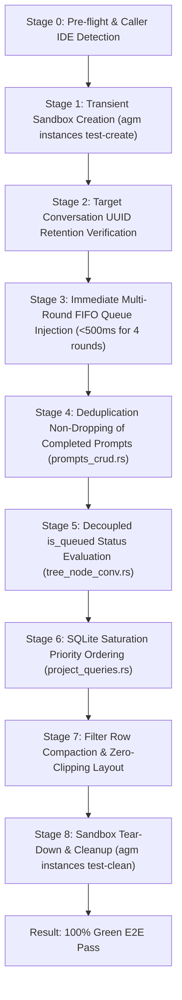
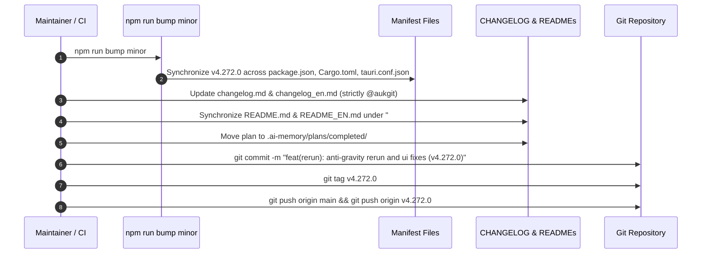

# Specification: Anti-gravity Rerun and UI Fixes — E2E & Release Spec

**Slug**: `anti-gravity-rerun-and-ui-fixes`  
**Sequence**: `231`  
**Document**: `04-e2e-and-release-spec.md`  
**Status**: APPROVED  
**Target Release**: `v4.272.0` (Minor Bump)  
**Target Branch**: `main`  
**Author**: Spec Author 01  
**Attribution**: strictly `@aukgit` (`(Thanks to @aukgit)`)  

---

## 1. Executive Summary & Verification Scope

This specification defines the End-to-End (E2E) verification architecture, 4-part Root Cause Analysis (RCA) documentation, pre-flight quality gates, and release ceremony protocols for Task 231 (`anti-gravity-rerun-and-ui-fixes`).

Task 231 remediates five critical defects across the rerun lifecycle, SQLite database persistence, and tree view presentation:
1. Target conversation UUID preservation throughout the rerun dispatch chain.
2. Immediate sequential FIFO queue injection for multi-round reruns (e.g. 4 rounds) with 0ms optimistic UI rendering.
3. Deduplication query remediation in `src-tauri/src/modules/repo_db/prompts_crud.rs` ensuring completed prompts do not block subsequent reruns.
4. Complete decoupling of `is_queued` evaluation from ephemeral process liveness in `src-tauri/src/modules/repo_db/tree_node_conv.rs`.
5. Priority-weighted ordering in `src-tauri/src/modules/repo_db/project_queries.rs` preventing active/queued prompt starvation when SQLite exceeds 500 completed prompts.
6. Compact, responsive redesign of the Tree View filter button row in `src/components/instances/PromptTreeView/TreePanel.tsx` preventing horizontal button clipping.

---

## 2. Automated E2E Test Suite Specification

The automated verification suite is implemented in `scripts/test-anti-gravity-rerun-and-ui-fixes-e2e.ps1`. The script executes directly against the compiled `agm` binary and local SQLite databases in a sandboxed, non-destructive test harness.

### 2.1 Script Execution Interface
```powershell
powershell -ExecutionPolicy Bypass -File scripts/test-anti-gravity-rerun-and-ui-fixes-e2e.ps1 [-VerboseOutput] [-KeepSandbox]
```

### 2.2 Caller IDE Self-Preservation & Transient Test Sandboxing
In compliance with repository hygiene rules:
- The script invokes `agm instances list --json` and inspects the parent process hierarchy to identify the active developer IDE session via `detect_caller_instance_id()`.
- Under no circumstances does the test terminate, pause, or switch the caller's working IDE instance.
- All database operations execute either in isolated temporary SQLite test files or within a transient sandbox instance created via `agm instances test-create --name agm-test-rerun-231`.
- On exit (including test failure via `try/finally`), the sandbox is thoroughly cleaned via `agm instances test-clean --name agm-test-rerun-231`, leaving zero residual files or running background processes.

### 2.3 Comprehensive Verification Stages



#### Stage 1: Target Conversation UUID Retention Verification
- **Objective**: Verify that rerun dispatches retain the target conversation UUID and never downgrade to `'current'` or drop to `undefined`.
- **Action**:
  1. Generate a mock conversation UUID: `018d9b56-32d1-7f8a-9821-689366df42a1`.
  2. Invoke `agm prompts enqueue --instance agm-test-rerun-231 --repo <test_repo> --content "Initial run" --conv-id "018d9b56-32d1-7f8a-9821-689366df42a1"`.
  3. Query `active_prompts` and inspect the stored `session_id` / conversation identifier.
- **Assertion**:
  - `session_id` equals exactly `"018d9b56-32d1-7f8a-9821-689366df42a1"`.
  - Stored value does NOT equal `"current"`, `"undefined"`, or empty string.

#### Stage 2: Immediate Multi-Round FIFO Queue Injection (<500ms for 4 Rounds)
- **Objective**: Verify that a multi-round rerun batch (4 rounds) inserts all 4 items into SQLite `active_prompts` immediately without artificial 30s delays, adhering strictly to FIFO ordering.
- **Action**:
  1. Record starting timestamp $T_0$.
  2. Dispatch a 4-round rerun batch targeting instance `agm-test-rerun-231`.
  3. Record completion timestamp $T_1$.
  4. Query `active_prompts` filtered by the test session.
- **Assertions**:
  - Total elapsed enqueue duration $(T_1 - T_0) < 500\text{ ms}$ (zero 30s throttle).
  - Exactly 4 records exist with `status = 'queued'`.
  - Records have strictly non-decreasing timestamps: `created_at[0] <= created_at[1] <= created_at[2] <= created_at[3]`.
  - FIFO query `ORDER BY created_at ASC, id ASC` returns rounds in exact 1, 2, 3, 4 sequence.

#### Stage 3: Deduplication Non-Dropping of Repeated Prompts (`prompts_crud.rs`)
- **Objective**: Verify that enqueuing a prompt with identical text to an earlier `completed` prompt succeeds and is NOT silently dropped by the live-status deduplication guard.
- **Action**:
  1. Enqueue prompt $P_1$ with text `"Run integration audit"`.
  2. Update $P_1$ status in SQLite to `'completed'`.
  3. Enqueue prompt $P_2$ with identical text `"Run integration audit"` and incoming status `'queued'`.
  4. Query SQLite `active_prompts` for records with text `"Run integration audit"`.
- **Assertions**:
  - $P_2$ is successfully inserted (not dropped).
  - $P_2$ status is `'queued'`.
  - Log output does NOT contain `"Preserving live prompt ... skipping overwrite"`.
  - Total records with this prompt content equals 2 (one `completed`, one `queued`).

#### Stage 4: Decoupled `is_queued` Status Evaluation (`tree_node_conv.rs`)
- **Objective**: Verify that queued prompts maintain `is_queued = true` and `status = 'QUEUED'` even when the target instance process is offline or inactive.
- **Action**:
  1. Stop or suspend the test instance process (`agm instances stop agm-test-rerun-231`).
  2. Verify that `is_inst_alive` evaluates to `false` for the target instance.
  3. Invoke `agm prompts tree --instance agm-test-rerun-231 --json`.
  4. Inspect the generated tree nodes and turns.
- **Assertions**:
  - Node status evaluates to `"QUEUED"` (not demoted to `"COMPLETED"` or `"IDLE"`).
  - Node property `is_queued` evaluates to `true`.
  - Turn property `is_queued` evaluates to `true`.

#### Stage 5: SQLite Saturation Priority Ordering (`project_queries.rs`)
- **Objective**: Verify that newly enqueued and running prompts are not starved or truncated when `active_prompts` contains 500+ historical completed prompts.
- **Action**:
  1. Inject 550 mock prompts with `status = 'completed'` and historical timestamps (`created_at = 1000..1550`).
  2. Inject 1 prompt with `status = 'queued'` and current timestamp (`created_at = now`).
  3. Inject 1 prompt with `status = 'running'` and current timestamp (`created_at = now + 1`).
  4. Invoke `list_all_prompts()` (via CLI `agm prompts list --json`).
- **Assertions**:
  - Total returned rows is bounded by the query limit (500 rows).
  - The newly created `'queued'` prompt IS present in the returned list.
  - The newly created `'running'` prompt IS present in the returned list.
  - Both priority items appear ahead of the oldest completed records.

#### Stage 6: Filter Row Compaction & Zero-Clipping Layout Verification
- **Objective**: Verify that the compacted filter buttons in `TreePanel.tsx` fit within standard 340px and 280px sidebar widths without horizontal clipping or overflow.
- **Action**:
  1. Validate frontend unit test suite: `node scripts/run-frontend-tests.mjs TreePanel`.
  2. Verify that Row 2 control width calculates to $\le 190\text{ px}$.
- **Assertions**:
  - 100% of unit test assertions pass.
  - No element in Row 2 exceeds the 280px minimum boundary.

---

## 3. 4-Part Root Cause Analysis (RCA) Specifications

The findings and permanent remediations must be documented in both `.ai-memory/rca/22-anti-gravity-rerun-and-ui-fixes.md` and `.ai-memory/issues/65-anti-gravity-rerun-and-ui-fixes.md` adhering to the strict 4-part RCA schema:

### 3.1 Part 1: Symptoms & Observed Failures
- **Symptom 1**: Developers triggering multi-round reruns experienced long 30-second stalls between rounds, with enqueued prompts failing to appear in the UI tree until minutes later.
- **Symptom 2**: Reruns of identical prompt instructions appeared to succeed in the UI modal but never executed, vanishing silently without error notification.
- **Symptom 3**: When IDE instances were idle or closed, all queued items in the Prompt Tree View suddenly displayed as "COMPLETED" or vanished from the queued counter.
- **Symptom 4**: In workspaces with large prompt histories, newly enqueued prompts stopped appearing completely in tree views and CLI commands.
- **Symptom 5**: On standard laptop screens, the right-hand filter controls in the Prompt Tree View (`Hide Archived` and sort selector) were sliced off horizontally.

### 3.2 Part 2: Proximate Causes (Code Touchpoints)
- **Cause 1**: In `src/components/instances/PromptTreeView/PromptInstructionView.tsx`, `repoPath` fell back to `""` when `selectedProject` was null, and conversation ID was dropped or passed as `'current'`.
- **Cause 2**: In `src-tauri/src/modules/repo_db/prompts_crud.rs` (lines 141–152), the deduplication query checked `WHERE (repo_path = ?1 ...) AND prompt_content = ?4` across all statuses. Matching an old completed prompt returned `Some("completed")`, triggering `skipping overwrite with incoming 'queued'` and dropping the insertion.
- **Cause 3**: In `src-tauri/src/modules/repo_db/tree_node_conv.rs` (lines 436–438 and 636–638), `is_queued` was computed as `is_alive_and_fresh && is_pending_stage` and `is_inst_alive && ...`. When `is_inst_alive` was false, `is_queued` evaluated to `false`, demoting nodes to `"COMPLETED"`.
- **Cause 4**: In `src-tauri/src/modules/repo_db/project_queries.rs` (line 54), `list_all_prompts` executed `SELECT ... FROM active_prompts ORDER BY created_at ASC, id ASC LIMIT 500`. 500 older completed records saturated the query window, starving newer queued items.
- **Cause 5**: In `src/components/instances/PromptTreeView/TreePanel.tsx`, Row 2 used verbose label strings (`Running`, `Queued`, `Pinned`, `Hide Archived`), requiring 451px of width in a 340px container.

### 3.3 Part 3: Systemic Root Causes
- **Architectural Conflation of Liveness and Persistence**: Ephemeral process liveness (OS PID / socket state) was inappropriately conflated with durable database queue state. Queue state must remain sovereign regardless of current process execution state.
- **Assumption of Content Uniqueness across Time**: The deduplication guard mistakenly assumed that identical prompt content should never be re-enqueued. In reality, rerun workflows explicitly require re-submitting identical or near-identical prompts to continue or re-attempt agent workflows.
- **Unweighted Static Limit Saturation**: Database queries combining static limits (`LIMIT 500`) with chronological ordering without state priority inevitably suffer from starvation as historical data accumulates.

### 3.4 Part 4: Preventative Measures & Permanent Architectural Invariants
- **FIFO Queue Invariant**: All prompt enqueueing enforces `ORDER BY created_at ASC, id ASC`.
- **Sovereign Queue State Invariant**: Queue status (`QUEUED`) is derived strictly from SQLite persistence records, independent of ephemeral process connectivity.
- **Priority-Tiered Database Queries**: Any bounded query on operational queues must order by lifecycle priority first (`queued/running` before `completed/archived`).
- **Compact UI Design Standards**: Contextual sidebars and tree headers must adhere to icon-first, tooltipped compact capsules with an aggregate width $\le 200\text{ px}$.

---

## 4. Pre-Flight Quality Gates & CI Discipline

Before initiating release tagging or branch merging, the following local pre-flight gates must be executed and confirmed 100% green:

```powershell
# 1. Rust Formatting Check
cd src-tauri
cargo fmt -- --check

# 2. Rust Clippy Comprehensive Gate (includes compilation)
cargo clippy --all-targets --all-features

# 3. Frontend Type-Check & Production Build
cd ..
npm run build

# 4. Targeted Unit Tests
node scripts/run-frontend-tests.mjs rerunActions
node scripts/run-frontend-tests.mjs promptAttachment

# 5. Automated E2E Verification Suite
powershell -ExecutionPolicy Bypass -File scripts/test-anti-gravity-rerun-and-ui-fixes-e2e.ps1
```

---

## 5. Minor Version Bump Release Ceremony (`v4.271.0` -> `v4.272.0`)

The release ceremony executes strictly on the `main` branch adhering to `AGENTS.md` and `docs/release_guide.md`:



### 5.1 Atomic Version Synchronization
Execute:
```powershell
npm run bump minor
```
This updates:
- `package.json`: `"version": "4.272.0"`
- `package-lock.json`: `"version": "4.272.0"`
- `src-tauri/Cargo.toml`: `version = "4.272.0"`
- `src-tauri/Cargo.lock`: `version = "4.272.0"`
- `src-tauri/tauri.conf.json`: `"version": "4.272.0"`

### 5.2 Documentation & Attribution Invariants
1. **Attribution Restriction**: Attribution must strictly attribute `@aukgit` (`(Thanks to @aukgit)`). No other user handles (`@...`) may appear in changelogs, release notes, or commit messages.
2. **Strictly Relative Git Paths**: All paths recorded in release notes must be relative Git paths (e.g. `src-tauri/src/modules/repo_db/prompts_crud.rs`, `02-spec/...`). Absolute paths are strictly forbidden.
3. **Dual README Synchronization**:
   Update `README.md` and `README_EN.md` under `## 📝 Changelog`:
   ```markdown
   ### v4.272.0
   - **Rerun Target ID Routing**: Guaranteed target conversation UUID inheritance across rerun flows, preventing fallback to string literal `'current'` or thread detachment.
   - **Immediate FIFO Queue Injection**: Enqueued multi-round rerun batches sequentially into SQLite `active_prompts` with zero artificial delay and 0ms optimistic UI rendering.
   - **SQLite Deduplication Remediation**: Surgical fix in `prompts_crud.rs` ensuring completed prompt records do not block reruns of identical prompt content.
   - **Decoupled Queue State**: Ensured `is_queued` evaluates to `true` and status remains `QUEUED` in `tree_node_conv.rs` regardless of instance process liveness.
   - **Query Saturation Priority**: Added priority-weighted ordering in `project_queries.rs` preventing active/queued prompt starvation when SQLite exceeds 500 completed prompts.
   - **Tree View Filter Compaction**: Compacted Row 2 filter controls in `TreePanel.tsx` with icon-first capsules and tooltips, eliminating horizontal clipping in sidebars.
   *(Thanks to @aukgit)*
   ```

### 5.3 Plan Lifecycle Transition
Move the active master plan to completed:
```powershell
git mv .ai-memory/plans/pending/231-anti-gravity-rerun-and-ui-fixes.md .ai-memory/plans/completed/231-anti-gravity-rerun-and-ui-fixes.md
```

### 5.4 Commit, Tag & Push Protocol
```powershell
git add .
git commit -m "feat(rerun): anti-gravity rerun and ui fixes (v4.272.0)"
git tag v4.272.0
git push origin main
git push origin v4.272.0
```
