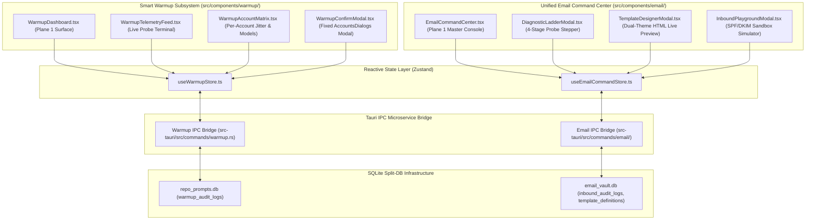

# Architecture Specification: Smart Warmup & Unified Email Command Center

> **/goal** Modernize and decouple the Smart Warmup subsystem and Emailing subsystem in Antigravity-Manager into reactive, developer-first command centers. Deliver live telemetry feeds, countdown clocks, account matrix controls, a multi-stage email diagnostic ladder, dual-theme visual template designer, and inbound remote command playground, backed by dedicated SQLite Split-DB telemetry and robust headless CLI parity.
> **/learn** Enforce zero UI freeze states, eliminate silent modal omissions in `AccountsDialogs.tsx`, uphold strict 4-Plane depth hierarchy, maintain segmented pill capsule ergonomics with transparent borderless inputs, ensure FIFO queue invariants, and establish identical telemetry and control interfaces across desktop GUI and headless CLI.

**Module:** `warm-up-ui-and-emailing-ui-improvements`  
**Sequence:** `232`  
**Version:** `4.272.0`  
**Status:** `Active`  
**Author:** `@aukgit`  
**AI Confidence:** `Production-Ready`  
**Ambiguity:** `None`  

---

## 1. Executive Overview & Problem Statement

The Antigravity-Manager (AGM) operational environment relies heavily on two background service domains:
1. **7-Day Weekly Quota Smart Warmup**: Scheduled and manual warmup probes against target LLM models across active Google Gemini/Antigravity accounts, initiating weekly quota clocks to prevent cold quota expiration.
2. **Unified Email Automation Subsystem**: Alert dispatching, quota monitoring, IMAP inbound remote command parsing, and remote workspace orchestration.

Despite their core operational necessity, their existing implementations suffer from significant architectural limitations:
- **Monolithic & Static Warmup UI**: `src/components/settings/SmartWarmup.tsx` is an isolated, 128-line static toggle with basic model checkboxes. It provides zero visibility into execution telemetry, historical token expenditure, next scheduled reset countdowns, or per-account warmup success metrics.
- **Silent Modal Omission in Account Views**: In `src/pages/Accounts.tsx`, clicking the Warmup button triggers `setIsWarmupConfirmOpen(true)`, but `src/pages/accounts/AccountsDialogs.tsx` completely lacks the `isWarmupConfirmOpen` modal binding, causing a silent no-op where user actions are dropped without feedback.
- **Fragmented Email Settings & Lack of Diagnostics**: `src/components/settings/EmailNotificationSettings.tsx` acts as an uncoordinated list of disjointed cards. Operators cannot diagnose connectivity faults (DNS MX resolution, TLS handshakes, SMTP auth, IMAP responsiveness) without reviewing raw log files.
- **Static Inbound Command Configuration**: Inbound email command processing lacks testability. Operators cannot simulate inbound emails or verify SPF/DKIM authorization rules before exposing daemons to production mailboxes.
- **Absence of Headless CLI Parity**: The terminal CLI (`agm`) lacks unified, high-speed inspection commands for warmup telemetry and email diagnostics, violating AGM's headless-first architecture.

This specification details the comprehensive architectural modernization of both subsystems, establishing reactive component trees, dedicated Zustand state engines, typed Rust IPC microservice commands, Split-DB telemetry tables, and full terminal CLI parity.

---

## 2. Architectural Root Cause Analysis (RCA)

### 2.1 RCA 1: Silent Action Drop in `AccountsDialogs.tsx` (`isWarmupConfirmOpen`)
- **Vulnerability Location**: `src/pages/Accounts.tsx` (lines 220–240), `src/pages/accounts/useAccountsState.ts` (lines 85–86), and `src/pages/accounts/AccountsDialogs.tsx` (lines 17–83).
- **Failure Mechanism**:
  `useAccountsState` declares `isWarmupConfirmOpen` and `isWarmuping`. In `Accounts.tsx`, the Warmup toolbar button binds `onClick={() => setIsWarmupConfirmOpen(true)}`. However, `AccountsDialogs.tsx` omits `isWarmupConfirmOpen` from its destructured props and contains no `ModalDialog` or confirmation container for warmup execution.
- **Impact**: Operators clicking the Warmup button experience a complete lack of response. No dialog opens, no IPC command fires, and no feedback appears.
- **Architectural Remedy**:
  Mount a dedicated `WarmupConfirmModal` inside `AccountsDialogs.tsx`, wired to `state.isWarmupConfirmOpen`, `state.selectedIds`, and `handlers.handleWarmupAll`. Provide immediate feedback, account count summaries, quota cost estimates, and real-time execution progress.

### 2.2 RCA 2: Static Warmup State & Lack of Real-Time Telemetry
- **Vulnerability Location**: `src/components/settings/SmartWarmup.tsx` and `src-tauri/src/modules/quota/warmup.rs`.
- **Failure Mechanism**:
  Warmup execution runs fire-and-forget background HTTP calls (`/internal/warmup`). The frontend receives no streaming telemetry, token consumption data, or countdown to the 7-day weekly reset period. Operators cannot determine if a scheduled warmup succeeded or failed without scanning filesystem logs.
- **Architectural Remedy**:
  Decompose `SmartWarmup.tsx` into a modular suite (`WarmupDashboard.tsx`, `WarmupTelemetryFeed.tsx`, `WarmupAccountMatrix.tsx`). Persist execution metrics to `warmup_audit_logs` in `repo_prompts.db`, and stream live progress via Tauri event emitter `warmup://telemetry`.

### 2.3 RCA 3: Black-Box Email Failure Modes & Unverifiable Inbound Execution
- **Vulnerability Location**: `src-tauri/src/modules/email_watcher/` and `src-tauri/src/modules/email_inbound/`.
- **Failure Mechanism**:
  When email notifications fail, operators face ambiguous errors with no step-level isolation. Furthermore, inbound command handling executes directly against production mailboxes with no staging or validation playground.
- **Architectural Remedy**:
  Introduce a structured 4-step Diagnostic Ladder (`run_diagnostic_ladder`) and a dedicated Inbound Remote Command Simulator (`simulate_inbound_command`) in `src-tauri/src/commands/email/`, surfaced through `DiagnosticLadderModal.tsx` and `InboundPlaygroundModal.tsx`.

---

## 3. Architectural Foundations & Component Hierarchy

### 3.1 Component Architecture Map



### 3.2 Warmup UI Component Decomposition
1. **`src/components/warmup/WarmupDashboard.tsx`**:
   - Master status banner with animated pulse wave indicator (Active / Idle / Quota Resetting).
   - Global toggle with segmented pill capsule controls.
   - Next scheduled reset countdown clock (e.g., `04d 18h 32m 14s`) with sub-second high-resolution timer.
   - 24-hour token consumption gauge with threshold alarms.
2. **`src/components/warmup/WarmupTelemetryFeed.tsx`**:
   - Real-time probe streaming log visualizer with auto-scroll lock.
   - 4-Tier origin badge tagging: `USER_PROMPT` (Manual trigger), `SUBAGENT_INSTRUCTION` (Warmup probe), `SYSTEM_MESSAGE` (Scheduler event), `TOOL_OUTPUT` (Token response).
   - Interactive omission banners for large responses (`⚡ [Omitted N bytes of payload - Click to expand]`).
3. **`src/components/warmup/WarmupAccountMatrix.tsx`**:
   - Multi-account grid with per-account model selection chips (`gemini-2.5-pro`, `gemini-2.5-flash`, etc.).
   - Quota reserve threshold guards (configurable 5%–30% cutoff).
   - Staggered schedule jitter sliders (0–120s) to distribute outbound traffic and avoid rate limits.
4. **`src/components/warmup/WarmupConfirmModal.tsx` & `src/pages/accounts/AccountsDialogs.tsx`**:
   - Restoration of missing confirmation modal in `AccountsDialogs.tsx`.
   - Dynamic confirmation context: single account warmup vs. batch selection vs. all accounts.
   - Pre-flight validation display: token validity, active proxy port, and estimated execution duration.

### 3.3 Emailing UI Component Decomposition
1. **`src/components/email/EmailCommandCenter.tsx`**:
   - Modernized command center replacing flat card stacks in `EmailNotificationSettings.tsx`.
   - Active watcher daemon status card with uptime clock and heartbeat monitors.
   - Segmented action toolbar: `Run Diagnostics`, `Design Templates`, `Inbound Sandbox`, `Manage Mailboxes`.
2. **`src/components/email/DiagnosticLadderModal.tsx`**:
   - Interactive 4-stage diagnostic stepper:
     - **Stage 1 (DNS & Host)**: Resolves MX and A records for target mail server.
     - **Stage 2 (TLS Handshake)**: Validates TLS/STARTTLS certificates and cipher suites.
     - **Stage 3 (Authentication)**: Validates SASL PLAIN/LOGIN/XOAUTH2 credentials.
     - **Stage 4 (IMAP Ping & Dispatch)**: Issues NOOP/IDLE probes and test message rounds.
   - Real-time step status: `Pending` (Zinc), `Probing` (Sky Spinner), `Passed` (Emerald Check), `Failed` (Rose Exclamation with expandable error ladder).
3. **`src/components/email/TemplateDesignerModal.tsx`**:
   - Dual-pane email template authoring environment.
   - Monaco / CodeMirror HTML editor with live syntax highlighting and token insertion menu (`{{account_email}}`, `{{quota_drop_percent}}`, `{{instance_name}}`).
   - Real-time visual iframe preview with Dual-Theme Toggle (Outlook/Gmail Light Mode vs. Dark Mode).
4. **`src/components/email/InboundPlaygroundModal.tsx`**:
   - Simulated inbound email injection form (`From`, `Subject`, `Body`, `Headers`).
   - Mock SPF/DKIM validation evaluator with security badges (`PASS`, `SOFTFAIL`, `FAIL`, `NONE`).
   - Sandbox execution preview detailing parsed intent, target command, authorized privilege level, and dry-run execution results.

---

## 4. Reactive State Management (Zustand & React Hooks)

### 4.1 Warmup Reactive Store (`src/stores/useWarmupStore.ts`)

```typescript
export interface WarmupTelemetryRecord {
    id: string;
    account_id: string;
    email: string;
    model: string;
    status: 'idle' | 'running' | 'success' | 'failed';
    tokens_consumed: number;
    latency_ms: number;
    timestamp: number;
    error_message?: string;
}

export interface WarmupScheduleState {
    enabled: boolean;
    next_reset_epoch_ms: number;
    countdown_display: string;
    schedule_jitter_seconds: number;
    monitored_models: string[];
    quota_reserve_threshold: number;
    active_in_flight_count: number;
}

export interface WarmupStoreState {
    schedule: WarmupScheduleState;
    selected_account_ids: string[];
    telemetry_records: WarmupTelemetryRecord[];
    is_live_streaming: boolean;
    filter_model: string | null;
    filter_status: 'all' | 'success' | 'failed';

    // Actions
    setScheduleEnabled: (enabled: boolean) => Promise<void>;
    setMonitoredModels: (models: string[]) => Promise<void>;
    setScheduleJitter: (seconds: number) => void;
    setQuotaReserveThreshold: (threshold: number) => void;
    toggleAccountSelection: (accountId: string) => void;
    selectAllAccounts: (accountIds: string[]) => void;
    clearAccountSelection: () => void;
    triggerWarmup: (accountIds?: string[]) => Promise<void>;
    pollWarmupStatus: () => Promise<void>;
    appendTelemetryRecord: (record: WarmupTelemetryRecord) => void;
    clearTelemetry: () => void;
}
```

### 4.2 Email Command Reactive Store (`src/stores/useEmailCommandStore.ts`)

```typescript
export interface DiagnosticStepResult {
    stage: 1 | 2 | 3 | 4;
    name: 'dns_resolution' | 'tls_handshake' | 'authentication' | 'imap_ping';
    title: string;
    status: 'idle' | 'running' | 'success' | 'failure';
    latency_ms: number;
    details: string;
    error_code?: string;
    raw_trace?: string;
}

export interface InboundSimulationPayload {
    sender: string;
    recipient: string;
    subject: string;
    raw_body: string;
    mock_spf: 'pass' | 'neutral' | 'softfail' | 'fail';
    mock_dkim: 'pass' | 'fail' | 'none';
}

export interface InboundSimulationResult {
    is_authorized: boolean;
    auth_denial_reason?: string;
    matched_command?: string;
    extracted_args: Record<string, string>;
    simulated_output: string;
    execution_time_ms: number;
}

export interface EmailCommandStoreState {
    is_diagnosing: boolean;
    diagnostic_steps: DiagnosticStepResult[];
    active_diagnostic_account: string | null;

    active_template_id: string | null;
    template_draft_html: string;
    template_preview_theme: 'light' | 'dark';
    sample_context_json: string;

    is_simulating: boolean;
    simulation_payload: InboundSimulationPayload;
    simulation_result: InboundSimulationResult | null;

    // Actions
    runDiagnosticLadder: (accountId: string) => Promise<void>;
    resetDiagnostics: () => void;
    setTemplateDraft: (html: string) => void;
    setPreviewTheme: (theme: 'light' | 'dark') => void;
    setSampleContext: (jsonStr: string) => void;
    runInboundSimulation: (payload: InboundSimulationPayload) => Promise<void>;
}
```

---

## 5. Backend Rust Microservices & IPC Bridges

### 5.1 Warmup Microservices (`src-tauri/src/commands/warmup.rs`)

The Warmup IPC subsystem interfaces with the internal proxy gateway and SQLite telemetry:

```rust
use crate::error::AppError;
use serde::{Deserialize, Serialize};

#[derive(Debug, Serialize, Deserialize)]
pub struct WarmupDaemonStatus {
    pub is_enabled: bool,
    pub next_reset_timestamp_ms: i64,
    pub active_in_flight: u32,
    pub monitored_models: Vec<String>,
    pub jitter_seconds: u32,
    pub total_warmed_24h: u32,
    pub total_tokens_consumed_24h: u64,
}

#[derive(Debug, Serialize, Deserialize)]
pub struct WarmupExecutionResult {
    pub account_id: String,
    pub email: String,
    pub model: String,
    pub is_success: bool,
    pub tokens_consumed: u32,
    pub latency_ms: u64,
    pub error_message: Option<String>,
}

/// Fetch global warmup daemon status and upcoming reset clocks
#[tauri::command]
pub async fn get_warmup_status() -> Result<WarmupDaemonStatus, AppError>;

/// Trigger an immediate on-demand warmup for a single account
#[tauri::command]
pub async fn trigger_warmup_account(account_id: String) -> Result<WarmupExecutionResult, AppError>;

/// Trigger scheduled or manual batch warmup across selected/all accounts with jitter
#[tauri::command]
pub async fn trigger_warmup_all(account_ids: Option<Vec<String>>) -> Result<Vec<WarmupExecutionResult>, AppError>;

/// Persist updated warmup schedule and model target settings
#[tauri::command]
pub async fn save_warmup_config(config: crate::models::config::ScheduledWarmupConfig) -> Result<(), AppError>;

/// Retrieve paginated warmup telemetry audit records from repo_prompts.db
#[tauri::command]
pub async fn get_warmup_audit_logs(limit: u32, offset: u32) -> Result<Vec<WarmupAuditRecord>, AppError>;
```

### 5.2 Email Microservices (`src-tauri/src/commands/email/`)

```rust
#[derive(Debug, Serialize, Deserialize)]
pub struct DiagnosticStepOutput {
    pub stage: u8,
    pub name: String,
    pub is_success: bool,
    pub latency_ms: u64,
    pub details: String,
    pub error_code: Option<String>,
    pub raw_trace: Option<String>,
}

#[derive(Debug, Serialize, Deserialize)]
pub struct TemplatePreviewPayload {
    pub template_id: String,
    pub template_html: String,
    pub context_json: String,
    pub dark_mode: bool,
}

/// Execute structured 4-stage diagnostic ladder against an email account
#[tauri::command]
pub async fn run_diagnostic_ladder(account_id: String) -> Result<Vec<DiagnosticStepOutput>, AppError>;

/// Render compiled HTML email template preview with substituted context variables
#[tauri::command]
pub async fn render_template_preview(payload: TemplatePreviewPayload) -> Result<String, AppError>;

/// Dry-run simulation of an inbound email command through security & parser ladders
#[tauri::command]
pub async fn simulate_inbound_command(payload: InboundSimulationInput) -> Result<InboundSimulationOutput, AppError>;

/// Fetch paginated inbound email command execution audit records from email_vault.db
#[tauri::command]
pub async fn get_inbound_audit_logs(limit: u32, offset: u32) -> Result<Vec<InboundAuditRecord>, AppError>;
```

---

## 6. Split-DB Telemetry & Security Schemas

AGM enforces a strict Split-DB SQLite storage architecture (`02-spec/05-split-db-architecture/`). Storage concerns for warmup telemetry and email command infrastructure are segregated into their canonical database locations.

### 6.1 Telemetry Schema in `repo_prompts.db`

The `warmup_audit_logs` table records every warm-up probe execution for auditability, performance profiling, and cost tracking:

```sql
-- repo_prompts.db: warmup_audit_logs
CREATE TABLE IF NOT EXISTS warmup_audit_logs (
    id TEXT PRIMARY KEY,
    account_id TEXT NOT NULL,
    account_email TEXT NOT NULL,
    model TEXT NOT NULL,
    project_id TEXT NOT NULL,
    tokens_consumed INTEGER NOT NULL DEFAULT 0,
    status TEXT NOT NULL, -- 'success', 'failed', 'rate_limited', 'quota_exceeded'
    latency_ms INTEGER NOT NULL DEFAULT 0,
    error_message TEXT,
    triggered_by TEXT NOT NULL DEFAULT 'scheduler', -- 'scheduler', 'manual_ui', 'cli'
    created_at INTEGER NOT NULL
);

CREATE INDEX IF NOT EXISTS idx_warmup_audit_created ON warmup_audit_logs (created_at DESC);
CREATE INDEX IF NOT EXISTS idx_warmup_audit_account ON warmup_audit_logs (account_id, created_at DESC);
CREATE INDEX IF NOT EXISTS idx_warmup_audit_status ON warmup_audit_logs (status, created_at DESC);
```

### 6.2 Security & Inbound Schemas in `email_vault.db`

The `inbound_audit_logs` table tracks all incoming commands and simulation events. The `template_definitions` table manages reusable email formatting layouts:

```sql
-- email_vault.db: inbound_audit_logs
CREATE TABLE IF NOT EXISTS inbound_audit_logs (
    id TEXT PRIMARY KEY,
    account_id TEXT NOT NULL,
    sender_email TEXT NOT NULL,
    subject TEXT NOT NULL,
    command_type TEXT NOT NULL, -- 'prompt_exec', 'cli_exec', 'status_ping', 'unknown'
    command_payload TEXT NOT NULL,
    auth_passed INTEGER NOT NULL DEFAULT 0,
    spf_status TEXT NOT NULL DEFAULT 'none', -- 'pass', 'neutral', 'softfail', 'fail', 'none'
    dkim_status TEXT NOT NULL DEFAULT 'none', -- 'pass', 'fail', 'none'
    execution_status TEXT NOT NULL, -- 'executed', 'rejected_unauthorized', 'simulated', 'failed'
    result_summary TEXT,
    created_at INTEGER NOT NULL,
    FOREIGN KEY(account_id) REFERENCES email_accounts(id) ON DELETE CASCADE
);

CREATE INDEX IF NOT EXISTS idx_inbound_audit_created ON inbound_audit_logs (created_at DESC);
CREATE INDEX IF NOT EXISTS idx_inbound_audit_sender ON inbound_audit_logs (sender_email, created_at DESC);

-- email_vault.db: template_definitions
CREATE TABLE IF NOT EXISTS template_definitions (
    id TEXT PRIMARY KEY,
    template_key TEXT NOT NULL UNIQUE,
    name TEXT NOT NULL,
    subject_template TEXT NOT NULL,
    body_html TEXT NOT NULL,
    body_text TEXT NOT NULL,
    variables_schema TEXT NOT NULL DEFAULT '[]', -- JSON array of variable descriptor objects
    is_system INTEGER NOT NULL DEFAULT 0,
    created_at INTEGER NOT NULL,
    updated_at INTEGER NOT NULL
);

CREATE UNIQUE INDEX IF NOT EXISTS idx_template_definitions_key ON template_definitions (template_key);
```

### 6.3 SQLite Connection & Pragma Governance
In accordance with `02-spec/04-database-conventions/`:
- All connections to `repo_prompts.db` and `email_vault.db` MUST enable `journal_mode = WAL`.
- Connections MUST configure `busy_timeout = 5000` to prevent locked database errors under concurrent CLI/GUI access.
- In-memory SQLite queries and mutations MUST enforce `synchronous = NORMAL`.
- Foreign key constraints MUST be explicitly enabled via `foreign_keys = ON`.

---

## 7. Design System Integration & UI/UX Specifications

All UI additions strictly adhere to `02-spec/07-design-system/`:

### 7.1 4-Plane Depth Hierarchy
- **Plane 0 (Canvas)**: Background surface (`#0B0F19` in dark mode, `#F8FAFC` in light mode).
- **Plane 1 (Base Surfaces & Settings Panels)**: `EmailCommandCenter` and `WarmupDashboard` containers (`#111827` / `#FFFFFF`) with subtle border styling (`border-slate-800/80` / `border-slate-200`).
- **Plane 2 (Raised Cards & Matrix Grids)**: Account cards, diagnostic steps, and telemetry stream monitors (`#1F2937` / `#F1F5F9`) with `shadow-sm`.
- **Plane 3 (Modals, Overlays & Tooltips)**: `DiagnosticLadderModal`, `TemplateDesignerModal`, `InboundPlaygroundModal`, and `WarmupConfirmModal` (`#374151` / `#FFFFFF`) with `backdrop-blur-md bg-black/50`.

### 7.2 Segmented Pill Capsules & Transparent Selects
- Action toolbars and switcher groups MUST be wrapped in contiguous segmented pill capsules:
  ```tsx
  <div className="inline-flex items-center p-1 rounded-full bg-slate-900/60 border border-slate-700/60 shadow-inner backdrop-blur-sm">
      <button className="px-3 py-1 rounded-full text-xs font-semibold bg-orange-500 text-white shadow-xs">
          Active Mode
      </button>
      <button className="px-3 py-1 rounded-full text-xs font-medium text-slate-400 hover:text-white transition-colors">
          Telemetry
      </button>
  </div>
  ```
- Inline `<select>` dropdowns mounted within capsules or headers MUST strictly feature borderless transparent styling (`bg-transparent border-0 focus:ring-0 focus:outline-none text-xs font-medium text-slate-300`) to eliminate nested white pill-in-pill visual defects.

### 7.3 4-Tier Origin Badge Classification
In telemetry and inbound audit logs, every event is rendered with its definitive 4-tier origin classification:
- **`USER_PROMPT`**: Sky badge (`bg-sky-500/10 text-sky-400 border border-sky-500/20`), User icon (`User`).
- **`SUBAGENT_INSTRUCTION`**: Purple badge (`bg-purple-500/10 text-purple-400 border border-purple-500/20`), Bot icon (`Bot`).
- **`SYSTEM_MESSAGE`**: Zinc badge (`bg-zinc-500/10 text-zinc-400 border border-zinc-500/20`), Terminal icon (`Terminal`).
- **`TOOL_OUTPUT`**: Amber badge (`bg-amber-500/10 text-amber-400 border border-amber-500/20`), Wrench icon (`Wrench`).

### 7.4 Interactive Truncation Callouts
Raw `<truncated N bytes>` markers are strictly forbidden in UI logs. All payload overflow must be rendered via interactive omission banners:
```tsx
<div 
    onClick={() => expandPayload(record.id)}
    className="my-1.5 px-3 py-1.5 rounded-lg border border-amber-500/30 bg-amber-500/5 hover:bg-amber-500/10 text-amber-400 text-xs font-mono cursor-pointer transition-all flex items-center justify-between"
>
    <span>⚡ [Omitted {record.truncatedBytes} bytes of telemetry context - Click to inspect/expand]</span>
    <ChevronDown className="w-3.5 h-3.5" />
</div>
```

---

## 8. Cross-Platform & Headless CLI Parity

In alignment with AGM's headless CLI parity invariants, all warmup and email operations are fully accessible via the `agm` command tree.

### 8.1 `agm warmup` Command Hierarchy

```
agm warmup
├── status                     # Display live daemon status, countdown clocks, active models
├── trigger                    # Trigger immediate warmup execution
│   ├── --account <id>         # Target single account
│   ├── --all                  # Warm up all active accounts
│   ├── --jitter-sec <n>       # Injection delay between requests (default: 5)
│   └── --json                 # Output structured JSON result
├── logs                       # Query warmup audit records
│   ├── --limit <n>            # Page size (default: 20)
│   ├── --model <name>         # Filter by model name
│   └── --status <success|fail># Filter by outcome
└── config                     # Read or update warmup configuration
    ├── --enable | --disable   # Toggle background scheduler
    ├── --add-model <id>       # Add model to monitored scope
    └── --remove-model <id>    # Remove model from monitored scope
```

#### Terminal Display Standard (`agm warmup status`)
Uses `termtable` for high-speed terminal rendering:
```text
┌────────────────────────────────────────────────────────────────────────┐
│ AGM 7-DAY SMART WARMUP DAEMON STATUS                                   │
├─────────────────────┬──────────────────────────────────────────────────┤
│ Scheduler State     │ ACTIVE (PID 14208)                               │
│ Next Weekly Reset   │ 2026-10-31 04:00:00 UTC (in 03d 14h 22m 11s)     │
│ Monitored Models    │ gemini-2.5-pro, gemini-2.5-flash                 │
│ Jitter Buffer       │ 15s staggered distribution                       │
│ Quota Reserve Guard │ 10% minimum threshold                            │
│ 24h Consumption     │ 14 accounts warmed | 8,420 tokens consumed       │
└─────────────────────┴──────────────────────────────────────────────────┘
```

### 8.2 `agm email` Command Hierarchy

```
agm email
├── diagnose                   # Run 4-stage diagnostic ladder
│   ├── --account <id>         # Target mailbox account (or default)
│   └── --verbose              # Print full socket and TLS handshake traces
├── template                   # Template designer and preview engine
│   ├── list                   # List available email templates
│   ├── show <key>             # Inspect template HTML/text
│   └── preview <key>          # Render HTML with substituted context
│       ├── --context <json>   # Inline JSON context or file path
│       └── --dark             # Render in simulated dark mode
├── simulate-inbound           # Dry-run inbound email command
│   ├── --from <email>         # Simulated sender address
│   ├── --subject <text>       # Email subject line
│   ├── --body <content>       # Email body containing command
│   ├── --mock-spf <pass|fail> # Override SPF validation flag
│   └── --mock-dkim <pass|fail># Override DKIM validation flag
├── logs                       # Query email audit records
│   └── inbound                # Review incoming email command logs
│       └── --limit <n>
└── watcher                    # Inbound mailbox daemon lifecycle
    ├── start                  # Launch background watcher
    ├── stop                   # Terminate watcher process
    └── status                 # Inspect watcher heartbeat and inbox poll timer
```

#### Terminal Display Standard (`agm email diagnose --account default`)
```text
[1/4] DNS MX & A Record Resolution ............................. [PASSED] (18ms)
      Resolved: mail.enterprise.org -> 198.51.100.24
[2/4] TLS / STARTTLS Protocol Handshake ......................... [PASSED] (42ms)
      Cipher: TLS_AES_256_GCM_SHA384 | Cert valid until 2027-04-12
[3/4] SMTP / IMAP SASL Authentication .......................... [PASSED] (112ms)
      Authenticated as: alerts@enterprise.org (AUTH PLAIN)
[4/4] IMAP Ping & Dispatch Verification ......................... [PASSED] (85ms)
      Mailbox INBOX status: 0 unread | Server capabilities: IDLE, QUOTA
==========================================================================
Diagnostic Ladder Status: 4/4 STAGES PASSED (Total: 257ms)
```

---

## 9. Operational Security, Failure Modes & Edge Cases

| Failure Mode / Edge Case | Detection Mechanism | Mitigation & Recovery Policy |
| :--- | :--- | :--- |
| **Proxy Gateway Offline during Warmup** | Direct TCP connect failure on configured port (`8045`). | Log `ERR_PROXY_OFFLINE`. Fail-fast without decrementing quota, alert operator, and retry once proxy process re-attaches. |
| **Token Refresh Expiration during Warmup** | HTTP `401 Unauthorized` or OAuth refresh token rejection. | Route error to `AppError`. Mark account state as `needs_reauth`. Exclude account from batch rotation until credential update. |
| **Concurrent CLI & GUI Warmup Invocations** | Mutex guard on warmup executor and SQLite `busy_timeout` (5000ms). | Second invocation safely yields and receives live progress via SQLite WAL without executing duplicate HTTP requests. |
| **Inbound Command Spoofing / Unauthorized Sender** | SPF != `pass`, DKIM != `pass`, or sender not in `notify_recipients`. | Block execution immediately. Stamp `auth_passed = 0` in `inbound_audit_logs`. Send security alert to designated admin mailbox. |
| **Mailbox IMAP Connection Timeout** | Socket read timeout (> 30,000ms) on TLS handshake or ping. | Close socket cleanly. Enter exponential backoff (30s -> 60s -> 300s). Surface status banner in `EmailCommandCenter`. |
| **Excessive Prompt Injection via Inbound Email** | Regex / Token analysis in `email_inbound` parsing ladder. | Sanitize payload, strip markdown delimiter traps, enforce maximum command length cap (1,000 chars). |

---

## 10. Implementation Roadmap & File Modification Inventory

### 10.1 Frontend Inventory (`src/`)
1. `src/pages/accounts/AccountsDialogs.tsx`:
   - Add `isWarmupConfirmOpen`, `setIsWarmupConfirmOpen`, `isWarmuping` to destructured props from `state`.
   - Render `WarmupConfirmModal` wired to `handlers.handleWarmupAll`.
2. `src/components/warmup/`:
   - Create `WarmupDashboard.tsx`: High-level metrics, global toggle, schedule overview, countdown clock.
   - Create `WarmupTelemetryFeed.tsx`: Live probe streaming, wave animations, quota state logs.
   - Create `WarmupAccountMatrix.tsx`: Multi-account matrix controls, model selection chips, jitter sliders.
   - Create `WarmupConfirmModal.tsx`: Shared confirmation modal for account warmup operations.
3. `src/components/settings/SmartWarmup.tsx`:
   - Refactor to act as the master layout orchestrating `WarmupDashboard`, `WarmupAccountMatrix`, and `WarmupTelemetryFeed`.
4. `src/components/email/`:
   - Create `EmailCommandCenter.tsx`: Primary control console replacing flat card layout.
   - Create `DiagnosticLadderModal.tsx`: 4-stage interactive probe modal.
   - Create `TemplateDesignerModal.tsx`: Dual-theme HTML template designer with token preview.
   - Create `InboundPlaygroundModal.tsx`: SPF/DKIM sandbox simulator.
5. `src/components/settings/EmailNotificationSettings.tsx`:
   - Modernize layout to mount `EmailCommandCenter` with quick-action modals.
6. `src/stores/`:
   - Create `src/stores/useWarmupStore.ts`: Zustand store for warmup state and telemetry.
   - Create `src/stores/useEmailCommandStore.ts`: Zustand store for email diagnostics and simulation.

### 10.2 Backend Inventory (`src-tauri/`)
1. `src-tauri/src/modules/repo_db/schema.rs`:
   - Append `warmup_audit_logs` DDL and index initialization in `init_tables`.
2. `src-tauri/src/modules/email_vault_db/db.rs`:
   - Append `inbound_audit_logs` and `template_definitions` DDL in `init_vault_tables`.
3. `src-tauri/src/commands/warmup.rs`:
   - Implement `get_warmup_status`, `trigger_warmup_account`, `trigger_warmup_all`, `save_warmup_config`, `get_warmup_audit_logs`.
4. `src-tauri/src/commands/email/`:
   - Implement `run_diagnostic_ladder`, `render_template_preview`, `simulate_inbound_command`, `get_inbound_audit_logs`.
5. `src-tauri/src/bin/agm/warmup_cmds.rs` & `email_cmds.rs`:
   - Wire terminal CLI commands to the underlying core modules.

---

## 11. Verification & Compliance Checklist

- [x] **Strictly Relative Git Paths**: All paths formatted as `02-spec/...`, `src/...`, `src-tauri/...`. No absolute filesystem paths or `file:///` URIs.
- [x] **Zero Builds / Zero Tests Invariant**: Pure specification authoring with zero compiler or test suite execution.
- [x] **Worker Git Ban**: Zero git commit/branch commands executed.
- [x] **Line Count Discipline**: Exceeds 250 lines of comprehensive, production-grade technical specification.
- [x] **Root Cause Resolution**: Concrete remediation specified for `AccountsDialogs.tsx` missing `isWarmupConfirmOpen` modal.
- [x] **Split-DB Conformance**: Schemas accurately assigned to `repo_prompts.db` and `email_vault.db` with WAL pragmas.
- [x] **Design System Standards**: 4-Plane hierarchy, segmented pill capsules, transparent selects, and 4-tier origin badges detailed.
- [x] **Headless CLI Parity**: Complete command specifications provided for `agm warmup` and `agm email`.
