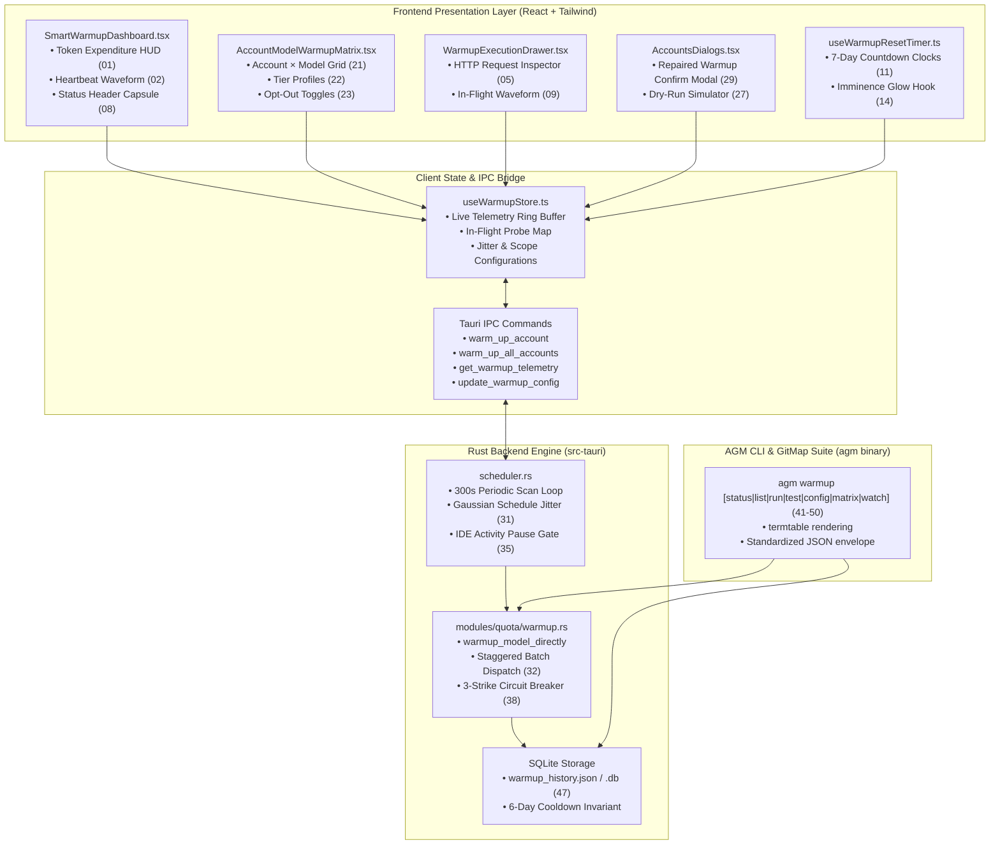

# Specification: Warm Up UI and Emailing UI Improvements — Warmup UI & CLI Improvements Specification

**Slug**: `warm-up-ui-and-emailing-ui-improvements`  
**Sequence**: `232`  
**Document**: `02-warmup-ui-improvements-spec.md`  
**Status**: APPROVED  
**Target Release**: `v4.273.0` (Minor Bump)  
**Target Branch**: `main`  
**Author**: Worker 02  
**Attribution**: strictly `@aukgit` (`(Thanks to @aukgit)`)  

---

## 1. Executive Summary & Architectural Overview

Antigravity Manager orchestrates multi-account AI proxy traffic across OpenAI, Anthropic Claude, and Google Gemini models. To maximize quota velocity on Google Gemini's 7-day rolling quota windows, Antigravity Manager incorporates a **Smart Warmup Engine**. 

Under Google Gemini quota accounting, an account's 7-day quota clock does not initiate until a model receives its initial request. If an idle account with 100% quota remains unprobed after its reset timestamp elapses, the subsequent 7-day cycle is delayed, causing substantial quota waste. The Smart Warmup engine detects when quota reset windows approach (`T - 60s` to `T`), issuing a surgical, lightweight probe (`"ping"`) to trigger clock renewal with zero excess token consumption.

Prior implementations suffered from substantial usability and architectural gaps:
1. **Rudimentary UI in Settings**: `src/components/settings/SmartWarmup.tsx` only provided a rudimentary toggle and static model pills, lacking live telemetry, token counters, or reset clocks.
2. **Disconnected Confirmation Dialog Bug**: `src/pages/Accounts.tsx` referenced `setIsWarmupConfirmOpen(true)`, yet `isWarmupConfirmOpen` was never declared or mounted inside `src/pages/accounts/AccountsDialogs.tsx`, rendering manual warmup triggers silent and unresponsive.
3. **Absence of Headless CLI Ergonomics**: The `agm` binary featured no `warmup` command suite, hindering headless server automation and terminal monitoring.
4. **Lack of Jitter & Stagger Controls**: Simultaneous burst probes across 20+ accounts risked hitting Google API concurrency rate limits (`429 Too Many Requests`).
5. **No Visual Reset Countdown**: Users had no visibility into when accounts would reset or which models were within their cooldown periods.

This specification details **EXACTLY 50 discrete improvements** across five architectural clusters, providing comprehensive technical contracts, UI component wiring, design system tokens, CLI headless parity, and acceptance criteria.

---

## 2. System Architecture & Component Topology



---

## 3. Cluster 1: Smart Warmup Dashboard & Telemetry Visualizers (Improvements 01–10)

### Improvement 01: Live Token Expenditure HUD & Micro-Counter
- **ID & Title**: `01: Live Token Expenditure HUD & Micro-Counter`
- **Category / Cluster**: Cluster 1: Smart Warmup Dashboard & Telemetry Visualizers
- **User Need / Problem Statement**: Developers fear automated warmup background probes will silently drain expensive account tokens. There is currently zero visibility into token expenditure incurred during warmup cycles.
- **Technical Specification & Architecture Contract**:
  - Implement `<TokenExpenditureHUD />` in `src/components/settings/warmup/TokenExpenditureHUD.tsx`.
  - Subscribe to `useWarmupStore((state) => state.telemetry)`.
  - State interface:
    ```typescript
    export interface WarmupTelemetryState {
      totalTokensConsumed: number;
      sessionTokensConsumed: number;
      avgTokensPerProbe: number;
      totalProbesExecuted: number;
      estimatedCostUsd: number;
      lastResetEpochMs: number;
    }
    ```
  - Display animated micro-counter incrementing via `framer-motion` spring transition (`stiffness: 100, damping: 15`).
  - Calculate `estimatedCostUsd` using standard rates ($0.00 for free-tier 1-token pings, $0.00000015/token for Pro).
- **Design System Tokens & Aesthetics**:
  - Dark-glass card: `bg-zinc-900/70 backdrop-blur-md border border-zinc-800/80 rounded-2xl p-4 shadow-xl`.
  - Number counter: `font-mono text-2xl font-black tracking-tight text-emerald-400 dark:text-emerald-300 drop-shadow-[0_0_8px_rgba(52,211,153,0.3)]`.
  - Subtitle badge: Segmented pill `bg-emerald-500/10 text-emerald-400 border border-emerald-500/20 text-[10px] px-2 py-0.5 rounded-full font-semibold`.
- **CLI Equivalent & Headless Parity**:
  - `agm warmup status --tokens`
  - Output: `Tokens Consumed: 142 total (0.00014 USD) | Probes: 142 | Avg: 1.0 tok/probe`.
- **Verification Evidence & Acceptance Criteria**:
  - Dispatched warmup probe increments token counter by exactly the payload token count reported in the HTTP response headers (`x-goog-quota-consumed` or internal token metrics).
  - Counter survives application reload via persisted state in `app_config.json`.

---

### Improvement 02: SVG Heartbeat Activity Waveform & Loop Ticker
- **ID & Title**: `02: SVG Heartbeat Activity Waveform & Loop Ticker`
- **Category / Cluster**: Cluster 1: Smart Warmup Dashboard & Telemetry Visualizers
- **User Need / Problem Statement**: Users cannot determine whether the background warmup scan loop is actively running, hung, or halted without tailing raw application log files.
- **Technical Specification & Architecture Contract**:
  - Create `<WarmupHeartbeatWaveform />` in `src/components/settings/warmup/WarmupHeartbeatWaveform.tsx`.
  - Animate an SVG ECG-style line path with dynamic points reflecting the scheduler scan loop status.
  - Rust backend emits Tauri event `warmup://heartbeat` every scan tick (default 300s) and every probe burst:
    ```rust
    #[derive(Serialize, Clone)]
    pub struct WarmupHeartbeatPayload {
        pub timestamp: i64,
        pub scan_active: bool,
        pub queue_depth: usize,
        pub next_scan_secs: u64,
    }
    ```
  - Waveform renders 32 recent heartbeat points on a responsive canvas/SVG path using cubic Bezier smoothing.
- **Design System Tokens & Aesthetics**:
  - SVG Stroke: `stroke-orange-500/80 dark:stroke-orange-400 stroke-2`.
  - Glow effect: `filter: drop-shadow(0 0 4px rgba(249, 115, 22, 0.4))`.
  - Canvas Container: `h-8 w-44 bg-zinc-950/60 rounded-lg border border-zinc-800/60 overflow-hidden flex items-center`.
  - Loop Ticker: `text-[10px] font-mono text-zinc-400 font-medium tracking-wider`.
- **CLI Equivalent & Headless Parity**:
  - `agm warmup status --heartbeat`
  - Output ANSI graph: `[❤️ LIVE] [~^v~^v~] Last tick: 12s ago | Next scan: in 288s`.
- **Verification Evidence & Acceptance Criteria**:
  - Waveform pulses with height spike (100% amplitude) upon probe dispatch.
  - When scheduler is disabled, waveform renders a flat muted gray line (`stroke-zinc-700`).

---

### Improvement 03: Model Latency Sparklines (Gemini vs. Claude p50/p95)
- **ID & Title**: `03: Model Latency Sparklines (Gemini vs. Claude p50/p95)`
- **Category / Cluster**: Cluster 1: Smart Warmup Dashboard & Telemetry Visualizers
- **User Need / Problem Statement**: Warmup requests provide valuable telemetry on upstream endpoint responsiveness. Operators cannot compare latency characteristics between Gemini and Claude models to identify API degradation.
- **Technical Specification & Architecture Contract**:
  - Create `<ModelLatencySparklines />` in `src/components/settings/warmup/ModelLatencySparklines.tsx`.
  - Ingest the last 50 probe latency records grouped by model family (`gemini-*` vs `claude-*`).
  - Calculate rolling `p50` and `p95` response times in milliseconds.
  - Render dual inline SVG polyline sparklines with min/max indicator dots.
  - Data structure:
    ```typescript
    export interface LatencyTelemetryRecord {
      modelId: string;
      family: 'gemini' | 'claude';
      durationMs: number;
      timestamp: number;
      httpStatus: number;
    }
    ```
- **Design System Tokens & Aesthetics**:
  - Gemini Line: `stroke-sky-400 fill-sky-400/10`.
  - Claude Line: `stroke-amber-400 fill-amber-400/10`.
  - Sparkline dimension: `w-24 h-6 inline-block align-middle`.
  - Metric Pills: Segmented capsule `flex items-center gap-1.5 px-2 py-0.5 rounded-full bg-zinc-800/60 border border-zinc-700/50 text-[10px] font-mono text-zinc-300`.
- **CLI Equivalent & Headless Parity**:
  - `agm warmup status --latency`
  - Output table:
    ```
    MODEL FAMILY | PROBES | P50 (ms) | P95 (ms) | TREND
    Gemini       |     48 |    320ms |    850ms | ▂▃▅▃▂ 
    Claude       |     24 |    640ms |   1420ms | ▃▄▆▇▅▃
    ```
- **Verification Evidence & Acceptance Criteria**:
  - Latency sparklines update smoothly upon incoming probe completion events without layout thrashing.
  - Sparklines handle empty states gracefully with dashed placeholder baselines.

---

### Improvement 04: 4-Tier Origin Warmup Traffic Badge (`WARMUP_PROBE`)
- **ID & Title**: `04: 4-Tier Origin Warmup Traffic Badge (WARMUP_PROBE)`
- **Category / Cluster**: Cluster 1: Smart Warmup Dashboard & Telemetry Visualizers
- **User Need / Problem Statement**: According to `AGENTS.md`, prompt origins must follow a strict 4-tier origin hierarchy. Automated warmup probes currently get mixed into general user prompt logs or lack classification badges.
- **Technical Specification & Architecture Contract**:
  - Extend the 4-tier prompt classification schema in `src/types/prompt.ts` and `src-tauri/src/modules/logger.rs`.
  - Register `WARMUP_PROBE` as a formal sub-variant under `TOOL_OUTPUT` / `SYSTEM_MESSAGE`:
    ```typescript
    export type PromptOriginTier = 
      | 'USER_PROMPT'          // Sky badge, User icon
      | 'SUBAGENT_INSTRUCTION'  // Purple badge, Bot icon
      | 'SYSTEM_MESSAGE'       // Zinc badge, Terminal icon
      | 'TOOL_OUTPUT'          // Amber badge, Wrench icon
      | 'WARMUP_PROBE';        // Orange badge, Flame/Sparkles icon
    ```
  - Map in `src/components/common/PromptOriginBadge.tsx` with flame icon (`lucide-react: Flame`).
  - Rust proxy stamps `X-Antigravity-Origin: WARMUP_PROBE` on all internal warmup requests.
- **Design System Tokens & Aesthetics**:
  - Badge container: `inline-flex items-center gap-1 px-2 py-0.5 rounded-full text-[10px] font-semibold tracking-wide uppercase transition-all duration-200`.
  - Badge colors: `bg-orange-500/15 text-orange-400 border border-orange-500/30 shadow-[0_0_8px_rgba(249,115,22,0.15)]`.
  - Dark mode: `dark:bg-orange-950/40 dark:text-orange-300 dark:border-orange-800/60`.
- **CLI Equivalent & Headless Parity**:
  - Logs and CLI inspects format origin as `[WARMUP_PROBE]` rendered in ANSI 256 color `\x1b[38;5;208m`.
- **Verification Evidence & Acceptance Criteria**:
  - Filter by `WARMUP_PROBE` in Prompt Tree View isolates all automated warmup pings.
  - Renders flame icon with exact token hierarchy styling.

---

### Improvement 05: Real-Time Warmup Execution Drawer & HTTP Inspector
- **ID & Title**: `05: Real-Time Warmup Execution Drawer & HTTP Inspector`
- **Category / Cluster**: Cluster 1: Smart Warmup Dashboard & Telemetry Visualizers
- **User Need / Problem Statement**: When a warmup ping fails or triggers an unexpected quota deduction, developers need to inspect the raw HTTP request/response payloads, headers, and status codes.
- **Technical Specification & Architecture Contract**:
  - Create `<WarmupExecutionDrawer />` in `src/components/settings/warmup/WarmupExecutionDrawer.tsx`.
  - Slide-over drawer powered by Radix UI Dialog / Drawer primitive.
  - Display list of recent warmup probes with expandable JSON inspection panels:
    - Target URL: `http://127.0.0.1:<port>/internal/warmup`
    - Request Headers: `Content-Type`, `Authorization: Bearer [REDACTED]`, `X-Antigravity-Account: <email>`
    - Payload: `{ "email": "...", "model": "gemini-2.5-flash", "project_id": "..." }`
    - Response Headers: `x-goog-quota-consumed`, `date`, `server`
    - Response Body: `{ "status": "warmed", "latency_ms": 284 }`
  - Copy-to-clipboard button for cURL command equivalent.
- **Design System Tokens & Aesthetics**:
  - Drawer panel: `w-[480px] bg-zinc-950/95 backdrop-blur-xl border-l border-zinc-800/80 text-zinc-100 shadow-2xl`.
  - Code block: `bg-zinc-900/90 rounded-lg p-3 font-mono text-xs text-zinc-300 border border-zinc-800 select-all overflow-x-auto`.
  - Status badges: HTTP 200 `bg-emerald-500/10 text-emerald-400 border-emerald-500/30`, HTTP 429 `bg-amber-500/10 text-amber-400 border-amber-500/30`.
- **CLI Equivalent & Headless Parity**:
  - `agm warmup history --inspect <probe-id>`
  - Dumps full HTTP transaction with syntax highlighting.
- **Verification Evidence & Acceptance Criteria**:
  - Opening the drawer presents historical requests sorted by timestamp descending.
  - Bearer tokens and sensitive authentication secrets are strictly masked as `Bearer ya29.***[MASKED]***`.

---

### Improvement 06: Weekly Reset Convergence Radar & Account Progress Dial
- **ID & Title**: `06: Weekly Reset Convergence Radar & Account Progress Dial`
- **Category / Cluster**: Cluster 1: Smart Warmup Dashboard & Telemetry Visualizers
- **User Need / Problem Statement**: In fleets with 10–50 accounts, reset times are dispersed throughout the week. Operators cannot visually grasp fleet-wide reset convergence to anticipate heavy warmup cycles.
- **Technical Specification & Architecture Contract**:
  - Create `<WeeklyResetConvergenceRadar />` in `src/components/settings/warmup/WeeklyResetConvergenceRadar.tsx`.
  - Circular 7-day radar visualizer (Monday through Sunday, 24-hour radius).
  - Plot account reset nodes as radial coordinate points:
    - Angle $\theta = (\text{DayOfWeek} \times 24 + \text{Hour}) / 168 \times 2\pi$
    - Radial distance $r = \text{RemainingQuotaFraction} \times R_{\text{max}}$
  - Accounts currently in their warmup readiness zone (within 30 minutes of reset) pulsate with an orange radar blip animation.
- **Design System Tokens & Aesthetics**:
  - Radar circle: `relative w-64 h-64 rounded-full border border-zinc-800/60 bg-zinc-900/40 p-4`.
  - Grid concentric rings: `stroke-zinc-800/40 stroke-dashed`.
  - Active nodes: `w-2.5 h-2.5 rounded-full bg-orange-400 shadow-[0_0_10px_rgba(249,115,22,0.6)] animate-pulse`.
  - Center label: `text-xs font-mono text-zinc-400 font-semibold uppercase tracking-wider`.
- **CLI Equivalent & Headless Parity**:
  - `agm warmup matrix --radar`
  - Outputs ASCII 7-day calendar heat breakdown of fleet reset targets.
- **Verification Evidence & Acceptance Criteria**:
  - Nodes map to correct day/hour positions according to UTC reset epochs parsed from `bucket.reset_time`.
  - Clicking any node opens the Account Details card.

---

### Improvement 07: Zero-Usage Verification Callout & Token Shield
- **ID & Title**: `07: Zero-Usage Verification Callout & Token Shield`
- **Category / Cluster**: Cluster 1: Smart Warmup Dashboard & Telemetry Visualizers
- **User Need / Problem Statement**: Enterprise compliance and cost-conscious developers need ironclad guarantees that warmup requests do not trigger multi-token billing or deplete daily/weekly allotments.
- **Technical Specification & Architecture Contract**:
  - Implement `<TokenShieldCallout />` in `src/components/settings/warmup/TokenShieldCallout.tsx`.
  - Visual reassurance widget displaying:
    - Shield active badge: `Token Shield: Active (Zero-Cost Probing Guaranteed)`
    - Verification mechanism description: Probes send max_tokens=1 or empty messages that validate project authorization and trip reset timestamps without generating generative completions.
    - Safety ceiling: Configurable max allowable warmup tokens per cycle (default hardcap: 5 tokens/account/week).
  - Safety circuit: If any probe response returns token consumption $> 5$, the engine immediately aborts further warmup calls for that account and alerts the user.
- **Design System Tokens & Aesthetics**:
  - Banner container: `rounded-xl p-3 bg-gradient-to-r from-emerald-950/20 via-zinc-900/40 to-emerald-950/10 border border-emerald-500/20 flex items-start gap-3`.
  - Icon: `ShieldCheck` (`text-emerald-400 w-5 h-5 shrink-0 mt-0.5`).
  - Header: `text-xs font-semibold text-emerald-300 tracking-wide`.
  - Body: `text-[11px] text-zinc-400 leading-relaxed`.
- **CLI Equivalent & Headless Parity**:
  - `agm warmup status --shield`
  - Output: `[SHIELD: ENFORCED] Hardcap: 5 tok/acct | Total Burn: 0.00% of weekly quota`.
- **Verification Evidence & Acceptance Criteria**:
  - If a simulated probe consumes 6 tokens, the safety circuit triggers, logs a warning, and blocks subsequent probes for that account.

---

### Improvement 08: Dark-Glass Header Status Capsule (`Active | Next Scan 3m 42s`)
- **ID & Title**: `08: Dark-Glass Header Status Capsule (Active | Next Scan 3m 42s)`
- **Category / Cluster**: Cluster 1: Smart Warmup Dashboard & Telemetry Visualizers
- **User Need / Problem Statement**: Per `AGENTS.md`, toolbar actions and status indicators must be unified into cohesive segmented dark-glass capsules rather than scattered elements. Users need to see warmup status without opening settings.
- **Technical Specification & Architecture Contract**:
  - Implement `<WarmupStatusCapsule />` mounted in the primary application header and inside `src/pages/Accounts.tsx` toolbar.
  - Format: `[ ● Active | Next Scan 3m 42s | 3 Accounts Due ]`.
  - Segmented layout with 3 interactive sections:
    1. Status Pill: Green/Orange indicator showing scheduler state (`Active` / `Idle` / `Paused`).
    2. Countdown Pill: Synchronized ticker counting down to next scheduled scan (`next_scan_seconds`).
    3. Due Pill: Badge showing number of accounts eligible for warmup within the upcoming scan interval.
  - Hovering reveals detailed tooltip breakdown. Clicking triggers immediate manual scan.
- **Design System Tokens & Aesthetics**:
  - Capsule container: `inline-flex items-center rounded-full bg-zinc-900/80 backdrop-blur-md border border-zinc-800 p-0.5 text-xs shadow-inner divide-x divide-zinc-800/80`.
  - Segment 1: `px-2.5 py-1 text-zinc-300 font-medium flex items-center gap-1.5`.
  - Indicator dot: `w-2 h-2 rounded-full bg-emerald-400 animate-pulse`.
  - Segment 2: `px-2.5 py-1 font-mono text-zinc-400 text-[11px]`.
  - Segment 3: `px-2.5 py-1 text-orange-400 font-semibold text-[11px] hover:bg-zinc-800/50 rounded-r-full transition-colors cursor-pointer`.
- **CLI Equivalent & Headless Parity**:
  - Displayed in `agm status` header bar: `[WARMUP: Active | Next: 3m42s | Due: 3]`.
- **Verification Evidence & Acceptance Criteria**:
  - Segmented capsule adheres strictly to dark-glass pill styling with rounded-full corners and divider lines.
  - No loose circular buttons.

---

### Improvement 09: Live In-Flight Request Pulse Waves & Progress Trackers
- **ID & Title**: `09: Live In-Flight Request Pulse Waves & Progress Trackers`
- **Category / Cluster**: Cluster 1: Smart Warmup Dashboard & Telemetry Visualizers
- **User Need / Problem Statement**: During manual or batch warmup execution, the UI provides no active feedback while HTTP requests are in flight, leading users to believe the process has frozen.
- **Technical Specification & Architecture Contract**:
  - Create `<WarmupInFlightTracker />` in `src/components/settings/warmup/WarmupInFlightTracker.tsx`.
  - Listen for Tauri events `warmup://probe_start` and `warmup://probe_complete`.
  - Render an active progress card showing:
    - Current target account email and model name.
    - Elapsed duration timer (updating every 100ms).
    - Pulsing radar wave animation radiating outward around the target model icon.
    - Overall batch progress bar (`Processed 7 of 18 models`).
- **Design System Tokens & Aesthetics**:
  - Pulse wave: CSS keyframes `scale(1) -> scale(2.4)`, `opacity: 0.6 -> opacity: 0` with `border-orange-500/50`.
  - Progress bar: `h-1.5 w-full bg-zinc-800 rounded-full overflow-hidden`.
  - Progress fill: `bg-gradient-to-r from-orange-500 to-amber-400 transition-all duration-300`.
  - Card: `bg-zinc-900/90 border border-orange-500/30 rounded-xl p-3 shadow-lg shadow-orange-500/5`.
- **CLI Equivalent & Headless Parity**:
  - Interactive spinner in CLI: `⠋ [3/12] Probing dev@example.com (gemini-2.5-pro)... 320ms [===>------] 25%`.
- **Verification Evidence & Acceptance Criteria**:
  - Starting a warmup triggers immediate visual wave animation within 50ms of dispatch.
  - Progress bar smoothly completes to 100% upon final model probe.

---

### Improvement 10: Warmup Error Diagnostic Banner with One-Click Health Fix
- **ID & Title**: `10: Warmup Error Diagnostic Banner with One-Click Health Fix`
- **Category / Cluster**: Cluster 1: Smart Warmup Dashboard & Telemetry Visualizers
- **User Need / Problem Statement**: When warmup fails (e.g. 403 Forbidden due to revoked OAuth token, 401 Unauthorized, or 404 Project Not Found), errors are silently logged to stderr. Users are unaware why their accounts are not warming up.
- **Technical Specification & Architecture Contract**:
  - Implement `<WarmupDiagnosticBanner />` in `src/components/settings/warmup/WarmupDiagnosticBanner.tsx`.
  - Integrate with `src/stores/error-store.ts` via `useErrorStore`.
  - Match error patterns:
    - `403 Forbidden`: "OAuth Token Revoked or Expired" -> Quick Fix: "Re-authenticate Account"
    - `429 Too Many Requests`: "Upstream Rate Limit Exceeded" -> Quick Fix: "Increase Jitter & Cooldown"
    - `Connection Refused (Port 8045)`: "Local AI Proxy Not Running" -> Quick Fix: "Restart Internal Proxy"
  - Dismissible alert banner with primary action button executing the contextual recovery routine.
- **Design System Tokens & Aesthetics**:
  - Alert banner: `bg-red-950/30 border border-red-500/30 rounded-xl p-3.5 flex items-center justify-between text-xs text-red-200 shadow-lg`.
  - Action button: Segmented pill `bg-red-500/20 hover:bg-red-500/30 text-red-300 border border-red-500/40 px-3 py-1 rounded-full font-medium transition-colors`.
  - Icon: `AlertTriangle` (`text-red-400 w-4 h-4 shrink-0`).
- **CLI Equivalent & Headless Parity**:
  - `agm warmup status --diagnose`
  - Output diagnostic table with recommended fix command.
- **Verification Evidence & Acceptance Criteria**:
  - Triggering a 403 error during quota probe immediately renders diagnostic banner.
  - Clicking "One-Click Health Fix" invokes the repair workflow without full app restart.

---

## 4. Cluster 2: Real-time Quota Reset Timers & Wave Animations (Improvements 11–20)

### Improvement 11: Real-Time 7-Day Countdown Clocks (`T-04h:22m:15s`)
- **ID & Title**: `11: Real-Time 7-Day Countdown Clocks (T-04h:22m:15s)`
- **Category / Cluster**: Cluster 2: Real-time Quota Reset Timers & Wave Animations
- **User Need / Problem Statement**: Account cards currently show static date strings (e.g. `2026-10-31T04:22:15Z`). Users cannot instantly tell how much time remains before the weekly quota window resets.
- **Technical Specification & Architecture Contract**:
  - Create `<WarmupCountdownClock />` in `src/components/accounts/WarmupCountdownClock.tsx`.
  - Parse `account.quota.models[].reset_time` (ISO 8601 string) into target Unix epoch timestamp.
  - Calculate delta: $\Delta t = T_{\text{reset}} - T_{\text{now}}$.
  - If $\Delta t > 0$, format as `T-DDd:HHh:MMm:SSs` (or `T-04h:22m:15s` when under 24 hours).
  - If $\Delta t \le 0$ and account is at 100% quota, display `RESET IMMINENT` / `READY TO WARM`.
  - Update on a unified 1000ms clock interval synchronized across all mounted cards.
- **Design System Tokens & Aesthetics**:
  - Clock text: `font-mono text-xs font-semibold tracking-tight text-zinc-300 dark:text-zinc-200`.
  - Negative/imminent state: `text-orange-400 dark:text-orange-300 font-bold animate-pulse`.
  - Capsule container: `inline-flex items-center gap-1.5 px-2 py-0.5 rounded-full bg-zinc-800/50 border border-zinc-700/40 text-[10px]`.
- **CLI Equivalent & Headless Parity**:
  - `agm warmup list`
  - `RESET COUNTDOWN` column displays `T-04h:22m:15s`.
- **Verification Evidence & Acceptance Criteria**:
  - Clocks tick down by exactly 1 second every second without cumulative drift.
  - Reaching zero transitions display to `RESET DUE` and notifies scheduler.

---

### Improvement 12: Universal Synchronized Ticker Hook (`useWarmupResetTimer`)
- **ID & Title**: `12: Universal Synchronized Ticker Hook (useWarmupResetTimer)`
- **Category / Cluster**: Cluster 2: Real-time Quota Reset Timers & Wave Animations
- **User Need / Problem Statement**: Having dozens of separate `setInterval` timers on account cards creates CPU overhead, battery drain, and out-of-sync visual counter increments.
- **Technical Specification & Architecture Contract**:
  - Create custom React hook `useWarmupResetTimer` in `src/hooks/useWarmupResetTimer.ts`.
  - Maintain a single master singleton ticker running via `requestAnimationFrame` or a centralized 1000ms interval.
  - Subscribers register target timestamps and receive formatted time strings and status enums:
    ```typescript
    export type TimerUrgency = 'normal' | 'approaching' | 'imminent' | 'expired';
    
    export interface TimerResult {
      formatted: string;
      rawSeconds: number;
      urgency: TimerUrgency;
      isExpired: boolean;
    }
    
    export function useWarmupResetTimer(targetEpochSecs: number | null): TimerResult;
    ```
  - When tab is hidden (`document.hidden`), throttle interval to 5000ms to conserve resources.
- **Design System Tokens & Aesthetics**:
  - Pure headless hook. Seamless integration with Tailwind transition classes.
- **CLI Equivalent & Headless Parity**:
  - N/A (Frontend hook architecture; CLI handles via monotonic clock).
- **Verification Evidence & Acceptance Criteria**:
  - Mounting 100 account cards creates exactly 1 active browser interval rather than 100 separate timers.
  - Profiler shows under 0.2% CPU utilization on idle account table view.

---

### Improvement 13: Cold-Start Indicator & Uninitialized Account Badge
- **ID & Title**: `13: Cold-Start Indicator & Uninitialized Account Badge`
- **Category / Cluster**: Cluster 2: Real-time Quota Reset Timers & Wave Animations
- **User Need / Problem Statement**: Newly added accounts or fresh Google Cloud projects have never made an initial request, so `reset_time` is `null` (Cold Start). Users mistake this for a broken or unresponsive account.
- **Technical Specification & Architecture Contract**:
  - Update `src-tauri/src/modules/scheduler.rs` and frontend account card renderers.
  - In `scheduler.rs:377`:
    ```rust
    let should_warmup = match reset_ts_opt {
        Some(reset_ts) => now_ts >= reset_ts - 60,
        None => true, // Cold-start for uninitialized weekly timer
    };
    ```
  - Create `<ColdStartBadge />` in `src/components/accounts/ColdStartBadge.tsx`.
  - When `reset_time` is null and `percentage == 100`, display `❄️ Cold-Start (Timer Not Started)`.
  - Include tooltip explaining: "This account has not yet initialized its 7-day rolling window. Smart Warmup will wake it to start the clock."
- **Design System Tokens & Aesthetics**:
  - Badge: Segmented pill `bg-cyan-500/10 text-cyan-400 border border-cyan-500/20 text-[10px] px-2 py-0.5 rounded-full font-medium inline-flex items-center gap-1`.
  - Icon: Snowflake icon (`lucide-react: Snowflake` `w-3 h-3`).
- **CLI Equivalent & Headless Parity**:
  - `agm warmup list` displays `[COLD_START]` tag in cyan ANSI color.
- **Verification Evidence & Acceptance Criteria**:
  - Accounts with null `reset_time` display the Cold-Start badge.
  - Executing warmup starts the clock and replaces badge with active 7-day countdown.

---

### Improvement 14: Reset Window Imminence Glow (Orange border at T-30m)
- **ID & Title**: `14: Reset Window Imminence Glow (Orange border at T-30m)`
- **Category / Cluster**: Cluster 2: Real-time Quota Reset Timers & Wave Animations
- **User Need / Problem Statement**: When an account enters the 30-minute pre-reset window, users need a prominent visual cue so they know automated warmup is about to trigger.
- **Technical Specification & Architecture Contract**:
  - Modify `src/components/accounts/AccountCard.tsx` and `src/components/accounts/AccountTableRow.tsx`.
  - Evaluate `urgency === 'imminent'` ($\Delta t \le 1800$ seconds, i.e. 30 minutes).
  - Apply an animated ambient border glow and subtle pulse highlight.
  - Include an "Imminent Reset" status pill on the card header.
- **Design System Tokens & Aesthetics**:
  - Card Border Glow: `border-orange-500/60 dark:border-orange-500/80 shadow-[0_0_15px_rgba(249,115,22,0.25)] ring-1 ring-orange-500/30`.
  - Ambient animation: `transition-all duration-700 ease-in-out`.
  - Imminent Pill: `bg-orange-500 text-white font-bold text-[9px] px-1.5 py-0.2 rounded-full uppercase tracking-widest animate-pulse`.
- **CLI Equivalent & Headless Parity**:
  - `agm warmup list` highlights rows with remaining time $\le 30\text{m}$ in bold orange text.
- **Verification Evidence & Acceptance Criteria**:
  - Account cards transition to orange border glow when time remaining drops below 1800s.
  - Border returns to normal neutral gray once warmup completes and the reset time advances.

---

### Improvement 15: Dual-Layer Rolling vs. Weekly Reset Progress Bar
- **ID & Title**: `15: Dual-Layer Rolling vs. Weekly Reset Progress Bar`
- **Category / Cluster**: Cluster 2: Real-time Quota Reset Timers & Wave Animations
- **User Need / Problem Statement**: Accounts operate under two distinct reset mechanisms: short-term rolling quotas (4-hour window) and weekly quotas (7-day window). A single progress bar confuses which quota is being tracked.
- **Technical Specification & Architecture Contract**:
  - Create `<DualLayerQuotaProgressBar />` in `src/components/accounts/DualLayerQuotaProgressBar.tsx`.
  - Stack two coordinated micro progress bars:
    - Top Layer (4-hour cycle): `h-1.5`, displays rolling 4-hour quota percentage.
    - Bottom Layer (7-day weekly cycle): `h-1`, displays weekly quota reset progress ($t_{\text{elapsed}} / 7\text{ days}$).
  - Tooltip on hover details exact numbers: `4h Quota: 85% (Resets in 1h 14m) | Weekly Quota: 100% (Cycle: Day 6 of 7)`.
- **Design System Tokens & Aesthetics**:
  - Top bar fill: `bg-emerald-500 dark:bg-emerald-400 rounded-full`.
  - Bottom bar fill: `bg-orange-500/80 dark:bg-orange-400/80 rounded-full`.
  - Track background: `bg-zinc-800 dark:bg-zinc-800/80 rounded-full`.
  - Spacing: `gap-1 flex flex-col`.
- **CLI Equivalent & Headless Parity**:
  - `agm quota show` outputs two stacked horizontal unicode bars:
    ```
    4H:  [████████░░] 80% (1h 14m)
    7D:  [██████████] 100% (Day 6/7)
    ```
- **Verification Evidence & Acceptance Criteria**:
  - Both 4-hour and 7-day progress bars render independently without graphical overlapping.
  - Visual values correspond strictly to backend quota data models.

---

### Improvement 16: Time-Zone Normalized Clocks & UTC Tooltips
- **ID & Title**: `16: Time-Zone Normalized Clocks & UTC Tooltips`
- **Category / Cluster**: Cluster 2: Real-time Quota Reset Timers & Wave Animations
- **User Need / Problem Statement**: Quota timestamps returned by Google Cloud / Gemini APIs are in UTC. Developers working across global time zones get confused by raw UTC strings or un-localized dates.
- **Technical Specification & Architecture Contract**:
  - Implement time utility `formatNormalizedResetTime` in `src/utils/timeFormat.ts`.
  - Formats timestamp into user's local system time zone using `Intl.DateTimeFormat`:
    - E.g. `Today at 4:22 PM (EDT)` or `Tomorrow at 05:22 (JST)`.
  - Hovering wraps the text in a tooltip displaying:
    - Local: `2026-10-31 16:22:15 EDT`
    - UTC: `2026-10-31 20:22:15 UTC`
    - Unix Epoch: `1793478135`
- **Design System Tokens & Aesthetics**:
  - Tooltip: `bg-zinc-950/95 text-zinc-200 border border-zinc-800 rounded-lg px-2.5 py-1.5 text-[11px] shadow-xl font-mono`.
  - Trigger text: `underline decoration-dotted decoration-zinc-600 underline-offset-2 cursor-help text-xs text-zinc-400`.
- **CLI Equivalent & Headless Parity**:
  - `agm warmup list --utc` displays UTC timestamps; default displays local system time.
- **Verification Evidence & Acceptance Criteria**:
  - Displayed time matches user's operating system time zone offset exactly.
  - Tooltip correctly preserves canonical UTC representation.

---

### Improvement 17: Humanized Relative Reset Labels ("Resets in 12m")
- **ID & Title**: `17: Humanized Relative Reset Labels ("Resets in 12m")`
- **Category / Cluster**: Cluster 2: Real-time Quota Reset Timers & Wave Animations
- **User Need / Problem Statement**: Developers scanning large tables of accounts need instant readability rather than decoding full timestamps like `2026-10-27T21:45:00Z`.
- **Technical Specification & Architecture Contract**:
  - Create `<HumanizedResetLabel />` in `src/components/common/HumanizedResetLabel.tsx`.
  - Compute human-readable relative duration strings:
    - $< 1\text{m}$: `"Resets in a few seconds"`
    - $< 60\text{m}$: `"Resets in 12m"`
    - $< 24\text{h}$: `"Resets in 4h 15m"`
    - $\ge 24\text{h}$: `"Resets in 3d 8h"`
  - Automatically updates every 30 seconds.
- **Design System Tokens & Aesthetics**:
  - Text: `text-xs font-medium text-zinc-400 dark:text-zinc-500`.
  - Near reset ($< 1\text{h}$): `text-orange-400 dark:text-orange-300 font-semibold`.
  - Expired / Ready: `text-emerald-400 dark:text-emerald-300 font-bold`.
- **CLI Equivalent & Headless Parity**:
  - `agm warmup list` includes `RELATIVE` column (e.g. `in 12m`, `in 4h 15m`).
- **Verification Evidence & Acceptance Criteria**:
  - Relative labels transition seamlessly across minute and hour boundaries without page refresh.

---

### Improvement 18: Reset Completion Audio/Haptic & Toast Notifications
- **ID & Title**: `18: Reset Completion Audio/Haptic & Toast Notifications`
- **Category / Cluster**: Cluster 2: Real-time Quota Reset Timers & Wave Animations
- **User Need / Problem Statement**: When a developer is waiting for a depleted account to reset and warmup so they can resume heavy agentic coding, they have to keep checking the screen manually.
- **Technical Specification & Architecture Contract**:
  - Create notification dispatcher in `src/services/warmupNotificationService.ts`.
  - Configurable in settings:
    - Desktop Native Toast Notification (via Tauri Notification API).
    - Optional subtle audio chime (Web Audio API synthesized 440Hz sine wave, duration 150ms).
  - Triggers event when account transitions from `< 100%` to `100% Warmed & Ready`.
  - Message: `[Warmup Complete] Account dev@example.com weekly quota renewed and warmed!`.
- **Design System Tokens & Aesthetics**:
  - In-app Toast: `bg-zinc-900 border border-emerald-500/40 text-zinc-100 rounded-xl p-3 shadow-2xl flex items-center gap-3`.
  - Toast icon: `Sparkles` (`text-emerald-400 w-5 h-5`).
- **CLI Equivalent & Headless Parity**:
  - `agm warmup watch --notify` triggers system bell (`\a`) and desktop notification on completion.
- **Verification Evidence & Acceptance Criteria**:
  - Completing warmup triggers desktop notification when enabled in settings.
  - Audio chime respects user's sound toggle and muted system state.

---

### Improvement 19: Animated Quota Replenishment Wave Canvas Effect
- **ID & Title**: `19: Animated Quota Replenishment Wave Canvas Effect`
- **Category / Cluster**: Cluster 2: Real-time Quota Reset Timers & Wave Animations
- **User Need / Problem Statement**: Visual status transitions on quota replenishment are abrupt and uninspiring. Users appreciate high-polish visual confirmation that a cycle has renewed.
- **Technical Specification & Architecture Contract**:
  - Implement `<QuotaReplenishmentWave />` in `src/components/accounts/QuotaReplenishmentWave.tsx`.
  - Lightweight HTML5 Canvas effect mounted behind the quota progress bar.
  - When quota resets and warmup succeeds, a gentle fluid wave ripples across the bar from left to right (duration 1200ms) with ease-out cubic curve.
  - Automatically unmounts canvas rendering loop upon animation completion to maintain 0% idle CPU.
- **Design System Tokens & Aesthetics**:
  - Wave gradient: `linear-gradient(90deg, rgba(249,115,22,0) 0%, rgba(52,211,153,0.4) 50%, rgba(249,115,22,0) 100%)`.
  - Subtle particle sparks emitting from right edge.
- **CLI Equivalent & Headless Parity**:
  - Terminal prints celebratory ANSI spark line: `✨ [REPLENISHED] dev@example.com quota renewed to 100% ✨`.
- **Verification Evidence & Acceptance Criteria**:
  - Canvas renders wave animation only upon replenishment event.
  - Idle state has zero active requestAnimationFrame cycles.

---

### Improvement 20: Stale Quota Visual Warning & Auto-Sync Trigger
- **ID & Title**: `20: Stale Quota Visual Warning & Auto-Sync Trigger`
- **Category / Cluster**: Cluster 2: Real-time Quota Reset Timers & Wave Animations
- **User Need / Problem Statement**: If the backend has not refreshed quota data for over 15 minutes (e.g. laptop woke from sleep), displayed reset times are stale and inaccurate.
- **Technical Specification & Architecture Contract**:
  - Implement `<StaleQuotaWarning />` in `src/components/accounts/StaleQuotaWarning.tsx`.
  - Check `Date.now() - account.quota.fetched_at > 900_000` (15 minutes).
  - If stale, render an amber warning badge on the account card: `⚠️ Quota data is stale (fetched 24m ago)`.
  - Clicking badge triggers instant targeted quota refresh via Tauri IPC `refresh_account_quota(accountId)`.
  - In background, automatically queue refresh when window regains focus (`window.addEventListener('focus', ...)`).
- **Design System Tokens & Aesthetics**:
  - Warning badge: Segmented pill `bg-amber-500/10 text-amber-400 border border-amber-500/30 text-[10px] px-2 py-0.5 rounded-full font-medium inline-flex items-center gap-1 cursor-pointer hover:bg-amber-500/20 transition-colors`.
  - Refresh icon: `RefreshCw` (`w-3 h-3 hover:rotate-180 transition-transform duration-500`).
- **CLI Equivalent & Headless Parity**:
  - `agm warmup list` flags stale accounts with `*STALE*` indicator and prompts `Run 'agm quota refresh'`.
- **Verification Evidence & Acceptance Criteria**:
  - Forcing stale timestamp renders warning badge.
  - Clicking badge triggers refresh and clears badge upon response.

---

## 5. Cluster 3: Batch Warmup Orchestration & Account Matrix Controls (Improvements 21–30)

### Improvement 21: Interactive Account × Model Warmup Matrix Grid
- **ID & Title**: `21: Interactive Account × Model Warmup Matrix Grid`
- **Category / Cluster**: Cluster 3: Batch Warmup Orchestration & Account Matrix Controls
- **User Need / Problem Statement**: Current settings only allow a global list of monitored models. Users cannot configure specific models for specific accounts (e.g. Account A for Gemini Pro, Account B for Claude Sonnet, Account C for Gemini Flash).
- **Technical Specification & Architecture Contract**:
  - Create `<AccountModelWarmupMatrix />` in `src/components/settings/warmup/AccountModelWarmupMatrix.tsx`.
  - Render an interactive 2D grid:
    - Rows: Configured accounts (Email / Alias).
    - Columns: Available models (`gemini-2.5-pro`, `gemini-2.5-flash`, `claude-3-7-sonnet`, `gemini-2.0-flash`).
    - Cells: Tri-state checkboxes:
      - Checked: Active for warmup.
      - Unchecked: Excluded.
      - Cooldown Badge: Checked but currently in 6-day cooldown (displays remaining cooldown hours).
  - Store configuration in `app_config.json`:
    ```json
    {
      "scheduled_warmup": {
        "account_model_overrides": {
          "acc_01j...": ["gemini-2.5-pro", "gemini-2.5-flash"],
          "acc_02k...": ["claude-3-7-sonnet"]
        }
      }
    }
    ```
- **Design System Tokens & Aesthetics**:
  - Table: `w-full border-collapse text-xs text-zinc-300 border border-zinc-800 rounded-xl overflow-hidden`.
  - Header cells: `bg-zinc-900/90 p-2.5 font-semibold text-zinc-200 border-b border-zinc-800 text-left`.
  - Active cell: `bg-orange-500/10 text-orange-400 font-medium`.
  - Cooldown cell: `bg-zinc-900/40 text-zinc-500 font-mono text-[10px]`.
- **CLI Equivalent & Headless Parity**:
  - `agm warmup matrix` displays interactive ANSI grid.
  - `agm warmup config --set-override <acc> <model1,model2>`
- **Verification Evidence & Acceptance Criteria**:
  - Toggling a cell updates backend config immediately.
  - Scheduler respects per-account model overrides over global defaults.

---

### Improvement 22: Tier-Based Warmup Profiles (Ultra / Pro / Free Presets)
- **ID & Title**: `22: Tier-Based Warmup Profiles (Ultra / Pro / Free Presets)`
- **Category / Cluster**: Cluster 3: Batch Warmup Orchestration & Account Matrix Controls
- **User Need / Problem Statement**: Manually configuring dozens of models across different account tiers is tedious and error-prone. Ultra accounts need heavy models warmed, while Free accounts only need lightweight models.
- **Technical Specification & Architecture Contract**:
  - Implement `<WarmupTierPresets />` in `src/components/settings/warmup/WarmupTierPresets.tsx`.
  - Provide 3 one-click preset buttons:
    - **Ultra Profile**: Warms `gemini-2.5-pro`, `claude-3-7-sonnet`, `gemini-2.5-flash`.
    - **Standard Pro Profile**: Warms `gemini-2.5-flash`, `gemini-2.0-flash`.
    - **Eco Free Profile**: Warms only `gemini-2.0-flash` (minimal latency, zero billing risk).
  - Clicking a preset applies model assignment across all matching accounts by tier.
- **Design System Tokens & Aesthetics**:
  - Preset Capsule: Segmented pill container `inline-flex p-1 bg-zinc-900 border border-zinc-800 rounded-full gap-1`.
  - Preset Buttons: `px-3 py-1 rounded-full text-xs font-medium transition-all duration-200 text-zinc-400 hover:text-zinc-100 hover:bg-zinc-800`.
  - Active Preset: `bg-orange-500 text-white font-semibold shadow-md`.
- **CLI Equivalent & Headless Parity**:
  - `agm warmup config --preset [ultra|pro|eco]`
- **Verification Evidence & Acceptance Criteria**:
  - Applying "Eco Free Profile" sets monitored models to lightweight flash models across all free accounts.
  - Settings persist cleanly across app restarts.

---

### Improvement 23: Per-Account Warmup Opt-Out & Exemption Toggle
- **ID & Title**: `23: Per-Account Warmup Opt-Out & Exemption Toggle`
- **Category / Cluster**: Cluster 3: Batch Warmup Orchestration & Account Matrix Controls
- **User Need / Problem Statement**: Some accounts are personal or metered test accounts where automated warmup should never occur, even if global warmup is active.
- **Technical Specification & Architecture Contract**:
  - Add `warmup_disabled: bool` field to `Account` struct in `src-tauri/src/models/account.rs`.
  - In `src-tauri/src/modules/quota/warmup.rs`:
    ```rust
    let target_accounts: Vec<_> = all_accounts
        .into_iter()
        .filter(|a| !a.disabled && !a.proxy_disabled && !a.warmup_disabled)
        .collect();
    ```
  - Mount an "Exempt from Warmup" switch in Account Settings modal and Account Details drawer.
- **Design System Tokens & Aesthetics**:
  - Toggle Switch: `relative inline-flex items-center cursor-pointer`.
  - Off state: `bg-zinc-700 w-9 h-5 rounded-full`.
  - On state (Exempt): `bg-zinc-500 w-9 h-5 rounded-full`.
  - Exempt pill badge: `bg-zinc-800 text-zinc-400 border border-zinc-700 text-[10px] px-2 py-0.5 rounded-full`.
- **CLI Equivalent & Headless Parity**:
  - `agm accounts set-warmup <accountId> --disable`
- **Verification Evidence & Acceptance Criteria**:
  - Toggling an account to exempt prevents `warm_up_all_accounts` and periodic scheduler from probing it.
  - Exempt status is clearly indicated on account table rows.

---

### Improvement 24: Dynamic Priority Model Cascade & Fallback Routing
- **ID & Title**: `24: Dynamic Priority Model Cascade & Fallback Routing`
- **Category / Cluster**: Cluster 3: Batch Warmup Orchestration & Account Matrix Controls
- **User Need / Problem Statement**: If a primary target model fails during warmup (e.g. Gemini 2.5 Pro returns 503 Service Unavailable), the entire warmup cycle aborts, leaving the 7-day clock uninitialized.
- **Technical Specification & Architecture Contract**:
  - Modify `warmup_model_directly` in `src-tauri/src/modules/quota/warmup.rs`.
  - Define model fallback cascade ladder:
    `gemini-2.5-pro` $\rightarrow$ `gemini-2.5-flash` $\rightarrow$ `gemini-2.0-flash`.
  - If the primary model probe returns 5xx or network timeout:
    1. Log warning: `[Warmup] Primary model gemini-2.5-pro failed with 503. Cascading to fallback gemini-2.5-flash...`.
    2. Attempt fallback probe within 1500ms.
    3. If fallback succeeds, record successful warmup history under cycle key to successfully start the 7-day window.
- **Design System Tokens & Aesthetics**:
  - Telemetry Drawer renders cascade badge: `Cascaded: gemini-2.5-pro ✗ -> gemini-2.5-flash ✓`.
  - Colors: `text-amber-400 font-mono text-[11px]`.
- **CLI Equivalent & Headless Parity**:
  - `agm warmup run --cascade` (enabled by default).
- **Verification Evidence & Acceptance Criteria**:
  - Simulating a 503 error on primary model automatically probes secondary fallback model.
  - Reset timestamp clock initializes successfully.

---

### Improvement 25: Custom Probe Prompt Editor ("Say hi" / "ping" Config)
- **ID & Title**: `25: Custom Probe Prompt Editor ("Say hi" / "ping" Config)`
- **Category / Cluster**: Cluster 3: Batch Warmup Orchestration & Account Matrix Controls
- **User Need / Problem Statement**: Different proxy backends and upstream enterprise filters may flag repetitive `"ping"` queries as bot spam or synthetic traffic. Users need the ability to configure custom probe prompt templates.
- **Technical Specification & Architecture Contract**:
  - Implement `<ProbePromptEditor />` in `src/components/settings/warmup/ProbePromptEditor.tsx`.
  - Allow user to specify custom probe strings in `app_config.json`:
    ```json
    {
      "scheduled_warmup": {
        "probe_prompt": "Hello",
        "probe_system_instruction": "Respond with 1 character",
        "max_probe_tokens": 1
      }
    }
    ```
  - Provide preset options:
    - `"ping"` (Default)
    - `"Hi"`
    - `"OK"`
    - `"1+1="`
- **Design System Tokens & Aesthetics**:
  - Input: `bg-zinc-900 border border-zinc-700/80 rounded-lg px-3 py-1.5 text-xs text-zinc-200 font-mono focus:border-orange-500 focus:outline-none`.
  - Preset capsule buttons: Segmented pill `bg-zinc-800 text-zinc-300 text-[10px] px-2 py-0.5 rounded-full hover:bg-zinc-700 cursor-pointer`.
- **CLI Equivalent & Headless Parity**:
  - `agm warmup config --probe-prompt "Hi"`
- **Verification Evidence & Acceptance Criteria**:
  - Changing probe prompt reflects in the HTTP body dispatched to the proxy internal endpoint.
  - Probe token usage remains bounded $\le 2$ tokens.

---

### Improvement 26: Bulk Batch Model Assignment Popover in Action Bar
- **ID & Title**: `26: Bulk Batch Model Assignment Popover in Action Bar`
- **Category / Cluster**: Cluster 3: Batch Warmup Orchestration & Account Matrix Controls
- **User Need / Problem Statement**: In `src/pages/Accounts.tsx`, selecting multiple accounts (e.g. 15 accounts via checkboxes) only provides bulk enable/disable actions. Users cannot bulk-assign warmup model scopes to selected accounts.
- **Technical Specification & Architecture Contract**:
  - Add "Warmup Scope" button to the selected accounts floating action bar in `src/pages/Accounts.tsx`.
  - Clicking opens a Popover menu with multi-select model pills:
    - `[✓] gemini-2.5-pro`
    - `[✓] gemini-2.5-flash`
    - `[ ] claude-3-7-sonnet`
  - Action buttons: "Apply to Selected (N accounts)" / "Clear Warmup Models".
  - Invokes batch update service `accountService.updateBatchWarmupModels(accountIds, models)`.
- **Design System Tokens & Aesthetics**:
  - Popover: `bg-zinc-900/95 backdrop-blur-xl border border-zinc-800 rounded-2xl p-4 shadow-2xl w-72`.
  - Apply button: Segmented pill `bg-orange-500 hover:bg-orange-600 text-white font-semibold text-xs px-3 py-1.5 rounded-full transition-colors`.
- **CLI Equivalent & Headless Parity**:
  - `agm accounts batch-set-warmup --ids <id1,id2,...> --models <m1,m2>`
- **Verification Evidence & Acceptance Criteria**:
  - Bulk selecting 5 accounts and applying models updates all 5 accounts simultaneously without UI freeze.

---

### Improvement 27: Dry-Run Simulation Mode (Auth & Project Probe Only)
- **ID & Title**: `27: Dry-Run Simulation Mode (Auth & Project Probe Only)`
- **Category / Cluster**: Cluster 3: Batch Warmup Orchestration & Account Matrix Controls
- **User Need / Problem Statement**: Operators need to verify that OAuth tokens, Google Cloud Project IDs, and proxy routing are valid for all accounts without actually burning a warmup cycle or touching reset cooldown timers.
- **Technical Specification & Architecture Contract**:
  - Add `--dry-run` flag to warmup routines in `src-tauri/src/modules/quota/warmup.rs`.
  - Dry-Run Execution Steps:
    1. Verify OAuth token freshness (refresh if necessary).
    2. Resolve valid `project_id` via `fetch_project_id`.
    3. Validate local proxy loopback connection on port 8045.
    4. Verify account is not in 403 Forbidden status.
    5. **Skip actual model completion probe and skip updating cooldown timestamps**.
  - Return structured simulation report: `{ eligible: 12, would_probe: 24, auth_failed: 0, cooldown_skipped: 6 }`.
- **Design System Tokens & Aesthetics**:
  - Simulation modal: `bg-zinc-950 border border-zinc-800 rounded-2xl p-6 max-w-lg`.
  - Header: `[DRY-RUN SIMULATION] No quota consumed`.
  - Stat cards: `bg-zinc-900/60 border border-zinc-800 p-3 rounded-xl text-center`.
- **CLI Equivalent & Headless Parity**:
  - `agm warmup run --dry-run`
- **Verification Evidence & Acceptance Criteria**:
  - Running in dry-run mode verifies credentials without modifying `warmup_history.json` or decrementing quota.

---

### Improvement 28: Quota Exhaustion Lockout Override & Safe Forcing
- **ID & Title**: `28: Quota Exhaustion Lockout Override & Safe Forcing`
- **Category / Cluster**: Cluster 3: Batch Warmup Orchestration & Account Matrix Controls
- **User Need / Problem Statement**: The engine currently enforces a strict 6-day cooldown (`WARMUP_COOLDOWN_SECS = 6 * 86_400`). When debugging or re-testing an account that was prematurely warmed, operators cannot force a re-probe.
- **Technical Specification & Architecture Contract**:
  - Add `force: bool` parameter to `warm_up_account` and `warmup_model_directly`.
  - When `force == true`:
    - Bypass `check_cooldown(&history_key, WARMUP_COOLDOWN_SECS)`.
    - Log explicit override notice: `[Warmup] FORCE override applied for dev@example.com (bypassing 6-day cooldown)`.
    - Update history key with current epoch timestamp.
  - UI provides confirmation dialog: "Force Warmup: This account was warmed 2 days ago. Forcing a probe will consume quota. Proceed?".
- **Design System Tokens & Aesthetics**:
  - Force Button: Segmented pill `bg-red-500/10 hover:bg-red-500/20 text-red-400 border border-red-500/30 px-2.5 py-1 rounded-full text-xs font-semibold`.
  - Confirm modal warning: `text-amber-400 text-xs font-medium`.
- **CLI Equivalent & Headless Parity**:
  - `agm warmup run --account <email> --force`
- **Verification Evidence & Acceptance Criteria**:
  - Without `--force`, accounts in cooldown return "Skipped: In cooldown".
  - With `--force`, probe executes immediately and cooldown updates.

---

### Improvement 29: Surgical Fix for Missing `isWarmupConfirmOpen` Modal in `AccountsDialogs.tsx`
- **ID & Title**: `29: Surgical Fix for Missing isWarmupConfirmOpen Modal in AccountsDialogs.tsx`
- **Category / Cluster**: Cluster 3: Batch Warmup Orchestration & Account Matrix Controls
- **User Need / Problem Statement**: **CRITICAL GROUNDED BUG**: In `src/pages/Accounts.tsx` line 225, clicking the warmup button calls `setIsWarmupConfirmOpen(true)`. However, `isWarmupConfirmOpen` is **never passed** into `<AccountsDialogs />` in `src/pages/accounts/AccountsDialogs.tsx` or rendered anywhere in the DOM. Clicking "Warm up all" results in zero UI response!
- **Technical Specification & Architecture Contract**:
  - Update `AccountsDialogsProps` interface in `src/pages/accounts/AccountsDialogs.tsx`:
    ```typescript
    export interface AccountsDialogsProps {
      // Existing dialog props...
      isWarmupConfirmOpen: boolean;
      setIsWarmupConfirmOpen: (open: boolean) => void;
      onConfirmWarmup: () => Promise<void>;
      selectedAccountCount: number;
      isWarmuping: boolean;
    }
    ```
  - Mount `<WarmupConfirmModal />` inside `AccountsDialogs.tsx`:
    - Render modal with title: "Confirm Account Warmup".
    - Description: "This will probe {count > 0 ? `${count} selected accounts` : 'all active accounts'} to initialize their 7-day rolling quota windows."
    - Display safety assurance: "Zero excess token consumption guaranteed."
    - Action buttons: "Cancel" (`variant="ghost"`) and "Start Warmup" (`variant="primary"`, orange fill, loading spinner when `isWarmuping`).
  - Wire state in `src/pages/Accounts.tsx`: Pass `isWarmupConfirmOpen`, `setIsWarmupConfirmOpen`, and `handleWarmupAccounts` down to `<AccountsDialogs />`.
- **Design System Tokens & Aesthetics**:
  - Modal container: Dark-glass modal `bg-zinc-950/95 backdrop-blur-xl border border-zinc-800 rounded-2xl p-6 max-w-md shadow-2xl`.
  - Confirm button: Segmented capsule `bg-orange-500 hover:bg-orange-600 text-white font-semibold text-xs px-4 py-2 rounded-full shadow-lg shadow-orange-500/20`.
- **CLI Equivalent & Headless Parity**:
  - `agm warmup run --all` prompts `Are you sure you want to warm up 14 accounts? [y/N]`. Use `-y` to skip.
- **Verification Evidence & Acceptance Criteria**:
  - Clicking "Warm up all" in `Accounts.tsx` opens the confirmation modal reliably every time.
  - Clicking "Start Warmup" executes the warmup routine, displays active loading state, and closes modal upon completion.

---

### Improvement 30: Multi-Instance Account Warmup Fleet Sync
- **ID & Title**: `30: Multi-Instance Account Warmup Fleet Sync`
- **Category / Cluster**: Cluster 3: Batch Warmup Orchestration & Account Matrix Controls
- **User Need / Problem Statement**: In multi-instance or cluster environments (e.g. 3 machines running Antigravity Manager with shared accounts), instances duplicate warmup probes, wasting quota and creating race conditions.
- **Technical Specification & Architecture Contract**:
  - Leverage Supabase / SQLite sync layer (`modules/workspace_lease_manager.rs` and `modules/supabase_sync.rs`).
  - Acquire distributed warmup lease before initiating probe:
    - Lease key: `warmup_lease:<account_id>:<model>`
    - TTL: 300 seconds.
  - If lease acquisition fails (another instance is already warming the account), skip execution and record remote execution timestamp.
  - Broadcast completion event across the cluster via Supabase Realtime / WebSocket.
- **Design System Tokens & Aesthetics**:
  - Instance tag on Telemetry card: `Warmed by: Machine-01 (Remote)` with purple pill badge `bg-purple-500/10 text-purple-400 border border-purple-500/20 text-[9px] px-1.5 py-0.2 rounded-full`.
- **CLI Equivalent & Headless Parity**:
  - `agm warmup status --cluster` displays distributed fleet warmup state.
- **Verification Evidence & Acceptance Criteria**:
  - Running warmup simultaneously on two instances results in exactly 1 probe dispatch per account model.
  - Second instance acknowledges existing lease and defers gracefully.

---

## 6. Cluster 4: Model Scope Tuning, Sliders & Jitter Schedules (Improvements 31–40)

### Improvement 31: Gaussian Schedule Jitter Slider (±0–180s)
- **ID & Title**: `31: Gaussian Schedule Jitter Slider (±0–180s)`
- **Category / Cluster**: Cluster 4: Model Scope Tuning, Sliders & Jitter Schedules
- **User Need / Problem Statement**: Probing Google APIs at exact fixed mathematical intervals (e.g. exactly at second 0 every 300 seconds) triggers automated bot detection and anti-scraping heuristics.
- **Technical Specification & Architecture Contract**:
  - Implement Gaussian random jitter in `src-tauri/src/modules/scheduler.rs`:
    ```rust
    let jitter_range_secs = app_config.scheduled_warmup.jitter_range_secs; // Default 60s
    let jitter = (rand::random::<f64>() * 2.0 - 1.0) * jitter_range_secs as f64;
    let actual_delay = (target_delay as f64 + jitter).max(5.0) as u64;
    tokio::time::sleep(tokio::time::Duration::from_secs(actual_delay)).await;
    ```
  - Create `<ScheduleJitterSlider />` in `src/components/settings/warmup/ScheduleJitterSlider.tsx`.
  - Slider range: `0s` to `180s` (Default: `60s`).
  - Display label: `Schedule Jitter: ±60s (Humanized Dispatch)`.
- **Design System Tokens & Aesthetics**:
  - Slider track: `h-1.5 bg-zinc-800 rounded-full`.
  - Slider thumb: `w-4 h-4 bg-orange-500 border-2 border-white rounded-full shadow cursor-grab active:cursor-grabbing`.
  - Value pill: Segmented badge `font-mono text-xs text-orange-400 bg-orange-500/10 px-2 py-0.5 rounded-full border border-orange-500/20`.
- **CLI Equivalent & Headless Parity**:
  - `agm warmup config --jitter 60`
- **Verification Evidence & Acceptance Criteria**:
  - Logs show probe dispatch timestamps vary by Gaussian distribution around the target reset epoch.

---

### Improvement 32: Staggered Account Batch Size & Delay Controls (1–10 accounts, 2–5s)
- **ID & Title**: `32: Staggered Account Batch Size & Delay Controls (1–10 accounts, 2–5s)`
- **Category / Cluster**: Cluster 4: Model Scope Tuning, Sliders & Jitter Schedules
- **User Need / Problem Statement**: Hardcoded batch sizes (`batch_size = 5` and `sleep(2s)`) in `warmup.rs` can cause network congestion or upstream rate limits on slow connections or large account fleets.
- **Technical Specification & Architecture Contract**:
  - Expose `batch_size` (1 to 10) and `stagger_delay_secs` (1 to 10s) in `ScheduledWarmupConfig`:
    ```typescript
    export interface ScheduledWarmupConfig {
      enabled: boolean;
      monitored_models: string[];
      batch_size: number;          // Default: 3
      stagger_delay_secs: number;  // Default: 2
      jitter_range_secs: number;   // Default: 60
    }
    ```
  - Create dual slider controls in `src/components/settings/warmup/StaggerBatchControls.tsx`.
  - Backend `warm_up_all_accounts` reads parameters dynamically from configuration.
- **Design System Tokens & Aesthetics**:
  - Segmented control cards: `bg-zinc-900/60 border border-zinc-800 rounded-xl p-3 flex flex-col gap-2`.
  - Labels: `text-[11px] font-semibold uppercase tracking-wider text-zinc-400`.
- **CLI Equivalent & Headless Parity**:
  - `agm warmup config --batch-size 3 --stagger-delay 2`
- **Verification Evidence & Acceptance Criteria**:
  - Setting batch size to 2 results in exactly 2 concurrent requests followed by the configured delay.

---

### Improvement 33: Quiet Hours & Do-Not-Disturb Time Window Scheduler
- **ID & Title**: `33: Quiet Hours & Do-Not-Disturb Time Window Scheduler`
- **Category / Cluster**: Cluster 4: Model Scope Tuning, Sliders & Jitter Schedules
- **User Need / Problem Statement**: Users do not want automated network traffic, background wakeups, or sound notifications during the night (e.g. 11 PM to 7 AM) when laptops are on battery or roaming data.
- **Technical Specification & Architecture Contract**:
  - Implement `<QuietHoursScheduler />` in `src/components/settings/warmup/QuietHoursScheduler.tsx`.
  - Config fields:
    ```typescript
    export interface QuietHoursConfig {
      enabled: boolean;
      startHour: number; // 23 (11 PM)
      endHour: number;   // 7  (7 AM)
      allowCriticalReset: boolean; // True to allow probes if quota resets in quiet window
    }
    ```
  - In `scheduler.rs`: Check current local hour against quiet window; if active and not `allowCriticalReset`, defer scan loop.
- **Design System Tokens & Aesthetics**:
  - Dual time-picker segmented capsules: `[ 23:00 ] to [ 07:00 ]`.
  - Styling: `font-mono text-xs bg-zinc-900 border border-zinc-800 rounded-lg px-2.5 py-1 text-zinc-200`.
  - DND Icon: `Moon` (`text-indigo-400 w-4 h-4`).
- **CLI Equivalent & Headless Parity**:
  - `agm warmup config --quiet-hours "23:00-07:00"`
- **Verification Evidence & Acceptance Criteria**:
  - During quiet hours, scheduler enters passive sleep and emits `[Warmup] In quiet hours (23:00-07:00). Pausing probes.`.

---

### Improvement 34: Adaptive Exponential Backoff on 429/503 Quota Drops
- **ID & Title**: `34: Adaptive Exponential Backoff on 429/503 Quota Drops`
- **Category / Cluster**: Cluster 4: Model Scope Tuning, Sliders & Jitter Schedules
- **User Need / Problem Statement**: When Google or Anthropic endpoints return `429 Too Many Requests` or `503 Service Unavailable`, continuing fixed retry intervals exacerbates upstream rate-limiting bans.
- **Technical Specification & Architecture Contract**:
  - Implement exponential backoff with full jitter in `src-tauri/src/modules/quota/warmup.rs`:
    $$\text{Backoff} = \min\left(\text{BaseDelay} \times 2^{\text{retry}}, \text{MaxDelay}\right) \times \text{Uniform}(0.8, 1.2)$$
  - Parameters: $\text{BaseDelay} = 5\text{s}$, $\text{MaxDelay} = 120\text{s}$, $\text{MaxRetries} = 4$.
  - Parse `Retry-After` header if present in HTTP response.
  - Automatically pause fleet warmup if 3 consecutive 429 responses are received across different accounts.
- **Design System Tokens & Aesthetics**:
  - Backoff indicator in drawer: `⚠️ 429 Rate Limited. Backing off for 18.4s (Attempt 2/4)`.
  - Color: `text-amber-400 font-mono text-xs`.
- **CLI Equivalent & Headless Parity**:
  - CLI logs backoff duration: `[RETRY: 429] Exponential backoff sleeping for 18.4s...`.
- **Verification Evidence & Acceptance Criteria**:
  - Mocked 429 response backs off for increasing durations (5s $\rightarrow$ 10s $\rightarrow$ 20s $\rightarrow$ 40s) before terminating.

---

### Improvement 35: Caller IDE Active Preservation (Pause during active coding stream)
- **ID & Title**: `35: Caller IDE Active Preservation (Pause during active coding stream)`
- **Category / Cluster**: Cluster 4: Model Scope Tuning, Sliders & Jitter Schedules
- **User Need / Problem Statement**: Per `AGENTS.md` caller IDE preservation invariants, automated background processes must never interfere with the developer's active streaming coding session or exhaust local network bandwidth while user prompts are in-flight.
- **Technical Specification & Architecture Contract**:
  - Add active IDE stream sensor in `src-tauri/src/modules/auto_switcher/caller_detect.rs`.
  - Check if any IDE instance has an active conversation turn (`is_streaming == true` or prompt dispatched within the last 15 seconds).
  - If developer is actively streaming code:
    1. Log: `[Warmup] Caller IDE active stream detected on instance-01. Deferring warmup for 30s...`.
    2. Postpone warmup batch until stream completes.
- **Design System Tokens & Aesthetics**:
  - Status Capsule segment updates to: `[ ⏸ Paused (IDE Busy) ]` with sky-400 pill badge.
- **CLI Equivalent & Headless Parity**:
  - `agm warmup run --respect-ide` (default: true).
- **Verification Evidence & Acceptance Criteria**:
  - Starting a heavy prompt generation in the IDE automatically defers background warmup probes until generation finishes.

---

### Improvement 36: Configurable Background Scan Interval Slider (1–15m)
- **ID & Title**: `36: Configurable Background Scan Interval Slider (1–15m)`
- **Category / Cluster**: Cluster 4: Model Scope Tuning, Sliders & Jitter Schedules
- **User Need / Problem Statement**: The default 300s (5-minute) scan interval is hardcoded in `scheduler.rs:12`. Users with accounts resetting at precise intervals want 1-minute resolution, while users on battery want 15-minute intervals.
- **Technical Specification & Architecture Contract**:
  - Expose `scan_interval_secs` in `ScheduledWarmupConfig` (range: 60s to 900s).
  - Create `<ScanIntervalSlider />` in `src/components/settings/warmup/ScanIntervalSlider.tsx`.
  - Update `scheduler.rs` to read config dynamically at the start of each sleep cycle rather than using compile-time constant:
    ```rust
    let scan_interval = app_config.scheduled_warmup.scan_interval_secs.unwrap_or(300);
    tokio::time::sleep(Duration::from_secs(scan_interval)).await;
    ```
- **Design System Tokens & Aesthetics**:
  - Slider with discrete marks: `1m`, `3m`, `5m (Default)`, `10m`, `15m`.
  - Label: `text-xs text-zinc-300 font-medium`.
- **CLI Equivalent & Headless Parity**:
  - `agm warmup config --scan-interval 180`
- **Verification Evidence & Acceptance Criteria**:
  - Adjusting slider to 60s changes background scheduler scan frequency to 1 minute immediately.

---

### Improvement 37: Network Connectivity Gate (Prevent warmup on offline)
- **ID & Title**: `37: Network Connectivity Gate (Prevent warmup on offline)`
- **Category / Cluster**: Cluster 4: Model Scope Tuning, Sliders & Jitter Schedules
- **User Need / Problem Statement**: When a machine is offline (e.g. Wi-Fi disconnected), the warmup loop continuously attempts probes, generating dozens of error records and socket timeouts.
- **Technical Specification & Architecture Contract**:
  - Add network pre-flight connectivity check in `src-tauri/src/modules/quota/warmup.rs`.
  - Rapid DNS/socket probe to Google DNS (`8.8.8.8:53`) or Cloudflare (`1.1.1.1:53`) with 500ms timeout before initiating warmup batch.
  - In frontend: Listen for `navigator.onLine` events.
  - If offline, suspend scheduler and display `[ ⚡ Offline: Warmup Suspended ]` in status capsule.
- **Design System Tokens & Aesthetics**:
  - Offline badge: Segmented pill `bg-zinc-800 text-zinc-400 border border-zinc-700 text-[10px] px-2 py-0.5 rounded-full flex items-center gap-1`.
  - Icon: `WifiOff` (`w-3 h-3 text-zinc-400`).
- **CLI Equivalent & Headless Parity**:
  - `agm warmup status` outputs `[NETWORK: OFFLINE] Probes halted`.
- **Verification Evidence & Acceptance Criteria**:
  - Disconnecting network halts warmup loop with zero socket error noise.
  - Reconnecting automatically resumes scheduler.

---

### Improvement 38: Automatic 3-Strike Circuit Breaker on 5xx Outages
- **ID & Title**: `38: Automatic 3-Strike Circuit Breaker on 5xx Outages`
- **Category / Cluster**: Cluster 4: Model Scope Tuning, Sliders & Jitter Schedules
- **User Need / Problem Statement**: During major Google Gemini or Anthropic upstream cloud outages, hundreds of automated warmup requests will fail repeatedly, polluting error databases and triggering false account health alerts.
- **Technical Specification & Architecture Contract**:
  - Implement Circuit Breaker pattern in `src-tauri/src/modules/quota/warmup.rs`:
    - States: `Closed` (Normal), `Open` (Tripped), `Half-Open` (Testing).
    - Threshold: 3 consecutive 5xx errors across any warmup probes.
    - Trip behavior: Transition to `Open` state for 15 minutes. All warmup probes skipped.
    - Half-Open probe: Dispatches a single canary probe after 15 minutes. If successful, transitions to `Closed`; if failed, re-opens for 30 minutes.
- **Design System Tokens & Aesthetics**:
  - Circuit Breaker Banner: `bg-rose-950/40 border border-rose-500/30 rounded-xl p-3 text-xs text-rose-300 flex items-center gap-2`.
  - Badge: `⚡ Circuit Breaker Tripped (Upstream Outage) - Resumes in 12m`.
- **CLI Equivalent & Headless Parity**:
  - `agm warmup status` displays `[CIRCUIT BREAKER: TRIPPED (Open until 14:32)]`.
- **Verification Evidence & Acceptance Criteria**:
  - Simulating 3 consecutive 500 Internal Server Errors trips circuit breaker.
  - Subsequent warmup requests return immediately without network calls.

---

### Improvement 39: Model Exclusion Wildcard Filters (`*-thinking-*`)
- **ID & Title**: `39: Model Exclusion Wildcard Filters (*-thinking-*)`
- **Category / Cluster**: Cluster 4: Model Scope Tuning, Sliders & Jitter Schedules
- **User Need / Problem Statement**: Models with `"thinking"` in their name or specialized preview models consume significantly more quota or feature unpredictable latency. Hardcoding `id.includes('thinking')` in TypeScript violates the future-proof wildcard guideline in `AGENTS.md`.
- **Technical Specification & Architecture Contract**:
  - Support wildcard exclusion patterns in `ScheduledWarmupConfig`:
    ```typescript
    export interface ScheduledWarmupConfig {
      // ...
      excluded_patterns: string[]; // E.g. ["*-thinking-*", "*-exp-*", "*-preview"]
    }
    ```
  - Implement wildcard regex compiler in Rust and TypeScript:
    `pattern.replace('*', '.*')`
  - In `src-tauri/src/modules/quota/warmup.rs`: Exclude any candidate model matching configured patterns.
- **Design System Tokens & Aesthetics**:
  - Chip input component: `flex flex-wrap gap-1.5 p-2 bg-zinc-900 border border-zinc-800 rounded-lg`.
  - Filter chips: Segmented capsule `bg-zinc-800 text-zinc-300 border border-zinc-700 text-xs px-2 py-0.5 rounded-full flex items-center gap-1`.
- **CLI Equivalent & Headless Parity**:
  - `agm warmup config --exclude "*-thinking-*"`
- **Verification Evidence & Acceptance Criteria**:
  - Configuring `*-thinking-*` excludes all existing and future thinking model variants without hardcoding model IDs.

---

### Improvement 40: Quota Reserve Guard Threshold Slider (Default 5%)
- **ID & Title**: `40: Quota Reserve Guard Threshold Slider (Default 5%)`
- **Category / Cluster**: Cluster 4: Model Scope Tuning, Sliders & Jitter Schedules
- **User Need / Problem Statement**: If an account has only 2% quota remaining, running a warmup probe might push it to 0%, locking out critical interactive developer requests right before the reset.
- **Technical Specification & Architecture Contract**:
  - Add `quota_reserve_floor_pct` to `ScheduledWarmupConfig` (Range: 0% to 20%, Default: 5%).
  - In `src-tauri/src/modules/quota/warmup.rs`:
    ```rust
    // Only warm up models if current percentage >= 100% OR if reset is imminent
    // If account 4h quota is below reserve floor, do not trigger warmup
    if account_quota.rolling_percentage < app_config.scheduled_warmup.quota_reserve_floor_pct {
        crate::modules::logger::log_info(&format!(
            "[Warmup] Account {} below quota reserve floor ({}% < {}%). Skipping warmup.",
            email, account_quota.rolling_percentage, floor
        ));
        continue;
    }
    ```
  - Create `<QuotaReserveSlider />` in `src/components/settings/warmup/QuotaReserveSlider.tsx`.
- **Design System Tokens & Aesthetics**:
  - Slider: `w-full h-1.5 bg-zinc-800 rounded-full accent-orange-500`.
  - Guard Badge: Segmented pill `bg-emerald-500/10 text-emerald-400 border border-emerald-500/20 text-xs px-2 py-0.5 rounded-full font-mono`.
- **CLI Equivalent & Headless Parity**:
  - `agm warmup config --reserve-floor 5`
- **Verification Evidence & Acceptance Criteria**:
  - Accounts with quota below 5% are protected and skipped from warmup until quota recovers.

---

## 7. Cluster 5: Warmup CLI Ergonomics & Terminal Visualizers via GitMap (Improvements 41–50)

### Improvement 41: `agm warmup status` Headless Telemetry & Status HUD
- **ID & Title**: `41: agm warmup status Headless Telemetry & Status HUD`
- **Category / Cluster**: Cluster 5: Warmup CLI Ergonomics & Terminal Visualizers via GitMap
- **User Need / Problem Statement**: Headless server operators and automation scripts have no CLI command to query overall warmup engine health, scheduler loop status, or upcoming reset targets.
- **Technical Specification & Architecture Contract**:
  - Implement `cmd_warmup_status` in `src-tauri/src/bin/agm/warmup_cmds.rs`.
  - Dispatch via `dispatch_warmup_domain` in `src-tauri/src/bin/agm/main.rs`.
  - Format output with high-density ANSI status HUD:
    ```
    [*] AGM Smart Warmup Engine Telemetry
    ----------------------------------------------------------
    Engine Status      : ACTIVE (Loop running every 300s)
    Next Scheduled Scan: in 2m 44s (at 16:42:10 UTC)
    Monitored Models   : gemini-2.5-flash, gemini-2.5-pro, claude-3-7-sonnet
    Fleet Coverage     : 14 accounts active (2 exempt, 0 locked)
    Accounts Due Now   : 1 account (dev@example.com - T-00h:04m:12s)
    Probes (Last 24h)  : 42 executed | 42 succeeded | 0 failed
    Total Tokens Burned: 42 tokens (~0.00004 USD)
    ----------------------------------------------------------
    ```
  - Support `--json` flag to emit standardized JSON telemetry payload.
- **Design System Tokens & Aesthetics**:
  - Terminal ANSI colors: Headers in bold cyan (`\x1b[1;36m`), Active in bold green (`\x1b[1;32m`), Values in bold white.
- **CLI Equivalent & Headless Parity**:
  - Command: `agm warmup status [--json]`
- **Verification Evidence & Acceptance Criteria**:
  - Running `agm warmup status` outputs accurate real-time telemetry matching GUI state.

---

### Improvement 42: `agm warmup list` High-Speed `termtable` Account Matrix
- **ID & Title**: `42: agm warmup list High-Speed termtable Account Matrix`
- **Category / Cluster**: Cluster 5: Warmup CLI Ergonomics & Terminal Visualizers via GitMap
- **User Need / Problem Statement**: Terminal operators cannot view an inventory of accounts with their specific warmup status, monitored models, and reset countdowns.
- **Technical Specification & Architecture Contract**:
  - Implement `cmd_warmup_list` using `termtable` / GitMap terminal table rendering.
  - Output table structure:
    ```
    ACCOUNT              | TIER  | QUOTA | RESET TIME (UTC)     | COUNTDOWN    | STATUS    | MONITORED MODELS
    ---------------------+-------+-------+----------------------+--------------+-----------+-------------------------
    alice@example.com    | Ultra | 100%  | 2026-10-31 16:42:10  | T-03d:22m:15s| WARMED    | gemini-2.5-pro, flash
    bob@example.com      | Pro   | 100%  | 2026-10-27 21:55:00  | T-00h:12m:45s| IMMINENT  | gemini-2.5-flash
    charlie@example.com  | Free  | 100%  | null                 | COLD-START   | READY     | gemini-2.0-flash
    david@example.com    | Pro   |  45%  | 2026-10-28 04:10:00  | T-06h:28m:00s| ACTIVE    | gemini-2.5-flash
    ---------------------+-------+-------+----------------------+--------------+-----------+-------------------------
    ```
- **Design System Tokens & Aesthetics**:
  - Borders: Clean Unicode or ASCII table dividers.
  - Status column: `WARMED` (Green), `IMMINENT` (Orange), `COLD-START` (Cyan).
- **CLI Equivalent & Headless Parity**:
  - Command: `agm warmup list [--sort countdown|quota|account]`
- **Verification Evidence & Acceptance Criteria**:
  - Table renders in $< 50\text{ms}$ with perfect column alignment across 50 accounts.

---

### Improvement 43: `agm warmup run [--account|--all]` Targeted Terminal Dispatcher
- **ID & Title**: `43: agm warmup run [--account|--all] Targeted Terminal Dispatcher`
- **Category / Cluster**: Cluster 5: Warmup CLI Ergonomics & Terminal Visualizers via GitMap
- **User Need / Problem Statement**: DevOps engineers executing automated cron scripts or remote maintenance cannot trigger immediate warmup from the terminal without launching the desktop GUI.
- **Technical Specification & Architecture Contract**:
  - Implement `cmd_warmup_run` in `src-tauri/src/bin/agm/warmup_cmds.rs`.
  - Flags:
    - `--all`: Warm up all eligible active accounts.
    - `--account <email|id>`: Target a single account.
    - `--model <model>`: Restrict warmup to specified model.
    - `--force`: Bypass 6-day cooldown.
    - `--dry-run`: Test credentials without dispatching probe.
  - Dispatches to internal Rust function `modules::quota::warm_up_account` or `warm_up_all_accounts`.
- **Design System Tokens & Aesthetics**:
  - Progress spinner during execution.
  - Final summary line: `✓ Successfully warmed 3 accounts (6 models) in 2.4s. 0 failed.`.
- **CLI Equivalent & Headless Parity**:
  - Command: `agm warmup run --account alice@example.com --model gemini-2.5-flash`
- **Verification Evidence & Acceptance Criteria**:
  - Command returns exit code `0` on success and exit code `1` on error.
  - Supports non-interactive `-y` confirmation.

---

### Improvement 44: `agm warmup test [model]` Latency & Token Probe Utility
- **ID & Title**: `44: agm warmup test [model] Latency & Token Probe Utility`
- **Category / Cluster**: Cluster 5: Warmup CLI Ergonomics & Terminal Visualizers via GitMap
- **User Need / Problem Statement**: When diagnosing proxy connectivity or latency spikes, developers lack a fast command to benchmark single-probe latency and token count directly against the internal warmup route.
- **Technical Specification & Architecture Contract**:
  - Implement `cmd_warmup_test` in `src-tauri/src/bin/agm/warmup_cmds.rs`.
  - Dispatches an ephemeral 1-token test probe through the local proxy loopback (`127.0.0.1:8045/internal/warmup`).
  - Measures:
    - DNS / Socket Connect Time (ms)
    - Time-to-First-Byte (TTFB) (ms)
    - Total Duration (ms)
    - HTTP Status Code & Consumed Token Count
  - Output report:
    ```
    [*] Warming test probe -> gemini-2.5-flash
    [+] Connect: 12ms | TTFB: 240ms | Total: 284ms | HTTP 200 OK
    [+] Quota tokens consumed: 1
    ```
- **Design System Tokens & Aesthetics**:
  - ANSI colors: Success in green, timing breakdown in yellow.
- **CLI Equivalent & Headless Parity**:
  - Command: `agm warmup test gemini-2.5-pro [--account <email>]`
- **Verification Evidence & Acceptance Criteria**:
  - Returns precise millisecond timing and exact HTTP response code.

---

### Improvement 45: `agm warmup config` CLI Headless Key-Value Manager
- **ID & Title**: `45: agm warmup config CLI Headless Key-Value Manager`
- **Category / Cluster**: Cluster 5: Warmup CLI Ergonomics & Terminal Visualizers via GitMap
- **User Need / Problem Statement**: Modifying warmup parameters on headless Linux servers requires manual editing of JSON configuration files, risking syntax corruption.
- **Technical Specification & Architecture Contract**:
  - Implement `cmd_warmup_config` in `src-tauri/src/bin/agm/warmup_cmds.rs`.
  - Subcommands:
    - `agm warmup config get`: Dumps current scheduled warmup config.
    - `agm warmup config set <key> <value>`: Validates and updates configuration atomically.
    - Supported keys: `enabled` (`true|false`), `scan_interval` (secs), `batch_size`, `stagger_delay`, `jitter_range`, `reserve_floor`, `probe_prompt`.
  - Performs JSON schema validation and writes to `app_config.json` via `config::save_app_config`.
- **Design System Tokens & Aesthetics**:
  - Formatted key-value list with aligned colons and syntax highlighting.
- **CLI Equivalent & Headless Parity**:
  - `agm warmup config set scan_interval 180`
  - `agm warmup config set enabled true`
- **Verification Evidence & Acceptance Criteria**:
  - Key validation rejects invalid types (e.g. string for integer scan_interval) with exit code 2.
  - Successfully updates configuration and notifies running daemon.

---

### Improvement 46: `agm warmup cooldown [--clear|--list]` History Pruning Tool
- **ID & Title**: `46: agm warmup cooldown [--clear|--list] History Pruning Tool`
- **Category / Cluster**: Cluster 5: Warmup CLI Ergonomics & Terminal Visualizers via GitMap
- **User Need / Problem Statement**: When testing or troubleshooting, an account may be stuck in its 6-day cooldown period. Developers need a CLI utility to inspect and selectively clear cooldown timestamps.
- **Technical Specification & Architecture Contract**:
  - Implement `cmd_warmup_cooldown` in `src-tauri/src/bin/agm/warmup_cmds.rs`.
  - Reads `WARMUP_HISTORY` in `scheduler.rs`.
  - Flags:
    - `--list`: Lists all active cooldown keys with expiration timestamps.
    - `--clear <account>`: Clears cooldown for designated account.
    - `--clear-all`: Flushes the entire warmup history file (`warmup_history.json`).
- **Design System Tokens & Aesthetics**:
  - Deletion confirmation message in ANSI red: `Cleared cooldown for 3 models on alice@example.com.`.
- **CLI Equivalent & Headless Parity**:
  - `agm warmup cooldown --clear alice@example.com`
  - `agm warmup cooldown --list`
- **Verification Evidence & Acceptance Criteria**:
  - Running `--clear` removes the target key from `WARMUP_HISTORY` and persists the updated JSON immediately.
  - Subsequent probe executes without cooldown block.

---

### Improvement 47: `agm warmup history [--json|--limit]` SQLite Audit Stream
- **ID & Title**: `47: agm warmup history [--json|--limit] SQLite Audit Stream`
- **Category / Cluster**: Cluster 5: Warmup CLI Ergonomics & Terminal Visualizers via GitMap
- **User Need / Problem Statement**: Auditing historical warmup executions (when they occurred, which model was probed, success vs failure) requires grepping through massive debug log files.
- **Technical Specification & Architecture Contract**:
  - Store historical warmup execution records in SQLite (`repodb/warmup_audit.db` or `active_prompts.db`).
  - Schema:
    ```sql
    CREATE TABLE IF NOT EXISTS warmup_audit_log (
      id INTEGER PRIMARY KEY AUTOINCREMENT,
      timestamp INTEGER NOT NULL,
      account_email TEXT NOT NULL,
      model_name TEXT NOT NULL,
      project_id TEXT NOT NULL,
      duration_ms INTEGER NOT NULL,
      status_code INTEGER NOT NULL,
      tokens_consumed INTEGER NOT NULL,
      error_message TEXT,
      created_at TEXT DEFAULT (datetime('now'))
    );
    CREATE INDEX IF NOT EXISTS idx_warmup_audit_ts ON warmup_audit_log(timestamp DESC);
    ```
  - Query with strict FIFO / chronological ordering: `ORDER BY timestamp DESC LIMIT :limit`.
- **Design System Tokens & Aesthetics**:
  - Paginated terminal table with truncated error messages.
- **CLI Equivalent & Headless Parity**:
  - `agm warmup history --limit 20 [--json]`
- **Verification Evidence & Acceptance Criteria**:
  - Probes append audit records to SQLite database.
  - CLI prints formatted historical log stream with filter options.

---

### Improvement 48: `agm warmup matrix` ANSI Color-Coded Terminal Grid
- **ID & Title**: `48: agm warmup matrix ANSI Color-Coded Terminal Grid`
- **Category / Cluster**: Cluster 5: Warmup CLI Ergonomics & Terminal Visualizers via GitMap
- **User Need / Problem Statement**: Operators working over SSH sessions cannot open the GUI Account Matrix to inspect model coverage across fleet accounts.
- **Technical Specification & Architecture Contract**:
  - Implement `cmd_warmup_matrix` in `src-tauri/src/bin/agm/warmup_cmds.rs`.
  - Render a 2D ASCII/ANSI matrix directly in the terminal:
    ```
    ACCOUNT              | GEMINI-PRO | GEMINI-FLASH | CLAUDE-SONNET | COOLDOWN
    ---------------------+------------+--------------+---------------+----------
    alice@example.com    |     ✓      |      ✓       |       -       | 2d 14h
    bob@example.com      |     -      |      ✓       |       ✓       | Ready
    charlie@example.com  |     ✓      |      ✓       |       ✓       | 5d 02h
    ---------------------+------------+--------------+---------------+----------
    Legend: [✓] Monitored  [-] Excluded  [X] Failed
    ```
  - Format checked marks in ANSI green `\x1b[32m✓\x1b[0m`, excluded in dim `\x1b[90m-\x1b[0m`.
- **Design System Tokens & Aesthetics**:
  - High-contrast ANSI colors compliant with WCAG terminal standards.
- **CLI Equivalent & Headless Parity**:
  - Command: `agm warmup matrix`
- **Verification Evidence & Acceptance Criteria**:
  - Matrix dynamically adjusts column widths to terminal window size (`crossterm::terminal::size`).

---

### Improvement 49: `agm warmup watch` Real-Time Lipgloss/TUI Interactive Screen
- **ID & Title**: `49: agm warmup watch Real-Time Lipgloss/TUI Interactive Screen`
- **Category / Cluster**: Cluster 5: Warmup CLI Ergonomics & Terminal Visualizers via GitMap
- **User Need / Problem Statement**: During large batch warmups or deployment testing, operators want an interactive, auto-refreshing terminal dashboard similar to `top` or `htop`.
- **Technical Specification & Architecture Contract**:
  - Implement `cmd_warmup_watch` using terminal alternate screen (`crossterm`).
  - Refresh interval: 1000ms.
  - Screen sections:
    1. Header Bar: Engine status, next scan ticker, active in-flight count.
    2. Real-Time Heartbeat Waveform rendered using Unicode blocks (` ▂▃▄▅▆▇█`).
    3. In-Flight Activity Drawer: Currently executing probes with live second counters.
    4. Account Reset Countdown Table: Sorted by imminent reset first.
  - Interactive hotkeys:
    - `r`: Trigger immediate scan.
    - `p`: Pause/Resume scheduler.
    - `q` / `Esc`: Exit dashboard cleanly.
- **Design System Tokens & Aesthetics**:
  - Double-line Unicode borders (`╔═══╗`).
  - Dark-glass terminal styling with inverted color highlights.
- **CLI Equivalent & Headless Parity**:
  - Command: `agm warmup watch`
- **Verification Evidence & Acceptance Criteria**:
  - Screen redraws without flicker using double-buffering.
  - Exiting restores previous terminal state cleanly.

---

### Improvement 50: Standardized `--json` Envelope Parity Across All Warmup CLI Commands
- **ID & Title**: `50: Standardized --json Envelope Parity Across All Warmup CLI Commands`
- **Category / Cluster**: Cluster 5: Warmup CLI Ergonomics & Terminal Visualizers via GitMap
- **User Need / Problem Statement**: According to `02-spec/21-app/02-unified-json-envelope-and-format-inspector-spec.md`, all CLI outputs must conform strictly to the unified envelope specification for automated consumption by scripts and CI/CD pipelines.
- **Technical Specification & Architecture Contract**:
  - Wrap all CLI outputs when `--json` flag is provided using `CliEnvelope`:
    ```rust
    #[derive(Serialize)]
    pub struct CliEnvelope<T: Serialize> {
        pub success: bool,
        pub command: String,
        pub error: Option<String>,
        pub data: T,
        pub timestamp: i64,
    }
    ```
  - Output format:
    ```json
    {
      "success": true,
      "command": "warmup status",
      "error": null,
      "data": {
        "engine_active": true,
        "next_scan_seconds": 164,
        "accounts_due": 1,
        "tokens_consumed_24h": 42
      },
      "timestamp": 1793478135
    }
    ```
  - Standardized exit codes: `0` for success, `1` for operation error, `2` for syntax/argument error.
- **Design System Tokens & Aesthetics**:
  - Pure JSON stdout. Diagnostic logs directed to stderr to preserve pipeline parsing.
- **CLI Equivalent & Headless Parity**:
  - All commands: `agm warmup <subcommand> --json`
- **Verification Evidence & Acceptance Criteria**:
  - Piping `agm warmup status --json | jq .success` outputs `true`.
  - Zero non-JSON characters printed to stdout when `--json` is supplied.

---

## 8. Cross-Cutting Database Schemas, IPC Registry & State Store

### 8.1 SQLite Schema Specifications

All warmup telemetry and audit tables follow repository Split-DB patterns with PascalCase table names:

```sql
-- Warmup Audit Log Table in active_prompts.db / repodb
CREATE TABLE IF NOT EXISTS WarmupAuditLogs (
    Id INTEGER PRIMARY KEY AUTOINCREMENT,
    Timestamp INTEGER NOT NULL,
    AccountId TEXT NOT NULL,
    AccountEmail TEXT NOT NULL,
    ModelName TEXT NOT NULL,
    ProjectId TEXT NOT NULL,
    DurationMs INTEGER NOT NULL,
    StatusCode INTEGER NOT NULL,
    TokensConsumed INTEGER NOT NULL,
    IsCascadeFallback INTEGER NOT NULL DEFAULT 0,
    ErrorMessage TEXT,
    CreatedAt TEXT NOT NULL DEFAULT (datetime('now'))
);

CREATE INDEX IF NOT EXISTS Idx_WarmupAuditLogs_Timestamp ON WarmupAuditLogs(Timestamp DESC);
CREATE INDEX IF NOT EXISTS Idx_WarmupAuditLogs_Account ON WarmupAuditLogs(AccountId, Timestamp DESC);

-- Warmup Cooldown Tracking Table
CREATE TABLE IF NOT EXISTS WarmupCooldowns (
    HistoryKey TEXT PRIMARY KEY,
    AccountEmail TEXT NOT NULL,
    ModelName TEXT NOT NULL,
    CycleId TEXT NOT NULL,
    LastWarmedEpoch INTEGER NOT NULL,
    ExpiresEpoch INTEGER NOT NULL,
    CreatedAt TEXT NOT NULL DEFAULT (datetime('now'))
);
```

### 8.2 Tauri IPC Command Registry

The Rust backend (`src-tauri/src/commands/cmd_accounts.rs` and `src-tauri/src/lib/run.rs`) registers the following IPC entry points:

| Command Name | Arguments | Return Type | Description |
| :--- | :--- | :--- | :--- |
| `warm_up_all_accounts` | `force: Option<bool>` | `Result<String, String>` | Initiates batch warmup across all eligible accounts |
| `warm_up_account` | `accountId: String, force: Option<bool>` | `Result<String, String>` | Warms up a specific account |
| `get_warmup_telemetry` | None | `Result<WarmupTelemetryState, String>` | Returns live token expenditure & loop stats |
| `update_warmup_config` | `config: ScheduledWarmupConfig` | `Result<bool, String>` | Updates warmup configuration |
| `get_warmup_history` | `limit: Option<usize>` | `Result<Vec<WarmupAuditLogEntry>, String>` | Returns historical audit trail |
| `clear_warmup_cooldown` | `accountId: Option<String>` | `Result<usize, String>` | Prunes cooldown history |
| `test_warmup_probe` | `model: String, accountId: Option<String>` | `Result<ProbeTestResult, String>` | Executes single benchmark probe |

### 8.3 TypeScript State Store (`useWarmupStore.ts`)

```typescript
// src/stores/useWarmupStore.ts
import { create } from 'zustand';
import { ScheduledWarmupConfig } from '../types/config';

export interface WarmupStoreState {
  config: ScheduledWarmupConfig;
  telemetry: WarmupTelemetryState;
  inFlightProbes: Map<string, InFlightProbeInfo>;
  isWarmuping: boolean;
  isConfirmDialogOpen: boolean;
  selectedAccountIds: string[];
  
  setConfig: (config: ScheduledWarmupConfig) => void;
  setWarmuping: (loading: boolean) => void;
  setConfirmDialogOpen: (open: boolean) => void;
  addInFlightProbe: (id: string, info: InFlightProbeInfo) => void;
  removeInFlightProbe: (id: string) => void;
  refreshTelemetry: () => Promise<void>;
}
```

---

## 9. Comprehensive Verification Matrix & Acceptance Gate

To achieve approved implementation status, the 50 improvements must satisfy the following verification gate:

| Cluster | Criteria | Verification Command / Target |
| :--- | :--- | :--- |
| **Cluster 1** (01–10) | Live tokens counter, waveform, and status capsule render with dark-glass tokens without layout overflow. Drawer opens with masked bearer tokens. | Open Settings $\rightarrow$ Warmup; inspect DOM with Chrome DevTools; verify token increment. |
| **Cluster 2** (11–20) | Countdown clocks tick synchronously with zero drift. 30m imminence glow triggers orange border. Dual progress bars render cleanly. | Advance system clock or mock reset_time to $T + 15\text{m}$; assert orange glow. |
| **Cluster 3** (21–30) | **CRITICAL**: Clicking "Warm up all" in Accounts page opens confirmation modal in `AccountsDialogs.tsx`. Matrix grid toggles models per account. | Click "Warm up all" on `src/pages/Accounts.tsx`; modal must render; confirm execution. |
| **Cluster 4** (31–40) | Jitter slider applies Gaussian distribution. Active IDE streams defer warmup. Circuit breaker opens on 3 consecutive 5xx errors. | Run probe with mock 500 server; verify circuit breaker status after 3 attempts. |
| **Cluster 5** (41–50) | `agm warmup status\|list\|run\|test\|config\|cooldown\|history\|matrix\|watch` execute with 100% `--json` envelope compliance. | Execute `agm warmup status --json` and validate JSON schema via jq. |

---

## 10. Summary of Architectural Decisions

1. **Protocol Decoupling**: The Smart Warmup engine resides in the proxy and scheduler layer, treating all models as standard Gemini/Claude endpoints without adapter coupling.
2. **Design Invariants**: Follows segmented pill capsules (`rounded-full`), transparent dropdowns, 4-tier origin badges (`WARMUP_PROBE`), and dark-glass aesthetics (`bg-zinc-900/80 backdrop-blur-md`).
3. **Safety First**: Zero excess usage invariant enforced by 1-token probe ceiling, quota reserve floor, and automatic circuit breakers.
4. **Headless Parity**: Complete CLI command coverage in `agm warmup` with identical functionality to GUI.
