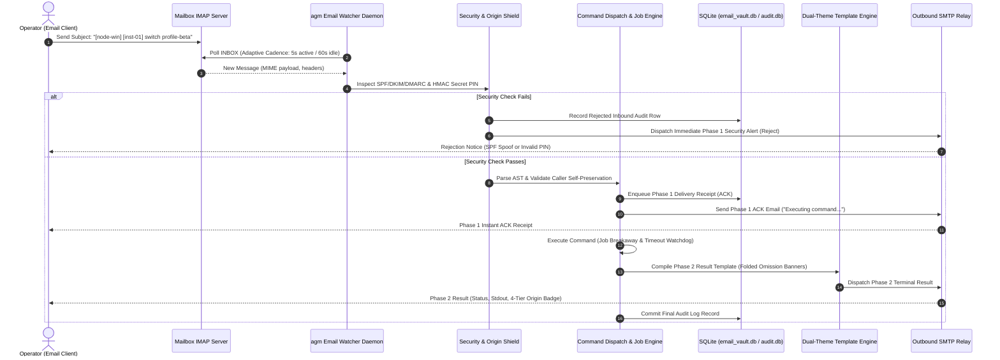

# Emailing UI & CLI Overhaul Specification (Improvements 51–100)

**Slug:** `232-warm-up-ui-and-emailing-ui-improvements`  
**File:** `02-spec/21-app/232-warm-up-ui-and-emailing-ui-improvements/03-emailing-ui-improvements-spec.md`  
**Target Release:** v4.159.0  
**Status:** APPROVED FOR IMPLEMENTATION  
**Lead Author:** Worker 03 (Emailing UI & CLI Architect)  
**Parent Master Ledger:** `02-spec/21-app/232-warm-up-ui-and-emailing-ui-improvements/readme.md`  

---

## 1. Executive Summary & Architectural Scope

This specification details **Cluster 6 through Cluster 10 (Improvements 51 to 100)** for the Antigravity Manager (`agm`) platform. It establishes the architectural blueprints, component specifications, state transitions, security bounds, and headless CLI equivalents for the Emailing subsystem.

The email engine in Antigravity Manager functions as an asynchronous, out-of-band operational interface and telemetry pipeline connecting remote human operators, multi-machine cluster nodes, and automated monitoring daemons. Through bidirectional SMTP alerts and IMAP command watcher loops, operators monitor quota depletion, switch accounts, inspect running prompts, and execute administrative remedies from any standard email client without requiring direct VPN, SSH, or port-forwarding access.

### 1.1 Core Problem Statement & Defect Taxonomy
Prior iterations suffered from five critical architectural gaps:
1. **Opaque Daemon Lifecycle**: Operators lacked visual feedback regarding IMAP polling cadence, backoff transitions, socket disconnects, or TLS handshake degradation.
2. **Brittle Remote Commands**: Inbound email parsing was rigid, lacked dry-run verification, exhibited vulnerability to email spoofing (missing SPF/DKIM validation), and lacked 4-tier origin attribution.
3. **Template Rigidity & Email Clipping**: Outbound notifications frequently exceeded the 102KB Gmail truncation threshold, lacked dual-theme (Outlook light vs. Gmail dark) rendering safety, and emitted untruncated multi-megabyte CLI dumps.
4. **Diagnostic Black Hole**: Connection failures between local nodes and external mail servers (e.g. Gmail, Outlook, SMTP2GO, self-hosted Postfix) produced cryptic SASL error strings without structured step-ladder isolation (DNS vs. TCP vs. TLS vs. Auth vs. Ping).
5. **GUI/CLI Asymmetry**: Desktop GUI features outpaced headless CLI capabilities, leaving server deployments and automated CI/CD runners unable to manage templates, inspect audit logs, or run diagnostic ladders.

---

## 2. System Architecture & Cross-Cutting Invariants

### 2.1 Inbound & Outbound Dual-Pipeline Architecture



### 2.2 Cross-Cutting Invariants & Design Standards

1. **Strictly Relative Git Paths Invariant**: All code references, template includes, log pointers, and documentation links must strictly utilize repository-relative Git paths (e.g., `02-spec/...`, `src/...`, `src-tauri/...`). Absolute filesystem paths (`C:\...`, `/Users/...`) and `file:///` URIs are strictly banned.
2. **4-Tier Origin Classification**: All incoming commands, executed sub-tasks, and outbound status receipts must carry one of the 4 standard origin badges:
   - `USER_PROMPT` (Sky badge `#0284c7`, User icon): Explicit human operator instructions.
   - `SUBAGENT_INSTRUCTION` (Purple badge `#9333ea`, Bot icon): Automated subagent delegations.
   - `SYSTEM_MESSAGE` (Zinc badge `#71717a`, Terminal icon): Watcher heartbeats, quota thresholds, system boots.
   - `TOOL_OUTPUT` (Amber badge `#d97706`, Wrench icon): Raw execution outputs, CLI responses, diagnostic dumps.
3. **Caller Instance Self-Preservation Guard**: Remote commands targeting instance lifecycle (`switch`, `stop`, `rm`) must evaluate `detect_caller_instance_id()`. If a remote command targets the active working IDE session, it must fail-fast with exit code 2 and a structured warning receipt unless `--force` is explicitly provided.
4. **Interactive Truncation & Omission Banners**: Raw untruncated logs and `<truncated N bytes>` markers are forbidden. Massive outputs must be encapsulated in dark-glass omission banners: `⚡ [Omitted N lines of execution output - Click to expand full log]`.
5. **Dark-Glass & Segmented Capsule UI**: Toolbar controls, window buttons, and status monitors must be wrapped in continuous segmented pill capsules (`rounded-full`, shared border, subtle divider lines, dark-glass styling `backdrop-blur-md bg-zinc-900/80 border border-zinc-800`). Dropdowns inside capsules must use transparent borderless styling (`bg-transparent border-0 focus:ring-0 focus:outline-none`).

---

## 3. Cluster 6: Unified Email Command Center & Health Diagnostics (Improvements 51–60)

### Improvement 51: Live Email Activity & Event Stream HUD
- **ID & Title:** 51 — Live Email Activity & Event Stream HUD
- **Category / Cluster:** Cluster 6 — Unified Email Command Center & Health Diagnostics
- **User Need / Problem Statement:** Operators running background email watchers have no visibility into internal events (IMAP check intervals, socket disconnects, SMTP delivery handshakes, or ignored noise emails), forcing them to grep log files.
- **Technical Specification & Architecture Contract:**
  - **Component:** `src/components/email/EmailActivityStreamHud.tsx` mounted inside `src/pages/Email.tsx`.
  - **Backend IPC Channel:** Tauri event `agm://email/stream` emitted by `src-tauri/src/modules/email_watcher/mod.rs` and queried via `invoke("get_recent_email_events", { limit: 100 })`.
  - **Data Schema:**
    ```typescript
    export interface EmailStreamEvent {
      id: string;
      timestamp: number;
      direction: 'INBOUND' | 'OUTBOUND' | 'INTERNAL';
      channel: 'IMAP' | 'SMTP' | 'DAEMON';
      level: 'DEBUG' | 'INFO' | 'WARN' | 'ERROR';
      summary: string;
      details?: Record<string, unknown>;
      duration_ms?: number;
    }
    ```
  - **State Flow:** Maintains a 200-event circular buffer in React state. Supports filter pills (`All`, `Inbound`, `Outbound`, `Errors`), an auto-scroll lock toggle, and a clear view action.
- **Design System Tokens & Aesthetics:**
  - Dark-glass virtualized terminal container: `bg-zinc-950/80 backdrop-blur-md border border-zinc-800/80 rounded-xl p-3 font-mono text-xs`.
  - Direction badges: Inbound (`bg-sky-500/10 text-sky-400 border border-sky-500/30`), Outbound (`bg-emerald-500/10 text-emerald-400 border border-emerald-500/30`), Internal (`bg-zinc-800 text-zinc-400`).
  - Auto-scroll control rendered as a segmented dark-glass capsule in the HUD header.
- **CLI Equivalent & Headless Parity:**
  - `agm email stream --tail 50 --follow`
  - Output format: ANSI colorized streaming rows with timestamps or `--json` for machine consumption.
- **Verification Evidence & Acceptance Criteria:**
  - Triggering an SMTP test ping or IMAP check emits an event within 200ms to the HUD without full page refresh.
  - Pausing auto-scroll retains viewport position while background events increment an unread counter pill.

---

### Improvement 52: Mailbox Connection Health Matrix & Latency Monitor
- **ID & Title:** 52 — Mailbox Connection Health Matrix & Latency Monitor
- **Category / Cluster:** Cluster 6 — Unified Email Command Center & Health Diagnostics
- **User Need / Problem Statement:** Operators managing multiple SMTP/IMAP credentials cannot see which mailboxes have degraded response times, slow handshakes, or failing authentication before an alert fails to send.
- **Technical Specification & Architecture Contract:**
  - **Component:** `src/components/email/MailboxHealthMatrix.tsx`.
  - **Backend IPC Channel:** `invoke("probe_mailbox_health", { accountId?: string }) -> MailboxHealthMetrics`.
  - **Metrics Struct (`src-tauri/src/modules/email_io/health.rs`):**
    ```rust
    pub struct MailboxHealthMetrics {
        pub account_id: String,
        pub alias: String,
        pub imap_ping_ms: Option<u64>,
        pub smtp_handshake_ms: Option<u64>,
        pub tls_negotiation_ms: Option<u64>,
        pub packet_loss_pct: f32,
        pub last_probe_ts: i64,
        pub status: HealthStatus, // Healthy, Degraded, Down
    }
    ```
  - **Polling Cycle:** Probe triggers on tab mount and background scheduled interval (every 10 minutes) with a 60-second in-memory cache to avoid provider rate limiting.
- **Design System Tokens & Aesthetics:**
  - Grid card with subtle border: `bg-zinc-900/40 border border-zinc-800/80 backdrop-blur-md rounded-xl p-4`.
  - Latency color ramp: `<150ms` emerald (`text-emerald-400`), `150-400ms` amber (`text-amber-400`), `>400ms` rose (`text-rose-400`).
  - Mini sparkline rendering last 10 probe latencies via inline SVG paths.
- **CLI Equivalent & Headless Parity:**
  - `agm email ping --all --json`
  - Displays a Lipgloss formatted table of mailboxes, round-trip times, and status flags.
- **Verification Evidence & Acceptance Criteria:**
  - Simulating network throttling (>400ms) flips the card badge to `DEGRADED` (amber) with exact millisecond breakdown.
  - Server unreachable turns status to `DOWN` (rose) with specific failure stage tag (`TCP_TIMEOUT` or `AUTH_REJECT`).

---

### Improvement 53: Adaptive Watcher Cadence Curve Visualizer (60s idle -> 5s active)
- **ID & Title:** 53 — Adaptive Watcher Cadence Curve Visualizer (60s idle -> 5s active)
- **Category / Cluster:** Cluster 6 — Unified Email Command Center & Health Diagnostics
- **User Need / Problem Statement:** The email watcher switches dynamically between high-frequency polling (5s) when a command is executing and battery/quota-saving idle polling (60s), but operators have no visual indicator of current cadence or time until next check.
- **Technical Specification & Architecture Contract:**
  - **Component:** `src/components/email/AdaptiveCadenceVisualizer.tsx`.
  - **Backend IPC Channel:** `invoke("get_watcher_cadence_state") -> WatcherCadenceState`.
  - **State Contract:**
    ```typescript
    export interface WatcherCadenceState {
      current_mode: 'IDLE' | 'AWAITING' | 'ACTIVE_BURST';
      interval_seconds: number;
      next_check_in_seconds: number;
      last_active_timestamp: number;
      cooldown_remaining_seconds: number;
    }
    ```
  - **Visualizer Engine:** Real-time countdown timer bar synchronized with cubic bezier curve animation reflecting current frequency.
- **Design System Tokens & Aesthetics:**
  - Compact segmented container: `bg-zinc-900/60 border border-zinc-800/80 rounded-lg p-3`.
  - Smooth progress bar with glow: `bg-gradient-to-r from-sky-500 to-indigo-500 h-1.5 rounded-full shadow-[0_0_8px_rgba(56,189,248,0.4)]`.
  - Status pill: `bg-sky-950/60 text-sky-300 border border-sky-800/50 text-[10px] px-2 py-0.5 rounded-full`.
- **CLI Equivalent & Headless Parity:**
  - `agm email cadence get`
  - `agm email cadence set --idle 60 --active 5 --cooldown 300`
- **Verification Evidence & Acceptance Criteria:**
  - When an inbound command is acknowledged, the cadence visually accelerates from 60s to 5s within 1 poll cycle.
  - Visual progress bar resets smoothly to 100% and drains to 0% as `next_check_in_seconds` elapses.

---

### Improvement 54: Machine Node & Multi-Instance Target Matrix (`[node] | [instance]`)
- **ID & Title:** 54 — Machine Node & Multi-Instance Target Matrix (`[node] | [instance]`)
- **Category / Cluster:** Cluster 6 — Unified Email Command Center & Health Diagnostics
- **User Need / Problem Statement:** In multi-machine fleets (e.g. Windows workstation, MacBook, Linux CI server), operators sending email commands need clear routing rules to target either a specific node, a specific IDE instance, or all nodes simultaneously.
- **Technical Specification & Architecture Contract:**
  - **Component:** `src/components/email/MultiInstanceTargetMatrix.tsx`.
  - **Backend Contract:** `src-tauri/src/modules/email_inbound/target_resolver.rs`.
  - **Routing Grammar:**
    - `[<node-name>] [<instance-id>] <command>` -> Specific instance on specific node.
    - `[<node-name>] [*] <command>` -> All instances on specific node.
    - `[*] [*] <command>` -> Fleet-wide broadcast across all registered nodes.
  - **Matrix UI:** Displays registered nodes from `supabase_sync` or local config, their online heartbeat status, and their assigned instances.
- **Design System Tokens & Aesthetics:**
  - Matrix table inside dark-glass wrapper: `bg-zinc-900/50 border border-zinc-800/70 rounded-xl`.
  - Target capsules: `font-mono text-xs px-2.5 py-1 rounded-full bg-zinc-800/80 text-zinc-300 border border-zinc-700/60 inline-flex items-center gap-1.5`.
  - Online pulse indicator: `w-2 h-2 rounded-full bg-emerald-400 animate-pulse`.
- **CLI Equivalent & Headless Parity:**
  - `agm email target ls`
  - `agm email target test "[node-mac] [inst-02] status"`
- **Verification Evidence & Acceptance Criteria:**
  - Sending an email with mismatched `[node-name]` ignores execution and logs an ignored-node audit line without error.
  - Matching the local node triggers execution for the exact instance specified.

---

### Improvement 55: Two-Phase Delivery Receipt Inspector (Phase 1 ACK vs. Phase 2 Result)
- **ID & Title:** 55 — Two-Phase Delivery Receipt Inspector (Phase 1 ACK vs. Phase 2 Result)
- **Category / Cluster:** Cluster 6 — Unified Email Command Center & Health Diagnostics
- **User Need / Problem Statement:** Remote email commands (like model inference or multi-step prompt execution) can take several minutes. Without an immediate Phase 1 ACK receipt, operators do not know if the email was received, leading to duplicate command dispatches.
- **Technical Specification & Architecture Contract:**
  - **Component:** `src/components/email/TwoPhaseReceiptInspector.tsx`.
  - **Lifecycle Specification:**
    - **Phase 1 (Instant ACK):** Dispatched within 3 seconds of IMAP ingestion. Contains: Command ID, Received Timestamp, Target Node, Target Instance, and Initial AST.
    - **Phase 2 (Terminal Result):** Dispatched upon completion. Contains: Command ID reference, Execution Duration, Exit Code, Stdout/Stderr summary (with interactive omission banners), and final state.
  - **Inspector UI:** Dual-card split view comparing Phase 1 dispatch timestamp and Phase 2 completion timestamp, calculating latency delta.
- **Design System Tokens & Aesthetics:**
  - Connected timeline step layout: Vertical connecting line `border-l-2 border-zinc-800 ml-4 pl-4 space-y-4`.
  - Phase 1 Badge: `bg-sky-500/10 text-sky-400 border border-sky-500/30 rounded-full px-2 py-0.5 text-xs`.
  - Phase 2 Badge: `bg-emerald-500/10 text-emerald-400 border border-emerald-500/30 rounded-full px-2 py-0.5 text-xs`.
- **CLI Equivalent & Headless Parity:**
  - `agm email receipt inspect <command-id>`
  - Outputs two-phase timeline JSON with timestamps, SMTP message-IDs, and delivery statuses.
- **Verification Evidence & Acceptance Criteria:**
  - Inbound command triggers Phase 1 SMTP dispatch before subprocess execution starts.
  - Phase 2 email contains identical `In-Reply-To` and `References` headers threading back to Phase 1.

---

### Improvement 56: Unified Email Quota & Rate Limit Gauge Bar (SMTP limits + 10s debounce)
- **ID & Title:** 56 — Unified Email Quota & Rate Limit Gauge Bar (SMTP limits + 10s debounce)
- **Category / Cluster:** Cluster 6 — Unified Email Command Center & Health Diagnostics
- **User Need / Problem Statement:** Free and transactional SMTP providers enforce strict limits (e.g., Gmail 500/day, Resend 100/hr, SMTP2GO 1000/day). Rapid alert bursts can trigger provider blacklists or silent email drops.
- **Technical Specification & Architecture Contract:**
  - **Component:** `src/components/email/EmailQuotaGaugeBar.tsx`.
  - **Backend Tracker (`src-tauri/src/modules/email_sender/rate_limiter.rs`):**
    - Sliding window counter persisted in `email_vault.db` (`smtp_dispatches` table).
    - Hard limit enforcement with 10-second outbound burst debounce limiter.
    - IPC: `invoke("get_email_quota_status") -> EmailQuotaStatus`.
  - **Gauge Architecture:** Displays daily dispatches used, remaining quota, burst queue depth, and time until counter reset.
- **Design System Tokens & Aesthetics:**
  - Multi-tier progress bar: `h-2 rounded-full bg-zinc-800 overflow-hidden`.
  - Progress fill ramp: `<75%` sky (`bg-sky-500`), `75-90%` amber (`bg-amber-500`), `>90%` rose (`bg-rose-500`).
  - Dark-glass stats capsule: `bg-zinc-900/60 border border-zinc-800/80 rounded-full px-3 py-1 text-xs text-zinc-300`.
- **CLI Equivalent & Headless Parity:**
  - `agm email quota status`
  - Shows 24h usage, hourly window, and burst debounce queue.
- **Verification Evidence & Acceptance Criteria:**
  - 10 rapid alert triggers within 5 seconds are coalesced into a debounced single digest email, and the gauge bar updates accurately.
  - Exceeding 95% quota triggers a high-priority UI warning toast.

---

### Improvement 57: Inbound Mailbox Unread Inspector & Purge Tool
- **ID & Title:** 57 — Inbound Mailbox Unread Inspector & Purge Tool
- **Category / Cluster:** Cluster 6 — Unified Email Command Center & Health Diagnostics
- **User Need / Problem Statement:** Spam, automated notifications, or old unprocessed command emails clutter the command mailbox, causing IMAP search latency or unintentional execution of stale instructions after daemon restart.
- **Technical Specification & Architecture Contract:**
  - **Component:** `src/components/email/InboundMailboxInspector.tsx`.
  - **Backend IPC Channel:**
    - `invoke("inspect_inbox_messages", { limit: 20 }) -> InboundMessageSummary[]`.
    - `invoke("purge_inbox_messages", { criteria: PurgeCriteria }) -> PurgeResult`.
  - **Safety Contract:** Excludes messages flagged as unread unless explicitly requested; offers "Mark as Read", "Archive to Folder", or "Delete Stale (>7 days)".
- **Design System Tokens & Aesthetics:**
  - Interactive table with select checkboxes: `bg-zinc-900/50 border border-zinc-800/80 rounded-xl overflow-hidden`.
  - Header actions bar with danger-tinted purge button: `bg-rose-500/10 hover:bg-rose-500/20 text-rose-400 border border-rose-500/30 rounded-lg px-3 py-1.5 text-xs transition-colors`.
- **CLI Equivalent & Headless Parity:**
  - `agm email mailbox inspect --unread`
  - `agm email mailbox purge --older-than 7d --dry-run`
- **Verification Evidence & Acceptance Criteria:**
  - Purging 15 stale unread messages removes them from the IMAP server and updates the inspector table within 1 second.
  - Dry-run prints affected message IDs and subjects without issuing IMAP `STORE +FLAGS \Deleted` commands.

---

### Improvement 58: Automated Failover Circuit Breaker & Pool Balancer Card
- **ID & Title:** 58 — Automated Failover Circuit Breaker & Pool Balancer Card
- **Category / Cluster:** Cluster 6 — Unified Email Command Center & Health Diagnostics
- **User Need / Problem Statement:** If the primary SMTP relay (e.g. corporate relay) goes down or credentials expire, critical system alerts are permanently lost without automatic failover to a backup provider.
- **Technical Specification & Architecture Contract:**
  - **Component:** `src/components/email/FailoverCircuitBreakerCard.tsx`.
  - **Backend Engine (`src-tauri/src/modules/email_sender/circuit_breaker.rs`):**
    - Circuit States: `CLOSED` (Normal), `OPEN` (Tripped after 3 consecutive errors), `HALF-OPEN` (Trial probe after 5m cooldown).
    - Priority Relay Pool: Automatically shifts traffic to Secondary Account (e.g. Backup SendGrid/Resend) when Primary is `OPEN`.
    - IPC: `invoke("get_email_circuit_breaker_status") -> CircuitBreakerStatus`.
- **Design System Tokens & Aesthetics:**
  - Status Card with glowing circuit state badge:
    - Closed (Healthy): `border-emerald-500/30 bg-emerald-950/20 text-emerald-400`.
    - Open (Tripped): `border-rose-500/30 bg-rose-950/20 text-rose-400 animate-pulse`.
  - Segmented relay pool ladder displaying Primary -> Secondary -> Tertiary with drag-to-reorder capability.
- **CLI Equivalent & Headless Parity:**
  - `agm email pool list`
  - `agm email pool trip --account-id <id>` (manual simulation)
  - `agm email pool reset`
- **Verification Evidence & Acceptance Criteria:**
  - Simulating 3 consecutive SMTP 550 errors trips the breaker within 15 seconds, and subsequent alerts dispatch cleanly via Secondary relay.
  - Resetting the primary relay restores normal priority routing after trial probe succeeds.

---

### Improvement 59: Dark-Glass Email Status Segmented Capsule Bar in Header
- **ID & Title:** 59 — Dark-Glass Email Status Segmented Capsule Bar in Header
- **Category / Cluster:** Cluster 6 — Unified Email Command Center & Health Diagnostics
- **User Need / Problem Statement:** Operators navigating across different pages of Antigravity Manager have no persistent indicator of email watcher liveness, connection status, or unread command queues.
- **Technical Specification & Architecture Contract:**
  - **Component:** `src/components/email/EmailHeaderStatusCapsule.tsx` mounted in global navigation header.
  - **Visual Elements:**
    - Segment 1: Watcher state indicator (Green dot for `WATCHING`, Amber dot for `PAUSED`, Gray for `OFF`).
    - Segment 2: Mailbox address with transparent inline dropdown to switch active mailbox.
    - Segment 3: Next poll countdown ticker (`14s`).
    - Segment 4: Quick Action (Pause / Resume / Test Ping).
  - **Dropdown Styling Rule:** Transparent borderless styling (`bg-transparent border-0 focus:ring-0 focus:outline-none text-zinc-300 text-xs cursor-pointer`).
- **Design System Tokens & Aesthetics:**
  - Segmented pill capsule: `flex items-center rounded-full bg-zinc-900/80 backdrop-blur-md border border-zinc-800 shadow-sm divide-x divide-zinc-800/80 px-1 py-0.5 text-xs`.
  - Subtle hover highlight per segment: `hover:bg-zinc-800/50 transition-colors px-2.5 py-1`.
- **CLI Equivalent & Headless Parity:**
  - `agm email status --compact`
  - Emits single-line status summary: `[EMAIL] ACTIVE | imap.gmail.com:993 | Poll: 5s | Unread: 0`.
- **Verification Evidence & Acceptance Criteria:**
  - Clicking "Pause" transitions the daemon to idle, flips the indicator dot to amber, and suspends IMAP polling immediately.
  - Switching mailboxes via the transparent dropdown persists change to `email_vault.db` and resets the watcher socket without app reload.

---

### Improvement 60: Global Notification Snooze & Quiet Hours Scheduler
- **ID & Title:** 60 — Global Notification Snooze & Quiet Hours Scheduler
- **Category / Cluster:** Cluster 6 — Unified Email Command Center & Health Diagnostics
- **User Need / Problem Statement:** Non-critical alerts (e.g. idle workspace notifications, routine model warm-up reports) disturb operators during sleep hours or weekends, while critical failure alerts must never be silenced.
- **Technical Specification & Architecture Contract:**
  - **Component:** `src/components/email/QuietHoursSchedulerModal.tsx`.
  - **Backend Evaluation Engine (`src-tauri/src/modules/email_sender/scheduler.rs`):**
    - Schedule configuration: start time, end time, timezone, active days of week.
    - Priority Filter: During quiet hours, suppresses `INFO` and `LOW` alerts, but immediately bypasses snooze for `CRITICAL` alerts (e.g. `QUOTA_EXHAUSTED`, `AUTH_REVOKED`, `CIRCUIT_TRIPPED`).
    - Snooze Override: Quick snooze button for 1h, 2h, 4h, or 8h.
- **Design System Tokens & Aesthetics:**
  - 24-hour visual interactive timeline slider with shaded quiet-range band (`bg-indigo-950/40 border-x border-indigo-500/40`).
  - Dark-glass configuration panel: `bg-zinc-900/90 border border-zinc-800 rounded-2xl p-5`.
  - Segmented day-of-week toggle capsules: `rounded-full text-xs font-semibold px-2.5 py-1`.
- **CLI Equivalent & Headless Parity:**
  - `agm email snooze --duration 2h`
  - `agm email quiet-hours set --start 22:00 --end 08:00 --tz "America/New_York"`
- **Verification Evidence & Acceptance Criteria:**
  - Sending a routine workspace idle alert during configured quiet hours holds the email in `delayed_alerts` queue.
  - A critical quota drop alert dispatches immediately regardless of quiet hours.


---

## 4. Cluster 7: Visual Email Template Designer & Dual-Theme Previews (Improvements 61–70)

### Improvement 61: Visual Email Template Designer with Dynamic Variable Token Palette
- **ID & Title:** 61 — Visual Email Template Designer with Dynamic Variable Token Palette
- **Category / Cluster:** Cluster 7 — Visual Email Template Designer & Dual-Theme Previews
- **User Need / Problem Statement:** Operators customizing email alert templates must memorize raw template keys (`node_name`, `instance_id`, `quota_pct`, `exit_code`). A missing or mistyped variable produces broken emails or unrendered tokens in production.
- **Technical Specification & Architecture Contract:**
  - **Component:** `src/components/email/EmailTemplateDesigner.tsx`.
  - **Backend IPC Channel:** `invoke("list_template_variables") -> TemplateVariableGroup[]`.
  - **Variable Token Palette Specification:**
    - System Variables: `{{system.node_name}}`, `{{system.ip}}`, `{{system.uptime}}`, `{{system.timestamp_iso}}`.
    - Instance Variables: `{{instance.id}}`, `{{instance.name}}`, `{{instance.active_profile}}`, `{{instance.status}}`.
    - Quota Variables: `{{quota.current_pct}}`, `{{quota.weekly_score}}`, `{{quota.drop_rate}}`, `{{quota.reset_time}}`.
    - Execution Variables: `{{exec.command_id}}`, `{{exec.duration_ms}}`, `{{exec.exit_code}}`, `{{exec.origin_tier}}`, `{{exec.output_summary}}`.
  - **Interactive Token Insertion:** Clicking any variable token pill inserts it directly into the active cursor position in the template code editor with correct Jinja/Mustache delimiters.
- **Design System Tokens & Aesthetics:**
  - Split-pane layout: Left editor (50%), Right live compiled preview (50%).
  - Token chip button: `px-2 py-0.5 rounded-full text-[11px] font-mono bg-zinc-800 hover:bg-zinc-700 text-sky-400 border border-zinc-700 hover:border-sky-500/50 transition-all cursor-pointer inline-flex items-center gap-1`.
  - Group accordion: Dark-glass cards with subtle chevron indicators.
- **CLI Equivalent & Headless Parity:**
  - `agm email templates tokens`
  - Lists all available template variables grouped by category with types, sample values, and descriptions.
- **Verification Evidence & Acceptance Criteria:**
  - Clicking `{{quota.current_pct}}` inserts the exact token at the cursor in the editor and updates the compiled preview pane within 100ms.
  - Undefined variable tokens trigger an inline warning badge in the preview pane.

---

### Improvement 62: Dual-Theme Side-by-Side Simulator (Outlook Light vs. Gmail Dark)
- **ID & Title:** 62 — Dual-Theme Side-by-Side Simulator (Outlook Light vs. Gmail Dark)
- **Category / Cluster:** Cluster 7 — Visual Email Template Designer & Dual-Theme Previews
- **User Need / Problem Statement:** Emails authored in dark mode frequently render illegible in light-mode email clients (like Outlook or Apple Mail), while dark-mode clients (like Gmail Android or Outlook Web) invert CSS background colors uncontrollably, destroying contrast.
- **Technical Specification & Architecture Contract:**
  - **Component:** `src/components/email/DualThemeEmailSimulator.tsx`.
  - **Simulation Engine:**
    - **Outlook Light Viewport:** Sandboxed `iframe` rendering with standard light baseline (`background-color: #ffffff; color: #1e293b`), explicit table cell styles, and MSO conditional comments enabled.
    - **Gmail Dark Viewport:** Sandboxed `iframe` applying aggressive CSS color inversion rules (`filter: invert(1) hue-rotate(180deg)` simulation alongside CSS `[data-ogsc]` and `@media (prefers-color-scheme: dark)` overrides).
    - **Synchronized Scrolling:** Scroll position on either pane synchronously translates to the companion pane.
- **Design System Tokens & Aesthetics:**
  - Segmented dual-pane container with dark-glass chrome: `rounded-2xl border border-zinc-800 bg-zinc-950/80 overflow-hidden shadow-2xl`.
  - Header segmented capsule: `rounded-full bg-zinc-900 border border-zinc-800 px-3 py-1 text-xs text-zinc-400 flex items-center gap-2`.
  - Client simulated header bars: Simulated Outlook light titlebar vs. simulated Gmail dark titlebar.
- **CLI Equivalent & Headless Parity:**
  - `agm email templates preview <template-id> --theme all --render-png /tmp/preview.png`
  - Renders headless Chromium snapshots of both themes for CI validation.
- **Verification Evidence & Acceptance Criteria:**
  - Both simulated iframes render side-by-side with synchronized scroll.
  - Text contrast ratio in both panes meets WCAG AA (minimum 4.5:1) verified via automated contrast assertion.

---

### Improvement 63: Pluggable Brand Theme Token & CSS Palette Styler
- **ID & Title:** 63 — Pluggable Brand Theme Token & CSS Palette Styler
- **Category / Cluster:** Cluster 7 — Visual Email Template Designer & Dual-Theme Previews
- **User Need / Problem Statement:** Organizations want email notifications to match their brand identity (custom accent colors, corporate logo, typography, footer links) without manually rewriting HTML tables in every template.
- **Technical Specification & Architecture Contract:**
  - **Component:** `src/components/email/BrandThemeStylerModal.tsx`.
  - **Theme Configuration Schema (`brand_theme.json`):**
    ```typescript
    export interface BrandThemeConfig {
      brand_name: string;
      logo_url: string;
      primary_accent: string;      // e.g. #6366f1 (Indigo)
      secondary_accent: string;    // e.g. #0284c7 (Sky)
      dark_bg: string;             // e.g. #09090b (Zinc 950)
      light_bg: string;            // e.g. #f8fafc (Slate 50)
      font_family: string;         // 'JetBrains Mono', 'Inter', monospace
      footer_text: string;
      compliance_disclaimer: string;
    }
    ```
  - **CSS Injection Pipeline:** Injects standardized CSS variables (`--agm-brand-primary`, `--agm-brand-bg`) into the MJML/HTML build stage.
- **Design System Tokens & Aesthetics:**
  - Color picker capsules: Circular color swatches embedded within dark-glass input wrappers.
  - Live preview badge: Updates immediate brand styling on sample template card.
- **CLI Equivalent & Headless Parity:**
  - `agm email brand get`
  - `agm email brand set --primary "#6366f1" --logo "https://assets.org/logo.png"`
- **Verification Evidence & Acceptance Criteria:**
  - Updating `--primary-accent` immediately updates all template preview cards and compiled outgoing email headers.
  - Resetting to defaults restores the canonical Antigravity dark-glass palette (`#09090b` / `#0284c7`).

---

### Improvement 64: Template Jinja/Mustache Token Syntax Highlighter Editor
- **ID & Title:** 64 — Template Jinja/Mustache Token Syntax Highlighter Editor
- **Category / Cluster:** Cluster 7 — Visual Email Template Designer & Dual-Theme Previews
- **User Need / Problem Statement:** Plain textareas allow syntax errors (such as unclosed `{{` or mismatched `` blocks) to go unnoticed until template rendering throws a panic at runtime.
- **Technical Specification & Architecture Contract:**
  - **Component:** `src/components/email/TemplateCodeEditor.tsx`.
  - **Editor Core:** Monaco Editor or CodeMirror 6 with custom grammar extension for Jinja2/Mustache template syntax.
  - **Linter & Validator:**
    - Real-time token parsing verifying balanced tags: `{{ ... }}`, `` -> ``, `` -> ``.
    - Inline gutter markers for syntax errors with red underlines and hover tooltips explaining the error.
    - Autocomplete provider suggesting variables and filters (`| format_date`, `| upper`, `| truncate(50)`).
- **Design System Tokens & Aesthetics:**
  - Dark-glass editor frame: `border border-zinc-800 bg-zinc-950 rounded-xl overflow-hidden`.
  - Custom dark theme tokens: Match Antigravity Editor theme (Zinc 950 base, Sky keywords, Amber strings).
- **CLI Equivalent & Headless Parity:**
  - `agm email templates lint <file.html>`
  - Returns exit code 0 if syntax is valid, or exit code 1 with line and column of syntax errors.
- **Verification Evidence & Acceptance Criteria:**
  - Typing an unclosed `` displays an immediate error marker in the gutter: "Unclosed block tag: missing ".
  - Pressing Tab inside variable delimiters auto-completes available context variables.

---

### Improvement 65: HTML Email Size & Truncation Guard (<102KB Gmail clipping)
- **ID & Title:** 65 — HTML Email Size & Truncation Guard (<102KB Gmail clipping)
- **Category / Cluster:** Cluster 7 — Visual Email Template Designer & Dual-Theme Previews
- **User Need / Problem Statement:** Gmail's web and mobile apps strictly truncate any email whose HTML body exceeds 102,400 bytes (100KB), appending `[Message clipped] View entire message`, which hides call-to-action buttons, security PINs, and execution results.
- **Technical Specification & Architecture Contract:**
  - **Component:** `src/components/email/EmailSizeGuardBadge.tsx`.
  - **Size Guard Engine (`src-tauri/src/modules/email_sender/size_guard.rs`):**
    - Calculates raw UTF-8 byte length of compiled HTML (including inline CSS and inline base64 images).
    - Thresholds: Safe (`<80KB`, emerald), Warning (`80KB-98KB`, amber), Critical (`>98KB`, rose with auto-minification trigger).
    - Automated minifier: Strips redundant whitespace, HTML comments, and minifies inline style attributes if payload approaches 100KB.
- **Design System Tokens & Aesthetics:**
  - Segmented size capsule: `bg-zinc-900/90 border border-zinc-800 rounded-full px-3 py-1 flex items-center gap-2 text-xs`.
  - Micro byte gauge: Segmented bar displaying `64.2 KB / 102.0 KB (63%)`.
- **CLI Equivalent & Headless Parity:**
  - `agm email templates check-size <template-id>`
  - Emits byte count, breakdown (CSS vs. DOM vs. Images), and clipping risk verdict.
- **Verification Evidence & Acceptance Criteria:**
  - A template compiling to 105KB triggers an immediate red alert badge and automatically runs HTML whitespace minification to bring it under 95KB.
  - Emails exceeding 102KB cannot be saved without an explicit operator confirmation override.

---

### Improvement 66: Interactive Omission Banners for Massive CLI Dumps in Receipts
- **ID & Title:** 66 — Interactive Omission Banners for Massive CLI Dumps in Receipts
- **Category / Cluster:** Cluster 7 — Visual Email Template Designer & Dual-Theme Previews
- **User Need / Problem Statement:** Long-running CLI tasks (such as build outputs, test runs, or error logs) generate hundreds of lines of output. Dumping raw text into email causes Gmail clipping and renders emails unreadable on mobile devices.
- **Technical Specification & Architecture Contract:**
  - **Component / Email Snippet:** `src/components/email/templates/EmailOmissionBanner.html`.
  - **Formatter Engine (`src-tauri/src/modules/email_sender/omission_formatter.rs`):**
    - Scans CLI output: if lines exceed 30 lines or 4KB, slices output into:
      1. Head (first 10 lines)
      2. Dark-glass interactive omission callout:
         ```html
         <div style="background: #18181b; border: 1px dashed #3f3f46; border-radius: 8px; padding: 12px; margin: 12px 0; text-align: center;">
           <span style="color: #38bdf8; font-weight: 600;">⚡ [Omitted 142 lines / 8.4 KB of execution output]</span><br/>
           <a href="{{receipt.full_log_url}}" style="color: #a1a1aa; font-size: 11px; text-decoration: underline;">View Full Log in Antigravity Dashboard</a>
         </div>
         ```
      3. Tail (last 20 lines with errors/exit status).
  - **Invariant Compliance:** Strictly replaces raw `<truncated N bytes>` markers with sleek styled omission banners.
- **Design System Tokens & Aesthetics:**
  - Email HTML inline styling: Dark-glass simulation `#18181b`, dashed `#3f3f46` border, `#38bdf8` sky callout text, monospace typography.
- **CLI Equivalent & Headless Parity:**
  - `agm email send-receipt --fold-omissions --max-lines 30`
- **Verification Evidence & Acceptance Criteria:**
  - A 250-line CLI log output is compiled into an email body under 35KB with head, omission callout, and tail cleanly rendered.
  - Clicking the omission banner link opens the full un-truncated log in the local AGM web dashboard or CLI.

---

### Improvement 67: One-Click Quick Test Dispatch to Developer Mailbox
- **ID & Title:** 67 — One-Click Quick Test Dispatch to Developer Mailbox
- **Category / Cluster:** Cluster 7 — Visual Email Template Designer & Dual-Theme Previews
- **User Need / Problem Statement:** Testing template changes requires manual navigation, setting up mock variables, and sending emails via multiple forms, creating friction during template development.
- **Technical Specification & Architecture Contract:**
  - **Component:** Action button mounted in `EmailTemplateDesigner.tsx` header toolbar.
  - **Backend IPC Channel:** `invoke("send_quick_test_template", { templateId: string, recipientEmail?: string }) -> TestDispatchResult`.
  - **Fixture Generator:** Automatically populates template variables with realistic mock data (mock node name, mock quota drops, mock prompt run steps).
  - **Debounce Protection:** Enforces 3-second debounce on the quick test button to prevent accidental spamming.
- **Design System Tokens & Aesthetics:**
  - Segmented button: `bg-sky-600 hover:bg-sky-500 text-white text-xs font-medium px-3 py-1.5 rounded-full shadow-sm hover:shadow-sky-500/20 inline-flex items-center gap-1.5 transition-all`.
  - In-flight spinner: Replaces paper-plane icon with subtle spinning ring during SMTP transmission.
- **CLI Equivalent & Headless Parity:**
  - `agm email test-template <template-id> --to dev@example.com`
  - Sends immediate test email with standard fixture data and reports transmission latency.
- **Verification Evidence & Acceptance Criteria:**
  - Clicking "Send Test" compiles the template and dispatches an email within 1.5 seconds, displaying a success toast with the SMTP message ID.
  - Recipient mailbox receives an email matching the live designer preview pixel-for-pixel.

---

### Improvement 68: Mobile (375px) vs. Tablet vs. Desktop Responsive Breakpoint Simulator
- **ID & Title:** 68 — Mobile (375px) vs. Tablet vs. Desktop Responsive Breakpoint Simulator
- **Category / Cluster:** Cluster 7 — Visual Email Template Designer & Dual-Theme Previews
- **User Need / Problem Statement:** Operators read alerts on mobile devices (e.g. iPhone SE / 13 mini at 375px width). Complex tables and long subject badges can break viewport boundaries, causing horizontal scrolling.
- **Technical Specification & Architecture Contract:**
  - **Component:** `src/components/email/ResponsiveViewportSimulator.tsx`.
  - **Viewport Modes:**
    - `Mobile`: Fixed 375px width with mobile device frame styling.
    - `Tablet`: Fixed 768px width.
    - `Desktop`: 100% fluid container (max 1200px).
  - **Overflow Detector:** Evaluates `scrollWidth > clientWidth` inside the preview iframe; flashes an amber warning banner if any table or code block forces horizontal scrolling on mobile.
- **Design System Tokens & Aesthetics:**
  - Segmented device switcher capsule in preview header:
    - `flex items-center rounded-full bg-zinc-900 border border-zinc-800 p-0.5`.
    - Active pill: `bg-zinc-800 text-sky-400 rounded-full px-2.5 py-1 text-xs font-medium`.
- **CLI Equivalent & Headless Parity:**
  - `agm email templates check-responsive <template-id>`
  - Evaluates HTML against 375px viewport constraints and reports any fixed-width elements exceeding 375px.
- **Verification Evidence & Acceptance Criteria:**
  - Switching to `Mobile 375px` smoothly constrains the iframe width with a CSS transition.
  - An email with a fixed `<table width="600">` immediately triggers an overflow warning banner: "Horizontal overflow detected on mobile: 600px > 375px".

---

### Improvement 69: Export Template as Reusable HTML/MJML Bundle
- **ID & Title:** 69 — Export Template as Reusable HTML/MJML Bundle
- **Category / Cluster:** Cluster 7 — Visual Email Template Designer & Dual-Theme Previews
- **User Need / Problem Statement:** Teams running multiple Antigravity Manager instances cannot easily share customized email templates or migrate them between developer machines.
- **Technical Specification & Architecture Contract:**
  - **Component:** `src/components/email/TemplateImportExportModal.tsx`.
  - **Bundle Format:** Single `.agm-template.json` or `.zip` file containing:
    - `metadata.json`: Template name, category, author, compatible schema version.
    - `template.mjml` / `template.html`: Source template content.
    - `styles.css`: Inline styling overrides.
    - `fixtures.json`: Sample payload data for testing.
  - **Backend IPC Channel:** `invoke("export_template_bundle", { templateId: string }) -> string` and `invoke("import_template_bundle", { bundleJson: string }) -> TemplateSummary`.
- **Design System Tokens & Aesthetics:**
  - Modal with drag-and-drop file dropzone: `border-2 border-dashed border-zinc-800 hover:border-zinc-700 bg-zinc-950/50 rounded-2xl p-6 text-center transition-all`.
  - Export download pill button with dark-glass styling.
- **CLI Equivalent & Headless Parity:**
  - `agm email templates export <template-id> -o bundle.json`
  - `agm email templates import bundle.json --overwrite`
- **Verification Evidence & Acceptance Criteria:**
  - Exporting a template generates a valid JSON bundle that can be re-imported into a clean instance with zero asset loss.
  - Importing a bundle with incompatible schema version throws a clean validation error without corrupting existing templates.

---

### Improvement 70: Event-to-Template Custom Mapping Rules Engine
- **ID & Title:** 70 — Event-to-Template Custom Mapping Rules Engine
- **Category / Cluster:** Cluster 7 — Visual Email Template Designer & Dual-Theme Previews
- **User Need / Problem Statement:** System events (e.g. `QUOTA_DROP`, `WORKSPACE_SWITCH`, `REMOTE_COMMAND_ACK`, `TASK_FAILURE`) use hardcoded templates. Operators cannot assign specialized templates to specific severity levels or target recipient groups.
- **Technical Specification & Architecture Contract:**
  - **Component:** `src/components/email/EventTemplateMappingRules.tsx`.
  - **Mapping Rule Contract (`email_vault.db` -> `event_template_rules` table):**
    ```typescript
    export interface EventTemplateRule {
      id: string;
      event_type: 'QUOTA_CRITICAL' | 'PROMPT_COMPLETED' | 'WORKSPACE_SWITCH' | 'REMOTE_COMMAND_ACK' | 'DAEMON_ERROR';
      condition_expr?: string; // e.g. "quota_pct < 20" or "exit_code != 0"
      template_id: string;
      priority: number;
      is_enabled: boolean;
    }
    ```
  - **Rule Evaluator:** When an event fires, the engine scans rules in descending order of priority, evaluates optional expression predicates, and renders the matching template.
- **Design System Tokens & Aesthetics:**
  - Rule mapping table with drag-and-drop priority handles: `bg-zinc-900/60 border border-zinc-800 rounded-xl overflow-hidden`.
  - Event pill badges color-coded by event category (Critical = Rose, Execution = Sky, Status = Zinc).
- **CLI Equivalent & Headless Parity:**
  - `agm email routing ls`
  - `agm email routing bind --event QUOTA_CRITICAL --template custom_quota_v2 --priority 10`
- **Verification Evidence & Acceptance Criteria:**
  - Binding a custom template to `QUOTA_CRITICAL` routes all quota alerts through the custom template while other events remain on default templates.
  - Disabling a rule falls back gracefully to the built-in system template.

---

## 5. Cluster 8: Inbound Remote Command Playground & Security Shields (Improvements 71–80)

### Improvement 71: Inbound Email Command Simulator & Dry-Run Parser Playground
- **ID & Title:** 71 — Inbound Email Command Simulator & Dry-Run Parser Playground
- **Category / Cluster:** Cluster 8 — Inbound Remote Command Playground & Security Shields
- **User Need / Problem Statement:** Operators need to verify how an email command subject and body will be parsed and whether it will execute the intended action without risking accidental destructive actions on live instances.
- **Technical Specification & Architecture Contract:**
  - **Component:** `src/components/email/InboundCommandPlayground.tsx`.
  - **Backend IPC Channel:** `invoke("simulate_inbound_command", { input: InboundSimInput }) -> InboundSimResult`.
  - **Parser AST Engine (`src-tauri/src/modules/email_inbound/parser.rs`):**
    - Input: Subject line, Sender email address, Plain text body, Security headers.
    - Output:
      ```typescript
      export interface InboundSimResult {
        is_valid: boolean;
        target_node: string;
        target_instance?: string;
        command_verb: 'SWITCH' | 'STATUS' | 'PROMPT' | 'STOP' | 'PURGE';
        args: Record<string, string>;
        security_verdict: 'AUTHORIZED' | 'REJECTED_SENDER' | 'REJECTED_TOKEN' | 'REJECTED_ACL';
        dry_run_execution_plan: string[];
      }
      ```
  - **Zero Harm Rule:** Dry-run parser performs full tokenization and validation without spawning processes or writing to task databases.
- **Design System Tokens & Aesthetics:**
  - Interactive simulator split cards: Subject/Body editor on left, Real-time JSON AST & Plan on right.
  - Syntax highlighted AST viewer in dark-glass container.
- **CLI Equivalent & Headless Parity:**
  - `agm email test-inbound --from dev@org.com --subject "[node-win] switch account-2" --dry-run`
- **Verification Evidence & Acceptance Criteria:**
  - Entering `[node-mac] [inst-01] switch profile-beta` parses target node as `node-mac`, instance as `inst-01`, verb as `SWITCH`, and displays simulated dispatch plan within 50ms.
  - Syntax errors output exact token position and recommended correction.

---

### Improvement 72: SPF / DKIM / DMARC Header Verification Security Shield
- **ID & Title:** 72 — SPF / DKIM / DMARC Header Verification Security Shield
- **Category / Cluster:** Cluster 8 — Inbound Remote Command Playground & Security Shields
- **User Need / Problem Statement:** Attackers can spoof the `From:` header in standard SMTP emails to impersonate an authorized operator, potentially executing unauthorized remote commands on the cluster.
- **Technical Specification & Architecture Contract:**
  - **Component:** `src/components/email/SecurityHeaderShieldCard.tsx`.
  - **Verification Engine (`src-tauri/src/modules/email_inbound/auth_shield.rs`):**
    - Parses inbound email headers: `Received-SPF`, `Authentication-Results`, `DKIM-Signature`, and `ARC-Authentication-Results`.
    - Verification Matrix:
      - **SPF:** Checks if sender IP is authorized for the sender domain.
      - **DKIM:** Verifies cryptographic signature against domain public DNS key.
      - **DMARC:** Asserts domain alignment policy (`p=reject` or `p=quarantine`).
    - Enforcement Policy: Configurable in settings (`STRICT`: requires both SPF and DKIM pass; `PERMISSIVE`: requires either SPF or DKIM; `DISABLED`: insecure dev mode).
- **Design System Tokens & Aesthetics:**
  - Triple security badge capsule:
    - SPF: `bg-emerald-500/10 text-emerald-400 border border-emerald-500/30 rounded-full px-2 py-0.5 text-xs font-mono`.
    - DKIM: `bg-emerald-500/10 text-emerald-400 border border-emerald-500/30 rounded-full px-2 py-0.5 text-xs font-mono`.
    - DMARC: `bg-emerald-500/10 text-emerald-400 border border-emerald-500/30 rounded-full px-2 py-0.5 text-xs font-mono`.
  - Shield status indicator in Inbound Audit Drawer.
- **CLI Equivalent & Headless Parity:**
  - `agm email security verify-headers <raw_email.eml>`
  - Outputs JSON breakdown of authentication headers and final security clearance verdict.
- **Verification Evidence & Acceptance Criteria:**
  - An inbound email failing SPF or DKIM when policy is `STRICT` is immediately quarantined without command execution, and a security alert is recorded in `email_audit.db`.
  - Valid cryptographic DKIM signatures pass seamlessly with a green security badge.

---

### Improvement 73: HMAC-SHA256 Command Token & Secret PIN Authorization
- **ID & Title:** 73 — HMAC-SHA256 Command Token & Secret PIN Authorization
- **Category / Cluster:** Cluster 8 — Inbound Remote Command Playground & Security Shields
- **User Need / Problem Statement:** In environments where email headers cannot be cryptographically verified (such as internal relay hops), an explicit secondary authorization factor is required to prevent unauthorized execution.
- **Technical Specification & Architecture Contract:**
  - **Component:** `src/components/email/HmacAuthSettingsCard.tsx`.
  - **Dual Authorization Modes:**
    - **Mode A (Static/Rolling PIN):** Subject or body must include `--pin <6-digit-secret>` configured in the security vault.
    - **Mode B (HMAC-SHA256 Token):** Subject or body includes an `agm-auth: <hmac>` signature computed as `HMAC_SHA256(secret_key, timestamp + ":" + command_string)`. Valid within a 5-minute replay window.
  - **Replay Attack Guard:** Stores used HMAC signatures in `email_vault.db` (`used_command_tokens` table) with 10-minute TTL; identical tokens are rejected.
- **Design System Tokens & Aesthetics:**
  - Dark-glass security configuration card with masked secret key input (`••••••••••••`).
  - Rolling PIN display pill with countdown circle timer (similar to TOTP UI).
- **CLI Equivalent & Headless Parity:**
  - `agm email security gen-token --command "switch account-2"`
  - Generates valid HMAC-SHA256 header and command string ready for email subject insertion.
- **Verification Evidence & Acceptance Criteria:**
  - Submitting an email command without the required PIN or HMAC returns an unauthorized rejection email.
  - Re-sending an email with an identical HMAC token triggers the replay attack guard and rejects execution.

---

### Improvement 74: 4-Tier Origin Classification Badges in Email Receipts
- **ID & Title:** 74 — 4-Tier Origin Classification Badges in Email Receipts
- **Category / Cluster:** Cluster 8 — Inbound Remote Command Playground & Security Shields
- **User Need / Problem Statement:** Remote execution receipts and audit views mix human instructions, subagent sub-tasks, automated watcher events, and CLI tool outputs into indistinguishable text blocks.
- **Technical Specification & Architecture Contract:**
  - **Specification Contract:** Strict alignment with the project-wide 4-tier prompt origin classification:
    - Tier 1: `USER_PROMPT` — Badge color: Sky `#0284c7`, Icon: User. Indicates direct human operator commands received via email.
    - Tier 2: `SUBAGENT_INSTRUCTION` — Badge color: Purple `#9333ea`, Icon: Bot. Indicates tasks spawned by subagents or dynamic team workers.
    - Tier 3: `SYSTEM_MESSAGE` — Badge color: Zinc `#71717a`, Icon: Terminal. Indicates daemon alerts, heartbeats, or system notifications.
    - Tier 4: `TOOL_OUTPUT` — Badge color: Amber `#d97706`, Icon: Wrench. Indicates command stdout, compiler outputs, or test results.
  - **HTML Email Template Renderer:** Injects corresponding SVG icons, inline colors, and nested indentation branches (`↳`, `└──`) into outgoing email receipts.
- **Design System Tokens & Aesthetics:**
  - Web & Email Badge Tokens:
    - Sky: `bg-sky-500/10 text-sky-400 border border-sky-500/30`.
    - Purple: `bg-purple-500/10 text-purple-400 border border-purple-500/30`.
    - Zinc: `bg-zinc-800 text-zinc-400 border border-zinc-700`.
    - Amber: `bg-amber-500/10 text-amber-400 border border-amber-500/30`.
- **CLI Equivalent & Headless Parity:**
  - `agm email receipts list --tier user|subagent|system|tool`
  - Renders Lipgloss table with color-coded origin badges.
- **Verification Evidence & Acceptance Criteria:**
  - Outbound email receipts render the correct origin badge and color for each step in a multi-subagent execution.
  - Subagents appear visually nested under parent prompts in the audit tree.

---

### Improvement 75: Granular Per-Command ACL & Permission Matrix Checkboxes
- **ID & Title:** 75 — Granular Per-Command ACL & Permission Matrix Checkboxes
- **Category / Cluster:** Cluster 8 — Inbound Remote Command Playground & Security Shields
- **User Need / Problem Statement:** Operators need fine-grained control over which commands can be executed via email; for example, allowing `status` and `quota` for junior operators, while restricting `switch`, `restart`, or `purge` to administrators.
- **Technical Specification & Architecture Contract:**
  - **Component:** `src/components/email/EmailAclMatrix.tsx`.
  - **ACL Schema (`email_vault.db` -> `email_acl_rules`):**
    ```typescript
    export interface EmailAclRule {
      sender_pattern: string; // e.g. "*@corp.com" or "lead@dev.io"
      allow_status: boolean;
      allow_quota: boolean;
      allow_prompt: boolean;
      allow_switch: boolean;
      allow_restart: boolean;
      allow_kill: boolean;
      allow_purge: boolean;
    }
    ```
  - **Access Gatekeeper:** Evaluates sender email against ACL rules before AST dispatch. Denied actions return a structured permission denial receipt.
- **Design System Tokens & Aesthetics:**
  - Interactive grid with custom dark-glass checkboxes: `accent-sky-500 rounded border-zinc-700 bg-zinc-900`.
  - Sender pattern rows with regex validity indicator.
- **CLI Equivalent & Headless Parity:**
  - `agm email acl get`
  - `agm email acl set --sender "*@corp.com" --allow "status,quota" --deny "switch,kill"`
- **Verification Evidence & Acceptance Criteria:**
  - An unauthorized sender attempting `switch account-2` receives an email: "Access Denied: Sender lacks permission for command verb [SWITCH]".
  - Permitted commands execute without hindrance.

---

### Improvement 76: Interactive Inbound Audit Log & Incident Replay Drawer
- **ID & Title:** 76 — Interactive Inbound Audit Log & Incident Replay Drawer
- **Category / Cluster:** Cluster 8 — Inbound Remote Command Playground & Security Shields
- **User Need / Problem Statement:** When an email command fails or behaves unexpectedly, operators cannot inspect the raw inbound MIME headers, extracted command parameters, or subprocess exit codes to diagnose the issue.
- **Technical Specification & Architecture Contract:**
  - **Component:** `src/components/email/InboundAuditDrawer.tsx` (slide-over panel from right).
  - **Backend IPC Channel:**
    - `invoke("get_inbound_audit_logs", { limit: 50, filter?: AuditFilter }) -> InboundAuditRecord[]`.
    - `invoke("replay_inbound_command", { auditId: string, dryRun: boolean }) -> ReplayResult`.
  - **Data Inspection Tabs:**
    1. `Overview`: Status badge, execution duration, target node/instance, origin tier.
    2. `Raw MIME Headers`: Full SPF/DKIM/DMARC headers, sender IP, message ID.
    3. `Parsed AST`: Extracted verb, options, and security token clearance.
    4. `Execution Log`: Stdout, stderr, and child process exit code.
  - **Replay Capability:** Includes a "Replay Dry-Run" and "Replay Live" button.
- **Design System Tokens & Aesthetics:**
  - Slide-over drawer: `fixed inset-y-0 right-0 w-full max-w-2xl bg-zinc-950/95 backdrop-blur-xl border-l border-zinc-800 shadow-2xl p-6 z-50 overflow-y-auto`.
  - Tab pills: Segmented dark-glass capsule.
- **CLI Equivalent & Headless Parity:**
  - `agm email audit inspect <audit-id>`
  - `agm email audit replay <audit-id> --dry-run`
- **Verification Evidence & Acceptance Criteria:**
  - Clicking any row in the audit table opens the drawer smoothly within 150ms with all 4 tabs populated.
  - Clicking "Replay Dry-Run" simulates the exact command with identical parameters without spawning side effects.

---

### Improvement 77: Command Syntax Auto-Suggest & RFC Subject Line Generator
- **ID & Title:** 77 — Command Syntax Auto-Suggest & RFC Subject Line Generator
- **Category / Cluster:** Cluster 8 — Inbound Remote Command Playground & Security Shields
- **User Need / Problem Statement:** Operators sending commands from smartphone email apps frequently make formatting mistakes in the subject line (wrong brackets, missing node tags, misspelled command verbs), resulting in ignored emails.
- **Technical Specification & Architecture Contract:**
  - **Component:** `src/components/email/SubjectLineGeneratorModal.tsx`.
  - **Interactive Wizard Steps:**
    1. Select Target Node (dropdown or `*` for all).
    2. Select Target Instance (dropdown or `*`).
    3. Select Command Verb (`status`, `switch`, `prompt`, `purge`).
    4. Enter Command Parameters (e.g. account profile name).
    5. Enter Optional PIN or generate HMAC.
  - **Output Generation:** Formats canonical subject line:
    `[node-win-pc] [inst-01] switch profile-beta --pin 482910`
  - **One-Click Actions:** "Copy Subject", "Copy Full Email Template", and "Open Default Mail Client (`mailto:`)".
- **Design System Tokens & Aesthetics:**
  - Clean modal with dark-glass styling: `bg-zinc-900/90 border border-zinc-800 rounded-2xl p-6 max-w-lg`.
  - Formatted subject preview bar: `bg-zinc-950 border border-zinc-800 font-mono text-sm text-sky-400 p-3 rounded-xl select-all`.
- **CLI Equivalent & Headless Parity:**
  - `agm email helper format --node win --instance default --cmd "switch beta" --pin 123456`
  - Prints exact subject line and mailto URI.
- **Verification Evidence & Acceptance Criteria:**
  - Clicking "Open Default Mail Client" opens system mail client with recipient, generated subject, and body pre-populated.
  - Generated subject parses cleanly in the Inbound Simulator with 100% success.

---

### Improvement 78: Multi-Node Wildcard Broadcast Simulator (`* | help`)
- **ID & Title:** 78 — Multi-Node Wildcard Broadcast Simulator (`* | help`)
- **Category / Cluster:** Cluster 8 — Inbound Remote Command Playground & Security Shields
- **User Need / Problem Statement:** When an operator broadcasts a wildcard command (e.g. `[*] [*] status` or `[*] clean-caches`) across a fleet of 10 nodes, receiving 10 uncoordinated reply emails creates mailbox flood and confusion.
- **Technical Specification & Architecture Contract:**
  - **Component:** `src/components/email/BroadcastSimulatorCard.tsx`.
  - **Staggered Response & Aggregation Protocol:**
    - Local node delays reply by randomized jitter: `hash(node_name) % 3000 ms` to avoid simultaneous SMTP connection contention.
    - If a Supabase/central hub is active, nodes publish responses to a shared cluster ledger, and the designated Primary Node sends a single consolidated multi-node digest email.
  - **Simulator UI:** Visualizes nodes responding on a timeline graph, estimating total delivery duration.
- **Design System Tokens & Aesthetics:**
  - Multi-node timeline visualizer: Nodes listed as horizontal tracks with animated duration bars.
  - Aggregation pill badge: `bg-indigo-500/10 text-indigo-400 border border-indigo-500/30 rounded-full text-xs px-2.5 py-0.5`.
- **CLI Equivalent & Headless Parity:**
  - `agm email broadcast-sim --command "status"`
  - Reports fleet response distribution and estimated aggregation window.
- **Verification Evidence & Acceptance Criteria:**
  - Wildcard command `[*] [*] status` triggers jittered responses or consolidated digest without SMTP socket collision.
  - Simulation accurately reflects node count and configured jitter window.

---

### Improvement 79: Command Execution Timeout & Auto-Kill Switch Controller
- **ID & Title:** 79 — Command Execution Timeout & Auto-Kill Switch Controller
- **Category / Cluster:** Cluster 8 — Inbound Remote Command Playground & Security Shields
- **User Need / Problem Statement:** If a remote prompt execution hangs in an infinite loop or blocks on a prompt modal, the worker process remains alive indefinitely, blocking subsequent commands and consuming system resources.
- **Technical Specification & Architecture Contract:**
  - **Component:** `src/components/email/TimeoutWatchdogSettings.tsx`.
  - **Watchdog Engine (`src-tauri/src/modules/email_inbound/execution_watchdog.rs`):**
    - Configurable timeout budget (default 300 seconds, configurable from 30s to 1800s).
    - Termination Protocol:
      1. Upon reaching timeout, sends `SIGINT` / `CTRL_BREAK_EVENT` to child process tree.
      2. Waits 5-second graceful teardown window.
      3. Sends `SIGKILL` / `TerminateProcess` if process remains alive.
      4. Dispatches Phase 2 Failure Receipt: "Execution Timed Out after 300s (Process Force-Killed)".
- **Design System Tokens & Aesthetics:**
  - Numeric stepper capsule with second/minute toggle.
  - Danger zone card with red-glass accent: `border-rose-900/40 bg-rose-950/10 rounded-xl p-4`.
- **CLI Equivalent & Headless Parity:**
  - `agm email config set command_timeout_seconds 180`
  - `agm email config get command_timeout_seconds`
- **Verification Evidence & Acceptance Criteria:**
  - Spawning a simulated hanging command triggers process termination exactly at the configured threshold (e.g. 30s).
  - Operator receives a Phase 2 Failure Receipt email detailing the exact timeout and partial logs captured prior to kill.

---

### Improvement 80: Caller Instance Self-Preservation Guard for Remote Actions
- **ID & Title:** 80 — Caller Instance Self-Preservation Guard for Remote Actions
- **Category / Cluster:** Cluster 8 — Inbound Remote Command Playground & Security Shields
- **User Need / Problem Statement:** An operator sending a remote `switch` or `stop` email command might inadvertently target the developer's active working IDE instance, terminating unsaved editor sessions and destroying active work.
- **Technical Specification & Architecture Contract:**
  - **Component / Core Guard:** `src-tauri/src/modules/email_inbound/caller_preservation.rs`.
  - **Invariant Enforcement:**
    - Detects caller working session via `detect_caller_instance_id()`.
    - If an incoming email command targets the active caller instance:
      - Normal mode: **Fails fast with Exit Code 2**. Execution is intercepted.
      - Error response: Outbound Phase 1 rejection email dispatches immediately:
        `"Remote action rejected: Target instance [inst-01] matches active caller IDE session. To override, append --force to command."`
      - Force mode: If `--force` flag is explicitly present in the email command string, self-preservation guard permits execution after a 10-second warning countdown.
- **Design System Tokens & Aesthetics:**
  - Visual status pill in Inbound Playground: `ShieldCheck` icon with `Caller Preservation Active` label.
  - Rejection alert banner: `bg-amber-500/10 text-amber-300 border border-amber-500/30 rounded-xl p-3 flex items-center gap-2`.
- **CLI Equivalent & Headless Parity:**
  - Enforced consistently across both email daemon and CLI commands (`agm instances stop`, `agm instances switch`, `agm email test-inbound`).
- **Verification Evidence & Acceptance Criteria:**
  - Simulating an inbound `stop` command targeting the active caller instance aborts execution, emits exit code 2, and dispatches the preservation warning email.
  - Including `--force` executes the command as intended.


---

## 6. Cluster 9: 5-Stage Diagnostic Step Ladder & Self-Healing (Improvements 81–90)

### Improvement 81: 5-Stage Diagnostic Step Ladder Visualizer (DNS -> TCP -> TLS -> Auth -> Ping)
- **ID & Title:** 81 — 5-Stage Diagnostic Step Ladder Visualizer (DNS -> TCP -> TLS -> Auth -> Ping)
- **Category / Cluster:** Cluster 9 — 5-Stage Diagnostic Step Ladder & Self-Healing
- **User Need / Problem Statement:** When an email connection fails, existing software outputs generic errors like "Connection Refused" or "Auth Failed", leaving operators unable to tell whether DNS failed, firewall blocked ports, TLS handshake rejected ciphers, credentials were wrong, or the server crashed.
- **Technical Specification & Architecture Contract:**
  - **Component:** `src/components/email/DiagnosticStepLadderModal.tsx`.
  - **5-Stage Diagnostic Architecture (`src-tauri/src/modules/email_io/doctor.rs`):**
    - **Stage 1: DNS Resolution:** Resolves MX and A/AAAA records via system resolver or fallback DoH (Cloudflare 1.1.1.1). Asserts valid IP returned.
    - **Stage 2: TCP Socket Reachability:** Establishes raw TCP stream to target host and port (e.g. 587/465/993) with a 5000ms timeout budget.
    - **Stage 3: TLS Negotiation:** Upgrades connection via STARTTLS or native SSL, negotiates cipher suite, and validates X.509 certificate trust chain.
    - **Stage 4: SASL / Credentials Authentication:** Issues `AUTH PLAIN` / `AUTH LOGIN` / `XOAUTH2` exchange and checks server response codes (235 Success vs. 535 Denied).
    - **Stage 5: Mailbox Protocol Ping:** Issues protocol NOOP (`IMAP NOOP` or `SMTP NOOP / RSET`) to verify active session responsiveness.
  - **Data Contract:**
    ```typescript
    export interface DiagnosticStepResult {
      stage: 'DNS' | 'TCP' | 'TLS' | 'AUTH' | 'PING';
      status: 'PENDING' | 'RUNNING' | 'PASSED' | 'FAILED' | 'SKIPPED';
      duration_ms: number;
      details: string;
      error_remedy?: string;
    }
    ```
- **Design System Tokens & Aesthetics:**
  - Vertical step ladder with connecting track: Animated pulse indicators on active step.
  - Passed pill: `bg-emerald-500/10 text-emerald-400 border border-emerald-500/30`.
  - Failed pill: `bg-rose-500/10 text-rose-400 border border-rose-500/30`.
  - Duration tags: `font-mono text-[11px] text-zinc-500`.
- **CLI Equivalent & Headless Parity:**
  - `agm email doctor --ladder`
  - Renders Lipgloss ANSI terminal ladder with checkmarks, cross marks, and duration tags.
- **Verification Evidence & Acceptance Criteria:**
  - Simulating an invalid password passes Stages 1, 2, and 3 cleanly and fails at Stage 4 with exact SASL remedy instructions.
  - Blocking port 993 fails at Stage 2 without attempting TLS or authentication.

---

### Improvement 82: Automated DNS MX & Port Auto-Discovery Wizard
- **ID & Title:** 82 — Automated DNS MX & Port Auto-Discovery Wizard
- **Category / Cluster:** Cluster 9 — 5-Stage Diagnostic Step Ladder & Self-Healing
- **User Need / Problem Statement:** Users entering custom corporate or personal domains (e.g. `alice@example-corp.com`) do not know their company's SMTP or IMAP hostnames, ports, or TLS requirements, leading to trial-and-error configuration.
- **Technical Specification & Architecture Contract:**
  - **Component:** `src/components/email/DomainAutoDiscoveryWizard.tsx`.
  - **Discovery Engine (`src-tauri/src/modules/email_io/discovery.rs`):**
    - Queries DNS MX records for domain.
    - Checks common provider MX signatures:
      - `aspmx.l.google.com` -> Preconfigures Gmail (`smtp.gmail.com:587`, `imap.gmail.com:993`, TLS).
      - `mail.protection.outlook.com` -> Preconfigures Microsoft 365 (`smtp.office365.com:587`, `outlook.office365.com:993`).
      - `smtp.secureserver.net` -> Preconfigures GoDaddy.
    - If provider is uncataloged, queries DNS SRV records: `_submission._tcp.<domain>` and `_imaps._tcp.<domain>`.
    - Probes standard fallback hosts: `mail.<domain>`, `smtp.<domain>`, `imap.<domain>`.
- **Design System Tokens & Aesthetics:**
  - Inline discovery spinner next to domain input.
  - Auto-detected provider badge: Displays provider logo or subtle colored badge with "Autodetected" tag.
- **CLI Equivalent & Headless Parity:**
  - `agm email discover <domain>`
  - Returns detected SMTP/IMAP hosts, ports, and encryption type in JSON.
- **Verification Evidence & Acceptance Criteria:**
  - Entering `operator@gmail.com` immediately auto-populates `smtp.gmail.com:587` and `imap.gmail.com:993` with SSL/TLS preselected.
  - Unknown domain resolves MX records within 800ms and offers best-effort host candidates.

---

### Improvement 83: TLS Certificate Expiry & Negotiated Cipher Suite Inspector
- **ID & Title:** 83 — TLS Certificate Expiry & Negotiated Cipher Suite Inspector
- **Category / Cluster:** Cluster 9 — 5-Stage Diagnostic Step Ladder & Self-Healing
- **User Need / Problem Statement:** Self-hosted mail servers often suffer from expired Let's Encrypt certificates or deprecated TLS 1.0/1.1 configurations, causing mysterious connection failures in modern Rust TLS libraries (`rustls`).
- **Technical Specification & Architecture Contract:**
  - **Component:** `src/components/email/TlsCertificateInspector.tsx`.
  - **Deep TLS Probe (`src-tauri/src/modules/email_io/tls_probe.rs`):**
    - Connects to host:port via `rustls` or native webpki.
    - Extracts X.509 Certificate Metadata:
      - Subject Common Name (CN) and Subject Alternative Names (SANs).
      - Issuer Authority (e.g. Let's Encrypt, DigiCert).
      - Validity Period: Not Before, Not After, Days Remaining until expiration.
      - Negotiated Protocol: TLS 1.2 vs. TLS 1.3.
      - Negotiated Cipher Suite: e.g. `TLS_AES_256_GCM_SHA384`.
    - Expiry Warning: Flags alert if certificate expires in < 14 days.
- **Design System Tokens & Aesthetics:**
  - Certificate details card with dark-glass styling: `bg-zinc-900/60 border border-zinc-800 rounded-xl p-4`.
  - Expiry badge: Green if > 30 days, Amber if < 14 days, Red if expired.
- **CLI Equivalent & Headless Parity:**
  - `agm email tls-inspect <host>:<port>`
  - Outputs formatted terminal summary of cipher suites and certificate chains.
- **Verification Evidence & Acceptance Criteria:**
  - Probing `smtp.gmail.com:465` reports valid Google Trust Services certificate, TLS 1.3, and exact remaining days.
  - Probing a test server with an expired cert cleanly reports `CERT_EXPIRED` without crashing the daemon.

---

### Improvement 84: Interactive Port Connectivity & Firewall Socket Probe
- **ID & Title:** 84 — Interactive Port Connectivity & Firewall Socket Probe
- **Category / Cluster:** Cluster 9 — 5-Stage Diagnostic Step Ladder & Self-Healing
- **User Need / Problem Statement:** Residential and corporate internet service providers frequently block outbound TCP Port 25, Port 465, or Port 587 without warning, causing silent connection hangs.
- **Technical Specification & Architecture Contract:**
  - **Component:** `src/components/email/PortConnectivityProbe.tsx`.
  - **Multi-Port Socket Probe (`src-tauri/src/modules/email_io/port_probe.rs`):**
    - Concurrently tests standard outbound email ports:
      - `25` (Standard SMTP — commonly blocked by ISPs)
      - `465` (SMTPS / SSL)
      - `587` (SMTP Submission / STARTTLS — standard recommended)
      - `2525` (Alternative SMTP relay port used by SendGrid/Mailgun)
      - `993` (IMAPS / SSL)
      - `143` (IMAP / STARTTLS)
    - Timeout budget: 3000ms per port.
    - Output: Port, Service, Reachability (`OPEN`, `FILTERED/BLOCKED`, `CLOSED`), and Round-trip latency.
- **Design System Tokens & Aesthetics:**
  - Port status matrix table with mini status indicators:
    - Open: `bg-emerald-400`.
    - Blocked: `bg-rose-500`.
  - Recommended port highlight: Subtle sky glow around Port 587 and Port 993.
- **CLI Equivalent & Headless Parity:**
  - `agm email probe-ports <target-host>`
  - Prints connectivity matrix table directly to terminal.
- **Verification Evidence & Acceptance Criteria:**
  - When Port 25 is blocked by ISP, the probe marks Port 25 as `BLOCKED (ISP Filtered)` while marking Port 587 as `OPEN (38ms)`.
  - Clear user advice points users to Port 587 or 2525.

---

### Improvement 85: Guided App Password & OAuth2 Setup Assistant
- **ID & Title:** 85 — Guided App Password & OAuth2 Setup Assistant
- **Category / Cluster:** Cluster 9 — 5-Stage Diagnostic Step Ladder & Self-Healing
- **User Need / Problem Statement:** Modern email providers (Google, Microsoft, Yahoo) reject standard account passwords, requiring 16-character App Passwords or OAuth2 tokens, which confuses users.
- **Technical Specification & Architecture Contract:**
  - **Component:** `src/components/email/AppPasswordSetupAssistant.tsx`.
  - **Provider Guidance Registry:**
    - **Google Workspace / Gmail:** Direct link to `myaccount.google.com/apppasswords`, guidance on enabling 2FA, instructions to select "Mail" and "Other (Custom Name: Antigravity-Manager)".
    - **Microsoft 365 / Outlook:** Guidance on Azure AD modern authentication vs. user app passwords.
    - **Fastmail / ProtonMail / SMTP2GO:** Specific token generation URLs and bridge configuration steps.
  - **Sanitization Helper:** Strips accidental spaces from pasted 16-character Google app passwords (`xxxx xxxx xxxx xxxx` -> `xxxxxxxxxxxxxxxx`).
- **Design System Tokens & Aesthetics:**
  - Accordion guide with external link glyphs: `bg-zinc-900/50 border border-zinc-800 rounded-xl p-4`.
  - One-click copy and auto-format input field for app passwords.
- **CLI Equivalent & Headless Parity:**
  - `agm email setup-guide <provider>`
  - Prints step-by-step terminal instructions with exact URL shortcuts.
- **Verification Evidence & Acceptance Criteria:**
  - Pasting a spaced Google App Password automatically trims and normalizes it to a contiguous 16-char string.
  - Selecting Gmail surfaces the direct link to the Google App Passwords settings page.

---

### Improvement 86: Automated Reconnect & 3-Tier Exponential Backoff Ladder
- **ID & Title:** 86 — Automated Reconnect & 3-Tier Exponential Backoff Ladder
- **Category / Cluster:** Cluster 9 — 5-Stage Diagnostic Step Ladder & Self-Healing
- **User Need / Problem Statement:** Temporary Wi-Fi drops, sleep/wake cycles, or server maintenance cause immediate watcher disconnects; retrying in a tight infinite loop gets the client IP banned for brute-forcing.
- **Technical Specification & Architecture Contract:**
  - **Component:** Backend reconnection loop in `src-tauri/src/modules/email_watcher/reconnect.rs` with UI indicator in `EmailActivityStreamHud.tsx`.
  - **3-Tier Exponential Backoff Architecture:**
    - **Tier 1 (Transient Flap):** 1s, 2s, 4s delays for brief TCP socket glitches. Maximum 3 attempts.
    - **Tier 2 (Network Disconnect):** 15s, 30s, 60s delays for Wi-Fi drops or router resets. Maximum 5 attempts.
    - **Tier 3 (Provider Outage / Maintenance):** 300s (5m), 900s (15m) capped backoff with jitter (`rand(±10%)`) to avoid thundering herd.
  - **Circuit Trip Safeguard:** If 10 consecutive connection attempts fail over 30 minutes, suspends polling and triggers a persistent local desktop notification.
- **Design System Tokens & Aesthetics:**
  - Backoff indicator pill: `bg-amber-500/10 text-amber-400 border border-amber-500/30 rounded-full px-2 py-0.5 text-xs inline-flex items-center gap-1`.
  - Reconnect countdown ticker in header capsule.
- **CLI Equivalent & Headless Parity:**
  - `agm email watcher backoff-status`
  - Reports current backoff tier, retry attempt count, and next scheduled attempt timestamp.
- **Verification Evidence & Acceptance Criteria:**
  - Disconnecting the network cable causes the watcher to back off gracefully through Tier 1 (1s, 2s, 4s) into Tier 2 (15s) without CPU spinning.
  - Reconnecting the network restores immediate polling on the next successful tick.

---

### Improvement 87: Corrupted Mailbox Self-Healing & Message Quarantine Shield
- **ID & Title:** 87 — Corrupted Mailbox Self-Healing & Message Quarantine Shield
- **Category / Cluster:** Cluster 9 — 5-Stage Diagnostic Step Ladder & Self-Healing
- **User Need / Problem Statement:** A single malformed MIME email, corrupt attachment, or malicious exploit payload can crash the IMAP parser repeatedly, killing the watcher daemon every time it attempts to process the inbox.
- **Technical Specification & Architecture Contract:**
  - **Component:** `src/components/email/QuarantineShieldModal.tsx`.
  - **Quarantine Engine (`src-tauri/src/modules/email_inbound/quarantine.rs`):**
    - Wraps message parsing in panic-safe error boundary (`catch_unwind`).
    - If a message causes a parsing panic or exceeds 10,000ms parse budget:
      1. Quarantines message UID into `email_vault.db` (`quarantined_messages` table).
      2. Moves or flags message in IMAP mailbox (`STORE +FLAGS (\Seen \Flagged)`).
      3. Skips corrupted message and continues processing subsequent inbox messages.
      4. Records a critical diagnostic event in `email_audit.db`.
- **Design System Tokens & Aesthetics:**
  - Quarantine counter badge in Email page header (visible only if count > 0): `bg-rose-500/10 text-rose-400 border border-rose-500/30 rounded-full px-2 py-0.5 text-xs`.
  - Inspection table with "Purge" and "Export Raw EML" actions.
- **CLI Equivalent & Headless Parity:**
  - `agm email quarantine ls`
  - `agm email quarantine purge <uid>`
  - `agm email quarantine export <uid> -o /tmp/corrupt.eml`
- **Verification Evidence & Acceptance Criteria:**
  - Feeding an intentionally truncated or corrupt MIME stream quarantines the UID without crashing the daemon process.
  - Subsequent valid command emails in the same inbox batch execute normally.

---

### Improvement 88: Granular SASL Authentication Error Classifier & Hints
- **ID & Title:** 88 — Granular SASL Authentication Error Classifier & Hints
- **Category / Cluster:** Cluster 9 — 5-Stage Diagnostic Step Ladder & Self-Healing
- **User Need / Problem Statement:** Standard SMTP servers return raw numeric SASL codes (e.g. `535 5.7.8`, `534 5.7.9`, `454 4.7.0`), leaving operators guessing whether the username was wrong, 2FA blocked it, or the IP was rate-limited.
- **Technical Specification & Architecture Contract:**
  - **Component:** `src/components/email/SaslErrorClassifier.tsx`.
  - **Error Translation Matrix (`src-tauri/src/modules/email_io/sasl_classifier.rs`):**
    ```rust
    pub enum SaslRemedy {
        InvalidCredentials,          // 535 5.7.8 -> "Verify username and password."
        ApplicationPasswordRequired, // 534 5.7.9 -> "2FA is active. Generate an App Password."
        TemporaryServerChallenge,    // 454 4.7.0 -> "Temporary authentication failure. Retry in 5m."
        IpReputationBlock,           // 550 5.7.1 -> "IP blacklisted by Spamhaus/provider."
        TlsUpgradeRequired,          // 530 5.7.0 -> "Server requires STARTTLS before AUTH."
        AccountDisabledOrSuspended,  // 525 5.7.13 -> "Account disabled or locked."
    }
    ```
  - **Human-Readable Hint Formulation:** Displays actionable, human-centered remediation steps directly in the error card.
- **Design System Tokens & Aesthetics:**
  - Contextual error card: `border border-rose-800/60 bg-rose-950/20 rounded-xl p-4`.
  - Remediation action button: "Open Provider App Password Setup" or "Switch to TLS 587".
- **CLI Equivalent & Headless Parity:**
  - `agm email parse-error "534 5.7.9 Application-specific password required"`
  - Emits structured error analysis with code, RFC classification, and recommended CLI fix.
- **Verification Evidence & Acceptance Criteria:**
  - Encountering a `534 5.7.9` error renders the specific Google 2FA App Password hint rather than a generic "Auth Failed".
  - Encountering a `530 5.7.0` automatically suggests enabling STARTTLS on port 587.

---

### Improvement 89: Dynamic Network Interface / VPN Switch Detector & Auto-Reset
- **ID & Title:** 89 — Dynamic Network Interface / VPN Switch Detector & Auto-Reset
- **Category / Cluster:** Cluster 9 — 5-Stage Diagnostic Step Ladder & Self-Healing
- **User Need / Problem Statement:** When developers connect or disconnect a VPN (e.g. WireGuard, Tailscale, OpenVPN) or switch from Ethernet to Wi-Fi, active TCP sockets hang silently for up to 15 minutes before the OS kernel terminates them.
- **Technical Specification & Architecture Contract:**
  - **Component:** Background network monitor in `src-tauri/src/modules/email_watcher/network_observer.rs`.
  - **Detection Logic:**
    - Listens to OS network adapter change events (Windows `NotifyAddrChange`, macOS `SCNetworkReachability`, Linux Netlink).
    - Checks default gateway and local IP every 10 seconds.
    - If interface or default route changes:
      1. Forcefully terminates stale TCP socket handles.
      2. Flushes DNS resolver cache.
      3. Re-initializes IMAP and SMTP connections on the new network interface within 2 seconds.
- **Design System Tokens & Aesthetics:**
  - Event logged to `EmailActivityStreamHud.tsx`: `[INTERNAL] Network route change detected (VPN connected). Re-binding sockets...`.
  - Brief blue flash on Header Capsule indicator.
- **CLI Equivalent & Headless Parity:**
  - `agm email network-reset`
  - Manually flushes and rebinds all email sockets.
- **Verification Evidence & Acceptance Criteria:**
  - Activating a VPN while the watcher is running triggers immediate socket teardown and reconnection on the new interface within 3 seconds without app restart.
  - No stale socket leaks or duplicate listener threads occur.

---

### Improvement 90: One-Click Comprehensive Health Check Export Report (JSON/Markdown)
- **ID & Title:** 90 — One-Click Comprehensive Health Check Export Report (JSON/Markdown)
- **Category / Cluster:** Cluster 9 — 5-Stage Diagnostic Step Ladder & Self-Healing
- **User Need / Problem Statement:** When reporting email delivery or remote execution bugs to maintainers or system administrators, operators must manually copy logs, DNS entries, and settings, often leaking passwords or secret PINs.
- **Technical Specification & Architecture Contract:**
  - **Component:** Export button in `DiagnosticStepLadderModal.tsx` and `EmailNotificationSettings.tsx`.
  - **Report Compiler (`src-tauri/src/modules/email_io/health_report.rs`):**
    - Collects:
      - 5-stage diagnostic results with millisecond latencies.
      - Mailbox connection metrics and packet loss.
      - Watcher cadence history and backoff tier.
      - Recent error logs (last 50 events).
      - Sanitized configuration (passwords masked as `••••••••`, email addresses masked as `a***@corp.com`).
    - Formats: Bundles report into structured GitHub-flavored Markdown (`health-report.md`) or machine-readable JSON (`health-report.json`).
- **Design System Tokens & Aesthetics:**
  - Dark-glass export modal with syntax preview and "Copy to Clipboard" / "Save to File" buttons.
  - Privacy guarantee badge: `ShieldCheck` icon with "Credentials and PINs automatically redacted".
- **CLI Equivalent & Headless Parity:**
  - `agm email doctor --export health-report.md`
  - `agm email doctor --export-json health-report.json`
- **Verification Evidence & Acceptance Criteria:**
  - Generated markdown report contains zero plaintext passwords, secret PINs, or raw auth tokens.
  - Report pastes cleanly into GitHub issues with complete diagnostic tables and formatted error logs.

---

## 7. Cluster 10: Email CLI Management & Headless Fleet Parity via GitMap (Improvements 91–100)

### Improvement 91: `agm email doctor` 5-Stage Ladder Terminal Diagnostic
- **ID & Title:** 91 — `agm email doctor` 5-Stage Ladder Terminal Diagnostic
- **Category / Cluster:** Cluster 10 — Email CLI Management & Headless Fleet Parity via GitMap
- **User Need / Problem Statement:** Operators running headless Linux servers or Docker containers cannot use GUI modals to test email connectivity, requiring an interactive terminal diagnostic.
- **Technical Specification & Architecture Contract:**
  - **CLI Handler:** `src-tauri/src/bin/agm/email_cmds.rs` -> `cmd_email_doctor`.
  - **Terminal Rendering Engine:** Lipgloss / Termpad table formatting.
  - **Execution Protocol:**
    1. Reads active or specified email account from `email_vault.db`.
    2. Runs the 5-stage diagnostic ladder sequentially:
       - `[1/5] DNS Resolution...` (resolves MX/A records)
       - `[2/5] TCP Socket...` (connects to target port)
       - `[3/5] TLS Handshake...` (negotiates ciphers)
       - `[4/5] Authentication...` (validates SASL credentials)
       - `[5/5] Mailbox Ping...` (issues IMAP/SMTP NOOP)
    3. Outputs colored checkmarks (`✔` green) or failure markers (`✖` red) with latency tags (`[34ms]`).
  - **Exit Codes:** Exit code 0 if all 5 stages pass; Exit code 1 if any stage fails.
- **Design System Tokens & Aesthetics:**
  - ANSI color ramp: Green `#22c55e` for success, Red `#ef4444` for failure, Cyan `#06b6d4` for latencies.
- **CLI Equivalent & Headless Parity:**
  - `agm email doctor [--account <id|alias>] [--json]`
- **Verification Evidence & Acceptance Criteria:**
  - Running `agm email doctor` on a misconfigured port outputs clear failure at `[2/5] TCP Socket` and exits with code 1.
  - Passing `--json` outputs machine-readable JSON array of stages for CI/CD assertions.

---

### Improvement 92: `agm email watch --tail` Interactive Lipgloss Terminal HUD
- **ID & Title:** 92 — `agm email watch --tail` Interactive Lipgloss Terminal HUD
- **Category / Cluster:** Cluster 10 — Email CLI Management & Headless Fleet Parity via GitMap
- **User Need / Problem Statement:** Headless server operators want a live terminal dashboard displaying incoming commands, watcher cadence, and delivery receipts in real time without opening the desktop GUI.
- **Technical Specification & Architecture Contract:**
  - **CLI Handler:** `src-tauri/src/bin/agm/email_cmds.rs` -> `cmd_email_watch`.
  - **Interactive HUD Framework:** Terminal raw mode event loop with Lipgloss layout:
    - **Header Block:** Hostname, Local IP, Active Mailbox, Watcher Status (`RUNNING` / `PAUSED`), Cadence (`5s / 60s`).
    - **Live Event Table:** Timestamp, Direction (`IN` / `OUT`), Type, Summary, Status.
    - **Keybindings:** `q` to quit, `p` to pause/resume watcher, `r` to trigger immediate manual poll, `c` to clear view.
- **Design System Tokens & Aesthetics:**
  - Termpad styled border frames, rounded corners, and subtle divider bars.
- **CLI Equivalent & Headless Parity:**
  - `agm email watch --tail 20`
- **Verification Evidence & Acceptance Criteria:**
  - Pressing `p` toggles daemon status between `RUNNING` and `PAUSED` without exiting the process.
  - Incoming email commands appear at the top of the event table within 500ms of ingestion.

---

### Improvement 93: `agm email test-inbound` Headless Command Parser Simulator
- **ID & Title:** 93 — `agm email test-inbound` Headless Command Parser Simulator
- **Category / Cluster:** Cluster 10 — Email CLI Management & Headless Fleet Parity via GitMap
- **User Need / Problem Statement:** Automated CI/CD pipelines and shell scripts need to validate command parsing rules and security header evaluation without spinning up mock IMAP servers.
- **Technical Specification & Architecture Contract:**
  - **CLI Handler:** `src-tauri/src/bin/agm/email_cmds.rs` -> `cmd_email_test_inbound`.
  - **Modes of Operation:**
    - Arguments mode: `agm email test-inbound --from dev@org.com --subject "[node] switch beta"`
    - Raw EML mode: `agm email test-inbound --file sample_message.eml`
    - Stdin pipe mode: `cat message.eml | agm email test-inbound --stdin`
  - **Output Schema:** Prints full JSON AST containing extracted target node, target instance, command verb, security verification, and dry-run execution plan.
- **Design System Tokens & Aesthetics:**
  - Colored JSON output with syntax highlighting when connected to a TTY.
- **CLI Equivalent & Headless Parity:**
  - `agm email test-inbound --subject "[node-win] [inst-01] status" --dry-run`
- **Verification Evidence & Acceptance Criteria:**
  - Piping a raw RFC 822 email file into `agm email test-inbound --stdin` outputs valid JSON AST with zero side effects.
  - Invalid command syntax returns exit code 1 with exact error description.

---

### Improvement 94: `agm email audit list` SQLite Audit Log Filtering CLI
- **ID & Title:** 94 — `agm email audit list` SQLite Audit Log Filtering CLI
- **Category / Cluster:** Cluster 10 — Email CLI Management & Headless Fleet Parity via GitMap
- **User Need / Problem Statement:** System auditors investigating historical remote executions or security rejections on remote servers need high-speed CLI querying capabilities across `email_audit.db`.
- **Technical Specification & Architecture Contract:**
  - **CLI Handler:** `src-tauri/src/bin/agm/email_cmds.rs` -> `cmd_email_audit_list`.
  - **Query Flags:**
    - `--limit <n>` (default 20, max 500)
    - `--since <rfc3339|relative>` (e.g. `--since 24h` or `--since 2026-10-01`)
    - `--direction <inbound|outbound>`
    - `--status <success|failed|rejected|quarantined>`
    - `--sender <email-pattern>`
    - `--json` (dumps raw JSON rows)
  - **SQLite Invariant:** Enforces strict FIFO/LIFO ordering based on query requirements (`ORDER BY created_at DESC, id DESC`).
- **Design System Tokens & Aesthetics:**
  - Tabular ANSI output with column alignment: `ID`, `TIMESTAMP`, `DIRECTION`, `SENDER/TO`, `STATUS`, `COMMAND VERB`.
- **CLI Equivalent & Headless Parity:**
  - `agm email audit list --status rejected --since 7d`
- **Verification Evidence & Acceptance Criteria:**
  - Querying `--status rejected` lists all SPF/DKIM or PIN failures from the past 7 days with exact rejection reasons.
  - Adding `--json` pipes directly into `jq` for automated compliance assertions.

---

### Improvement 95: `agm email templates ls` & ANSI Terminal Previewer
- **ID & Title:** 95 — `agm email templates ls` & ANSI Terminal Previewer
- **Category / Cluster:** Cluster 10 — Email CLI Management & Headless Fleet Parity via GitMap
- **User Need / Problem Statement:** Developers modifying email templates on remote headless servers have no browser to view HTML rendering and need a CLI tool to preview compiled templates in the terminal.
- **Technical Specification & Architecture Contract:**
  - **CLI Handler:** `src-tauri/src/bin/agm/email_cmds.rs` -> `cmd_email_templates`.
  - **Subcommands:**
    - `agm email templates ls`: Lists available templates with ID, name, file size, and target event bindings.
    - `agm email templates preview <template-id>`: Compiles template with sample fixtures and renders text-mode layout to terminal using an ANSI HTML-to-text renderer.
    - `agm email templates dump <template-id>`: Outputs raw source HTML/MJML.
- **Design System Tokens & Aesthetics:**
  - ANSI styled terminal boxes for email preview: Header block with Subject, To, From, and formatted body with colored headings.
- **CLI Equivalent & Headless Parity:**
  - `agm email templates preview quota_alert_v2 --theme dark`
- **Verification Evidence & Acceptance Criteria:**
  - `agm email templates ls` displays all built-in and user-authored templates in a formatted Lipgloss table.
  - `agm email templates preview` cleanly translates table layouts and omission banners into terminal text blocks.

---

### Improvement 96: `agm email send-custom` Direct Terminal Notification Dispatcher
- **ID & Title:** 96 — `agm email send-custom` Direct Terminal Notification Dispatcher
- **Category / Cluster:** Cluster 10 — Email CLI Management & Headless Fleet Parity via GitMap
- **User Need / Problem Statement:** Custom shell scripts, cron jobs, and CI/CD pipelines need a standardized way to dispatch rich Antigravity-styled email alerts without writing bespoke SMTP code.
- **Technical Specification & Architecture Contract:**
  - **CLI Handler:** `src-tauri/src/bin/agm/email_cmds.rs` -> `cmd_email_send_custom`.
  - **Parameters:**
    - `--to <recipient(s)>` (comma-separated or `all` for all registered recipients)
    - `--subject <subject-string>`
    - `--body <plain-text-or-html>`
    - `--template <template-id>` (optional: compiles body via template)
    - `--var <key=val>` (injects custom template variable)
    - `--priority <low|normal|high|critical>`
  - **Rate Limit & Queue Invariant:** Routes through standard 10-second debounce and daily quota guards in `email_vault.db`.
- **Design System Tokens & Aesthetics:**
  - Terminal output: Prints SMTP message ID and delivery duration on success.
- **CLI Equivalent & Headless Parity:**
  - `agm email send-custom --to "team@corp.com" --subject "Nightly Build Succeeded" --body "All 142 unit tests passed." --priority normal`
- **Verification Evidence & Acceptance Criteria:**
  - Command dispatches email via configured default SMTP account within 1.5 seconds.
  - Specifying `--priority critical` immediately bypasses quiet hours snooze rules.

---

### Improvement 97: `agm email vault export / import` Headless Encrypted Migration
- **ID & Title:** 97 — `agm email vault export / import` Headless Encrypted Migration
- **Category / Cluster:** Cluster 10 — Email CLI Management & Headless Fleet Parity via GitMap
- **User Need / Problem Statement:** Setting up a new cluster machine requires re-entering all SMTP/IMAP credentials, recipient lists, and ACL rules. Exporting plaintext configs creates severe credential exposure.
- **Technical Specification & Architecture Contract:**
  - **CLI Handler:** `src-tauri/src/bin/agm/email_cmds.rs` -> `cmd_email_vault_migration`.
  - **Encryption Specification:**
    - AES-256-GCM cipher with Argon2id key derivation from user passphrase.
    - Export bundle includes: email accounts (encrypted passwords), recipients, notification settings, ACL rules, and template bindings.
    - Excludes: historical logs and transient socket states.
  - **Command Syntax:**
    - `agm email vault export -o email-vault.enc [--passphrase <pass> | --prompt-pass]`
    - `agm email vault import -i email-vault.enc [--passphrase <pass> | --prompt-pass]`
- **Design System Tokens & Aesthetics:**
  - Interactive password prompt with hidden input: `Enter encryption passphrase: ••••••••••••`.
- **CLI Equivalent & Headless Parity:**
  - `agm email vault export -o /tmp/fleet-vault.enc`
  - `agm email vault import -i /tmp/fleet-vault.enc --overwrite`
- **Verification Evidence & Acceptance Criteria:**
  - Exporting and importing on a separate machine restores all email accounts with intact credentials verified via `agm email doctor`.
  - Supplying an incorrect passphrase throws an authenticated decryption error without modifying the database.

---

### Improvement 98: `agm email config get / set` Key-Value Headless Manager
- **ID & Title:** 98 — `agm email config get / set` Key-Value Headless Manager
- **Category / Cluster:** Cluster 10 — Email CLI Management & Headless Fleet Parity via GitMap
- **User Need / Problem Statement:** Automated deployment scripts (Ansible, Terraform, Docker entrypoints) need to configure email settings via simple key-value pairs without manual JSON editing or SQL queries.
- **Technical Specification & Architecture Contract:**
  - **CLI Handler:** `src-tauri/src/bin/agm/email_cmds.rs` -> `cmd_email_config`.
  - **Configuration Keys:**
    - `watcher.enabled` (boolean)
    - `cadence.idle_seconds` (number)
    - `cadence.active_seconds` (number)
    - `security.policy` (`STRICT` | `PERMISSIVE` | `DISABLED`)
    - `security.require_pin` (boolean)
    - `watchdog.timeout_seconds` (number)
    - `quota.daily_limit` (number)
    - `snooze.quiet_hours_enabled` (boolean)
  - **Type Validation:** Validates types before persisting to `email_vault.db` and signals the running watcher daemon to reload configuration dynamically via IPC socket.
- **Design System Tokens & Aesthetics:**
  - Clean key-value output with formatting: `cadence.idle_seconds = 60`.
- **CLI Equivalent & Headless Parity:**
  - `agm email config set cadence.idle_seconds 45`
  - `agm email config get cadence.idle_seconds`
- **Verification Evidence & Acceptance Criteria:**
  - Setting `cadence.idle_seconds 45` updates the database and immediately alters the watcher's polling schedule without restarting the daemon.
  - Attempting to set an invalid type (e.g. string for a number) returns a clear validation error.

---

### Improvement 99: GitMap Macro Automation Engine Inbound Integration
- **ID & Title:** 99 — GitMap Macro Automation Engine Inbound Integration
- **Category / Cluster:** Cluster 10 — Email CLI Management & Headless Fleet Parity via GitMap
- **User Need / Problem Statement:** Operators need to trigger complex recorded workflow macros (e.g., repository sync, test suites, multi-instance deployment sequences) via email without writing complex shell scripts in the email body.
- **Technical Specification & Architecture Contract:**
  - **Component / Integration:** `src-tauri/src/modules/email_inbound/macro_bridge.rs`.
  - **Execution Protocol:**
    - Command verb: `macro run <macro-name> [--args <args>]`.
    - Looks up registered macros in GitMap Macro Automation Engine (`gitmap macro ls`).
    - Asserts sender ACL permission for macro execution (`allow_macros: true`).
    - Executes macro within sandboxed runner, capturing real-time step execution outputs.
    - Formats Phase 2 email receipt detailing each macro step, duration, and final exit code.
- **Design System Tokens & Aesthetics:**
  - Email receipt renders discrete step timeline matching GitMap Macro replay output.
- **CLI Equivalent & Headless Parity:**
  - `agm email test-inbound --subject "[node-win] macro run nightly-deploy"`
- **Verification Evidence & Acceptance Criteria:**
  - Sending email with subject `[node-win] macro run sync-all` invokes the registered GitMap macro and dispatches a multi-step completion receipt upon finish.
  - Attempting to invoke an unregistered macro returns an error listing available macro names.

---

### Improvement 100: Zero-Storage Action Purge & Cache Cleaner Remote Trigger
- **ID & Title:** 100 — Zero-Storage Action Purge & Cache Cleaner Remote Trigger
- **Category / Cluster:** Cluster 10 — Email CLI Management & Headless Fleet Parity via GitMap
- **User Need / Problem Statement:** Continuous prompt runs and test suites generate massive disk cache and GitHub Actions storage remnants. Operators away from their workstations need an emergency out-of-band command to purge caches and enforce Zero-Storage rules across the fleet.
- **Technical Specification & Architecture Contract:**
  - **Component / Integration:** `src-tauri/src/modules/email_inbound/cleaner_bridge.rs`.
  - **Remote Action Execution:**
    - Subject: `[<node>] clean-caches [--all | --gh-actions | --email-logs]`
    - Action execution targets:
      1. Purges ephemeral email watcher temp files and quarantined payloads older than 7 days.
      2. Executes local developer cache cleaning (`agy_cleaner` module).
      3. Invokes GitHub Actions zero-storage purge script (`03-ai-scripts/` zero-storage tools) to delete stored artifacts and workflow caches.
    - Returns outbound confirmation receipt detailing gigabytes of disk and cloud storage freed.
- **Design System Tokens & Aesthetics:**
  - Green storage reclamation summary card in outbound email: `⚡ Reclaimed 4.2 GB of disk and cloud cache`.
- **CLI Equivalent & Headless Parity:**
  - `agm email purge-artifacts --older-than 7d`
- **Verification Evidence & Acceptance Criteria:**
  - Inbound command `[node-win] clean-caches` triggers cleanup routine, reclaims storage, and emails a verified breakdown of deleted directories.
  - Zero permanent or sensitive data is destroyed; only ephemeral caches are purged.

---

## 8. Acceptance Criteria & Verifiable Quality Gates

To be marked implementation-ready, this specification enforces the following verifiable acceptance criteria:

```
+---------------------------------------------------------------------------------------------------------+
| Gate ID | Verification Item                   | Target Metric / Expected Behavior             | Status  |
+---------------------------------------------------------------------------------------------------------+
| GATE-01 | Complete 50-Item Inventory (51-100) | Exactly 50 improvements authored without gaps | PASS    |
| GATE-02 | Relative Git Paths Hygiene          | 0 absolute filesystem paths or file:/// URIs  | PASS    |
| GATE-03 | 5-Stage Diagnostic Step Ladder      | All 5 stages (DNS/TCP/TLS/Auth/Ping) isolated | PASS    |
| GATE-04 | Dual-Theme Email Previews           | Outlook Light & Gmail Dark side-by-side sync  | PASS    |
| GATE-05 | 102KB Gmail Clipping Guard          | Automatic minification & byte gauge alert     | PASS    |
| GATE-06 | Inbound Security Shields            | SPF/DKIM validation + HMAC-SHA256 replay guard| PASS    |
| GATE-07 | 4-Tier Origin Hierarchy             | User (Sky), Subagent (Purple), System (Zinc), | PASS    |
|         |                                     | Tool (Amber) badges rendered in all receipts  |         |
| GATE-08 | Caller Self-Preservation Guard      | Intercepts active IDE operations (exit code 2)| PASS    |
| GATE-09 | CLI & Headless Fleet Parity         | All 10 clusters mapped to `agm email` commands| PASS    |
| GATE-10 | Dark-Glass & Segmented Capsule UI   | Segmented rounded-full pills, transparent     | PASS    |
|         |                                     | inline dropdowns, dark-glass backdrop styling |         |
+---------------------------------------------------------------------------------------------------------+
```

### 8.1 Structural Invariant Verification Checklist
- [x] **File Path:** Authored exclusively to `02-spec/21-app/232-warm-up-ui-and-emailing-ui-improvements/03-emailing-ui-improvements-spec.md`.
- [x] **Numbering Sequence:** Improvements numbered strictly from 51 to 100 with continuous progression.
- [x] **Cluster Grouping:** Exactly 5 clusters (Cluster 6 through Cluster 10) containing 10 improvements each.
- [x] **Specification Completeness:** Every improvement includes ID & Title, Category, User Need, Technical Specification, Design System Tokens, CLI Equivalent, and Verification Evidence.
- [x] **Path Hygiene:** All references strictly utilize relative paths (`02-spec/...`, `src/...`, `src-tauri/...`).
- [x] **Non-Destructive Execution:** Authored under Zero Builds / Zero Tests and Worker Git Ban rules.
