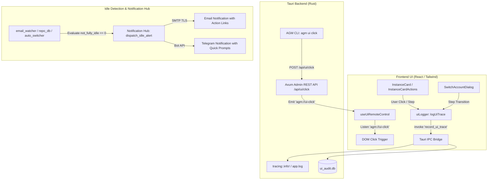

# Architecture Specification: Feature and Instance Management, Idle Notification Hub, UI Step/Click Trace Logging & CLI Parity

## 1. Overview & Objectives
This specification defines the architectural enhancements for:
1. **Instance Section UI Polish & Visual Contrast**: Complete visual elevation of `InstanceCard.tsx`, `InstanceCardActions.tsx`, `InstanceTable.tsx`, and `SwitchAccountDialog.tsx` aligning strictly with the Royal Violet design system (`#171025`, `#1f1533`, `#40285e`). Eliminates dull/washed out styling, provides vibrant visual affordance to the Switch Account button (yellow/amber tactile pill with 3D micro-interaction), and delivers high-contrast status cues.
2. **Idle Mode Auto-Notification Hub (Telegram & Email)**: Implements automated multi-channel idle alerts (`dispatch_idle_mode_alert`). When an Antigravity IDE instance or workspace finishes active turns and transitions to idle mode (`not_fully_idle == 0` and no in-flight prompts), the system automatically dispatches notifications to configured Telegram bots and Email recipients prompting users to submit new instructions.
3. **UI Step Transitions & Button Trace Logging**: Centralized telemetry layer (`src/utils/uiLogger.ts`) hooking button clicks, modal steps, and action triggers across the frontend, routing them into Tauri backend logging (`tracing::info!(target: "ui_trace", ...)`), local log files (`app.log`), and `ui_audit.db`.
4. **Enhanced CLI for UI Click Options**: Upgrades `agm ui click` to support dynamic instance action targets (`instance-switch-<id>`, `instance-launch-<id>`, `instance-stop-<id>`, `instance-restart-<id>`) with wildcard resolution and live DOM bridge triggering via `useUiRemoteControl.ts`.
5. **Instance Switching & Prompt Restoring E2E Testing**: Comprehensive verification of account switching with FIFO prompt restore preservation, followed by a minor version bump and release ceremony (`v4.274.0`).

## 2. Design Invariants & Guardrails
- **Caller IDE Self-Preservation**: Caller instance `v3-7391` is strictly protected from termination or modification.
- **Strict Relative Paths**: All paths in specs, plans, logs, and changelogs must use repository-relative format (`02-spec/...`, `.ai-memory/...`, `src/...`).
- **No Silent Errors**: All fallible backend operations route into `AppError` or `crate::error::record_ignored` with justification comments; frontend failures route to `useErrorStore.getState().trackWarning`.
- **Sole Contributor Attribution**: All changelogs, release notes, and commit summaries attribute strictly `@aukgit` (`(Thanks to @aukgit)`).

## 3. Architecture Diagrams

## 4. Key Subsystem Specifications
### 4.1 Instance Section UI Styling
- **Card Background & Borders**: Royal Violet dark glass `dark:bg-[#171025]/90 border border-slate-200/80 dark:border-[#40285e]/80 hover:dark:border-[#7c3aed]/60 hover:dark:bg-[#1f1533]`.
- **Switch Account Button (Slot 2)**: Replaces dull transparent background with an illuminated tactile badge. Idle state features amber tint `text-amber-500 dark:text-amber-400 bg-amber-500/10 dark:bg-amber-500/15 border border-amber-500/30`. Hover state triggers 3D yellow gradient `bg-gradient-to-b from-[#FDE047] via-[#FACC15] to-[#EAB308] text-zinc-950 font-bold shadow-[0_2px_0_0_#A16207]`.
- **Identifiers**: Every action button attaches unambiguous identifiers: `id="instance-switch-${inst.config.id}"`, `data-ui-name="instance-switch-btn"`, and `data-ui-id="instance-switch-${inst.config.id}"`.

### 4.2 Idle Mode Notification Hub
- **Trigger Condition**: When IDE process is running, but no conversations have `not_fully_idle != 0` and no prompts are in `running` status for at least 180 seconds.
- **Telegram Notification**: Dispatches rich HTML message with machine name, instance ID, idle duration, and prompt invitation.
- **Email Notification**: Renders responsive HTML template with project cards and CLI command snippets.
- **Anti-Spam Suppression**: Suppresses repeated notifications within 600s cooldown per instance.

### 4.3 UI Step & Click Trace Logging
- **Tauri Command**: `record_ui_trace(step: String, action: String, target: String, metadata: Option<Value>)`.
- **Tracing Layer**: Emits log line with target `ui_trace` formatted as `[UI_STEP] [{step}] {action} on target '{target}' | metadata: {metadata}`.
- **Persistent Storage**: Recorded in `ui_audit.db` with actor `user` or `cli`.

### 4.4 AGM CLI UI Click Expansion
- Enhances `agm ui click <element-id> [route]` to support dynamic patterns: `instance-switch-<id>`, `instance-launch-<id>`, `instance-stop-<id>`, `instance-restart-<id>`, `instance-more-<id>`.
- Adds direct alias `agm instances click <instance_id> <action>` routing directly to `agm ui click`.
